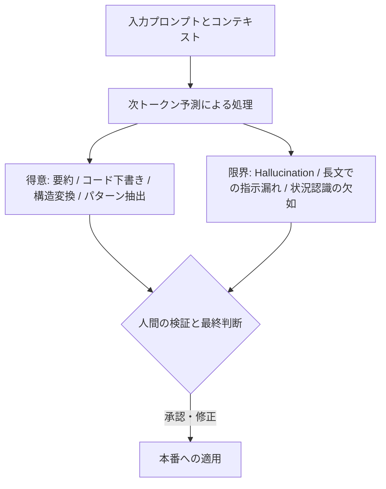

# 第 1 章 AI の能力と限界（AI Capabilities and Limitations）

> [!TIP]
> **この章のたとえ：超高速で博識だが、現場の責任は持てない「リサーチアシスタント」**
>
> 大量の文献を読み込み、数秒でコードや文章の下書きを作れる優秀なアシスタントがいます。ただし、このアシスタントは「次に来る最も自然な言葉」を確率で紡ぎ出しているため、知らないことも自信満々に言い切ることがあります。何が任せてよい作業で、どこからが人間の責任かを切り分けることが出発点になります。

## この章のゴール

- LLM がテキストやコードを生成する基本原理（次トークン予測）と、そこから生じる強み・弱みを説明できる。
- Hallucination やコンテキスト劣化（Context Rot / Drift）が起きる構造的な理由を理解し、対策を選べる。
- モデルが予期しない出力を返したときに、原因を切り分けて対処する手順を説明できる。
- 顧客や開発チームに対して、AI に任せるべき作業と人間が最終判断すべき境界を明確に伝えられる。

## 要点 3 つ

1. **LLM の強みと限界は、どちらも同じ仕組みから生まれる。** 次トークン予測（Next-Token Prediction）と大規模なパターン学習により、要約・変換・コード生成で高い性能を発揮する一方、事実の真偽を自動で検証する仕組みは持たない。
2. **コンテキストウィンドウには「容量」だけでなく「注意の限界」がある。** 入力が長くなるほど指示の抜け漏れや焦点のぼやけ（Contextual Drift）が起きやすいため、必要な情報だけを整理して渡す設計が欠かせない。
3. **LLM には自律的な意図や現実世界の責任能力がない。** 下書きの作成・構造化・選択肢の列挙は AI に任せ、セキュリティ承認・アーキテクチャの最終決定・対外的な責任は必ず人間が引き受ける。

## 30 秒で全体像

## 用語

| 用語 | 意味 |
| --- | --- |
| Next-Token Prediction | 入力された文脈に続く最も確率の高いトークンを順に予測して出力を生成する仕組み |
| Context Window | モデルが 1 回の推論で同時に参照できる入力および出力トークンの最大枠 |
| Hallucination | 事実や入力コンテキストに根拠がないにもかかわらず、もっともらしく誤った内容を出力する現象 |
| Contextual Drift / Context Rot | 会話や入力が長くなるにつれ、初期の指示や制約への注意が薄れて出力品質が低下する現象 |
| Parametric Memory | モデルの事前学習を通じて重み（パラメータ）の内部に保持されている知識 |
| Non-deterministic（非決定性） | 同じ入力を与えても、サンプリング設定や確率的処理により毎回まったく同じ出力になるとは限らない性質 |

## 本編

### 1-1 LLM が得意な領域と苦手な領域

Forward Deployed Engineer（FDE）として顧客の課題に向き合うとき、最初に問われるのは「この課題は LLM で解くべきか、どの部分に使うべきか」の見極めです。LLM の能力と限界は対になっており、性質を正確に把握することで過剰な期待や誤用を防げます。

| 観点 | 得意な領域（AI に向いている） | 苦手な領域（人間や決定論的コードが担う） |
| --- | --- | --- |
| 情報処理 | 非構造化テキストの要約、分類、JSON 等の構造化データ抽出 | 厳密な数値計算、暗号処理、100% 再現性が必要な決定論的処理 |
| 生成・執筆 | コードの下書き生成、リファクタリング案、ドキュメント草案 | 組織固有の暗黙知を前提とした最終意思決定、法的・倫理的責任を伴う承認 |
| 推論・探索 | 複数の観点からのアイデア出し、ログやコードのパターン照合 | 学習データやコンテキストにない最新事実の正確な再現（検索なし） |
| 状況認識 | 与えられたコンテキスト内での整合性チェックや変換 | 現実世界の暗黙の制約、社内の政治的背景、未知の障害への責任ある対処 |

> [!IMPORTANT]
> 顧客が「AI にすべてを自動で判断させたい」と要望した場合でも、FDE は「正確性・再現性・説明責任」が求められる箇所を決定論的なコードや人間のレビューゲートとして設計に組み込む必要があります。

### 1-2 予期しない出力が起きる 4 つの原因と切り分け

モデルが期待どおりに動かないとき、闇雲にプロンプトを書き直すのではなく、どの層で問題が起きているかを切り分けます。

1. 知識の不足（Knowledge Gap）は、最新の仕様や社内固有のルールが Parametric Memory に含まれていないために起きます。プロンプトや外部検索（RAG・ツール）でコンテキストに根拠を与える必要があります。
2. 指示の曖昧さ（Ambiguity）は、成功条件や出力形式、禁止事項が明示されていないために起きます。モデルが一般的なパターンで補完してしまうため、制約と具体例を明記します。
3. コンテキスト過多・劣化（Context Overload / Drift）は、無関係なログや長大な履歴を詰め込みすぎて重要な指示が埋もれる状態です。不要な情報を削り、重要な制約を明確に配置します。
4. 能力の境界（Capability Boundary）は、複雑な多段階の厳密計算やツールなしのリアルタイム情報取得など、LLM 単体の性質上不得手な作業を直接頼んでいる状態です。外部ツールやコード実行に委ねる設計へ切り替えます。

### 1-3 AI の限界を踏まえた安全・信頼性の原則

- 非決定性を前提にし、同じ入力でも出力が揺れる可能性に備えて、本番利用では構造化出力の検証や自動テストを組み合わせます。
- 「もっともらしさ」と「正しさ」を切り離し、モデルが流暢に回答しても根拠（出典ファイル、ツール結果、事実データ）が伴っているかを必ず検証します。
- Human-in-the-Loop（人間による確認）の境界を引き、取り消せない操作（本番データの削除、外部送信、契約判断）の前には人間の承認を挟みます。

## まとめ：どう判断するか

| 状況 | 避ける選択 | とるべき選択 |
| --- | --- | --- |
| 社内固有の業務ルールに関する質問でモデルが誤答する | モデルに「正確に思い出して」とプロンプトで念押しする | 社内ドキュメントを検索ツールやコンテキスト経由で明示的に渡す |
| 複雑な金額集計をモデルの暗算に任せたら端数がずれた | より丁寧な言葉遣いで計算をやり直させる | 計算処理自体はコードやツールに任せ、モデルには解釈や要約を任せる |
| 長い会話の後半でモデルが冒頭のフォーマット指定を忘れた | 会話履歴をさらに増やして注意文を何度も繰り返す | 不要な履歴を整理し、必要な制約だけを再提示するかセッションを分ける |
| セキュリティ要件の最終承認を AI のレビューだけで通したい | 高性能モデルに切り替えて承認作業も完全に自動化する | AI には論点抽出と一次チェックを任せ、最終承認は人間が行う |

## 確認問題

### 問 1

ある顧客が過去の商談議事録（テキスト）から「決定事項」「課題」「次のアクション」を抽出し、同時に契約金額の複雑な日割り計算と請求書発行の最終承認までをすべて LLM 単体の 1 回の呼び出しで自動化したいと相談してきました。FDE として最も適切な提案はどれですか。

A. 最新の大規模モデルを使えば計算も承認も 1 回で完結できると提案する  
B. 議事録からの項目抽出・要約は LLM に任せ、日割り計算は決定論的なコード、請求書発行の最終承認は人間が担う役割分担を提案する  
C. プロンプトに「計算を絶対に間違えないでください」と追記して全工程を自動化する  
D. 議事録を学習データとして毎回ファインチューニングしてから計算させる

解答

**B**。非構造化テキストからの情報抽出・要約は LLM が得意とする領域ですが、厳密な数値計算は決定論的コード、不可逆で責任を伴う請求承認は人間が担うべきです。

### 問 2

社内規定に関する Q&A ボットを開発中、モデルが実際には存在しない社内制度の名前を挙げて非常に流暢に回答してしまいました。この現象の主な原因と最初の対処として最も適切なものはどれですか。

A. モデルが意図的に嘘をついているため、温度設定ではなくモデルの倫理ガイドラインを書き換える  
B. 社内固有の情報がモデルの Parametric Memory にないまま回答生成（Hallucination）しているため、検索等で公式ドキュメントをコンテキストに与え、根拠がない場合は「分からない」と答えるよう指示する  
C. モデルのコンテキストウィンドウが不足しているため、質問文を 1 単語に短縮する  
D. 出力トークン上限を増やして、モデルが正しい答えにたどり着くまで長く書かせる

解答

**B**。LLM は次トークン予測によってもっともらしい文を生成するため、根拠となる知識が与えられないと Hallucination が起きやすくなります。根拠資料をコンテキストへ渡し、不明時は回答を控える設計が有効です。

### 問 3

長時間のチャット支援ツールで、会話が 30 往復を超えたあたりから、最初に指定していた「出力は必ず箇条書き 3 点以内」という制約をモデルが無視するようになりました。最も可能性が高い原因はどれですか。

A. モデルがユーザーに飽きて指示を拒否している  
B. 蓄積された会話履歴によってコンテキストが膨らみ、初期指示への注意が薄れる Contextual Drift が起きている  
C. Next-Token Prediction は 30 往復を超えると必ず停止する仕様になっている  
D. モデルの重みが会話中に書き換わってしまった

解答

**B**。コンテキストウィンドウに長大な履歴が溜まると、初期の制約が相対的に埋もれて出力品質が落ちる Contextual Drift が発生します。履歴の整理や制約の再配置が必要です。

