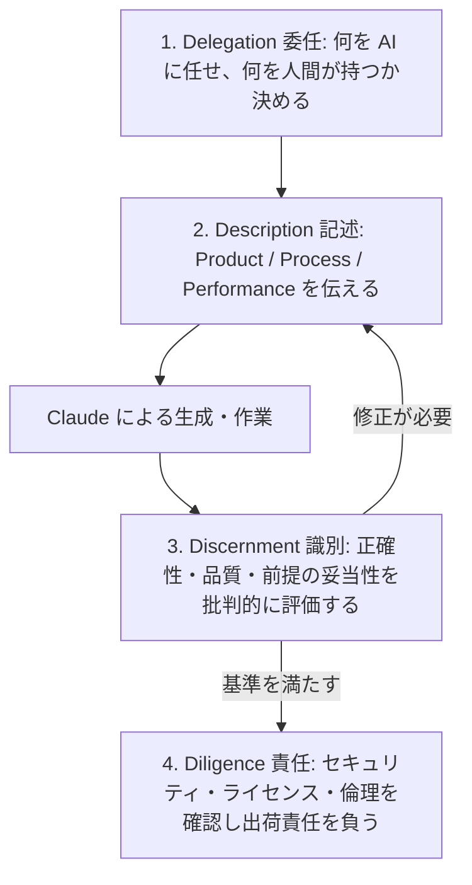

# 第 2 章 ビルダー向け AI フルーエンシーと 4D フレームワーク（AI Fluency for Builders）

> [!TIP]
> **この章のたとえ：優秀な開発パートナーへの「仕事の任せ方・伝え方・検収・出荷責任」**
>
> 単にプロンプトの小手先テクニックを覚えるのではなく、「どの仕事を任せるか（Delegation）」「何をどう伝えるか（Description）」「上がってきた成果物をどう見抜くか（Discernment）」「自分の名前で世に出せる状態まで責任を持てるか（Diligence）」という 4 つの習慣を揃えることが、ビルダーにとっての AI 活用力になります。

## この章のゴール

- Anthropic が定義する AI Fluency（有効・効率的・倫理的・安全な協働）の意味を説明できる。
- 4D Framework（Delegation / Description / Discernment / Diligence）の 4 要素と、それぞれの実務上のチェックポイントを説明できる。
- Description を構成する 3 つの視点（Product / Process / Performance）を使い分けて明確な指示を書ける。
- 顧客や開発チームに AI 協働ワークフローを導入する際、人間が主導権（Driver's Seat）を握り続ける設計を示せる。

## 要点 3 つ

1. **AI Fluency とはプロンプトの暗記ではなく「協働の型」である。** AI と有効（Effective）・効率的（Efficient）・倫理的（Ethical）・安全（Safe）に協働し、人間が主導権を保ちながら成果を出す力を指す。
2. **4D Framework が設計から出荷までの全工程を支える。** Delegation（委任）・Description（記述・指示）・Discernment（識別・評価）・Diligence（注意・責任）の 4 つが揃って初めて、本番に耐える開発ができる。
3. **「実装は委任できても、最終判断は委任できない」。** テストや下書きの生成は Claude に任せられるが、要件の妥当性・セキュリティ・アーキテクチャの最終判断と出荷責任はビルダー自身が負う。

## 30 秒で全体像

## 用語

| 用語 | 意味 |
| --- | --- |
| AI Fluency | AI システムと有効・効率的・倫理的・安全に協働するための実践的な能力 |
| 4D Framework | Delegation・Description・Discernment・Diligence の 4 要素からなる Anthropic の AI 協働フレームワーク |
| Delegation（委任） | 課題や工程のうち、いつ・何を・どのように AI に任せ、何を人間が保持するかを決めること |
| Description（記述） | 求める成果物や進め方、AI の振る舞いを明確に言語化して伝えること |
| Discernment（識別・評価） | AI が返した出力の正確性、品質、技術的負債、抜け漏れを批判的に見極めること |
| Diligence（注意・責任） | 安全性、セキュリティ、法令・ライセンス遵守、説明責任を含めて最終成果物を担保すること |

## 本編

### 2-1 Delegation：何を任せ、何を人間が持つか

FDE やビルダーが最初に陥りやすい失敗は、「全部 AI に丸投げする」か「逆に何も任せず手作業に固執する」かの両極端です。Delegation では、タスクの性質とリスクに応じて分担を決めます。

| 観点 | AI に委任しやすい作業 | 人間が保持すべき判断 |
| --- | --- | --- |
| 設計・仕様 | 仕様書の叩き台作成、エッジケースの洗い出し | 業務要件の優先順位付け、顧客との合意形成 |
| 実装・テスト | ボイラープレート作成、単体テスト生成、リファクタリング案 | コアアーキテクチャの選定、不可逆なデータ移行判断 |
| レビュー・調査 | ログの一次整理、既知パターンのバグ候補抽出 | セキュリティ上の最終承認、本番リリース可否の判断 |

> [!IMPORTANT]
> コアとなる判断基準は **「実装（Implementation）の委任は多くの場合安全だが、最終判断（Final Judgment）の委任は危険である」** という点です。

### 2-2 Description：3 つの視点で明確に伝える

「ログイン画面を作って」のような曖昧な依頼では、前提の食い違いがそのまま手戻りにつながります。ビルダー向けの Description では、次の 3 つを意識して指示を組み立てます。

1. **Product Description（何を作るか）**: 目的、対象ユーザー、満たすべき要件、出力フォーマット、制約条件。
2. **Process Description（どう進めるか）**: 手順、採用すべき技術・設計方針、避けるべきアプローチ、段階的な確認ポイント。
3. **Performance Description（どう振る舞うか）**: 協働中の AI の役割や姿勢（例：「厳格なコードレビュアーとして、実装前に私の前提の穴を指摘してから進めてください」）。

この 3 つを分けることで、AI は「何を出せばよいか」だけでなく「どの順序で、どのような基準で思考すべきか」を把握しやすくなります。

### 2-3 Discernment：出力を批判的に見抜く

Claude が読みやすいコードや整った提案書を返しても、そのままコピー＆ペーストしてはいけません。Discernment では、以下の観点で出力を検証します。

- **正確性**: 要件や仕様と食い違っていないか、存在しない API や設定値を作り出していないか。
- **品質と保守性**: 過剰な複雑化や不要な依存関係、将来的な技術的負債を増やしていないか。
- **前提の妥当性**: AI が暗黙のうちに置いた仮定が、顧客環境の制約と矛盾していないか。

### 2-4 Diligence：責任を持って出荷する

Diligence は、技術的な正しさにとどまらず「プロフェッショナルとして世に出せる状態か」を担保する姿勢です。

- **セキュリティとプライバシー**: 機密情報や認証情報をプロンプトに不用意に含めていないか、生成コードに脆弱性（インジェクション、権限漏れ等）がないか。
- **透明性と説明責任**: AI の支援を受けた成果物であっても、仕組みと根拠を自分の言葉で顧客やチームに説明できるか。
- **ライセンスとコンプライアンス**: 顧客の組織ポリシーや著作権・ライセンス要件に違反していないか。

## まとめ：どう判断するか

| 状況 | 避ける選択 | とるべき選択 |
| --- | --- | --- |
| 顧客向けの設計書を急いで作る必要がある | AI に一言だけ投げて生成文をそのまま提出する | Delegation で下書きを任せ、Description で要件と制約を伝え、Discernment と Diligence で人間が検証してから提出する |
| AI が一見動くコードを出力したが、なぜ動くか理解できない | テストが通ったので中身を読まずに本番へマージする | Discernment の観点から処理と境界条件を読み解き、説明できる状態にしてから採用する |
| 仕様が固まっていない段階で AI に実装を頼みたい | いきなりコード全文を書かせて後で手直しする | Performance Description で「まず不明点やリスクを質問させてから設計案を出す」よう指示する |
| 機密性の高い顧客データを扱うプロトタイプを作る | 本番データをそのままチャットに貼り付けて試す | Diligence の観点からダミーデータやマスキング済みデータを使い、データ取扱い方針を確認する |

## 確認問題

### 問 1

あるエンジニアが Claude を使って新機能の実装を進める際、「機能の要件（Product）」と「使ってほしいライブラリや禁止事項（Process）」に加えて、「いきなりコードを書かず、まず設計上の懸念点を 3 つ指摘してから提案してください」と伝えました。4D Framework のうち、この工夫に最も直接当てはまる要素はどれですか。

A. Delegation  
B. Description（特に Performance Description）  
C. Discernment  
D. Diligence

解答

**B**。協働中に AI がどのような姿勢・振る舞いで応答するかを指定するのは、Description のうちの Performance Description に該当します。

### 問 2

Claude が生成した認証機能のコードが、ローカルの簡易テストでは問題なく動作しました。しかし開発者はコードの中身を確認せず、「AI が書いた最新ベストプラクティスだから大丈夫」と考えて本番へデプロイしようとしています。4D Framework に照らして最も欠けている要素の組み合わせはどれですか。

A. Delegation と Description  
B. Description と Performance  
C. Discernment と Diligence  
D. Product と Process

解答

**C**。生成されたコードの妥当性や脆弱性を批判的に見極める力（Discernment）と、セキュリティや本番出荷に対する最終責任を果たす姿勢（Diligence）の両方が欠けています。

### 問 3

4D Framework における Delegation の原則として、最も適切な考え方はどれですか。

A. 複雑な判断ほど人間より AI の方が客観的なので、セキュリティ承認も AI に委任する  
B. 下書き作成やテストコード生成などの実装作業は委任しやすいが、要件の優先順位や最終承認などの判断は人間が保持する  
C. AI とのやり取りを最小限にするため、プロジェクト全体を 1 つのプロンプトで委任する  
D. AI が誤るリスクを避けるため、定型的なコード変換も含めてすべて人間が手書きする

解答

**B**。実装の下書きや定型作業は有効に委任できますが、最終判断と責任は人間（ビルダー）が握り続けることが Delegation の基本原則です。

