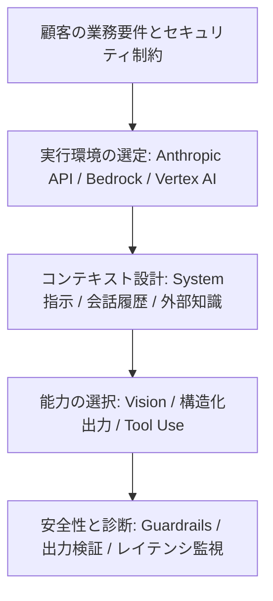

# 第 3 章 Claude プラットフォームとモデル基盤（Claude Platform and Model Foundations）

> [!TIP]
> **この章のたとえ：料理を始める前の「キッチンの選定と下ごしらえ」**
>
> プロンプトを書くことは「火にかけて調理すること」に似ています。しかし、そもそもどのキッチンで調理するか（実行環境の選定）、どれだけの作業台があるか（Context Window）、どんな調理器具を並べるか（Tool Use）、火事を出さない安全装置はあるか（安全性・コンプライアンス）を先に決めておかなければ、顧客の本番環境では通用しません。

## この章のゴール

- プロンプトを書き始める前に、実行基盤（Anthropic API / Amazon Bedrock / Google Cloud Vertex AI 等）やデータ境界をどう選定するか説明できる。
- Context Window、トークン課金、マルチモーダル入力、構造化出力といったプラットフォームの基礎構造を理解する。
- Claude がツール（Tool Use）や外部知識と連携して動作する仕組みと、モデル挙動の診断ポイントを説明できる。
- 顧客のセキュリティ・コンプライアンス要件に応じた基盤選びの基本判断ができる。

## 要点 3 つ

1. **プロンプト設計の前に「どこで動かすか」と「データの境界」を決める。** Anthropic 直接 API（Console / API）に加え、企業のクラウド環境やガバナンス要件に応じて **Amazon Bedrock** や **Google Cloud Vertex AI** などを選択する。
2. **モデルはステートレスであり、コンテキストがすべての入力になる。** API 呼び出し自体は過去の会話を自動記憶しないため、必要な履歴・システム指示・ツール定義を毎リクエストの構成として設計する。
3. **テキスト出力だけでなく、Tool Use と構造化出力がアプリケーション統合の軸になる。** 自然言語の会話にとどまらず、JSON 形式での出力や外部システム呼び出しを前提に設計することで、業務システムへ安全に組み込める。

## 30 秒で全体像

## 用語

| 用語 | 意味 |
| --- | --- |
| Anthropic API（1st-party） | Anthropic が直接提供する API および Console 環境。最新機能やモデルへのアクセスが最も早い |
| Amazon Bedrock | AWS 上で Claude を利用できるマネージドサービス。IAM や VPC など AWS のガバナンスと統合しやすい |
| Google Cloud Vertex AI | Google Cloud 上で Claude を利用できるプラットフォーム。GCP の権限管理や請求・セキュリティ基盤と統合しやすい |
| Stateless API | 各 API リクエストが独立しており、サーバー側が前回のやり取りを自動で保持しない設計（履歴はクライアント側から渡す） |
| Tool Use（関数呼び出し） | モデルが外部 API 検索やデータ取得の必要性を判断し、構造化された引数でツール呼び出しを要求する仕組み |
| Vision（マルチモーダル入力） | テキストだけでなく、画像や PDF ページ等をコンテキストとして読み取り分析する能力 |

## 本編

### 3-1 プロンプトを書く前に決める「実行環境」

FDE が企業顧客のパイロット案件に入るとき、最初に確認すべきなのは「どのプロバイダ経由で Claude を呼び出すか」です。モデルの知能は同じファミリーでも、調達・セキュリティ・ネットワーク・既存クラウド契約によって最適解が変わります。

| 実行環境 | 主な特徴 | 選ばれやすい顧客ケース |
| --- | --- | --- |
| **Anthropic API（直接利用）** | 最新モデル・最新機能（Prompt Caching や新しいベータ機能等）の提供が最も早い。シンプルな課金と直接サポート | スピード重視の PoC、最新機能を使いたい開発チーム、マルチクラウドや独立系 SaaS |
| **Amazon Bedrock** | AWS アカウント内で完結し、IAM・PrivateLink・CloudTrail・既存 AWS 契約（EDP）を活用できる | すでに AWS を標準基盤としており、データ閉域化や AWS 請求統合が必須の大企業 |
| **Google Cloud Vertex AI** | GCP の IAM・VPC Service Controls・監査ログ・既存 GCP 契約と統合できる | GCP を主軸にしており、BigQuery や GCP セキュリティ統制下で動かしたい企業 |

> [!NOTE]
> いずれの環境を選ぶ場合も、モデルの切り替えや将来的な移行を見据え、アプリケーションコードは特定のプロバイダ固有仕様に過度に密結合させない設計（設定やアダプタ層の分離）が望まれます。

### 3-2 プラットフォームの 4 つの基礎メカニズム

1. ステートレスな対話構造のため、Messages API は呼び出しごとに独立しています。連続した会話や業務フローを実現するには、必要なシステムプロンプトと会話履歴を毎回コンテキストとして組み立てて渡します。そのため、会話が長くなるほど入力トークン数とレイテンシが増える構造を理解しておく必要があります。
2. コンテキストとトークンの経済性として、入力（Prompt）と出力（Completion）の両方がトークン単位で計算されます。大量の固定指示や資料を毎回送る場合は、後続のコスト最適化（Prompt Caching や必要最小限のコンテキスト抽出）を視野に入れて構造を整理します。
3. マルチモーダル（Vision 等）を活用すると、請求書画像、画面スクリーンショット、図表を含む PDF などをそのまま入力して構造化データを取り出せるため、従来の OCR 前処理パイプラインを簡素化できる場合があります。
4. Tool Use による外部接続では、モデルにツール定義（名前・説明・入力スキーマ）を渡すことで、モデルが必要なときにツール呼び出しを要求します。アプリケーション側がそのツールを実行して結果を返すことで、社内 DB 検索やチケット起票などの実業務と連携できます。

### 3-3 モデル挙動の診断と品質・安全性の基盤

パイロット構築中に「期待した出力が出ない」「意図しない拒否や誤動作が起きる」といった事象が起きた際、プラットフォームの基礎を押さえていれば冷静に原因を特定できます。

| 症状 | 確認すべき基盤要素 | 改善の方向性 |
| --- | --- | --- |
| 特定業務の用語やルールを誤解する | システムプロンプトまたはコンテキスト内の前提情報 | 用語定義や判断基準をコンテキストに明記する、または検索ツールで参照させる |
| 出力形式が崩れて後続プログラムでパースできない | 構造化出力の指定や出力スキーマの定義 | JSON スキーマやツール呼び出し形式を使い、形式を強制・検証する |
| 応答が遅すぎてユーザー体験が悪い | 入力トークン量、出力トークン量、モデルティア、ストリーミング有無 | ストリーミング（Streaming）の有効化、不要コンテキスト削減、モデルや Effort の見直し |
| 安全性フィルタに誤って引っかかる・不適切な出力が出る | 入力データの文脈やプロンプトの曖昧さ、アプリケーション側のガードレール | 業務上の正当な文脈を明確化し、入出力の検証ルールをアプリケーション層に設ける |

## まとめ：どう判断するか

| 状況 | 避ける選択 | とるべき選択 |
| --- | --- | --- |
| 全社標準が AWS で、データを外部インターネットに出せない要件がある | 顧客のネットワーク要件を確認せず個人向け API キーで開発を進める | Amazon Bedrock など、顧客の既存クラウド統制（IAM / 閉域接続）に適合する基盤を提案する |
| チャットボットで長い会話を続けるとコストと遅延が増えている | API が自動で過去の会話を記憶していると思い込み原因を放置する | ステートレス構造で毎回履歴を送っている前提に立ち、履歴の要約・削減やキャッシュ活用を設計する |
| システム連携のため、毎回決まった JSON 形式で結果を受け取りたい | 「必ず JSON で書いて」と自然言語で頼むだけでパース処理を書く | 構造化出力や Tool Use のスキーマ定義を活用し、型や必須項目を検証する |
| 応答完了まで画面が 10 秒固まり、ユーザーが離脱している | すべての生成が終わるまで画面表示を待たせる | ストリーミング配信を有効にし、生成途中のテキストを逐次表示して体感待ち時間を減らす |

## 確認問題

### 問 1

ある金融機関の顧客が既存の AWS セキュリティ統制（IAM による権限管理、VPC 閉域ネットワーク、AWS 請求への統合）を満たした上で Claude を業務アプリに組み込みたいと考えています。プロンプト作成に入る前にまず検討すべき実行基盤として最も適切なものはどれですか。

A. 個人のクレジットカードで作成した Anthropic Console アカウントを全員で共有する  
B. Amazon Bedrock 上で Claude を利用する構成を検討・選定する  
C. ローカル PC にモデルの重みをダウンロードして社内 LAN で動かす  
D. ブラウザ拡張機能を使って手作業でコピー＆ペーストする運用にする

解答

**B**。顧客が AWS のセキュリティ統制・閉域接続・請求統合を要件としている場合、Amazon Bedrock を選択するのが実務上の定石です。

### 問 2

Claude Messages API を利用した社内システムで、ターン数が増えるにつれて 1 リクエストあたりの入力トークン課金と応答までの待ち時間が比例して増加していることが分かりました。プラットフォームの仕様に基づく原因として最も適切なものはどれですか。

A. API がユーザーごとに課金単価を自動で値上げしているため  
B. API がステートレスであり、会話の継続のために毎回システム指示と蓄積された会話履歴をすべて入力として再送信しているため  
C. 出力トークンが自動的に 10 倍に水増しされるため  
D. 2 回目以降の呼び出しでは必ず全ツールが自動実行されるため

解答

**B**。Messages API はステートレスであるため、会話文脈を維持するには過去の履歴を含めて毎回送信する必要があります。履歴が膨らむと入力トークンとレイテンシが増えるため、履歴管理やキャッシュの設計が重要になります。

### 問 3

社内の問い合わせ対応エージェントで、顧客の注文データベースを参照して回答を返す必要があります。プラットフォームの能力を最も適切に活用した設計はどれですか。

A. 100 万件の注文データベースを毎回システムプロンプトに全件貼り付ける  
B. Tool Use を設計し、モデルが必要に応じて注文 ID 等を引数に検索ツールを呼び出し、返却された結果をもとに回答を組み立てるようにする  
C. モデルが注文番号から内容を推測して回答するようプロンプトで指示する  
D. データベースの内容を画像化して Vision で毎回全件読み込ませる

解答

**B**。動的な外部データや大規模データベースとの連携には Tool Use を用い、必要なレコードだけを検索・取得してコンテキストに渡すのが適切です。

