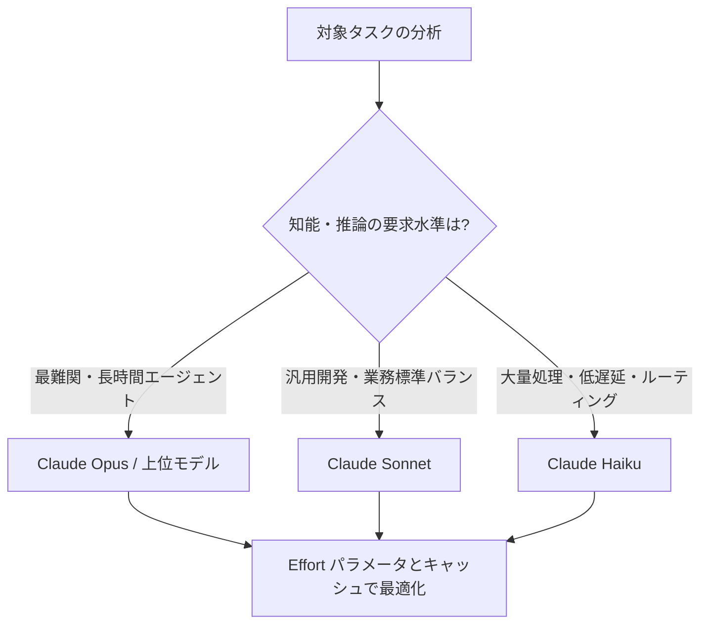

# 第 4 章 適切な Claude モデルの選定（Choosing the Right Claude Model）

> [!TIP]
> **この章のたとえ：用途に応じた「車両の使い分け」**
>
> すべての荷物を大型トラック（Opus）で運ぶとコストと時間がかかりすぎ、逆に軽自動車（Haiku）に重い重機を積むと途中で止まってしまいます。日々の配送はバランスのよい中型車（Sonnet）を軸にしつつ、試作や大量の軽作業には軽自動車、高難度の長距離・精密作業には大型トラックを選ぶ、という使い分けがモデル選定の本質です。

## この章のゴール

- Claude の主要モデルティア（Opus / Sonnet / Haiku 等）の特性と得意なワークロードを説明できる。
- モデル選定の 3 つの評価軸（Capabilities / Speed & Latency / Cost & Budget）のトレードオフを整理できる。
- モデル自体を切り替える前に調整できる **Effort パラメータ** の役割を理解する。
- **Efficiency-First Approach** と **Capability-First Approach** の 2 つの導入戦略を場面に応じて使い分けられる。

## 要点 3 つ

1. **「常に最強のモデル」ではなく、タスクの複雑さと制約に合わせて選ぶ。** Opus（最高難度の推論・長時間の自律コーディング）、Sonnet（知能と速度の最適バランス・汎用開発）、Haiku（超高速・低コスト・大量分類やルーティング）を使い分ける。
2. **モデルを変える前に `effort` パラメータでの調整も検討する。** 同一モデルファミリー内でも推論の深さ（Effort）を調整することで、レイテンシ・コストと回答品質のバランスを制御できる。
3. **2 つのアプローチ（Efficiency-First / Capability-First）を使い分ける。** 低リスク・高頻度で素早く試したいなら **Efficiency-First（軽量モデルから開始）**、高難度・失敗が許されない業務でまず成立性を確かめるなら **Capability-First（高性能モデルから開始して最適化）** をとる。

## 30 秒で全体像

## 用語

| 用語 | 意味 |
| --- | --- |
| Claude Opus | 複雑な推論、高度な知識業務、長時間の自律型エージェント・コーディング向けの最上位ティア |
| Claude Sonnet | 高い知能と高速な応答を両立したバランス型ティア。一般的なアプリケーション開発や日常業務の主力 |
| Claude Haiku | 最も高速かつ低コストな軽量ティア。大量の分類、データ抽出、入力ルーティング、リアルタイム応答向け |
| Effort Parameter | 同一モデル内で推論に割く計算量（思考の深さ）を調整し、品質とレイテンシ・コストのバランスをとる設定 |
| Efficiency-First Approach | 軽量・低コストなモデルから検証を始め、能力が不足する箇所だけ上位モデルへ引き上げる進め方 |
| Capability-First Approach | まず最上位の知能を持つモデルで課題が解けるベースラインを作り、後からコストや速度を最適化する進め方 |

## 本編

### 4-1 モデルティアの比較と使い分け

Claude のモデルラインナップは、単一の優劣ではなく「どの業務制約を優先するか」で設計されています。

| モデルティア | 強み | 主な適用ワークロード | 注意点 |
| --- | --- | --- | --- |
| **Opus**（高難度・フラッグシップ） | 深い推論、曖昧な要件の整理、複雑なコードベースの横断修正、長時間エージェント | 高度な設計判断、複雑なデバッグ、高付加価値な専門文書分析 | トークン単価とレイテンシが高いため、単純作業や大量バッチに無差別適用しない |
| **Sonnet**（バランス・主力） | 知能と応答速度のバランスが優秀。コスト効率と品質の両立 | 一般的な企業向けアプリ、RAG 回答生成、標準的なコーディング支援、業務ワークフロー | ほとんどのユースケースで最初の基準点（標準候補）になる |
| **Haiku**（高速・低コスト） | 極めて低いレイテンシと安価な単価。大量並列処理に強い | 問い合わせの一次分類（Routing）、定型データ抽出、スパム判定、リアルタイム補完 | 複雑な多段階推論や微妙なニュアンスの判断では精度が落ちやすい |

> [!NOTE]
> コース教材では、さらに高度な長期推論タスク向けの最上位枠（Fable 等の位置づけ）に触れる場合もありますが、実務の標準設計では **Opus / Sonnet / Haiku の 3 ティア** と **モデルルーティング（入力の難易度に応じて振り分ける構成）** が基本になります。

### 4-2 選定を左右する 4 つの評価軸

1. Capabilities（必要な能力）として、複雑なツール連携、長文コンテキストの統合、高度なコード生成が必要かを見極めます。
2. Speed & Latency（速度と待ち時間）として、ユーザーが画面の前で待っている（インタラクティブ）か、夜間の非同期バッチ処理かを確認します。
3. Cost & Budget（コストと予算）として、1 日あたりのリクエスト数や 1 件あたりの入力トークン量に対して採算が合うかを評価します。
4. Effort Parameter（推論の深さ）を調整することで、モデルティアを上げ下げする前に同じモデル上で要件を満たせるか確認します。たとえば、単純な問いには低い Effort で即答させ、複雑な分析だけ Effort を引き上げる運用ができます。

### 4-3 2 つの導入アプローチ

顧客のパイロット案件を立ち上げる際、FDE はタスクの性質に応じて 2 つの進め方を選びます。

| アプローチ | 進め方 | 向いているケース |
| --- | --- | --- |
| **Efficiency-First（効率優先）** | Haiku や Sonnet の軽量構成から素早くプロトタイプを作り、評価テストで能力不足が見つかった部分だけ上位モデルへ切り替える | 処理件数が非常に多い分類・抽出業務、厳しいレイテンシ上限や予算制約が最初からある案件 |
| **Capability-First（能力優先）** | まず Opus 等の高性能モデルで「この課題は AI で本当に解けるか（品質の上限）」を証明し、ベースラインが確定してから Sonnet / Haiku への置き換えや最適化を行う | 複雑で成否が未知数な業務、まず顧客に品質インパクトを示して価値を証明したい PoC |

## まとめ：どう判断するか

| 状況 | 避ける選択 | とるべき選択 |
| --- | --- | --- |
| 1 日 100 万件の問い合わせを 5 カテゴリに分類したい | 精度を気にして全件を Opus で処理する | Haiku（必要に応じて分類基準の具体例を提示）で高速・低コストに処理する |
| 顧客の新規 PoC で「そもそも AI で複雑な契約レビューができるか」を検証したい | 最初から最安モデルだけで試し、「AI では無理」と結論づける | Capability-First で上位モデルを使って成立性を検証し、その後コスト最適化を図る |
| Sonnet で概ね良いが、ごく一部の難問だけ推論が浅く感じる | すべてのリクエストを無条件で最上位モデルへ切り替える | Effort パラメータの引き上げ、または難問だけを上位モデルへルーティングする構成にする |
| チャットボットの応答速度を上げつつ品質も保ちたい | モデルを変える以外の工夫（ストリーミングや不要コンテキスト削減）を一切見ない | 適切なティア選定に加え、不要な入力削減と Streaming 配信を組み合わせる |

## 確認問題

### 問 1

ある EC サイトで、毎日 50 万件届くユーザーレビューから「商品カテゴリ」「感情（ポジティブ／ネガティブ）」「配送トラブルの有無」の 3 項目を抽出し、0.5 秒以内の応答と最小限の API コストで処理したいと考えています。最初に選ぶべきモデルティアとして最も適切なものはどれですか。

A. Claude Opus  
B. Claude Haiku  
C. 推論の深さを最大にした最上位モデル  
D. 毎回 3 つのモデルを並列実行して多数決をとる構成

解答

**B**。大量・高頻度かつ定型的な分類・情報抽出と低レイテンシが求められるタスクには、最も高速でコスト効率の高い Claude Haiku が適しています。

### 問 2

FDE として顧客の新規パイロットを担当することになりました。対象業務は「過去の設計書と障害報告書を横断して原因仮説を立てる」という高難度な作業で、そもそも LLM で実用レベルに達するかが未知数です。初期フェーズで採るべきアプローチとして最も適切なものはどれですか。

A. Capability-First Approach を採り、まず高性能なモデルで課題が解けるベースラインを証明してから、段階的にコストや速度を最適化する  
B. Efficiency-First Approach を採り、最も安価なモデルで動かない場合はプロジェクトを即座に中止する  
C. モデル選定を行わず、プロンプトの長さだけを 10 倍に増やす  
D. コストをゼロにするため、モデル呼び出しをすべて乱数生成に置き換える

解答

**A**。難易度が高く成立性の検証が最優先となるパイロットでは、Capability-First Approach でまず実用品質のベースラインを示し、その後に下位モデルへの置き換えや最適化を行うのが有効です。

### 問 3

社内開発支援ツールで Claude Sonnet を主力として使っていますが、一部の複雑なリファクタリング依頼だけ思考が浅く見落としが出ることが分かりました。コストの急増を抑えつつ改善を図るアプローチとして適切なものはどれですか。

A. 全社すべての単純な質問も含めて無条件に Opus へ切り替える  
B. Effort パラメータの調整や、複雑なタスクのみ上位モデルへ振り分けるルーティングを検討する  
C. 会話履歴を毎ターン削除せずに 100 万トークンまで溜め続ける  
D. 出力形式を JSON から自由記述の詩に変更する

解答

**B**。全量を上位モデルへ切り替える前に、同一モデルでの Effort 設定の見直しや、タスクの難易度に応じたモデルルーティングを行うことで、品質とコストのバランスを最適化できます。

