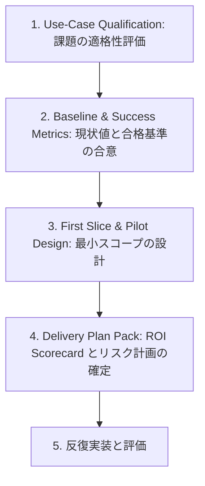

# 第 5 章 デリバリーメソドロジー（Delivery Methodology）

> [!TIP]
> **この章のたとえ：大きな建物を建てる前の「測量とモデルルーム建築」**
>
> 顧客から「全社業務を AI で自動化したい」と相談されたとき、いきなり全社システムの設計図を引き始めると予算も時間も破綻します。まずは現在の作業時間やエラー率を測量し（Baseline Establishment）、最初に価値を示せる 1 部屋（First Slice）に絞ってモデルルーム（Pilot）を建て、合意した合格基準で評価する手順がデリバリーメソドロジーです。

## この章のゴール

- Use-Case Qualification により、LLM・エージェント適用に適した顧客課題を厳選できる。
- コードやプロンプトを書く前に Baseline Metrics と定量的な Success Metrics を定義できる。
- 全社一括ではなく First Slice に絞った Pilot Design を行える。
- Delivery Plan Pack を構成する成果物（ユースケース評価・パイロット設計・ROI Scorecard・リスク管理）を説明できる。

## 要点 3 つ

1. **コードを書く前に Baseline と Success Metrics を合意する。** 導入前の所要時間・精度・エラー率を数値で押さえ、何をもってパイロット成功とみなすかを事前に握っておくことで、後からの評価ブレを防ぐ。
2. **「First Slice」に絞って素早く価値を証明する。** 最初から全社横断の巨大システムを狙わず、インパクトが大きく複雑さが制御できる業務の切り口を選んでパイロットを回す。
3. **Delivery Plan Pack で関係者間の期待値とリスクを構造化する。** ユースケース適格性、パイロット境界、ROI Scorecard、マイルストーン・依存関係・リスク対策を一式で文書化し、本番移行の判断材料を揃える。

## 30 秒で全体像

## 用語

| 用語 | 意味 |
| --- | --- |
| Use-Case Qualification | 顧客の業務課題が技術的・ビジネス的に LLM / エージェント適用に適しているかを見極める工程 |
| Baseline Metrics | AI 導入前の現状値（処理時間、人件費、誤答率、エスカレーション率など）の定量記録 |
| Success Metrics | パイロットの成否を判定するために事前合意する具体的な目標指標 |
| First Slice | 全体構想のうち、短期間で価値を実証しやすくリスクを制御できる最初の実装範囲 |
| Delivery Plan Pack | ユースケース適格性、パイロット設計、ROI Scorecard、マイルストーン、リスク対策をまとめた標準計画資料 |
| ROI Scorecard | 投資コスト（開発・API 費用）と期待効果（時間削減・品質向上）を定量比較する評価表 |

## 本編

### 5-1 Use-Case Qualification：案件の適格性を見極める

顧客の要望をすべてそのまま引き受けるのではなく、FDE は最初に「成功確率が高く、投資対効果が見合うか」を査定します。

| 評価軸 | 適している課題 | 注意・見直しが必要な課題 |
| --- | --- | --- |
| ビジネス価値 | 反復頻度が高く、1 件あたりの処理時間や人手コストが大きい | 年数回しか発生せず、自動化しても効果が見合わない |
| 技術的適合性 | 非構造化データの読解、要約、分類、コード生成、知識検索が中心 | 100% 決定論的な厳密計算や、リアルタイム超低遅延制御のみが目的 |
| データと検証 | 参照すべき正解データや評価基準が社内に存在し、人手で検証できる | 正解の定義が曖昧で、誰も出力の良し悪しを判定できない |
| 顧客の関与 | 現場の業務オーナーと意思決定者がパイロットに参加できる | 現場不在で IT 部門だけが「何か作ってほしい」と依頼している |

### 5-2 Baseline Establishment と Success Metrics

パイロット終了後に「なんとなく便利になった気がするが投資対効果が分からない」という状態（Pilot Fatigue）を防ぐため、実装前に必ず数値の物差しを置きます。

1. 現状の計測（Baseline）では、AI 導入前に人間が同じ作業を行った場合の平均所要時間、手戻り率、処理件数、既存ツールの精度を記録します。
2. 成功基準の合意（Success Metrics）では、「応答精度 90% 以上」「1 件あたり調査時間を 30 分から 5 分へ短縮」のように、ビジネス側と技術側の双方が納得できる合格ラインを明文化します。
3. 評価データの準備として、実際の業務に近いテストケースをあらかじめ確保し、主観的な感想ではなく定量評価で改善を回します。

### 5-3 First Slice による Pilot Design

企業の大規模ワークフローを最初からすべて置き換えようとすると、権限調整や例外処理で頓挫しやすくなります。

- **境界を明確にする**: 対象部署、入力データの種類、連携するシステムを最小限に絞ります。
- **Human-in-the-Loop を前提に組む**: 初期パイロットでは完全自律実行にこだわらず、人が最終確認する半自動化から始めて安全に実績を作ります。
- **段階的拡張を設計する**: First Slice が目標を達成したあとに、次のスライスへどう広げるかの道筋を描いておきます。

### 5-4 Delivery Plan Pack の構成

Anthropic のデリバリー手法では、顧客と合意形成するための標準成果物として Delivery Plan Pack を整備します。

- **Use-Case Qualification Summary**: 選定理由、対象業務、期待されるビジネスインパクト。
- **Pilot Architecture & Scope**: 実行環境、連携システム、First Slice の範囲、対象外（Out of Scope）の明記。
- **ROI Scorecard**: 現状の Baseline、開発・運用コスト、目標削減効果の試算。
- **Milestones, Dependencies & Risk Mitigation**: 週次マイルストーン、顧客側の前提作業（データ提供・権限付与）、想定リスクと回避策。

## まとめ：どう判断するか

| 状況 | 避ける選択 | とるべき選択 |
| --- | --- | --- |
| 顧客が「全 10 部署の業務を一度に AI 化したい」と要望した | 全社一括の巨大プロジェクトとして見積もり・実装を始める | 最も効果が高く検証しやすい First Slice（1 部署・1 業務）に絞ってパイロットを設計する |
| 開発を始める前に顧客が指標設定を後回しにしようとしている | まず動くものを作り、評価基準は最後に考える | 実装前に Baseline Metrics と Success Metrics を文書で合意する |
| 顧客が「精度が良ければ導入する」と曖昧に述べている | 開発側の感覚で「良さそう」と判断して開発を進める | Delivery Plan Pack に具体的な合格数値と評価手順を落とし込む |
| パイロットで外部 API 連携の承認に 2 か月かかることが分かった | 承認待ちでプロジェクト全体を停止させる | モックデータや読み取り専用の範囲で First Slice を先行させ、依存関係をリスク管理表で追う |

## 確認問題

### 問 1

ある顧客がカスタマーサポート部門への Claude 導入を希望しています。現場の担当者は「まずは動かしてみて、使えそうなら本番展開を決めたい」と話しており、現在の平均対応時間や目標精度は未定のままです。Delivery Methodology に基づき、FDE が最初にとるべき行動として最も適切なものはどれですか。

A. すぐに最新のプロンプトを書き始め、1 週間後にデモを見せる  
B. 実装に入る前に、現状の平均対応時間や正答率などの Baseline Metrics を計測し、パイロットの合格ラインとなる Success Metrics を顧客と合意する  
C. サポート部門の全システムへの書き込み権限を初日に要求する  
D. 目標値は決めず、最も安価なモデルで無制限に試行錯誤する

解答

**B**。コードやプロンプトを書く前に Baseline Metrics と定量的な Success Metrics を合意しておくことで、パイロット終了後の客観的な ROI 判断が可能になります。

### 問 2

顧客の経理部門から「請求書受領から仕訳入力、承認、支払実行、監査レポート作成までを最初から全自動で完結させたい」という相談を受けました。Delivery Methodology の観点から最も適切な提案はどれですか。

A. 全工程を一度に構築する大規模開発計画を提示する  
B. 価値が高く検証しやすい工程（例：請求書からの情報抽出と仕訳案の提示）を First Slice として切り出し、人間の確認を挟むパイロットから始める  
C. 経理ルールが複雑なため AI 適用は不可能であると断る  
D. 支払実行だけ先に自動化し、情報抽出は手作業のまま残す

解答

**B**。全体を一気に作り込むのではなく、効果と実現性のバランスが良い First Slice にスコープを絞り、HITL を含めた安全なパイロットで価値を証明するのが定石です。

### 問 3

Delivery Plan Pack に含める要素として、役割が適切に組み合わされているものはどれですか。

A. モデルの学習重みパラメータ一覧と社内人事評価表  
B. Use-Case Qualification、Pilot Scope（対象・対象外）、Baseline と Success Metrics を含む ROI Scorecard、マイルストーンとリスク対策  
C. 開発者の個人メモと未検証のプロンプト履歴のみ  
D. 競合他社の価格表とマーケティング用パンフレット

解答

**B**。Delivery Plan Pack は、ユースケース適格性、パイロット境界、ROI Scorecard、マイルストーン・依存関係・リスク軽減策を構造化して関係者と合意するための計画資料です。

