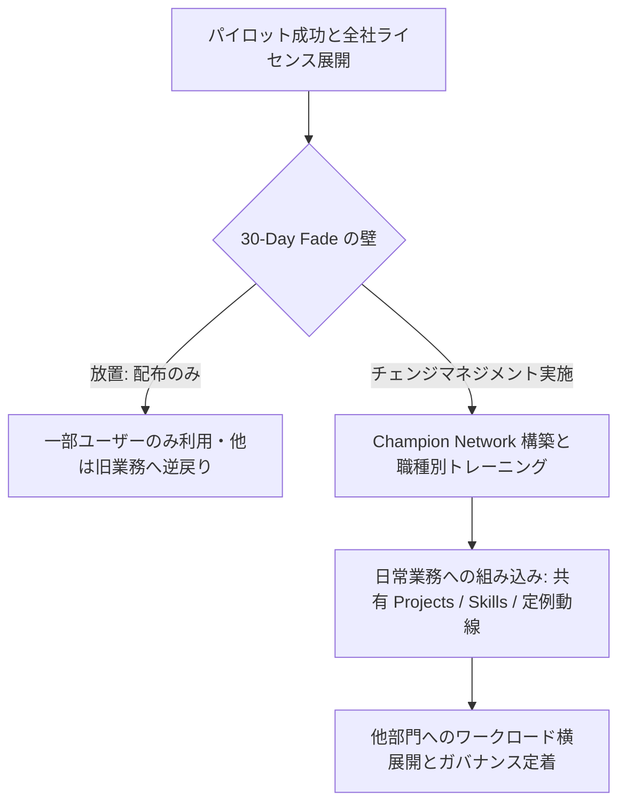

# 第 6 章 エンタープライズ導入の推進（Driving Enterprise Adoption of Claude）

> [!TIP]
> **この章のたとえ：ジムの「法人会員権配布」で終わらせず「通い続ける仕組み」を作ること**
>
> 企業に Claude のライセンスや API を配ることは、社員全員にジムの会員証を配るようなものです。最初の 2〜3 週間は物珍しさで賑わいますが、使い方が分からないまま 1 か月経つと通わなくなります（30-Day Fade）。部門ごとの Champion を育て、日常業務の動線に組み込み、成果を横展開して初めて組織の習慣になります。

## この章のゴール

- パイロット成功後に起きやすい「ライセンス配布止まり」と **30-Day Fade** の構造的原因を説明できる。
- **Champion Network**、職種別トレーニング、専用サポートチャネルを用いた組織定着の仕組みを設計できる。
- 日常業務への組み込み（Projects / Skills / 定例ワークフロー化）と、AI 利用ガバナンスの両立を説明できる。
- 初期部門から他部門（Engineering / Legal / Finance / Customer Support 等）へワークロードを段階展開する計画を立てられる。

## 要点 3 つ

1. **アクセス権の配布と「定着（Adoption）」は別物である。** 導入直後の関心が 3〜4 週間で薄れる 30-Day Fade を防ぐには、ツール提供後のチェンジマネジメントが不可欠になる。
2. **社内 Champion Network と職種別 Enablement が拡大のエンジンになる。** IT 部門からの一方的な通達ではなく、各部門の実務者が相談できる Champion と専用の質問チャネル、役割ごとの実践演習を整える。
3. **日常の業務動線に組み込み、成果が出たワークロードを横展開する。** 単発のチャット利用にとどめず、共有 Projects や標準化されたワークフローに落とし込み、他部門へ順序立てて展開する。

## 30 秒で全体像

## 用語

| 用語 | 意味 |
| --- | --- |
| 30-Day Fade | AI ツール導入直後 2〜3 週間は利用が伸びるものの、1 か月前後で多くの社員が元の業務手順へ戻ってしまう現象 |
| Champion Network | 各部門の先進ユーザーを旗振り役として任命し、身近な相談・事例共有を担わせる社内ネットワーク |
| Role-Based Training | 全社一律の一般論ではなく、法務・財務・営業・開発など職種ごとの実業務に即したトレーニング設計 |
| AI Governance & Policy | セキュリティ、機密情報の取扱い、禁止事項、人間による最終確認ルールを定めた組織運用規程 |
| Workload Expansion | パイロットで成果が出た業務パターンを、隣接チームや他部門の高価値ワークロードへ順次広げる展開戦略 |

## 本編

### 6-1 なぜ「30-Day Fade」が起きるのか

多くの企業導入で、技術的なパイロットやライセンス配布は順調に進んだにもかかわらず、数週間後にアクティブ率が急落します。主な原因は次の 3 点です。

- 日常業務との接続不足により、「何に使えばよいか」が抽象的なままで、自分の毎日のタスクにどう当てはめるかが分からない。
- 最初の失敗体験として、曖昧なプロンプトで期待外れの結果が出たとき、相談できる相手がおらずそのまま使わなくなる。
- 組織的な後押しとルールの欠如により、「使ってよいデータか分からない」「上司や評価制度が AI 活用を推奨していない」という心理的ブレーキが残っている。

### 6-2 チェンジマネジメントの 4 本柱

30-Day Fade を乗り越え、組織全体の習慣に変えるために、以下の 4 つを並行して整備します。

| 柱 | 具体的な施策 | ねらい |
| --- | --- | --- |
| **1. Champion Network** | 各部門から意欲的な実務者を選出し、Slack / Teams の専用チャネルで質問対応や成功事例の共有を担う | IT 部門任せにせず、現場の言葉で素早く疑問を解消できる体制を作る |
| **2. 職種別 Enablement** | エンジニア、法務、財務、CS など職種ごとに「明日から使える実例プロンプトとワークフロー」をハンズオンで学ぶ | 一般的な操作説明ではなく、自分の業務時間に直結する成功体験を提供する |
| **3. ガバナンスと安心感** | 入力してよいデータ区分、禁止事項、レビュー責任のルールを明確にし、迷わず使える基準を示す | コンプライアンス不安による利用萎縮と、無秩序なシャドー AI 利用の両方を防ぐ |
| **4. 業務リズムへの組み込み** | 定例の会議準備、週次レポート、共有 Projects、再利用可能な Skills としてチームの標準手順に組み込む | 「余裕があるときに使う道具」から「いつもの業務手順の一部」へ変える |

### 6-3 他部門へのワークロード横展開（Expansion）

最初のパイロット部門で定着が進んだら、成果データをもとに次の展開先を選定・順序付けします。

1. **定量成果の可視化**: 削減時間、対応件数、品質改善を社内事例として経営層と現場双方へ共有する。
2. **次期ワークロードの優先順位付け**: 「データ整備度」「業務頻度」「部門の推進意欲」を基準に、エンジニアリング、法務、財務、カスタマーサポートなどから次の展開先を選ぶ。
3. **テンプレートの再利用**: 先行部門で磨き込んだワークフローやガバナンス基準を横展開し、立ち上げコストを下げる。

## まとめ：どう判断するか

| 状況 | 避ける選択 | とるべき選択 |
| --- | --- | --- |
| 全社に Claude アカウントを配布したが、1 か月後に利用率が 15% まで落ちた | 「社員の関心が低い」と判断し、追加の周知メールだけを送る | 30-Day Fade と捉え、部門別 Champion の配置、質問チャネル設置、職種別ハンズオンを実施する |
| 全社研修として「プロンプトの基礎」を全社員に同じ内容で 1 回実施する予定 | 職種を問わず同じ汎用デモだけを見せて終える | 法務・営業・開発など職種別の実務シナリオを使った Role-Based Training に組み替える |
| 現場社員が「顧客情報を入れてよいか分からず使えない」と足踏みしている | 個人の判断に任せて放置する | AI 利用ポリシーとデータ取扱い区分を明文化し、安全に使える範囲を周知する |
| 開発部門での導入が成功し、経営層から他部門展開を求められた | すべての他部門へ同じ開発者向けツールをそのまま渡す | 各部門の業務課題と準備度に応じて優先順位を付け、業務に合った形で順次展開する |

## 確認問題

### 問 1

ある企業で全社員向けに Claude を導入し、最初の 2 週間は高い利用率を記録しました。しかし 4 週間後には、もともと新しい技術に関心が高かった一部社員しか使わなくなっていました。この現象と、立て直し策として最も適切なものはどれですか。

A. 一時的なシステム障害が起きているため、モデルティアを最上位に変更する  
B. 導入直後の利用が 1 か月前後で落ち込む 30-Day Fade が起きているため、部門ごとの Champion Network 構築や職種別トレーニング、専用サポートチャネルで日常業務への定着を支援する  
C. 利用しない社員への罰則規定を設け、強制的にアクセス数を増やす  
D. 導入に失敗したと判断して全アカウントを解約する

解答

**B**。ツールを配布しただけでは 30-Day Fade が起きやすいため、現場に近い Champion の支援と職種に即した Enablement により、日常業務へ組み込むチェンジマネジメントが必要です。

### 問 2

法務部・財務部・カスタマーサポート部へ Claude の活用を広げる際、全社一律の一般的な使い方説明会ではなく Role-Based Training を行う最大の理由はどれですか。

A. 部門ごとに使える文字数上限が異なるため  
B. 各職種の日常業務に直結する具体的なユースケースで成功体験を作らないと、実務への定着が進まないため  
C. 法務部には英語だけで説明する必要があるため  
D. トレーニング回数を増やしてライセンス費用を上げるため

解答

**B**。汎用的な機能紹介だけでは「自分の仕事でどう使うか」が結びつかず定着しません。職種別の実務シナリオで学ぶことで、即座に業務時間を削減できる実感が生まれます。

### 問 3

エンタープライズ導入を成功させるためのガバナンス設計として、最も適切な考え方はどれですか。

A. リスクをゼロにするため、どの部門でも業務データの入力を全面禁止する  
B. セキュリティ・機密データの取扱い基準と人間による確認ルールを明確に示し、社員が安心して業務利用できる境界を整える  
C. ガバナンス規程を作ると利用が減るため、ルールは一切定めず完全に自由利用とする  
D. すべての出力を法務部長 1 人が毎回承認する体制にする

解答

**B**。全面禁止や無制限放任ではなく、「何を入力してよく、どこを人が確認するか」の明確な基準を設けることが、安全性と積極的な業務活用を両立する鍵になります。

