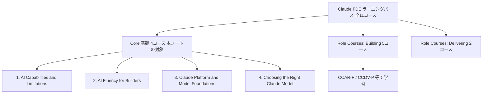
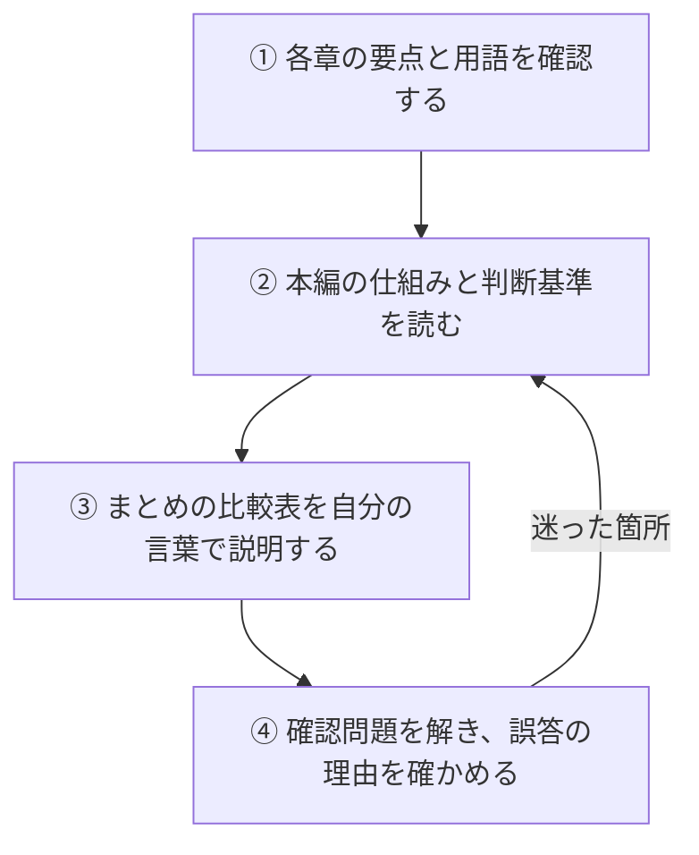

# Claude Forward Deployed Engineer (FDE) Core 対策ノート

## このノートについて

このノートは Anthropic Partner Academy（Skilljar）の **Claude Forward Deployed Engineer (`claude-fde`)** ラーニングパスのうち、Core（基礎・中核）に位置づけられる 4 つのコースを体系的にまとめた学習資料です。

現在はパートナー向けの学習パスですが、今後認定資格として試験化される可能性も見据え、実務の判断軸とシナリオ形式の確認問題までを一通り整理しています。

## 全体像：FDE パスにおける Core の位置づけ

`claude-fde` パスは全 11 コース（約 9.5 時間）で構成されており、大きく **Core（基礎 4 コース）** と **Role Courses（構築・デリバリー 7 コース）** に分かれます。

| 区分 | コース名 | 目安時間 | 本ノートでの扱い |
| --- | --- | --- | --- |
| Core 1 | AI Capabilities and Limitations | 約 60 分 | **第 1 章**で解説 |
| Core 2 | AI Fluency for Builders | 約 45 分 | **第 2 章**で解説 |
| Core 3 | Claude Platform and Model Foundations（Partner 限定） | 約 60 分 | **第 3 章**で解説 |
| Core 4 | Choosing the Right Claude Model | 約 10 分 | **第 4 章**で解説 |
| Role (Building) | Claude Platform 101 / Claude Code 101 / Claude Code in Action / MCP / Agent Skills | 約 5 時間 | 他資格（CCAR-F / CCDV-P 等）で学習するため対象外 |
| Role (Delivering) | Delivery Methodology / Driving Enterprise Adoption of Claude | 約 2 時間 | 本ノートの対象外（Core のみ） |

## 学び方

1. 各章の冒頭にある「この章のゴール」「要点 3 つ」「用語」で全体像をつかみます。
2. 本編では機能の暗記にとどめず「なぜその制約が起きるのか」「どの場面でどの選択をとるべきか」という判断基準を押さえます。
3. 各章末の「確認問題」を解答を開く前に解き、不正解の選択肢がなぜ不適切なのかまで確認します。
4. 最後に「用語集」と「直前チェック」で二択の判断軸を総復習します。

## 収録ファイル一覧

| 章 | ファイル | 主なテーマ |
| --- | --- | --- |
| 第 1 章 | [01-AIの能力と限界.md](./01-AIの能力と限界.md) | 次トークン予測、コンテキストウィンドウ、Hallucination、人間が担うべき判断領域 |
| 第 2 章 | [02-ビルダー向けAIフルーエンシーと4Dフレームワーク.md](./02-ビルダー向けAIフルーエンシーと4Dフレームワーク.md) | AI Fluency の定義、4D Framework（Delegation / Description / Discernment / Diligence） |
| 第 3 章 | [03-Claudeプラットフォームとモデル基盤.md](./03-Claudeプラットフォームとモデル基盤.md) | 実行環境（Anthropic API / Amazon Bedrock / Google Cloud Vertex AI）、プロンプト前の設計判断、Context と Tool Use の基礎 |
| 第 4 章 | [04-適切なClaudeモデルの選定.md](./04-適切なClaudeモデルの選定.md) | モデルティア（Opus / Sonnet / Haiku 等）、Intelligence / Speed / Cost、Effort パラメータ、2 つの導入アプローチ |
| 用語集 | [用語集.md](./用語集.md) | Core 4 コースの重要用語と混同しやすいポイント |
| 直前チェック | [直前チェック.md](./直前チェック.md) | 二択判断表と総合確認問題 |
