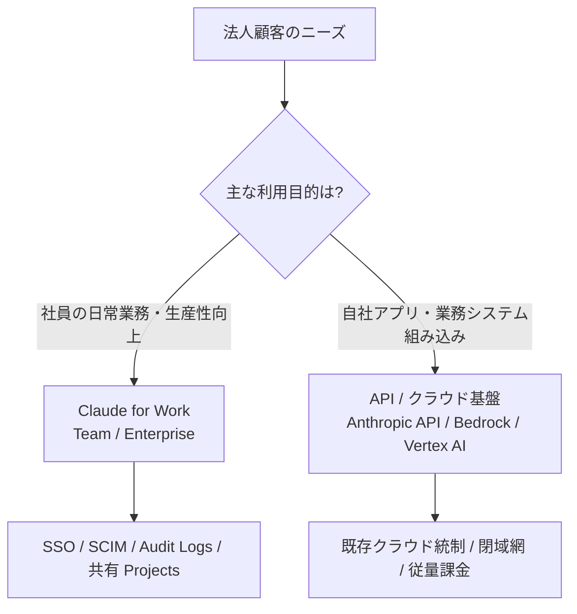

# 第 1 章 Claude 製品ラインナップと提案の全体像

> [!TIP]
> **この章のたとえ：同じエンジンを積んだ「個人向け乗用車」「社用車フリート」「組み込み用エンジン」**
>
> Claude のモデル知能というエンジンは共通でも、個人のパソコンで使うもの（Free / Pro）、会社全体で安全に管理・統制して使う社用車（Team / Enterprise）、自社の業務アプリやクラウド基盤に直接組み込むエンジン（Anthropic API / Amazon Bedrock / Google Cloud Vertex AI）では、契約・管理・セキュリティの仕組みがまったく異なります。顧客の目的に合った形態を選ぶことが営業提案の第一歩です。

## この章のゴール

- 個人向けプラン（Free / Pro）と法人向けプラン（Team / Enterprise）の決定的な違いを説明できる。
- SaaS 型（Claude Enterprise）と API / クラウド基盤型（Anthropic API / Amazon Bedrock / Google Cloud Vertex AI）の使い分けを提案できる。
- Claude の差別化ポイント（安全性・長文コンテキスト・Projects / Artifacts / Claude Code / Connectors）を顧客課題に結びつけて語れる。
- 社内の Shadow AI（個人アカウントの無断利用）を解消する価値を経営層・IT 部門へ伝えられる。

## 要点 3 つ

1. **法人顧客には原則として法人向け契約（Enterprise / Team / 商用 API）を提案する。** 個人向けプランを業務利用すると IT 管理や監査ができず Shadow AI の温床になるため、統制可能な商用プランへ誘導する。
2. **「すぐ業務で使う SaaS」か「自社システムへ組み込む API / クラウド」かで提案軸を分ける。** 社員が日常業務で使うなら Claude Enterprise、自社アプリ連携や閉域網統合なら API や Bedrock / Vertex AI を選ぶ。
3. **モデルの性能だけでなく「安全に企業データとつなげる力」を価値として訴求する。** Projects による知識共有、Artifacts による成果物生成、Connectors / MCP による社内ツール連携、Claude Code による開発支援を一体のプラットフォームとして提案する。

## 30 秒で全体像

## 用語

| 用語 | 意味 |
| --- | --- |
| Claude for Work | 法人向けに提供される Team プランおよび Enterprise プランの総称 |
| Claude Enterprise | 大企業向けの最上位 SaaS プラン。SSO、SCIM、Audit Logs、Compliance API、カスタム保持期間などを備える |
| Shadow AI | 従業員が会社の許可や管理外の個人向け AI アカウントへ業務データを入力してしまう状態 |
| Projects / Artifacts | 社内資料や指示をチームで共有できるワークスペース（Projects）と、文書・コード等を並べて編集できる出力機能（Artifacts） |
| Cloud Marketplaces | Amazon Bedrock や Google Cloud Vertex AI など、顧客の既存クラウド契約枠（EDP 等）で購入・運用できる提供形態 |

## 本編

### 1-1 プラン・提供形態の比較とポジショニング

顧客の規模や利用形態に応じて、適切な提供形態を見極めます。

| 区分 | 主な対象 | 主な特徴・統制機能 | 提案が向いている場面 |
| --- | --- | --- | --- |
| **Free / Pro（個人向け）** | 個人ユーザー | 個人単位の課金。組織の SSO や監査ログ管理はない | 法人提案では原則対象外（Shadow AI 化を防ぐため商用プランへ移行を促す） |
| **Claude Team** | 中小〜中堅チーム | 共有 Projects、チーム管理、商用データ保護（学習利用なし） | 数名〜数十名規模で、まずチーム単位の協働を始めたい場合 |
| **Claude Enterprise** | 中堅・大企業 | SSO、SCIM、Enterprise Audit Logs、Compliance API、カスタムデータ保持、Claude Code 統制 | 全社展開、CISO / 法務の監査要件、Shadow AI の一掃が必要な企業 |
| **Anthropic API（1st-party）** | 開発チーム・SaaS 事業者 | 最新モデル・機能への最速アクセス、柔軟な API 課金 | 自社プロダクトや社内自動化パイプラインへ直接組み込む場合 |
| **Amazon Bedrock / Google Cloud Vertex AI** | クラウド標準を持つ大企業 | 既存 AWS / GCP の IAM、VPC 閉域接続、クラウド請求・EDP 消化 | 既存クラウドのセキュリティ審査を通過済みの環境で動かしたい場合 |

### 1-2 企業顧客へ訴求する 4 つの差別化価値

1. **安全性と予測可能なガバナンス**: 商用プランおよび API では顧客データをモデルの事前学習に利用しない（Zero Training by Default）ことを明確に保証できます。
2. **長文コンテキストと深い読解力**: 契約書、仕様書、コードベースなど大量の資料をまとめて読み込み、整合性を保ったまま分析・作成できます。
3. **業務に溶け込む機能群**: Projects に社内ルールや資料を登録しておけば毎回長い前提を打つ必要がなく、Artifacts で資料やプロトタイプをその場で形にできます。
4. **ビジネスと開発の両輪（Claude Code 連携）**: 事務・企画部門の支援だけでなく、Claude Enterprise 配下でエンジニア向けの Claude Code も統合管理でき、全社でプラットフォームを統一できます。

## まとめ：どう判断するか

| 状況 | 避ける選択 | とるべき選択 |
| --- | --- | --- |
| 従業員が個人の Pro アカウントで社内資料を要約している | 「便利に使えているならそのまま様子を見ましょう」と放置する | Shadow AI リスクを指摘し、SSO・監査ログ・学習除外が効く Claude Enterprise への統合を提案する |
| 顧客が「自社アプリにチャットボットを組み込みたい」と相談 | SaaS 版の Claude Enterprise アカウントを人数分売ろうとする | Anthropic API、または顧客のクラウド環境に応じた Bedrock / Vertex AI を提案する |
| 大企業の情報シスが「新規ベンダーの支払い手続きや審査に時間がかかる」と難色 | 1st-party の直接契約だけに固執して商談が止まる | すでに契約済みの AWS（Bedrock）や Google Cloud（Vertex AI）経由での調達・EDP 活用を提案する |

## 確認問題

### 問 1

従業員 3,000 名の企業で、情報システム部門から「現場の社員が勝手に個人向け AI アカウントへ業務データを入力しており困っている。全社で安全に管理できる環境を整えたい」と相談を受けました。最初に提案すべき中心的なプランはどれですか。

A. 社員全員に個人の Pro アカウントを経費精算で契約させる  
B. SSO・SCIM・Audit Logs・学習除外を備えた Claude Enterprise を提案し、管理された環境へ移行する  
C. 開発者向けの API キーを 1 つ発行し、全社員のブラウザに手動設定させる  
D. AI の利用を全面禁止する以外の選択肢はないと伝える

解答

**B**。Shadow AI を解消するには、IT 部門が認証（SSO / SCIM）と監査（Audit Logs）を統制でき、データが学習に使われない Claude Enterprise へ統合する提案が最適です。

### 問 2

顧客のエンジニアリング部門が「自社で開発している顧客向け SaaS 製品の裏側に Claude の要約機能を組み込みたい」と考えています。提案すべき提供形態として最も適切なものはどれですか。

A. Claude Enterprise のユーザーシートを顧客のエンドユーザー人数分契約してもらう  
B. Anthropic API、または顧客が利用しているクラウド基盤（Amazon Bedrock / Google Cloud Vertex AI）の API を提案する  
C. 社員が毎日画面からコピー＆ペーストして要約を返す運用を提案する  
D. Free プランのブラウザ画面を iframe で埋め込む

解答

**B**。自社アプリケーションやサービスへの組み込み用途には、SaaS シートではなく API（Anthropic API / Bedrock / Vertex AI）が適しています。

### 問 3

ある大手小売企業が「すでに AWS と大型の年間利用契約（EDP）を結んでおり、新規のクラウドサービス調達には厳しい審査と数か月の稟議がかかる」と述べています。営業担当として商談を前進させる最適な提案はどれですか。

A. 審査が終わるまで半年以上待つしかないと伝える  
B. Amazon Bedrock 上で Claude を利用する構成を提案し、既存の AWS セキュリティ統制と EDP 契約枠を活用できるようにする  
C. 審査を回避するため個人のクレジットカードで API を契約するよう勧める  
D. 契約不要な Free プランで本番システムを動かすよう提案する

解答

**B**。顧客が AWS や Google Cloud の既存契約・セキュリティ統制を重視する場合、Amazon Bedrock や Google Cloud Vertex AI 経由の導入を提案することで調達と審査の障壁を大きく下げられます。

