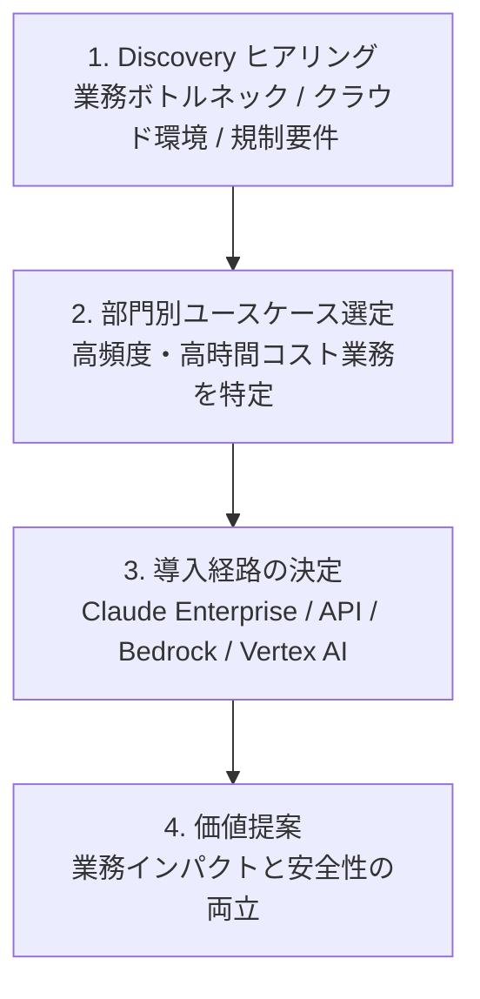

# 第 2 章 顧客課題のヒアリングと提案設計（Discovery & Solution Positioning）

> [!TIP]
> **この章のたとえ：症状を聞く前に薬を出さない「総合診療医の問診」**
>
> 「AI を導入したい」という顧客の言葉は、「何か体調を良くしたい」という相談に似ています。どの業務で何分かかっているのか、誰が決裁者で、どんなセキュリティ制約があるのかを問診（Discovery）で引き出して初めて、Claude Enterprise か API か、どの部門から始めるべきかの処方箋が書けます。

## この章のゴール

- 商談初期のヒアリング（Discovery）で押さえるべき 4 つの観点（業務課題・データ環境・IT 統制・意思決定構造）を説明できる。
- 部門別の代表的なユースケース（Engineering / Legal / Finance / Sales / Customer Support）に対して Claude の価値を具体化できる。
- 顧客の環境（SaaS 中心か、AWS / GCP 中心か）に応じて最適な導入経路を選定できる。
- 単なる「機能の売り込み」ではなく、顧客の経営課題に直結した提案ストーリーを組み立てられる。

## 要点 3 つ

1. **「AI で何ができますか？」と聞かれたら、顧客の業務ボトルネックへ質問を返す。** 汎用デモを見せる前に、時間のかかっている業務・人手不足の領域・既存データの所在を聞き出す。
2. **部門ごとの「具体的な痛み」に合わせてユースケースを提示する。** 開発なら Claude Code によるコード理解と修正、法務なら契約書レビュー、営業なら提案書作成や CRM 連携など、相手の言葉で価値を語る。
3. **導入経路とセキュリティ条件を初期段階で特定する。** 商談の終盤で「実は AWS 閉域網が必須だった」と発覚する手戻りを防ぐため、早い段階でクラウド方針とコンプライアンス要件を確認する。

## 30 秒で全体像

## 用語

| 用語 | 意味 |
| --- | --- |
| Discovery（課題発掘） | 提案前に顧客の業務プロセス、課題、数値目標、制約条件、決裁プロセスを聞き出す商談工程 |
| Business Pain | 顧客が時間・コスト・品質・リスクの面で実際に困っている具体的な業務課題 |
| Champion（社内推進者） | 顧客社内で導入の必要性を理解し、他部門や決裁者との調整を後押ししてくれる味方 |
| Economic Buyer（決裁者） | 予算承認と契約の最終決定権を持つ責任者（CIO、CISO、事業部長など） |
| Land and Expand | まず課題が明確な 1 部門・1 ユースケースで導入し（Land）、成果を示して他部門へ広げる（Expand）戦略 |

## 本編

### 2-1 Discovery で必ず確認すべき 4 つの質問領域

1. **業務と効果の領域**: 「現在最も時間や人手がかかっており、AI で改善したい定型・知的業務は何か」「その作業に現在何時間／何人かかっているか」
2. **データと連携の領域**: 「参照したい社内文書やナレッジはどこにあるか（Google Drive、SharePoint、Salesforce、GitHub 等）」「機密情報や個人情報・医療情報は含まれるか」
3. **IT・クラウド基盤の領域**: 「全社標準のクラウドは AWS / Google Cloud / Microsoft のどれか」「ID 管理（SSO / SCIM）や監査ログ（SIEM）の要件はあるか」
4. **組織・調達の領域**: 「パイロットの成功基準を誰と決めるか」「契約・セキュリティ審査に関わる関係部門（CISO・法務・購買）はどこか」

### 2-2 部門別ユースケースのマッピング

| 部門 | よくある課題（Pain） | Claude の提案ポイント |
| --- | --- | --- |
| **Engineering（開発）** | レガシーコードの解読、テスト不足、PR レビュー待ち | Claude Code や API による調査・実装・テスト支援、技術仕様書の自動整理 |
| **Legal（法務）** | 大量の契約書チェック、社内基準との照合に時間がかかる | 長文コンテキストでの契約条項比較、リスク箇所の抽出と一次レビュー支援 |
| **Finance（財務・経理）** | 決算資料・稟議書・請求データの突合と要約作業 | PDF や表データの読解、異常値や確認ポイントの構造化レポート生成 |
| **Sales（営業）** | 顧客リサーチ、商談準備、提案書作成、CRM 更新の負担 | 共有 Projects での提案書ドラフト作成、商談メモの構造化とフォロー案作成 |
| **Customer Support（CS）** | 複雑なマニュアル検索、一次回答作成、エスカレーション判断 | 社内ナレッジに基づく回答下書き生成、問い合わせ分類による処理時間短縮 |

### 2-3 Land and Expand を意識した初期スコープ提案

最初の商談から「全社全業務を一気に変えましょう」と提案すると、意思決定が重くなり失注しやすくなります。

- **Land（着地）**: 効果が測りやすく推進意欲のある 1〜2 部門を選び、明確な成功指標を置いて小さく確実に成果を出す。
- **Expand（拡大）**: 初期部門で得た削減時間や品質データを社内事例として使い、隣接部門や全社ライセンスへ拡大する。

## まとめ：どう判断するか

| 状況 | 避ける選択 | とるべき選択 |
| --- | --- | --- |
| 顧客が「とりあえず Claude の機能デモを全部見せてほしい」と依頼 | 相手の業務を聞かずに全機能を 1 時間説明し続ける | 最初の 10 分で対象部門・課題・クラウド方針をヒアリングし、関連するユースケースに絞って見せる |
| 営業担当者との商談で盛り上がっているが、IT・セキュリティ部門の要件を確認していない | 受注間際まで技術・セキュリティ要件の確認を先送りにする | 初期段階でクラウド標準（AWS / GCP）や審査部門の要件を確認し、後から手戻りしない提案にする |
| 顧客が複数部門での導入を検討しているが、予算稟議が通りにくい | 最初から全社数千人分の大規模見積もりだけを提示する | Land and Expand に沿い、まず効果を示しやすい重点部門でのパイロット提案から入る |

## 確認問題

### 問 1

ある企業の事業部長から「社内で生成 AI を使いたいので Claude のデモを見せてほしい」と依頼がありました。商談の冒頭で営業担当がまず行うべき対応として最も適切なものはどれですか。

A. 質問は一切せず、用意してきた 50 枚の製品機能スライドを最初から最後まで説明する  
B. 対象となる部門や現在時間のかかっている業務課題、社内データの所在、セキュリティ上の制約をヒアリングし、顧客の課題に即したデモへ焦点を合わせる  
C. 契約書をその場で提示してサインを求める  
D. 最も技術的に複雑な API コードの解説から始める

解答

**B**。Discovery によって顧客の具体的な業務課題と制約条件を引き出してから関連ユースケースを示すことで、導入後の価値を自分事としてイメージしてもらいやすくなります。

### 問 2

法務部門の責任者に対して Claude Enterprise の価値を提案する際、最も響きやすいユースケースの説明はどれですか。

A. 「Web サイトの CSS アニメーションを高速に生成できます」  
B. 「長大な契約書や社内法務基準をコンテキストとして読み込み、リスク条項の抽出や一次レビューの所要時間を大幅に短縮できます」  
C. 「サーバーの Kubernetes マニフェストを自動デプロイできます」  
D. 「SNS のバズる投稿を 100 本連続で作れます」

解答

**B**。相手の部門（ここでは法務）が日々抱えている契約書レビュー等の課題に直結する価値を提示することが、部門別提案の基本です。

### 問 3

顧客が全社導入に関心を示しているものの、全社規模の予算承認に時間がかかる見込みです。商談を前進させるアプローチとして最も適切なものはどれですか。

A. 全社予算が下りるまで 1 年間営業活動を停止する  
B. Land and Expand 戦略に基づき、課題が明確で効果を数値化しやすい 1〜2 部門からスモールスタートし、実績をもとに全社拡大を提案する  
C. 顧客の許可なく一部社員へ個人アカウントを配布する  
D. 機能やサポートをすべて削った無償トライアルだけを永続利用させる

解答

**B**。まずは確実な成果を出せる部門に絞って着地（Land）し、定量成果を根拠に全社へ拡大（Expand）する進め方が、企業商談では最も再現性の高いアプローチです。

