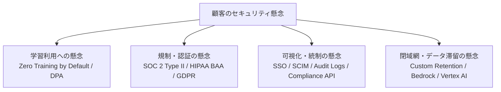

# 第 3 章 セキュリティとコンプライアンスの反論処理（Objection Handling）

> [!TIP]
> **この章のたとえ：銀行の金庫室を示すような「安心の根拠提示」**
>
> どれほど性能が優れていても、CISO や法務部門は「社外秘データが他社の学習に混ざらないか」「監査ログを追えるか」「医療や金融の規制を満たせるか」という一点で導入を止める権限を持っています。営業が抽象的に「安全です」と言うのではなく、契約条項・第三者認証・管理機能の具体的な仕組みで不安を取り除くことが受注の鍵になります。

## この章のゴール

- 商用プラン・API における **Zero Training by Default**（学習利用なし）とデータ分離の仕組みを正確に説明できる。
- **SOC 2 Type II**、**HIPAA / BAA**、**GDPR / DPA** など主要コンプライアンス要件への対応方針を案内できる。
- **SSO / SCIM**、**Enterprise Audit Logs**、**Compliance API**、**Custom Data Retention** による IT 統制を説明できる。
- 顧客（CISO・法務・開発責任者）からよく出る 5 つのセキュリティ反論に対して的確に切り返せる。

## 要点 3 つ

1. **商用プラン・API の入力データはモデルの学習に使われない。** Team / Enterprise や商用 API では、プロンプトも出力もアップロードファイルも Anthropic の基盤モデル学習に利用されない（Zero Training by Default）。
2. **エンタープライズ向けの監査・統制機能が標準で揃っている。** SSO / SCIM による ID 管理、Enterprise Audit Logs と Compliance API による SIEM 連携、カスタムデータ保持期間の設定により、CISO の監査要件を満たせる。
3. **規制要件や閉域網要件が厳しい場合は、Bedrock / Vertex AI の選択肢も即座に提示する。** 医療（HIPAA / BAA）や金融など厳格な業界でも、標準コンプライアンス文書（SOC 2 Type II / DPA）やクラウド環境統合によって解決策を示せる。

## 30 秒で全体像

## 用語

| 用語 | 意味 |
| --- | --- |
| Zero Training by Default | 商用プラン（Team / Enterprise）および API に入力されたデータをモデル学習に使わない原則 |
| SOC 2 Type II | セキュリティや可用性等の統制が一定期間適切に運用されていることを示す第三者監査報告書 |
| HIPAA / BAA | 米国の医療情報保護法（HIPAA）に準拠するため、取扱事業者の責任を定める契約（Business Associate Agreement） |
| DPA（Data Processing Addendum） | 個人データ（GDPR 等）の適切な処理条件を定めるデータ処理補遺契約 |
| Enterprise Audit Logs / Compliance API | 管理者が組織内の利用履歴・操作ログ・チャット内容をプログラム経由で取得し SIEM 等へ連携できる機能 |
| Custom Data Retention | 企業ポリシーに合わせてデータ保持期間（自動削除サイクル等）を管理者が設定できる機能 |

## 本編

### 3-1 よくある 5 大セキュリティ反論と切り返し

| 顧客の懸念（Objection） | 相手の心理・リスク | 適切な切り返し（Counter-Objection） |
| --- | --- | --- |
| **1. 「入力した社内データがモデルの学習に使われませんか？」** | 競合他社への機密漏洩リスクを恐れている | Claude Team / Enterprise および商用 API は **Zero Training by Default** であり、顧客データは学習に一切使われません。DPA や Trust Center の情報も提示できます |
| **2. 「金融・医療など規制産業のため、SOC 2 や HIPAA 対応が必須です」** | 社内ベンダー審査に通らない、法令違反になる | **SOC 2 Type II** を取得済みです。医療・ライフサイエンス分野では **HIPAA 対応と BAA の締結**、EU 関連では **GDPR 準拠の DPA** に対応できます |
| **3. 「社員が何を入力しているか監査・SIEM 連携できません」** | 内部不正や情報流出の追跡・eDiscovery ができない | Claude Enterprise には **Enterprise Audit Logs** と **Compliance API** があり、活動履歴や会話内容を SIEM へ連携でき、ID 管理も **SSO / SCIM** で統制できます |
| **4. 「開発者が Claude Code でソースコードを扱うのが心配です」** | 社内コードの外部流出や設定統制の欠如 | Enterprise 契約配下で Claude Code も統合管理でき、`managed-settings.json` 等による設定強制が可能です。さらに AWS Bedrock 等の **VPC 閉域環境** での運用も選べます |
| **5. 「無期限にデータが残ると社内保持ポリシーに反します」** | 不要データの長期保管による漏洩リスク増大 | 初期設定ではデータ消失防止のため保持されますが、Enterprise 管理者が **Custom Data Retention** により自動削除期間を自社規定に合わせて設定できます |

### 3-2 審査をスムーズに通す営業のコツ

- **審査資料を早期に出す**: 商談が最終局面に入ってから「SOC 2 報告書が欲しい」となると数週間遅れるため、IT・セキュリティ部門が関与した時点で Trust Center や NDA 下の監査資料、DPA / BAA の案内を先回りで共有します。
- **クラウド選択肢を「逃げ道」として持っておく**: SaaS 型の審査がどうしても社内規定で厳しい顧客には、すでに承認済みの **Amazon Bedrock / Google Cloud Vertex AI** 経由での導入を即座に提案できるようにしておきます。

## まとめ：どう判断するか

| 状況 | 避ける選択 | とるべき選択 |
| --- | --- | --- |
| 顧客の法務部が「学習利用されない保証を契約で確認したい」と要求 | 「大丈夫ですので口頭で約束します」と済ませる | 商用プランの Zero Training 条項と DPA（Data Processing Addendum）を提示して確認してもらう |
| 医療機関から HIPAA 準拠の要件が出た | 「AI サービスは医療向けには使えません」と諦める | Claude Enterprise / API での HIPAA 対応と BAA 締結、または対応クラウド経由のルートを案内する |
| CISO が「従業員の AI 利用をすべてログ監視したい」と要望 | 「チャット画面を目視で確認してください」と答える | Enterprise Audit Logs と Compliance API を使った SIEM 連携を説明する |

## 確認問題

### 問 1

大手製薬企業の CISO から「研究データや医療関連情報を扱う可能性があるため、SOC 2 の監査証明と HIPAA 準拠の BAA 締結ができなければ導入できない」と指摘されました。営業担当として最も適切な回答はどれですか。

A. 「個人向け Pro プランなら規約がシンプルなので契約不要で使えます」  
B. 「Anthropic は SOC 2 Type II を維持しており、Claude Enterprise 等では HIPAA 対象ワークロード向けに BAA の締結に対応しています。関連資料を NDA 下で共有します」  
C. 「AI は医療分野では一切利用できないため、別部門だけで検討してください」  
D. 「ログを一切残さないので審査は不要です」

解答

**B**。SOC 2 Type II の取得状況と、HIPAA 準拠に向けた BAA 締結の可否を正確に伝え、必要な監査資料を早期に共有するのが適切な対応です。

### 問 2

顧客の情報システム部門が「すでに社内で Splunk などの SIEM を運用しており、社員の AI 利用ログも一元監視できなければ許可できない」と述べています。Claude Enterprise の機能として提案すべきものはどれですか。

A. 社員に毎週末 Excel で利用報告を提出させる運用  
B. Enterprise Audit Logs および Compliance API を利用し、組織の利用履歴やアクティビティを SIEM へ自動連携する仕組み  
C. 各社員のブラウザ履歴を情報シス担当者が毎日巡回して確認する方法  
D. ログ監視は不可能なので諦めるよう伝える

解答

**B**。Claude Enterprise は Enterprise Audit Logs と Compliance API を備えており、組織の利用状況や監査データをプログラム経由で SIEM へ取り込むことができます。

### 問 3

顧客のコンプライアンス担当者が「データの無期限保管は社内規程で禁止されており、一定期間で自動削除される仕組みが必要だ」と懸念しています。正しい説明はどれですか。

A. データ保持期間は全社固定で変更できないため、導入は不可能である  
B. Claude Enterprise では管理者が Custom Data Retention を設定し、自社の保持ポリシーに合わせて自動削除スケジュールを構成できる  
C. 社員が毎日手動でチャット履歴を消せば規程違反にならない  
D. 個人プランへ切り替えれば自動削除される

解答

**B**。Claude Enterprise では管理者が自社のガバナンス方針に合わせて Custom Data Retention（カスタムデータ保持期間）を設定できます。

