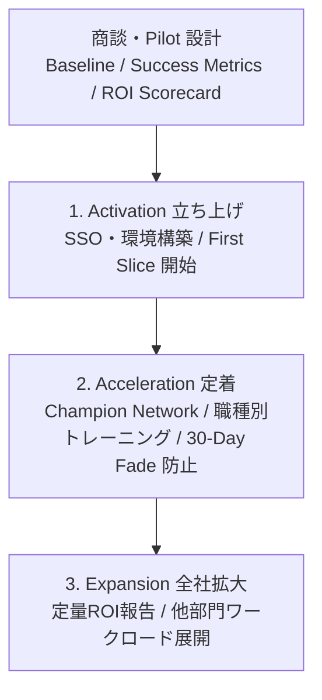

# 第 4 章 ROI 設計と全社拡大戦略（Pilot ROI & Enterprise Expansion）

> [!TIP]
> **この章のたとえ：「契約＝ゴール」ではなく「更新・拡大＝本番」のリレー**
>
> 最初のパイロット契約や 100 シートの受注で営業が手を引いてしまうと、顧客社内では 30-Day Fade が起きて翌年の更新時に解約されてしまいます。契約前から投資対効果（ROI）の物差しを握り、導入後は Champion Network と職種別トレーニングで定着させ、次の部門へ価値を広げていく一連の流れが Claude Sales の勝負どころです。

## この章のゴール

- パイロット開始前に **Baseline Metrics**・**Success Metrics**・**ROI Scorecard** を顧客と合意する営業上の意義を説明できる。
- **First Slice** によるスモールスタートと、本契約・全社展開への橋渡しを設計できる。
- 導入後の **30-Day Fade** を防ぐ 3 フェーズ（Activation / Acceleration / Expansion）と **Champion Network** の役割を説明できる。
- パートナー企業自身の **Claude Partner Network（CPN）** ティア維持・昇格と認定資格・導入実績のつながりを理解する。

## 要点 3 つ

1. **売る前から「成功の証明方法（ROI Scorecard）」を合意する。** 導入前の業務時間・件数・コストを Baseline として記録し、パイロット終了時に投資対効果を経営層へ説明できる材料を最初に仕込む。
2. **受注後の 30-Day Fade を防ぐ仕組みをセットで提案する。** ライセンス販売だけでなく、Champion Network 構築や職種別トレーニング（Role-Based Training）を組み込むことで、継続利用とアップセルにつながる。
3. **Activation → Acceleration → Expansion の 3 段階で全社へ広げる。** 初期部門の定量成果を社内事例化し、Engineering・Legal・Finance・CS などの隣接ワークロードへ計画的に拡大する。

## 30 秒で全体像

## 用語

| 用語 | 意味 |
| --- | --- |
| ROI Scorecard | 導入コスト（ライセンス・API・構築費）と定量効果（削減時間・品質向上・売上貢献）を対比する評価資料 |
| Baseline / Success Metrics | 導入前の現状値と、パイロット成功を判定するための事前合意目標値 |
| Activation / Acceleration / Expansion | エンタープライズ導入を「立ち上げ」「定着加速」「全社拡大」の 3 段階で推進するフレームワーク |
| 30-Day Fade | 導入後 2〜3 週間で初期の興味が薄れ、1 か月前後で利用率が急落する企業導入の典型的な失敗パターン |
| Claude Partner Network (CPN) | Anthropic のパートナープログラム。認定資格保有者数や導入実績に応じて Select / Preferred / Global Premier 等のティアが設定される |

## 本編

### 4-1 決裁者を納得させる ROI Scorecard の作り方

経営層（CIO / CFO / 事業部長）は「AI が賢いかどうか」ではなく「投資に見合うリターンがあるか」で予算を決めます。

| 項目 | 具体的に押さえる数値 | 営業上の効果 |
| --- | --- | --- |
| **現状コスト（Baseline）** | 対象業務の月間件数 × 1 件あたりの平均作業時間 × 人件費単価 | 「放置している現在の見えないコスト」を可視化できる |
| **改善目標（Success Metrics）** | 処理時間の短縮率（例：40% 削減）、一次回答精度、レビュー待ち時間 | パイロット終了時の「合格・本番移行」の判断基準がぶれない |
| **投資コスト（Investment）** | ライセンス費用（シート単価 × 人数）または API 利用料 ＋ 初期導入支援費 | 費用対効果（回収期間・ROI 倍率）を明確に算出できる |

### 4-2 導入後の定着と拡大（Activation → Acceleration → Expansion）

1. **Activation（立ち上げ期）**: SSO / SCIM 連携、カスタム保持期間の設定、利用ポリシーの周知を完了し、First Slice の対象チームが迷わず使い始められる状態を作ります。
2. **Acceleration（定着加速期）**: 30-Day Fade を防ぐため、各部門に **Champion** を立てて専用チャットチャネルで質問を受け付け、**Role-Based Training** で実務直結の成功体験を広げます。
3. **Expansion（全社拡大期）**: 初期部門で達成した ROI Scorecard の実績をもとに経営報告を行い、次の高価値部門（開発・法務・財務・営業・CS）へのシート追加・API 連携を提案します。

### 4-3 パートナー企業としての CPN 連携

パートナー企業の営業・コンサルタントにとって、顧客の成功は自社のパートナー地位向上にも直結します。Claude Partner Network（CPN）では、認定資格の取得数やエンタープライズ導入の実績が Select / Preferred / Global Premier といったティア要件と連動しており、販売して終わりではなく定着と拡大まで伴走することが双方の利益になります。

## まとめ：どう判断するか

| 状況 | 避ける選択 | とるべき選択 |
| --- | --- | --- |
| 顧客が「まずは 50 シートだけ試して効果を見たい」と言っている | 目標値を決めず、50 シートを納品して 1 か月後に様子を聞く | 導入前に Baseline と Success Metrics を ROI Scorecard に落とし込み、中間・終了レビューの日程まで予約する |
| 契約後、利用率が 3 週間目から落ち始めている | 「顧客側の利用努力の問題」として更新時期まで放置する | Champion Network の活性化と職種別ハンズオンを提案し、30-Day Fade を立て直す |
| パイロットで年間 5,000 時間相当の削減効果が確認できた | パイロット部門の担当者へお礼を言って完了とする | 成果を ROI Scorecard にまとめて経営層へ報告し、他部門への Expansion 商談へつなぐ |

## 確認問題

### 問 1

ある企業の情報システム部長から「100 名規模で Claude Enterprise のパイロットを行いたいが、3 か月後に経営会議で本導入の予算承認を得る必要がある」と相談されました。営業担当として提案に必ず組み込むべき仕組みはどれですか。

A. 評価指標は設けず、3 か月後に社員の感想だけを口頭で集める  
B. パイロット開始前に現状業務の Baseline Metrics と達成目標の Success Metrics を定義し、経営会議で説明できる ROI Scorecard を作成する計画を組む  
C. 経営会議の前日に最も安いプランへ切り替える  
D. 予算承認を待たずに 5,000 シート分の請求書を先に出す

解答

**B**。経営会議で予算承認を得るには主観的な感想ではなく定量的な根拠が必要です。導入前から Baseline と Success Metrics を握り、ROI Scorecard で効果を示す設計が不可欠です。

### 問 2

Claude Enterprise を導入した顧客で、最初の 2 週間は活発に使われていたものの、1 か月経つとアクティブ率が大幅に低下しました。営業・カスタマーサクセスとして提案すべき最優先の打ち手はどれですか。

A. 全社員に同じ内容の長い利用規約 PDF を再送する  
B. 30-Day Fade への対策として、部門ごとの Champion Network 構築・専用質問チャネル・職種別トレーニング（Role-Based Training）を提案する  
C. 利用していない社員のアカウントを予告なく削除する  
D. モデルの説明だけを書いた技術論文を配布する

解答

**B**。30-Day Fade は「自分の日常業務にどう使うか分からない」「困ったときに聞ける相手がいない」ことで起きます。Champion Network と職種別トレーニングによる定着支援が最も効果的です。

### 問 3

顧客の 1 部門でのパイロットが目標を大きく上回る成果を出しました。Land and Expand および Expansion フェーズの営業アクションとして最も適切なものはどれですか。

A. 成果データを社内に閉じたまま、次のアクションは顧客からの連絡待ちにする  
B. 得られた定量成果を社内成功事例として整理し、決裁者・Champion と連携して隣接部門（法務・財務・CS 等）への横展開を提案する  
C. パイロット部門のライセンスを解約して別製品を提案する  
D. すべての他部門へ事前のヒアリングなしで開発者向け API キーだけを配布する

解答

**B**。初期部門で証明した定量成果をてこに、次の高価値部門へ段階的に適用範囲を広げるのが Expansion フェーズの王道です。

