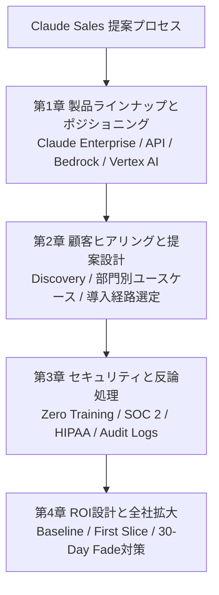
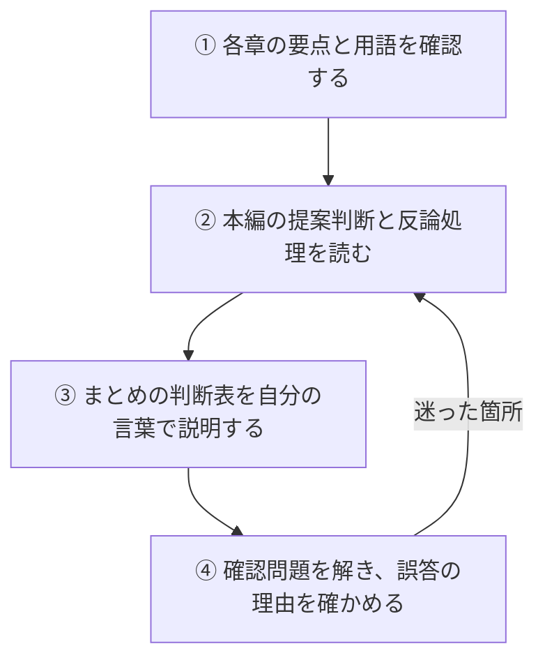

# Claude Sales (C-S) 対策ノート

## このノートについて

このノートは Anthropic Partner Academy（Skilljar）の **Claude Sales (`claude-sales`)** ラーニングパスを想定し、パートナー営業・プリセールス・アカウントマネージャーに求められる **Sales 固有の知識と判断軸** をまとめた学習資料です。

LLM の基礎（AI の能力と限界・4D Framework・モデル選定）や開発者向け技術（Claude Code・MCP・Agent Skills）は [C-FDE勉強](../C-FDE%E5%8B%89%E5%BC%B7/C-FDE%E5%8B%89%E5%BC%B7.html) や CCAR-F / CCDV-P で扱うため、本ノートでは **製品ポジショニング・顧客ヒアリング・セキュリティ反論処理・ROI と拡大戦略** に絞って整理しています。

## 全体像：Claude Sales で押さえる 4 本柱

## 学び方

1. 各章の冒頭にある「この章のゴール」「要点 3 つ」「用語」で全体像をつかみます。
2. 本編では顧客（経営層・事業部門・CISO・情報システム部門）の立場ごとの関心事と、適切な切り返しを押さえます。
3. 各章末の確認問題（シナリオ形式）を解答を開く前に解き、誤答の選択肢がなぜ不適切なのかまで確認します。
4. 最後に「用語集」と「直前チェック」で二択の判断軸を総復習します。

## 収録ファイル一覧

| 章 | ファイル | 主なテーマ |
| --- | --- | --- |
| 第 1 章 | [01-Claude製品ラインナップと提案の全体像.md](./01-Claude製品ラインナップと提案の全体像.md) | 個人向け vs 法人向け（Team / Enterprise）、API / Cloud Marketplaces、主要機能と価値訴求 |
| 第 2 章 | [02-顧客課題のヒアリングと提案設計.md](./02-顧客課題のヒアリングと提案設計.md) | Discovery 質問、部門別ユースケース、導入形態（SaaS vs Bedrock / Vertex AI）の選定 |
| 第 3 章 | [03-セキュリティとコンプライアンスの反論処理.md](./03-セキュリティとコンプライアンスの反論処理.md) | Zero Training、SOC 2 Type II、HIPAA / BAA、SSO / SCIM / Audit Logs、5 大反論への切り返し |
| 第 4 章 | [04-ROI設計と全社拡大戦略.md](./04-ROI設計と全社拡大戦略.md) | Baseline / Success Metrics、ROI Scorecard、30-Day Fade 防止、Champion Network と横展開 |
| 用語集 | [用語集.md](./用語集.md) | Claude Sales で頻出するビジネス・セキュリティ用語 |
| 直前チェック | [直前チェック.md](./直前チェック.md) | 商談場面別の二択判断表と総合確認問題 |
