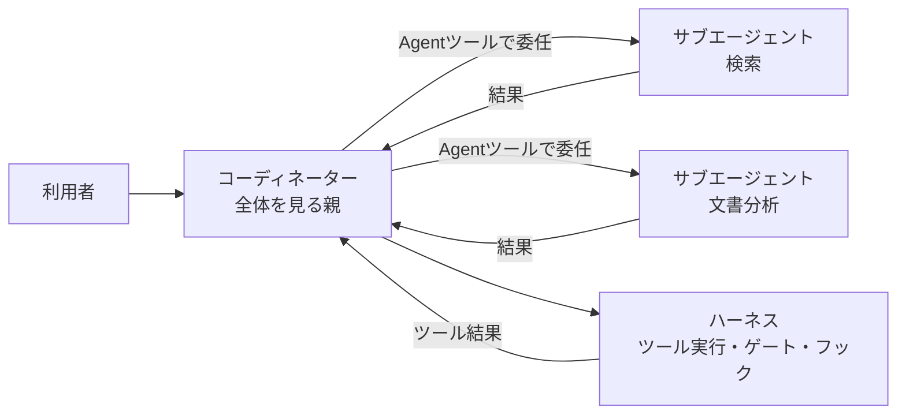
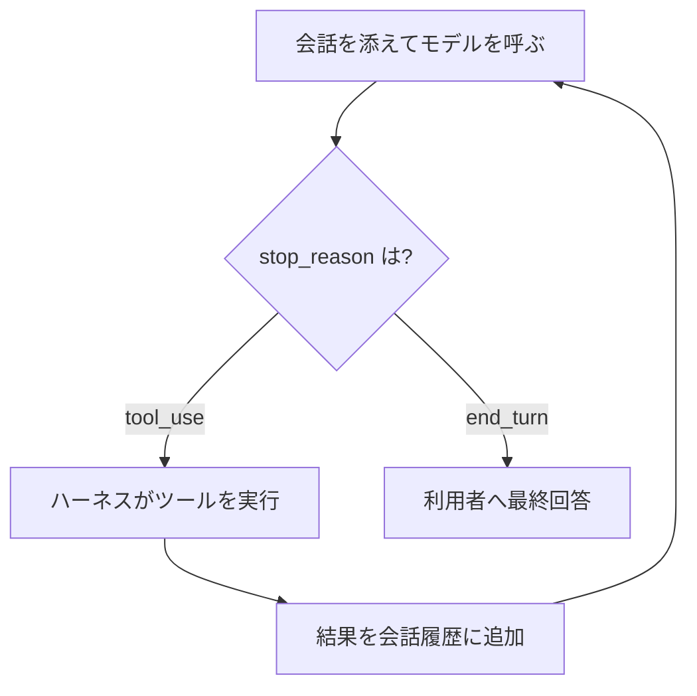
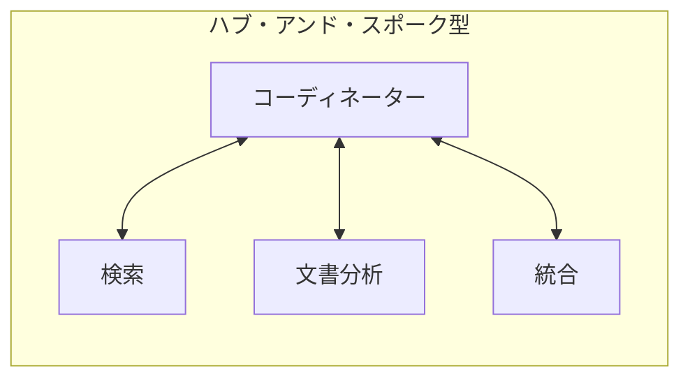
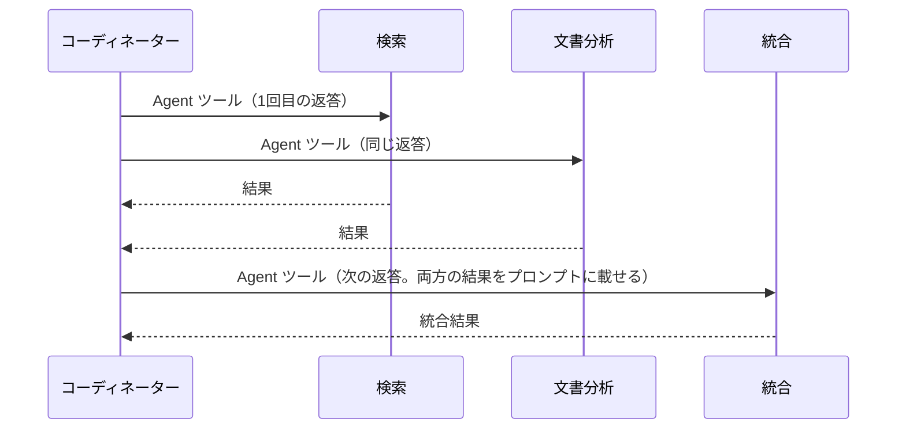
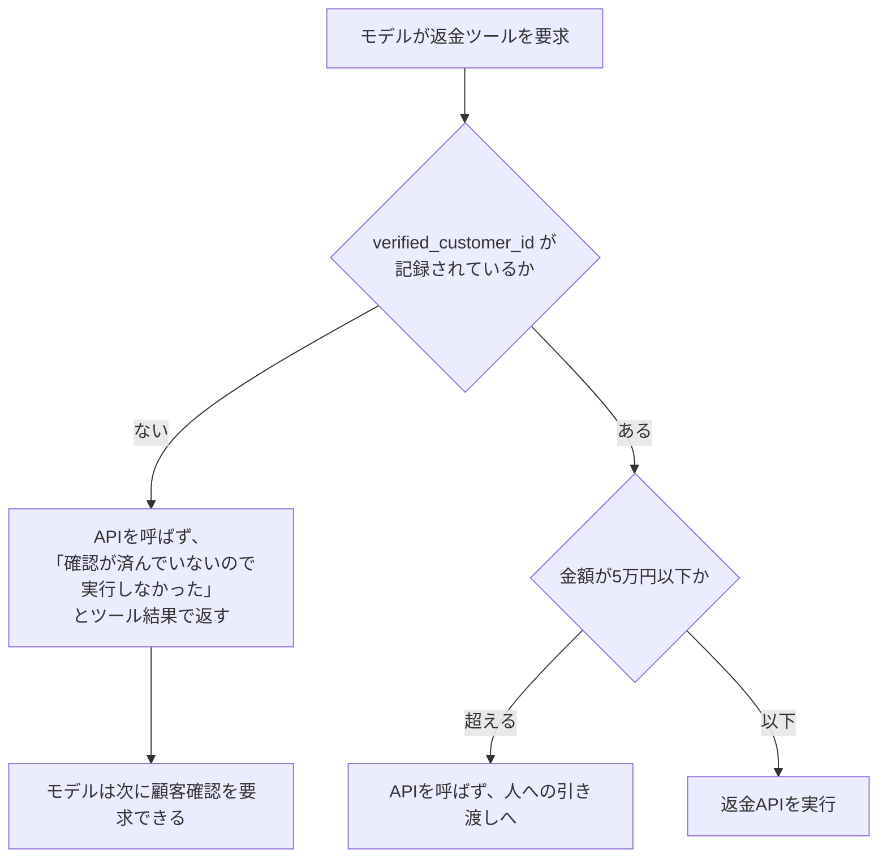
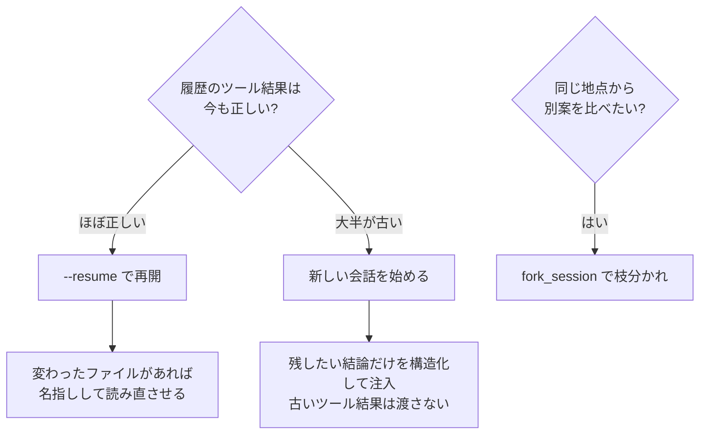
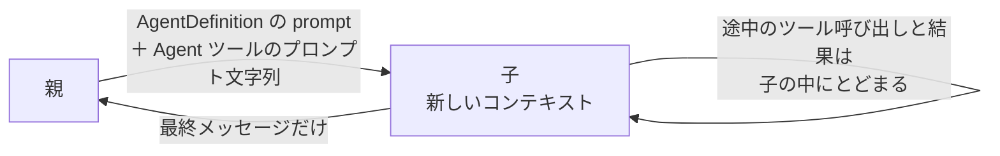

# 第1章 エージェントアーキテクチャとオーケストレーション

> [!TIP]
> **この章のたとえ：モデルは「指示を出す監督」、ハーネスは「実際に動くスタッフ」**
>
> 監督（モデル）は「この資料を取ってきて」と頼むだけで、自分では動きません。スタッフ（ハーネス＝あなたのプログラム）が実際に取りに行き、結果を監督の机に置きます。監督は机の上にあるものだけを見て、次の指示を出します。机に置き忘れた資料は、監督にとって「無かったこと」になります。

## 音声（4本）

先にノートの該当節を読んでから聞くと、図と結びついて残ります。

| 音声 | 対応する節 |
| --- | --- |
| [a. ループと判断の主体](audio/01-a-ループと判断の主体.mp3) | 1-1 〜 1-3 |
| [b. 委任とコンテキスト](audio/01-b-委任とコンテキスト.mp3) | 1-4 〜 1-8 |
| [c. 強制と分解とセッション](audio/01-c-強制と分解とセッション.mp3) | 1-9 〜 1-14 |
| [d. 公式の仕様で押さえる点](audio/01-d-公式の仕様で押さえる点.mp3) | 1-15 〜 1-19 |

## この章のゴール

- ツールを何度も使う仕事を、ループとして正しく回し、正しく止められる。
- 複数のエージェントに仕事を分けるとき、「誰が全体を見るか」「何を明示的に渡すか」を決められる。
- 外れると事故になる手順を、プロンプトではなくプログラム（ゲートとフック）で止められる。
- 昨日の会話を「再開する」「新しく始める」「枝分かれさせる」のどれにするか選べる。

## 要点3つ

1. **モデルはツールを実行しない。** 実行して結果を会話に戻すのはハーネス。ループを止める合図は `stop_reason` が `end_turn` になったときだけ。
2. **サブエージェントは親の会話を見ない。** 必要な情報はコーディネーターがプロンプトに書いて渡す。通信は必ずコーディネーター経由。
3. **事故になる順序は「お願い」ではなく「検査」で守る。** プロンプトは従う確率を上げるだけ。返金前の本人確認などはゲートとフックで止める。

## 30秒で全体像

モデルは「このツールを呼んでほしい」と宣言し、ハーネスが実行して結果を会話に戻します。この往復がエージェントループです。仕事を分けるときは、コーディネーターがハブになり、子に渡す情報を明示します。返金のように順序を外すと事故になる箇所は、ゲートとフックで止めます。仕事の分け方は「やることが最初から見えているか」で選び、会話を続けるかどうかは「履歴の中身が今も正しいか」で選びます。

## 用語

| 用語 | 意味 |
| --- | --- |
| ハーネス | モデルを呼び出し、ツールを実行し、結果を次の依頼に足すプログラム。つまり「あなたが書く側」 |
| `stop_reason` | 返答が止まった理由。ループを続けるか止めるかの分岐に使う |
| `tool_use` | 「ツールを実行してほしい」という停止。実行して、ループを続ける |
| `end_turn` | 「返答を終えた」という停止。ループを閉じる |
| ツール結果 | ハーネスが会話履歴へ戻す、ツールの戻り値 |
| コーディネーター | 仕事を分け、委任し、結果を集め、足りなければ再委任する親エージェント |
| サブエージェント | 別の会話で、渡された依頼だけを処理するエージェント |
| Agent ツール | サブエージェントを起動するツール。旧称は Task（Claude Code v2.1.63 で改名） |
| `allowedTools` | 列挙したツールを**承認の確認なしで実行させる**設定。列挙していないツールも使えなくなるわけではない |
| `tools` / `disallowedTools` | 使えるツールを**絞る**設定。`disallowedTools` に書いたツールは定義ごと外れる |
| `AgentDefinition` | サブエージェントの種類ごとの説明・システムプロンプト・使えるツールの定義 |
| 前提条件ゲート | 前の手順の結果が記録されるまで、後のツールを実行させない検査 |
| `PostToolUse` | ツール実行の**後**、モデルが読む**前**に結果を整えるフック |
| 実行前フック | ツール実行の**前**に、規則違反の呼び出しを止めるフック |
| ハンドオフ | 会話ログを見られない人に渡す、判断に必要な情報だけをまとめた要約 |
| プロンプトチェーン | やることが最初から決まっている仕事を、段階ごとに順番に処理する分け方 |
| 動的な分解 | 途中で分かったことに応じて、次のサブタスクを足していく分け方 |
| `--resume` | 名前を付けた過去の会話を、履歴ごと再開する |
| `fork_session` | 同じ地点から会話を枝分かれさせ、別案を混ぜずに比べる |

## 本編

### 1-1 ループは、モデルとハーネスのキャッチボール

モデルの1回の呼び出しは、「それまでの会話を読んで、次のメッセージを1つ返す」だけです。ファイルを開いたり、返金APIを呼んだりはしません。モデルが返すのは「このツールを、この引数で呼んでほしい」という**宣言**です。実際に実行するのはハーネスです。

返答には停止理由（`stop_reason`）が付きます。

- `tool_use` なら：宣言されたツールを実行し、結果を会話に足し、もう一度モデルを呼びます。
- `end_turn` なら：モデルは利用者への返答を終えています。ループを閉じます。

**例：返品の依頼を4往復で処理する**

利用者「注文 A-19 の壊れたヘッドホンを返金して」

| 回 | `stop_reason` | モデルの宣言 | ハーネスが履歴に足す結果 |
| --- | --- | --- | --- |
| 1 | `tool_use` | 顧客確認ツールを呼んで | 顧客は確認済み、ID は C-42 |
| 2 | `tool_use` | 注文参照ツールを呼んで | ヘッドホン、配送済み、金額 8000 |
| 3 | `tool_use` | 返金ツールを呼んで | 返金成功 |
| 4 | `end_turn` | 「返金しました」と利用者に回答 | （ループ終了） |

もし1回目の結果を履歴に戻し忘れると、2回目のモデルは利用者の最初の文しか見えません。顧客IDを知らないので、同じ確認をもう一度要求するか、IDなしで先へ進もうとします。

> [!IMPORTANT]
> モデルに隠れたメモリはありません。次の判断材料は、会話履歴（トランスクリプト）に入っているものだけです。

### 1-2 止める合図は `stop_reason` だけ。文章からは読まない

「止める合図」を間違えると、仕事の途中で止まったり、終わったのに回り続けたりします。

| 止め方 | なぜダメか |
| --- | --- |
| 文章が付いていたら終わり | モデルはツールの前に「確認します」と書くことがある。文章があっても、仕事は終わっていない |
| 文章が空なら終わり | ツール直前のつなぎが空に近いことがある。逆に、最終回答が短くても終わっていることがある |
| 「完了しました」という語を拾う | モデルは途中でもその語を書く。語を拾って止めると、返金の直前で止まる |
| 回数の上限に達したら終わり | 上限は暴走を止める**ヒューズ**であって、完了の定義ではない |
| `max_tokens` で切れたら終わり | 切断は完了ではない。切れたツール呼び出しのJSONを実行すると、壊れた引数で動く |

> [!TIP]
> **一言まとめ**：続けるのは `tool_use`、止めるのは `end_turn`。それ以外はすべて「異常」として扱う。

**異常のときの対応**

- **回数の上限で止めたとき**：利用者に「完了」と返してはいけません。「どこまで実行し、何が未実行か」を返します。返金だけ未実行なのに「対応しました」と書くのが典型的な事故です。
- **`max_tokens` で切れたとき**：切れたJSONを補って実行してはいけません。金額の桁が欠けたまま返金が通るかもしれません。出力の上限を増やして同じ履歴からやり直すか、失敗として返します。

**「止まらない」「同じことを繰り返す」ときの切り分け**

同じツールが同じ引数で3回続くなら、原因はたいてい次のどちらかです。

1. **結果が履歴に戻っていない**（ハーネスの結び付け漏れ）→ ハーネスを直す。
2. **結果が「失敗」の一言だけ**で、モデルが再試行をやめる根拠を持てない → ツールの戻り値を直す（第2章）。

プロンプトに「繰り返すな」と書いても、結果が見えていなければ、モデルの次の手は同じ要求です。

### 1-3 次のツールを選ぶのは、モデルか決定木か

- **モデル主導**：モデルがツールの説明と会話を見て、次のツールを選びます。「返品の方針だけ教えて」なら、顧客確認も返金も呼びません。
- **決定木**：あらかじめ書いた分岐どおりにツールを呼びます。書き漏れた枝では、間違ったツールが呼ばれます。

普段の分岐はモデルに選ばせます。決定木が勝つのは「順序そのものが安全の条件」のときだけで、それは 1-9 のゲートで扱います。

> [!WARNING]
> **よくある失敗**：「必ず顧客確認→注文参照→返金の順で呼べ」とプロンプトに固定する。モデルはだいたい従いますが、従わない回が残ります。
> - 目的が**事故防止**なら → プロンプトではなくゲートにする。
> - 目的が**効率**なら → モデルに選ばせたほうが、不要な呼び出しが減る。

### 1-4 コーディネーターがハブになる理由

サブエージェントは**別の会話**です。親の履歴はコピーされず、呼び出しをまたいでメモリも共有しません。検索役に「さっきの文書の続き」と頼んでも、「さっきの文書」はその会話にありません。

そこで、通信はすべてコーディネーター経由にします（ハブ・アンド・スポーク型）。

子どうしを直接つなぐと、経路が掛け算で増え、エラーの形がばらばらになり、ログを1か所で追えなくなります。利用者の目的と全員の結果を同時に見られるのは、コーディネーターだけです。

**コーディネーターの4つの仕事**

1. 目的をサブタスクに**分ける**
2. 誰を呼ぶか**選ぶ**（毎回全員を通す必要はない。「この用語の定義は？」で全文検索から始めると、待ち時間と費用が増えるだけ）
3. 結果を**集める**
4. 穴があれば、範囲を絞って**呼び直す**

範囲の割り方は「重ねすぎない」ことです。テーマで分けるか、情報源の種類で分けます。同じ記事を2人に読ませると、統合役は重複を消す作業に時間を使います。

### 1-5 全員が成功しても、全体が欠けることがある

「AIが創作産業に与える影響」を調べるのに、コーディネーターが**視覚表現の3テーマだけ**を割り当てたとします。検索も、文書分析も、統合も、割り当てられた範囲ではすべて成功しました。それでも報告には、音楽も、執筆も、映像もありません。誰も失敗していません。**割り当てられていなかった**だけです。

| 間違った直し方 | 正しい直し方 |
| --- | --- |
| 検索クエリを増やす（視覚の中で詳しくなるだけ） | コーディネーターの分解を直す。最初にテーマ全体を列挙し、各サブタスクの担当範囲を明示する |

穴が見えたあとの動きも、コーディネーターの仕事です。統合の結果に「音楽は未調査」とあれば、音楽だけを検索役に再委任し、戻ってきたら統合をやり直します。全員を最初からやり直すより安く済みます。一度きりのリレーにすると、最初の分解のミスがそのまま確定します。

> [!TIP]
> **一言まとめ**：下流が全員成功しているのに偏っていたら、分解の幅を疑う。

### 1-6 サブエージェントの起動と、情報の渡し方

**起動は Agent ツールで行う**

サブエージェントを起動する道具が Agent ツールです（旧称 Task。古い資料やログでは Task と書かれています）。親が Agent ツールを使える状態でなければ、モデルは「検索役に頼みます」と文章で書くだけで、実際には誰も起動しません。Agent SDK の例では、承認なしで起動できるよう `allowedTools` に `"Agent"` を入れます。委任は意図ではなく、ツール要求です。

> [!WARNING]
> `allowedTools` は「承認なしで実行してよいツール」の一覧で、**使えるツールを絞る設定ではありません**。絞るのは `tools`（使えるものを列挙）や `disallowedTools`（外すものを列挙）です。

**渡す情報は、子のプロンプトに書く**

検索結果や分析結果は、統合役のプロンプトに直接載せます。「前の役が知っている」は通用しません。会話が分かれているからです。

載せるときは、**本文とメタデータを分けます**。主張、抜粋、URL、文書名、ページ、公開日、などです。本文だけを貼ると、統合役の文章から出典が消えます（第5章の出典保持につながります）。

**並列は「1回の返答で Agent ツールを複数呼ぶ」**

- 1回の返答に Agent ツールの呼び出しを複数出すと、ハーネスはそれらを同時に実行し、全部そろってから次のモデル呼び出しをします。
- 返答を分けて1人ずつ起動すると、待ち時間が直列に積み上がります。
- **依存があるものだけ直列にします。** 統合は検索の結果が必要なので、同じ返答に並べても、統合は空の材料を受け取ります。

**`AgentDefinition` の説明は具体的に**

コーディネーターは、各サブエージェントの説明を読んで依頼先を決めます。

| 曖昧な説明 | 具体的な説明 |
| --- | --- |
| なんでも調査する | 公開ウェブの記事を探し、URLと抜粋を返す。論文PDFは扱わない |

具体的に書くと、論文の依頼は文書分析役に回るようになります。

### 1-7 委任は「手順」ではなく「目標と品質基準」で書く

| | 悪い委任（手順書） | 良い委任（目標と基準） |
| --- | --- | --- |
| 指示 | 「検索ツールを使え。クエリは『創作、AI、アート』。5件取ったら文書役へ渡せ」 | 「問いは創作産業の雇用への影響。視覚・音楽・執筆・映像を別々に検索し、主張・抜粋・URL・公開日を分けて返せ。一次情報に近い出典のない数字は空欄でよい。見つからなければ、見つからなかったと書け」 |
| 起きること | テーマが視覚に偏る。件数で打ち切られる。3番目のサイトが落ちると止まる | 子がクエリを自分で変えられる。空欄は失敗ではなく「穴の報告」になる |

**親と子で、書く内容は違います。**

- **コーディネーターのプロンプト**：利用者の目的、品質の基準、再委任してよい条件（例：「視覚が4件で音楽が0件なら、音楽だけクエリを変えてもう一度」）。クエリの文字列そのものは書きません。
- **子のプロンプト**：返す構造と、空欄でよい条件。

> [!WARNING]
> 親が子の結論を**自分の言葉で要約してから**次の子へ渡すと、「8000円」が「数千円」になり、URLが落ちます。渡すのは、子が返した構造のままです。どうしても要約するときも、数字と出典の行は残します。

手順が「安全上の順序」なら、それは子のプロンプトではなくゲートに置きます（1-9）。

### 1-8 ツール呼び出しにはIDがあり、結果は必ずIDで対応させる

1回の返答にツール要求が2つあるとき、それぞれに識別子（ID）が付きます。ハーネスは結果を、そのIDに結び付けて返します。

**例：並列検索の片方だけが失敗した**

視覚の検索（`call_v`）は抜粋を返し、音楽の検索（`call_m`）はタイムアウトしました。

| やり方 | 何が起きるか |
| --- | --- |
| ✅ IDで対応させ、成功は結果を、失敗は失敗の構造（種類・試したクエリ・部分結果）を返す | モデルは視覚の統合を進め、音楽だけ再委任できる |
| ❌ 返ってきた順の配列で対応させる | 音楽の失敗が先に届くと、視覚の欄に失敗が入る。統合は「視覚の記事が無かった」と書く |
| ❌ 両方捨ててやり直す | タイムアウトのたびに費用が倍になる |
| ❌ 失敗を「空の成功」にする | 音楽は「記事が無かった」という結論になり、失敗が消える |

もう1つの誤りは、モデルが頼んでいないツールを、ハーネスが気を利かせて先に実行し、結果を履歴に足すことです。モデルは「自分が頼んだ結果が並んでいる」前提で次を判断するので、どの前提で話しているかが追えなくなります。先に済ませたい条件があるなら、ゲートとして「このツールはまだ実行できない」と返します。

### 1-9 外れてはいけない順序は、確率では守れない（ゲート）

モデルは指示に高い割合で従います。それでも、従わない回がゼロにはなりません。返金前の本人確認を太字で強調しても、確認を飛ばす回が残ります。その1回で、別人の口座が動きます。

**ゲートは、ハーネスが持つ状態の検査です。**

- 顧客確認ツールが検証済みIDを返したときだけ、ハーネスが `verified_customer_id` を記録します。
- 返金ツールの実行関数の先頭で、その値を確認します。空なら、APIを呼ばずにツール結果を返します。副作用は起きません。
- **テストの方法**：プロンプトから確認の指示を全部消しても、この分岐が残ること。それがゲートです。

| 手段 | 効果 |
| --- | --- |
| プロンプトを強調する／正しい順序の会話例を足す | 従う割合が**上がる**（ゼロにはならない） |
| ゲート・フック | 外れた回の副作用を**止める** |

事故の値段が高い順序だけをゲートにします。トーンや説明の詳しさのように「だいたい従えばよい」ものはプロンプトのままにします。何でもゲートにすると、「返金の条件は？」という質問まで止まります。検査は**返金ツールの実行関数にだけ**掛けます。

確認のゲートと金額の検査は、別の条件です。一つにまとめないでください。

### 1-10 フックは「実行の前」と「実行の後」で仕事が違う

| | 実行前フック | `PostToolUse`（実行後フック） |
| --- | --- | --- |
| タイミング | ツールが実行される**前** | ツールが返した**後**、モデルが読む**前** |
| 仕事 | 規則違反の呼び出しを止める | 結果の形をそろえる |
| 例 | 5万円を超える返金なら、APIを呼ばず人への引き渡しへ回す | Unix時刻・ISO 8601・数値コードがばらばらな結果を、日付の文字列と「配送済み」などの言葉にそろえる |

形式の変換をモデルにやらせると、その分のターンを使い、日付の取り違えが返金判断を曲げます。変換は決まった処理なので、モデルの仕事ではありません。

ルールをプロンプトにだけ書いてフックを省くと、モデルが「今回は例外のはず」と実行を要求できてしまいます。フックは要求を受け取ったうえで、実行だけを拒否します。

### 1-11 通し例：1件の返金を、ループ・ゲート・フックで処理する

依頼「注文 A-19 を返金して」。方針は「写真のない破損申告は返金しない」「5万円を超えたら人へ」。

| ターン | 何が起きるか | 落とし穴 |
| --- | --- | --- |
| 1 | `tool_use`：顧客確認。ハーネスが検証済みID C-42 を**状態に記録**し、結果を履歴に足す | 状態への記録を忘れると、後のゲートが常に空を見て、正しい顧客でも返金できない |
| 2 | `tool_use`：注文参照。`PostToolUse` がUnix時刻と数値コードを「日付」「配送済み」に変換。金額 8000、写真なし | 変換しないと、数値コードを「未配送」と読む回があり、判断が変わる |
| 3 | `tool_use`：返金。実行前の検査で、IDあり・5万円以下を確認。しかし方針の検査が「写真なし」を見て、APIは呼ばない。結果は「写真が無いので実行しなかった」 | |
| 4 | `end_turn`：利用者に写真を依頼する文 | 最終文だけを成功の印にすると、未実行の返金を「完了」と報告してしまう |

写真があり金額が8000円なら、3ターン目でAPIが実行され、4ターン目の `end_turn` が本当の完了です。

### 1-12 人への引き渡し（ハンドオフ）は「写し」ではなく「判断材料」

引き渡す相手は、エージェントの会話ログを開けません。必要なのは全文の写しではなく、次の行動を選ぶための材料です。

| 悪いハンドオフ（会話の貼り付け） | 良いハンドオフ（構造化） |
| --- | --- |
| 「お客様はご立腹で、注文の話のあと配送の話になり、金額はどこかで8000と言っていた」 | 顧客：C-42 ／ 注文：A-19 ヘッドホン、配送済み ／ 希望：全額返金 ／ エージェントの判断：破損写真が無く方針外 ／ 推奨：写真を依頼、または例外承認 |

最低限必要なのは「顧客ID」「何が起きたか」「金額」「推奨する次の行動」の4点です。欠けると、人は最初から聞き直します。

1通の問い合わせに用件が複数あるときは、用件ごとに分け、共通の事実（同じ顧客IDなど）を共有しながら調べ、最後に1つの返答にまとめます。

### 1-13 仕事の分け方は「やることが最初から見えているか」で選ぶ

| | プロンプトチェーン | 動的な分解 |
| --- | --- | --- |
| 向いている仕事 | やることが事前に決まっている（例：コードレビュー） | 次の問いが途中で生まれる（例：古いコードにテストを足す、調査） |
| 進め方 | ファイルごとの局所チェック → ファイル横断のデータの流れ、と段階を分ける | まず全体構造をつかみ、影響の大きい箇所を見つけ、依存が見つかるたびに優先度を更新する |
| 逆に使うと | 調査に使うと、名前を付けなかった枝が消える | レビューに使うと、チェックリストを捨てて探索に流れる |

**なぜレビューを分けるのか**：14ファイルを一度に渡すと、注意が一部のファイルに偏り、同じ問題を片方では指摘し、もう片方では見逃します。モデルが怠けているのではなく、一度に配れる注意に限りがあるからです。段階を分ければ、各段の入力が小さくなり、深さがそろいます。

**分けないほうが速い仕事もあります。** サブエージェントには起動・プロンプトの複製・待ち時間のコストがかかります。1回の検索で済む調査にサブエージェントを使っても、待ちが増えるだけです。

分ける基準は次の3つです。どれにも当てはまらなければ、親が直接ツールを呼びます。

1. 入力が長く、親の会話に残すと後の作業の予算が足りなくなる
2. 必要なツールの組み合わせが違い、親に全部持たせると選択が揺れる
3. 失敗しても目的の一部だけが欠ける、と切り出せる

> [!WARNING]
> **副作用の順序は、委任で分けない。** 本人確認と返金を別の子に任せると、確認済みIDは子の会話の中に閉じこもり、親のゲートが見る状態に入りません。確認も返金も、同じハーネスの状態と検査の上に置きます。委任してよいのは、検索のように失敗しても口座が動かない仕事です。
>
> また、「子に親の全履歴を渡せば楽」という案は、分離した意味を消します。子は関係のない途中経過まで読み、コンテキストを無駄に使います。

### 1-14 会話を続けるか：再開・新規・フォークの三択

判断の軸は「**履歴の中のツール結果が、今も正しいか**」です。履歴にあるツール結果は、実行した瞬間のファイルやAPIの「写真」にすぎません。

**例：月曜日に認証モジュールを分析し、セッション名を `auth-review` にした**

- **水曜日、`session.ts` の有効期限だけが変わった** → 再開して「`session.ts` の有効期限の比較が14日から1日に変わった。そのファイルだけ読み直し、月曜日の他の結論を維持してよいか答えて」と伝えます。名指しを忘れると、月曜日の古いコードを今のコードとして話します。
- **ファイルが大きく変わった、または当時のAPIがもう無い** → 新しい会話を始め、決めた境界・未解決の問い・読むべきファイル名だけを注入します。古い数字を入れるなら「当時の観測では在庫は10」のようにラベルを付けます。ラベルがないと、新しい会話でも「現在の在庫」として扱われます。
- **認証をミドルウェアに移す案と、各ハンドラに残す案を比べたい** → 月曜日の分析の直後で `fork_session` します。1つの会話で両方を試すと、先の案の差分が後の案の評価に混ざります。枝に分ければ、共通の分析だけを共有し、その後の結果は混ざりません。

「古さの問題」と「比較の問題」は別の問題です。再開とフォークを同時に使う必要はありません。

### 1-15 API の基本：会話はアプリが毎回すべて送る

ここからは、公式ドキュメントの仕様として押さえておきたい点をまとめます。問題集ではこの細部がよく問われます。

**Messages API はステートレス（状態を持たない）**

API の側には、前のリクエストの内容は残りません。会話を続けるには、アプリケーションがそれまでの利用者とアシスタントのメッセージを**すべて**リクエストに入れて送ります。Claude が参照できるのは、そのリクエストに入っているメッセージとシステムプロンプトだけです。

| よくある誤解 | 実際 |
| --- | --- |
| プロンプトキャッシュを使えば、前の会話を覚えていてくれる | キャッシュは繰り返し送る先頭部分の処理を再利用して、時間と費用を減らす仕組み。送る内容は変わらない |
| `max_tokens` を大きくすれば、長い履歴を参照できる | `max_tokens` は**出力**の長さの上限。履歴の参照とは関係ない |

**ツール結果の戻し方**

ツールの実行結果は、role が `user` のメッセージに `tool_result` ブロックとして入れて返します。失敗したときは `is_error: true` を付けます（MCP では `isError`。第2章）。1回の応答に `tool_use` ブロックが複数あれば、ハーネスはそれらを実行し、結果を**次のリクエストでまとめて**返します。

**ループの終わり方は2つある**

ループは、モデルが応答を終えた（`end_turn`）ときだけでなく、`max_turns` のようなターン数の上限に達したときにも終わります。上限で終わると、タスクは途中のままです。

> [!TIP]
> 必ず満たすべき業務要件（たとえば「最後に必ず記録を保存する」）は、ループの**外側**、つまりループを呼び出すアプリケーションのコードで確認します。ループの終わり方がどちらでも、そのコードは必ず実行されるからです。

### 1-16 サブエージェントの仕様

| 項目 | 仕様 |
| --- | --- |
| 起動 | Agent ツール（旧称 Task）。Claude は各 `AgentDefinition` の `description` を読んで、どのサブエージェントに任せるかを決める |
| 子に渡るもの | `AgentDefinition` の `prompt`（その種類のシステムプロンプト）と、Agent ツールに渡すプロンプト文字列だけ。親の会話履歴やツール結果は渡らない |
| 親に戻るもの | 子の**最終メッセージだけ**。途中のツール呼び出しと結果は子の中にとどまる |
| `tools` | その子が使えるツールを絞る |
| `maxTurns` | その子（`AgentDefinition`）のターン数の上限。`query` 全体の `max_turns` とは別 |
| フォーク | 新しいコンテキストではなく、親のそれまでの会話をコピーして始まる子。親の文脈を**子に持たせる**仕組みで、子の途中結果を親に戻す仕組みではない |
| 実行 | 既定でバックグラウンドで動き、報告はあとのターンで届く。完了を待つよう指示すれば、その場で受け取れる（中身は最終報告のまま） |
| 再開 | 以前のサブエージェントを再開すると、ツール呼び出し・結果・推論を含む履歴を保ったまま続きから作業できる。新しく呼べば毎回まっさらな状態から始まる |
| `SubagentStop` フック | 子が終わったときに呼ばれる。ログの記録や結果の確認用で、子どうしの受け渡しの経路にはならない |

> [!IMPORTANT]
> 後の段で必要な数値や出典は、子の**最終報告に書かせない限り**親に届きません。何を報告に含めるかは、子への依頼文か `AgentDefinition` の `prompt` で指定します。

**マルチエージェントはトークンを多く使う**

マルチエージェントの構成は、単一のエージェントよりはるかに多くのトークンを消費します。独立したコンテキストで調べる価値がある大きな仕事や、並列にできる仕事に使い、コーディネーターがすでに持っている情報で済む処理はコーディネーター自身が行います。

**Anthropic のマルチエージェントリサーチシステムから学べること**

- **労力の調整**：リードエージェントが問い合わせの複雑さを判断し、単純な事実確認なら1つのエージェントと少ないツール呼び出しで済ませる、という規則をプロンプトに入れている。
- **並列化**：リードがサブエージェントを並列に起動し、複雑な調査の時間を最大90％短縮した。
- **依頼の書き方**：目的・出力の形・使うツールと情報源の指針・範囲の明確な境界を含める。「半導体不足を調べて」のような短く曖昧な依頼では、作業の重複や抜けが起きた。
- **受け渡しの損失を減らす**：子が成果を外部に保存し、コーディネーターには軽い参照を返す。出典の特定は専用のエージェントが担う。
- **再開**：エラーが起きても最初からやり直さず、起きた地点から再開できるようにする。計画はメモリに保存して、コンテキストが切り詰められても失われないようにする。

### 1-17 ワークフローの型

Anthropic の「効果的なエージェントの作り方」で整理されている型を、使いどころで覚えます。

| 型 | 動き | 向いている仕事 |
| --- | --- | --- |
| プロンプトチェーン | 決まった手順に分け、各呼び出しが前の出力を処理する | 決まったサブタスクにきれいに分けられる仕事 |
| オーケストレーター・ワーカー | 中心の LLM が仕事を**その場で**分けてワーカーに任せ、結果をまとめる | 必要なサブタスクを事前に予測できない複雑な仕事 |
| 評価者・最適化 | 1つが出力を作り、別の1つが評価と指摘を返す流れを繰り返す | 出力の質を上げたい仕事（仕事を観点で分ける仕組みではない） |
| 自律型エージェント | ツール結果を見ながら、次の行動をモデルが決め続ける | 手順が決められない、終わりが見えない仕事 |

**一方向の流れの弱点**：収集 → 評価 → 執筆を一度ずつ流すだけの構成では、後の段で見つかった不足を前の段に戻せません。資料を読んで初めて足りないものが分かる調査では、コーディネーターが途中の結果を見て追加の依頼を出せる**ループ**にします。不足を最も正確に知っているのは資料を読んだ子なので、子に「何が足りないか」を具体的な論点として返させます。

### 1-18 フックと権限の細部

| 仕組み | 押さえる点 |
| --- | --- |
| `PreToolUse` フック | 実行**前**に呼び出しを受け取り、拒否（deny）できる。フックによる拒否は `bypassPermissions` モードでも有効 |
| `PostToolUse` フック | 実行が**成功した後**に動く。整形や記録はできるが、すでに起きた処理は止められない。matcher に `Edit\|Write` を指定すれば、ファイルを編集するたびに整形ツールを走らせられる |
| 権限ルール | `deny` → `ask` → `allow` の順に評価される。`Edit(./vendor/**)` のように書けば特定のパスの編集を禁止できる。`PreToolUse` フックが許可を返しても、一致する `deny` ルールは拒否する |
| ツールの中での判定 | ツールの実装の中で検査すれば、どの経路から呼ばれても同じ検査が必ず行われる。いちばん確実 |

**検査の条件は、防ぎたい誤りに合わせて選ぶ**

予約の取り消しで「他人の予約を取り消させない」のが目的なら、番号の形式チェックや、番号が実在するかのチェックでは足りません。実在する**別の顧客**の番号は通ってしまうからです。「その予約が、認証済みの顧客のものか」を照合します。止めたときは `is_error` を付けて何が問題かを具体的に返すと、モデルは予約を調べ直すなどして立て直せます。

**人による確認（human-in-the-loop）は、中身を見せてこそ効く**

送信や支払いのような取り消しにくい操作の前に、人の承認をはさむことがあります。確認の画面に**実行される内容**が表示されていないと、承認は「いつも押すボタン」になり、ほぼすべてが通ります。入力の手間や承認者を増やしても判断の材料は増えません。MCP のクライアントも、機密性のある操作ではサーバーを呼ぶ前にツールの入力を利用者に見せます。

### 1-19 セッションの細部

| 操作 | 仕様 |
| --- | --- |
| `resume` | セッション ID を渡すと、読んだファイルや分析を含む履歴を引き継いで、その履歴に追記していく |
| `fork_session=True`（Python）／`forkSession: true`（TypeScript） | `resume` と一緒に指定すると、元の履歴をコピーした**新しいセッション**が独自の ID で作られる。元のセッションは変わらない |
| フォークが分岐させるもの | **会話の履歴だけ**。ファイルシステムは分岐しない |
| `git worktree` | 作業ツリー（ファイル）を分けられるが、会話の履歴は引き継がない |
| ファイルのチェックポイント | エージェントが加えたファイルの変更を記録し、以前の状態に戻せる。戻すのはファイルで、会話ではない |

**Claude Code でのセッション操作**

- `--name`（`-n`）で起動時に、`/rename` で途中から、セッションに名前を付けられる。名前は `/resume` の一覧に表示される。
- `claude --resume <名前またはID>`（`-r`）でそのセッションを再開する。引数なしなら一覧から選ぶ。
- `--continue`（`-c`）は、今のディレクトリで**最も新しい**会話を開く。間に別の会話をしていれば、目的の会話は開けない。
- `claude attach` は、`--bg` などで起動したバックグラウンドのセッションに端末から接続するコマンド。
- セッションが保存するのは会話の履歴で、ファイルの状態ではない。離れている間に変わったファイルは、名前を挙げて読み直させる。

## まとめ：どう判断するか

| 状況 | 判断 |
| --- | --- |
| ループをいつ止めるか | `end_turn` のときだけ。`tool_use` の間は実行して履歴に戻す。文章・回数・空文字・切断は完了ではない |
| 次のツールを誰が選ぶか | 普段はモデル。事故になる順序だけゲートにする |
| サブエージェントに何を渡すか | Agent ツールを使える状態にし、必要な結果をプロンプトに、本文と出典を分けて書く。依存のない役だけ1回の返答で並列にする |
| 全員成功なのに成果物が偏る | 分解の幅を疑う。穴は範囲を絞って再委任する |
| 結果の形をそろえたい／呼び出しを拒否したい | そろえるのは実行後（`PostToolUse`）、拒否するのは実行前のフック |
| 仕事の分け方 | やることが見えているレビューはチェーン。見えない調査は動的な分解 |
| 昨日の会話をどうするか | 履歴が今も正しければ再開＋変更ファイルを名指し。古ければ要約して新規。案の比較はフォーク |
| API の会話 | ステートレス。履歴はアプリが毎回すべて送る。ツール結果は user メッセージの `tool_result` で返す |
| 子に何が渡り、何が戻るか | 渡るのは `prompt` と依頼文だけ。戻るのは最終メッセージだけ |
| ツールを絞りたい | `tools` か `disallowedTools`。`allowedTools` は自動承認の設定 |
| ループ終了後に必ずやりたいこと | ループの外側のアプリのコードで確認・実行する |
| フォークで分かれるもの | 会話の履歴だけ。ファイルは分かれない |

## 確認問題

### 問1

返金エージェントが、顧客確認の結果を履歴に足さずに次の呼び出しをしています。何が起きますか。

A. モデルは確認結果を覚えているので、注文参照へ進める  
B. 次の呼び出しは確認結果を見られないので、同じ確認を繰り返すか、IDなしで先へ進む  
C. `end_turn` が自動で付き、ループが正しく終わる  
D. サブエージェントが親の履歴を補う

解答

**B**。モデルの判断材料は会話履歴だけです。結果を戻さなければ、モデルにとって確認は起きていません。A（記憶している）も、D（親の履歴を自動で補う）も起きません。

### 問2

検索も文書分析も統合も、割り当てられた視覚表現のテーマでは成功しています。しかし報告に音楽がありません。最初に直す場所はどこですか。

A. 検索クエリの語数を増やす  
B. 統合の文章を長くする  
C. コーディネーターがテーマを視覚だけに割り当てたこと  
D. ループの回数上限を上げる

解答

**C**。下流は割り当てられた仕事を完了しています。割り当てられていない領域は、下流の精度をいくら上げても出てきません。

### 問3

検証済みの顧客IDがない返金は、絶対に実行されてはいけません。従う割合を上げるだけでは足りません。どの仕組みを使いますか。

A. システムプロンプトに順序を太字で書く  
B. 正しい順序の会話例を足す  
C. 返金の実行直前に、確認済みIDが状態にあるかを検査し、なければAPIを呼ばない  
D. モデルに確信度を申告させ、高いときだけ実行する

解答

**C**。AとBは従う割合を上げますが、ゼロにはしません。Dの確信度は校正されておらず、難しい案件でも高く出ることがあります。

### 問4

3つの配送APIが、時刻をそれぞれ別の形式で返します。モデルが読む前に日付の文字列へそろえたいとき、どこで変換しますか。

A. 実行後、モデルが読む前の結果変換フック（`PostToolUse`）  
B. 実行前に呼び出しを拒否するフック  
C. 利用者向けの最終回答のあと  
D. セッションの再開時だけ

解答

**A**。Bの拒否フックは「呼ばせない」ための仕組みで、成功した結果の形はそろえません。

### 問5

3日前の調査会話を続けたいが、当時読んだファイルは昨日大きく変わりました。どの進め方が妥当ですか。

A. 古いツール結果が残った会話を、変更を伝えずに再開する  
B. 残すべき結論だけを新しい会話に注入し、古いツール結果は渡さない  
C. 自然文の「完了」でループを止める  
D. すべての子に親の全履歴を自動で引き継がせる

解答

**B**。写しが古いまま再開すると、過去のファイルを現在のものとして話します。履歴がまだ正しく、変更が小さいときだけ、変更箇所を名指しして再開します。

### 問6

コーディネーターが分析役のサブエージェントに売上の集計を任せました。子は途中でデータベースを何度も照会しましたが、親が受け取った報告には集計の結論の文章しかなく、後段の担当が必要とする月ごとの数値がありません。最初に直すべきところはどれですか。

A. 子をフォークで起動し、親の会話を子にコピーする  
B. 子への依頼文（または `AgentDefinition` の `prompt`）で、最終報告に月ごとの数値を項目として含めるよう指定する  
C. `SubagentStop` フックで、子のツール結果を次のサブエージェントに直接渡す  
D. 親の `allowedTools` にデータベースのツールを追加する

解答

**B**。親に戻るのは子の最終メッセージだけで、途中のツール結果は子の中にとどまります。必要な数値は最終報告に書かせます。A のフォークは親の文脈を子に持たせる仕組みで、逆向きの受け渡しではありません。C の `SubagentStop` は終了時の処理を差し込むもので、受け渡しの経路ではありません。D は自動承認の設定で、報告の中身は変わりません。

### 問7

エージェントに使わせたくない書き込みツールがあります。プロンプトにも書いていないのに、ときどき呼ばれます。確実にそのツールを候補から外す設定はどれですか。

A. `allowedTools` から書き込みツールを外す  
B. `disallowedTools` に書き込みツールの名前を書く  
C. システムプロンプトに「書き込みツールは使わない」と太字で書く  
D. `max_turns` を小さくする

解答

**B**。`disallowedTools` に書いたツールは定義ごとリクエストから外れ、Claude は見ることも呼ぶこともできません。A の `allowedTools` は承認なしで実行させる一覧で、外しても「使えない」ことにはなりません。C は従う割合を上げるだけで、D はツールの選択と関係ありません。

### 問8

テスト方針の案Aと案Bを、同じ分析の地点から比べたいと考え、セッションをフォークしました。ところが案Aの枝で書き換えたファイルが、案Bの枝からも変更済みに見えます。何が起きていますか。

A. フォークは会話の履歴だけを分け、ファイルシステムは分けないため  
B. フォークのときに `resume` を指定しなかったため  
C. 案Bの枝の `max_turns` が小さかったため  
D. プロンプトキャッシュが案Aの内容を返したため

解答

**A**。フォークが分岐させるのは会話の履歴で、ファイルは共通のままです。ファイルも分けたいなら `git worktree` などで作業ツリーを分けます（ただし worktree は会話の履歴を引き継ぎません）。

## 自分で確かめる

1. 小さなハーネスを書き、`tool_use` ではダミーのツールを実行して結果を戻し、`end_turn` で止めてください。結果を戻す行を消すと、同じツールを要求し続けることを観察します。
2. 金額が閾値を超えた返金要求を、実行前フックで拒否してください。プロンプトからその指示を消しても、拒否が残ることを確認します。
3. 1回の親の返答に Agent ツールの呼び出しを2つ載せた場合と、ターンを分けた場合で、待ち時間の積み上がり方を比べます。
