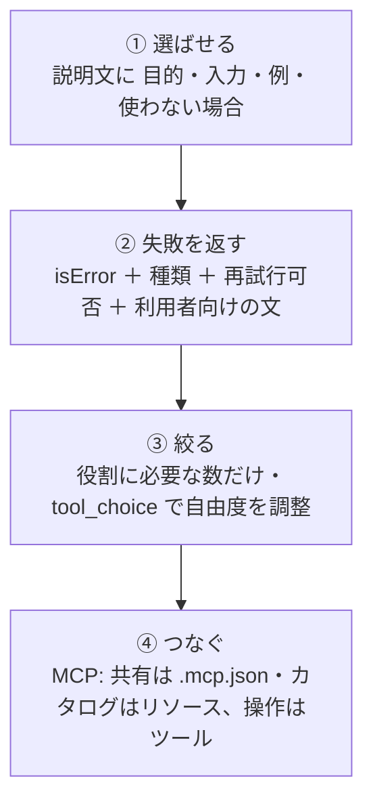
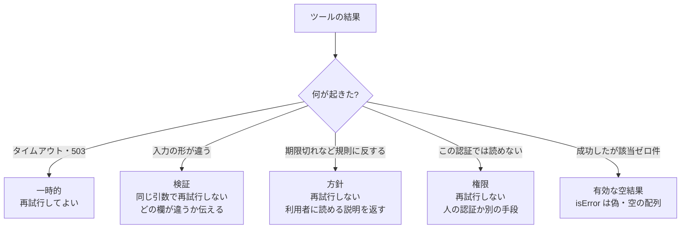
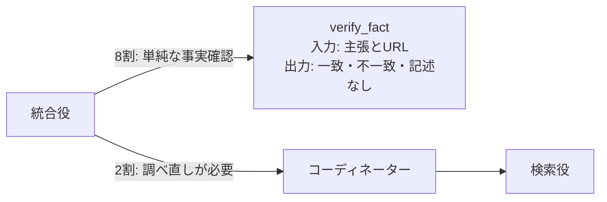
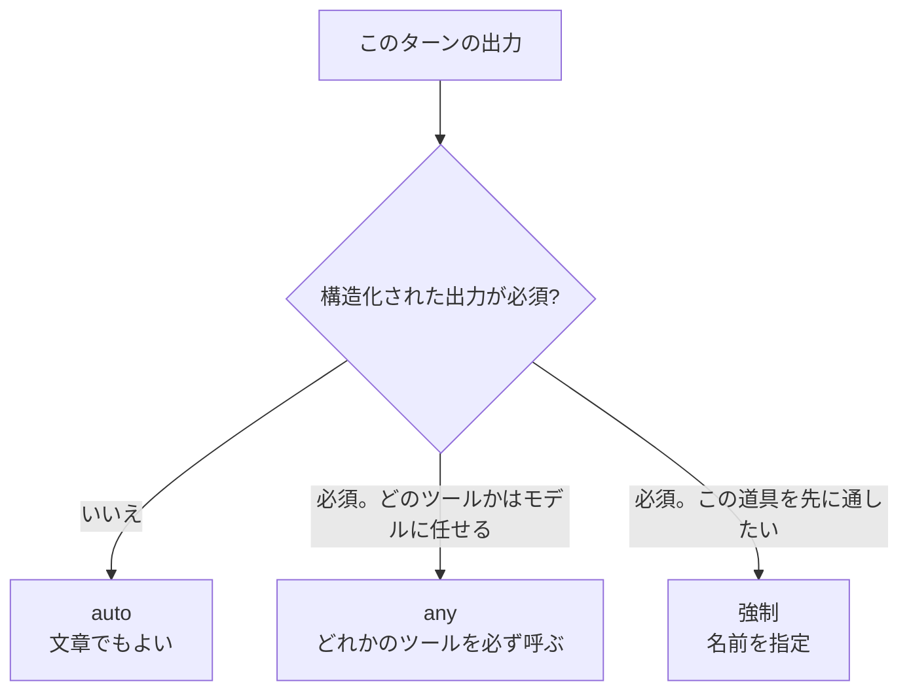
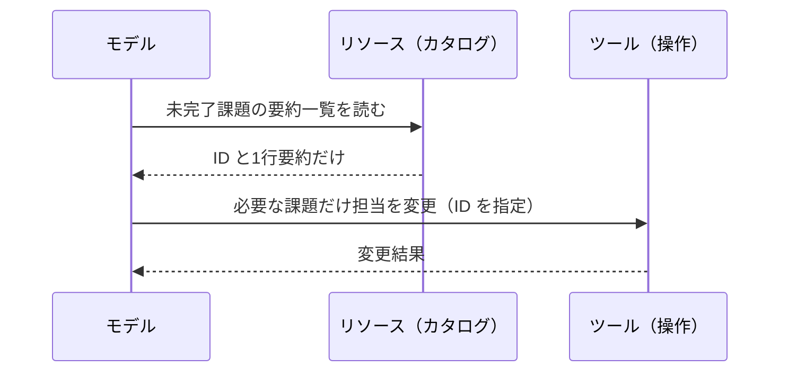
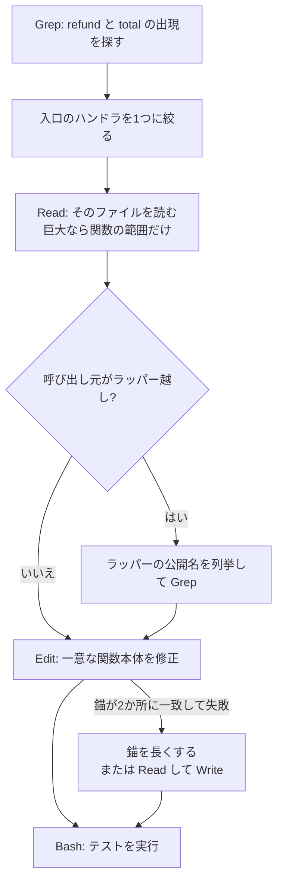

# 第2章 ツール設計とMCP統合

> [!TIP]
> **この章のたとえ：ツールは「道具箱の道具」、説明文は「道具に貼ったラベル」**
>
> モデルは道具の形（名前）ではなく、ラベル（説明文）を読んで道具を選びます。ラベルが「いろいろ使える」だけの道具が2本あれば、取り違えます。道具が壊れたときに「壊れた」としか書かれていなければ、直すべきか、待つべきか、人を呼ぶべきかも分かりません。

## 音声（4本）

| 音声 | 対応する節 |
| --- | --- |
| [a. 説明とエラー](audio/02-a-説明とエラー.mp3) | 2-1 〜 2-5 |
| [b. 配分とツールチョイス](audio/02-b-配分とツールチョイス.mp3) | 2-6 〜 2-7 |
| [c. MCPと組み込みツール](audio/02-c-MCPと組み込みツール.mp3) | 2-8 〜 2-9 |
| [d. 公式の仕様で押さえる点](audio/02-d-公式の仕様で押さえる点.mp3) | 2-10 〜 2-13 |

## この章のゴール

- モデルがツールを正しく選べる説明文を書ける。
- 失敗を、次の行動（再試行・修正・説明・人へ）が決まる形で返せる。
- ツールが多すぎる状態と、少なすぎて往復が増える状態を見分けられる。
- `tool_choice` の3つの設定を使い分けられる。
- MCPの設定を「チーム共有」と「個人の実験」で置き分け、リソースとツールを混ぜない。
- 組み込みツール（Grep・Glob・Edit・Read・Write・Bash）を取り違えない。

## 要点3つ

1. **選択の決め手は説明文。** 名前を変えるだけでは効果が薄い。目的・入力の形・使う例・使わない場合を書く。
2. **失敗は「種類」と「再試行してよいか」を付けて返す。** ゼロ件の検索は失敗ではなく「成功の空」。タイムアウトの空と区別する。
3. **持たせるツールは役割の分だけ。** よく使う狭い確認だけを例外として持たせる。

## 30秒で全体像

モデルはツール名の雰囲気ではなく、説明文を読んで選びます。失敗は「失敗しました」だけでは次の手が決まりません。種類と再試行の可否を返します。ツールを増やすほど選択は不安定になります。`tool_choice` は、文章で答えてよいか、ツールを必須にするか、名前まで固定するかをハーネスが決める設定です。チームで使うMCPはプロジェクトの `.mcp.json` に置き、秘密は環境変数で渡します。中身の検索は Grep、パスの検索は Glob、一意な部分修正は Edit です。

## 用語

| 用語 | 意味 |
| --- | --- |
| ツール説明 | 選択の決め手。目的、入力の形、使う例、端のケース、使わない場合を書く |
| `isError` | 「この結果は失敗」とモデルに伝えるフラグ |
| `errorCategory` | 失敗の種類。一時的（transient）・検証（validation）・権限（permission）・方針（policy）が典型 |
| `isRetryable` | 同じやり方で再試行してよいか（`retriable` と書くこともある） |
| 有効な空結果 | 問い合わせは成功し、該当がゼロ件だった状態 |
| `tool_choice: auto` | ツールを呼ばず、文章で答えてもよい |
| `tool_choice: any` | どれかのツールを必ず呼ぶ（どれかはモデルが選ぶ） |
| 強制ツール選択 | 名前を指定したツールを、このターンで必ず呼ぶ |
| `.mcp.json` | リポジトリでチーム共有するMCPの設定 |
| `~/.claude.json` | その人だけの実験用MCPの設定 |
| 環境変数展開 | 設定ファイルに秘密を書かず、`${GITHUB_TOKEN}` のように参照だけ書いて実行時に埋める |
| MCPリソース | 課題一覧・文書の階層・スキーマなど「何があるか」のカタログ（読むだけ） |
| MCPツール | 取得や更新など「何かをする」操作 |
| Grep | ファイルの**中身**をパターンで探す |
| Glob | ファイルの**パス**（名前・拡張子）で探す |
| Edit | ファイル内で一意な文字列を目印（錨）にして、部分だけ書き換える |
| Read / Write | ファイル全体を読む／書く |
| Bash | シェルコマンドを実行する。テスト実行などに使う。Grep や Edit の代わりにはしない |

## 本編

### 2-1 モデルが見ているのは「名前・説明・入力スキーマ」の一覧

ツールは、会話とは別に一覧でモデルに渡されます。各ツールは「名前」「説明」「入力スキーマ」の3つです。モデルはこの一覧とこれまでの会話だけを見て、次にどのツールを、どの引数で呼ぶかを決めます。ハーネスが「たぶん注文のことだろう」と補ってくれることはありません。

だから、**選択の本文は説明文**です。

| 悪い例 | 起きること |
| --- | --- |
| `get_customer`：「情報を取得する」 `lookup_order`：「詳細を取得する」 | モデルは2つを同じ道具として扱う。「A-19」のような注文番号を `get_customer` に渡してしまう |

### 2-2 説明に書く4つのこと

1. **何のためのツールか**（目的）
2. **入力の形式**（顧客IDか、注文番号か、電話番号は受けるか）
3. **どんな依頼で使うか**（例）
4. **似たツールとの境界**（使わない場合）

**例：説明を直す前と後**

依頼「A-19 のヘッドホン、まだ届いていません」

| | `lookup_order`（注文参照） | `get_customer`（顧客確認） |
| --- | --- | --- |
| 直す前 | 情報を取得する | 情報を取得する |
| 直した後 | 目的：配送状態の参照。入力：`A-` で始まる注文番号。例：「届いたか」「返金の対象か」。使わない場合：氏名だけの依頼 | 目的：本人確認。入力：顧客IDまたは電話番号。注文番号は受けない |
| 結果 | → 依頼は `lookup_order` に正しく行く | |

**名前だけ変えても効果は薄い**

`analyze_content` と `analyze_document` の説明がほぼ同じなら、名前を変えても揺れます。ウェブ抽出に限るなら、名前を `extract_web_results` にし、説明も「HTMLから本文とURLを抜き出す。PDFは受けない」に変えます。モデルは名前より説明を読むからです。

**形式は「スキーマ」と「説明」の両方に書く**

| どちらか一方だけだと | 問題 |
| --- | --- |
| スキーマだけ（注文番号は `A-数字` のパターン） | 拒否されても、モデルは**理由**が分からず、同じ文字列を別の欄に入れ替えて試す |
| 説明だけ | 実行時の検査がなく、表示名がそのままAPIまで届く |

> [!TIP]
> **一言まとめ**：形式はスキーマで守り、理由は説明で伝える。

**1つのツールに何でもさせない**

1つの `analyze_document` に要点抽出・要約・出典との照合を全部させると、呼ぶたびに返ってくる形が変わります。契約（入力と出力の約束）を分けます。

| ツール | 返すもの |
| --- | --- |
| `extract_data_points` | 項目（欄） |
| `summarize_content` | 段落 |
| `verify_claim_against_source` | 主張・抜粋・一致したか |

呼ぶ側は、ツール名を見ればどの形が返ってくるか分かります。

### 2-3 説明を直しても選択が揺れるとき

**① システムプロンプトのキーワードを疑う**

システムプロンプトに「『分析』という言葉が出たら analyze_document を使え」のような行が残っていると、説明で引いた境界が負けます。モデルは説明と常時の指示の両方を見るからです。直す順序は「キーワードの行を消す → 説明の境界を残す → 効果を測り直す」です。

**② 入力スキーマが両方とも自由文字列になっていないか**

スキーマを分ければ（注文番号は `A-数字`、顧客IDは `C-数字`）、形が違う依頼はスキーマの段階で弾かれます。

**後回しにすること**

| 手段 | なぜ後回しか |
| --- | --- |
| 具体例を10件足す | トークンを使う。説明が短いままなら、新しい言い回しで同じ取り違えが起きる |
| 発話を正規表現で振り分ける前処理 | 「返して」が返金か返却か、のような文脈の差を捨ててしまう |
| 2つのツールをすぐ1つに統合する | 入力の約束が曖昧なまま内部の分岐に隠れ、失敗の理由も混ざる。説明を直したうえで「本当に契約が1つだ」と分かってから統合する |

### 2-4 失敗は、次の行動が分かれる形で返す

`isError` が立っていない結果を、モデルは成功として読みます。本文に「失敗」と書いてあっても、フラグがなければ成功の文として扱われることがあります。**失敗はフラグと構造の両方で伝えます。**

種類を分ける理由は、**次の手が違う**からです。

| 種類 | `isError` | `isRetryable` | 利用者向けの文の例 |
| --- | --- | --- | --- |
| 一時的 | 真 | 真 | 「注文サービスが応答しませんでした。少しあとで同じ番号でもう一度確認できます」 |
| 検証 | 真 | 偽 | 「`order_id` は A- で始まる番号です。渡されたのは表示名です」 |
| 方針 | 真 | 偽 | 「配送から14日を過ぎているため、このツールでは返金できません。例外が必要なら人に伝えてください」 |
| 権限 | 真 | 偽 | 「この認証では他の人の注文は読めません」 |
| ゼロ件（成功） | **偽** | — | （空の配列を返す） |

> [!WARNING]
> **一律の "Operation failed" はダメ。** 4つの失敗が同じに見え、モデルは再試行するか・謝るか・人に渡すかを選べません。再試行を選べば、権限エラーを10回繰り返します。

**ゼロ件とタイムアウトを、同じ空 `[]` にしない**

- ゼロ件を `isError` にすると → モデルはクエリを変えて延々と再試行します。
- タイムアウトもゼロ件も `[]` にすると → 後の段は「記事が無かった（調査の結論）」と「取りに行けなかった（穴）」を区別できません。

**利用者向けの文と、開発者向けの詳細は欄を分ける**

利用者向けの欄にスタックトレースを入れると、モデルはそのトレースを利用者に話し始めます。モデルには利用者向けの文だけを渡し、詳細はログにだけ残します。

### 2-5 一時的な失敗はサブエージェントの中で直し、だめなら構造で親へ

サブエージェントは、一時的な失敗だけを自分の中で、少ない回数（例：3回）まで再試行します。それでも直らなければ、4回目の判断をモデルに任せず、次の情報を付けて親へ返します。

- 失敗の種類
- 試したクエリ
- 取れた部分結果

| やってはいけない返し方 | 問題 |
| --- | --- |
| 「検索を利用できません」の一文だけ | 親がクエリを変える材料がない |
| 空を「成功」として返す | 失敗が消える |
| 1回のタイムアウトで調査全体を終える | 取れていた部分まで捨てる |
| 再試行の判断をモデルに任せる | 同じタイムアウトを会話のターンで繰り返す |

### 2-6 ツールの数：減らす、ただし例外は認める

**多すぎると選択が揺れる**

ツールが18個あるエージェントは、説明を読んでもなお、似た2つの間で迷います。4〜5個で足りる役割に18個渡すと、無関係な説明が毎回ノイズになります。統合役にウェブ検索を持たせると、統合の途中で探索を始め、返すべき構造を書かなくなります。

**基本は「その役割のツールだけ」。例外は「よく使う、狭い確認」**

統合の確認の8割が「この日付と固有名詞は出典と一致するか」だけなら、統合役に `verify_fact` を持たせます。

検索ツール一式を統合役に渡してしまうと、例外が役割そのものになります。

**できることを減らすと、選択が安定する**

任意のURLを取りに行く汎用の `fetch_url` より、文書専用の `load_document` にして、許可したホスト以外は検証エラーにします。

**「数を減らす」と「1つに潰す」は違う**

18個を4〜5個に減らすのは、無関係な説明を候補から外すためです。一方、残った2つの説明が両方「文書を分析する」なら、先に契約（返す形）を分けます。契約が本当に1つだと分かってから統合します。

### 2-7 `tool_choice`：モデルの自由度をハーネスが調整する

制約がないと、モデルはツールを呼ばずに文章で答えることがあります。抽出の仕事では、その文章は機械が読めません。

| 設定 | 文章で答える | どのツールか選ぶ | 使う場面 |
| --- | --- | --- | --- |
| `auto` | 許す | 許す | 普通の対話。方針の説明を文章で返してよいとき |
| `any` | 許さない | 許す | 文書が請求書か納品書か不明で、スキーマが2つあるとき |
| 強制 | 許さない | 許さない | 最初に必ず `extract_metadata` を通したいとき |

> [!WARNING]
> 抽出なのに `auto` のままだと、モデルは表を文章で書き、パーサが失敗します。

**強制は「先頭の1段」だけ。成功したら自由度を戻す**

例：文書を渡して、まずメタデータを取り、次に種類に応じた抽出をする仕事。

| ターン | `tool_choice` | 動き |
| --- | --- | --- |
| 1 | 強制（`extract_metadata`） | メタデータを抽出 |
| 2 | `any`（1の結果がスキーマを通ったら戻す） | 結果を見て、モデルが請求書用か納品書用の抽出ツールを選ぶ |

- 強制のままにすると、モデルは毎ターン同じツールしか呼べず、次の工程に進めません。
- 強制を外す条件は「1回呼んだ」ではなく「**成功した**」です。「呼んだ」で外すと、メタデータが検証エラーでも次へ進んでしまいます。失敗したなら強制を維持して取り直すか、検証エラーを返して引数を直させます。
- 強制を常に使うと、モデル主導の利点が消えます。

### 2-8 MCPの置き場所と、リソースとツールの境界

**どこに書くか**

| 用途 | 置き場所 | 注意 |
| --- | --- | --- |
| チーム全員が使うサーバー（課題管理など） | **プロジェクト**スコープ：リポジトリのルートの `.mcp.json` | トークンの値は書かない。`${GITHUB_TOKEN}` のように環境変数の参照だけを書き、値は各自の環境に置く |
| 個人の実験・まだ配りたくないサーバー（このプロジェクトだけ） | **ローカル**スコープ（既定）：`~/.claude.json` の中の、そのプロジェクトのパスの下 | 本人だけが、そのプロジェクトでだけ使える |
| 自分のすべてのプロジェクトで使うサーバー | **ユーザー**スコープ：`~/.claude.json` | 本人専用。個人の指示ファイル `~/.claude/CLAUDE.md` と同じ場所ではない。`~/.claude/` に `.mcp.json` を置いても、個人用としては読まれない |

> [!WARNING]
> 接続すると、設定済みの**全サーバーのツールが同時に**候補に並びます。実験用の書き込みツールを個人設定に残したまま共有リポジトリを開くと、そのツールも選ばれる候補に入ります。実験が終わったら個人設定から外します。

標準的な課題管理のように広く使われているサーバーがあるなら、自作より既存のものを使います。自作するのは、社内の権限体系やチーム独自の操作が必要なときです。

**説明が薄いMCPツールは、高機能でも Grep に負けます。** モデルは使い方が想像できるほうを呼ぶからです。「課題を検索する」ではなく、「未完了の課題を、更新日・担当・要約の3欄で返す。本文全文は返さない」と書きます。

**リソース＝何があるか、ツール＝何をするか**

| 取り違え | 起きること |
| --- | --- |
| カタログをツールにする（毎回検索させる） | 同じ一覧が履歴に何度も積み上がる。探索が増える |
| 操作をリソースにする | 読むだけで副作用が起きたように見える |

リソースがないサーバーでは、ツールの説明に「1回目は要約だけ返す。本文はIDを指定した2回目で返す」と書き、戻り値の側で本文を削ります。削るのは**履歴に足す前**です。モデルに読ませてから要約させても、全文はもうコンテキストを使っています。

### 2-9 組み込みツールの選び方

| 知りたいこと・やりたいこと | 選ぶ | 選ばない |
| --- | --- | --- |
| 関数名、エラー文字列、import の出現場所 | **Grep** | 全ファイルの Read、Bash での走査 |
| `**/*.test.tsx` のようなパスの一覧 | **Glob** | Grep（中身は要らないので無駄） |
| ファイル全体を把握する／全体を書き換える | **Read / Write** | 巨大ファイルをいきなり全部 Read |
| 一意な箇所だけ書き換える | **Edit** | 一意でない錨での Edit |
| Edit の錨が2か所に一致して失敗した | 錨を長くして Edit、または **Read してから Write** | 錨を変えずに Edit を繰り返す／Bash の sed |
| テストを実行する | **Bash** | （Grep が使える構成なら）Grep の代わりに Bash で grep |

> [!NOTE]
> Claude Code の構成によっては、Glob・Grep が組み込みツールとして使えず、Bash の `find`・`grep` で同じことをします。考え方（名前で探すか、中身で探すか）は同じです。

**例：「返金の合計が明細と一致しない」バグを調べる**

1. 最初に全ファイルを Read しません。Grep で入口を探します。パスの一覧が欲しいだけなら Glob です（Glob では中身の文字列は探せません）。
2. ラッパー越しに呼ばれているなら、ラッパーが公開している名前を先に列挙し、その名前で Grep します。内部の実装名だけを探すと、公開名経由の呼び出しを見落とします。
3. 修正は Edit です。`return item.total` がファイルに2回あると、Edit は「どちらを変えるか決められない」ので失敗します。次の手は、錨を関数名まで含めて長くするか、Read してから Write です。

> [!WARNING]
> ハーネスが Edit の失敗を握りつぶして「編集しました」と返すと、モデルは変わっていないファイルを「変更済み」として話を進めます。失敗は失敗として返します。
> また、Bash の sed で置き換えるのは、一意かどうかの検査を自分で捨てることになるので、Edit の代わりになりません。

### 2-10 MCP のエラーは2種類ある

MCP のツールのエラー報告には、性質の違う2種類があります。

| 種類 | 使う場面 | 返し方 | モデルに届くか |
| --- | --- | --- | --- |
| プロトコルエラー | 存在しないツールの呼び出し、`CallToolRequest` のスキーマを満たさない不正な要求、サーバー自体のエラー | JSON-RPC のエラー | 届かないことがある |
| ツール実行エラー | ツールが動いたあとに分かる失敗。外部 API の失敗（503 も 404 も）、入力値の検証エラー、業務ロジックのエラー | `content` に内容を書き、`isError: true` を付けたツール結果 | クライアントはモデルに渡す**べき**（SHOULD）とされている |

ツールの中で API を呼んで失敗したなら、それは**ツール実行エラー**です。ツール結果として返せば、モデルはその内容を読んで、入力を直す・再試行する・利用者に確認するといった対処を選べます。ツールが例外を投げるだけでは、何が起きたのかがモデルに届きません。

> [!WARNING]
> 進捗通知（`progressToken` が付いた要求への途中経過）や `_meta`（やり取りに追加情報を付けるための予約項目）は、モデルに渡す内容を入れる場所ではありません。

**構造化したツール結果**

ツール結果を、値ごとに名前の付いた欄を持つ形で返すと、モデルは必要な値を欄から直接取り出せます。文章で返すと、どの数字が何を表すかを読み取る必要があり、取り違えが起きます。MCP のツールは `structuredContent` で構造化した結果を返せ、`outputSchema` を定義すると型の情報も伝えられます。ただし、JSON で返してもモデルの処理が決定的になるわけではありません。効果は「値の取り出しが確実になる」ことです。

### 2-11 ツール設計の原則（公式の指針から）

| 原則 | 内容 |
| --- | --- |
| 説明がいちばん効く | 何をするか、いつ使うか（使わないか）、各引数の意味、注意点と制限を詳しく書く。必須の値が抜けるような無効な呼び出しは、たいてい説明が足りないサイン |
| 手元の情報で呼べる入力にする | エージェントが利用者の知らない値（郵便番号など）を求められると、その値を得るために別のツールを先に呼ぶことになる。手元の情報で呼べるように設計する |
| 決まった連鎖はまとめる | 空き時間の確認 → 予定の作成のように、毎回同じ順で呼ぶ API の連鎖は1つのツールにまとめる。ただし**判断が必要な手順**までまとめると、その判断が固定のルールに置き換わってしまう |
| 目的を重ねない | 各ツールは明確で互いに重ならない目的を持つ。何でも処理する汎用ツールに自由記述の指示を渡すと、結果の形がぶれる |
| まとめるか分けるか | 必要な引数が同じ操作は、`action` のような引数で選ぶ1つのツールにまとめると選択の迷いが減る。必要な引数が大きく違う操作は、分けたほうが引数の誤りが減る |
| 応答は次の判断に必要な分だけ | 回数を減らすために何でもまとめて返すと、不要な情報が会話に積まれる |

**スキーマが守れること・守れないこと**

`enum` は取れる値を列挙した候補に限り、`strict: true` は生成される引数をスキーマに厳密に従わせます。どちらもスキーマに**書かれた**制約を守らせるだけで、「この操作のときはこの引数が必須」のような条件までは守らせません。条件で必須の引数が変わるなら、操作ごとのツールに分けます。

**判定はツール側で確定させる**

ツールが生の確信度（0.62 など）だけを返すと、その解釈はモデルに任され、呼び出しごとに揺れます。ラベル付きのデータで決めたしきい値をツールのコードで適用し、`ok` や `review` のような**状態の値**と、どの欄がどの理由でそうなったかを返すと、判定が毎回同じになります。

**成否が分からない操作**

請求や通知の送信のように、2回実行すると2回分の結果が残る操作がタイムアウトしたときは、「失敗した」とも「再試行してよい」とも言えません。結果が不明であること自体を返し、再実行しないよう促します。

**有効な空の結果は、成功の印と分けて返す**

空の配列だけを返すと、「該当なし」なのか「取得できなかった」のかがモデルには分かりません。成功を示す値と結果の配列を分けて返すと、「検索は成功し、該当は0件」という意味が構造から読み取れます。条件で探して0件だったのは成功の結果で、ID を指定した照会で対象が存在しない場合とは区別します。

### 2-12 MCP の3つの構成要素と、Claude Code での使い方

| 構成要素 | 何か | 誰が使うか | Claude Code での使い方 |
| --- | --- | --- | --- |
| ツール | 処理を行う操作 | モデルが作業に応じて自分で呼ぶ | 名前は `mcp__<サーバー名>__<ツール名>` |
| リソース | ファイルの内容、DB のスキーマ、API の文書などの読み取り専用データ。一意の URI を持ち、`resources/list` やテンプレートで発見できる | アプリケーションが制御する | `@` メンションで参照すると、自動で取得されて添付される |
| プロンプト | 指示のテンプレート | 利用者が選んで実行する | `/` の一覧に `/サーバー名:プロンプト名 (MCP)` と表示される。`/mcp__サーバー名__プロンプト名` でも実行でき、引数は空白区切りで渡す |

- エージェントは `tools/list` でサーバーのツールを発見します。Agent SDK の `mcpServers` に複数のサーバーを書くと、すべてに接続して全ツールが使えるようになります。
- MCP のツールが多いときは、ツール検索（tool search）が既定で働き、ツールの定義を必要なときに読み込みます。読み込む時期の工夫で、使えるサーバーを1つに絞る仕組みではありません。
- プロジェクトの `.mcp.json` のサーバーは、対話セッションでは使う前に承認を求められます。`claude -p` などの非対話の実行では、この確認は出ません。
- `allowedTools` で MCP のツールを指定するときも `mcp__<サーバー名>__<ツール名>` の形で書きます。これは実行の許可（自動承認）を決める設定で、どのツールを選ぶかを導くものではありません。
- MCP サーバーの動作確認には MCP Inspector（`uv run mcp dev mcp_server.py`）を使い、ツール、静的リソース（`Resources`）、テンプレート付きリソース（`Resource Templates`、例：`docs://documents/{doc_id}`）、プロンプトを単体で検証できます。接続方式（トランスポート）はローカルの標準入出力（`stdio`）とリモートの HTTP/SSE があります。

### 2-13 組み込みツールの細部

| ツール | 押さえる点 |
| --- | --- |
| Grep | ripgrep がもとで正規表現が使える。括弧などの記号を文字として探すときはエスケープが必要。既定の出力は一致した**ファイルのパス**（files_with_matches）で、出力モードを変えると一致した行も返す |
| Glob | `**/*.py` のような名前やパスのパターンで探す。中身は見ない |
| Edit | `old_string` を `new_string` に置き換える完全一致の置換。`old_string` はファイルの中に1回だけ現れる必要がある。`replace_all` を指定すると一致したすべてを置き換える |
| Write | 渡した全文で新しいファイルを作るか、既存のファイルを**上書き**する。追記やマージはしない。既存の内容を残すには、Read した全文に変更を加えて渡す |
| `find`（Bash） | 条件に合うファイルやディレクトリを探すコマンド。`-type d` でディレクトリだけを探す |

**探し方のコツ**

- **固有の文字列で探す**：`QUOTA_LOCKED` のようなエラーコードやメッセージの文言は、発生元のコードにそのまま書かれていることが多く、入口探しの最初の一手に向きます。`raise` のような一般的な語は一致が多すぎて絞り込みになりません。
- **別名に注意**：読み込み側のモジュールが値を別の名前で公開していると（`legacy_timeout_ms` を `requestDeadline` として公開など）、利用側には元の名前が現れません。公開されている名前でも探します。
- **基底クラスから読む**：継承を使った設計では、import と継承関係を手がかりに基底クラスを先に読むと、全体の骨組みが分かります。そのあと目的に関係する実装だけを読みます。
- **インポート文を探す**：どのモジュールがどこから使われているかは、全ファイルを Read しなくても、Grep でインポート文を探せば短時間でつかめます。依存関係のファイル（`requirements.txt` など）からは、使っているサービスは分かっても、呼び出している行は分かりません。

## まとめ：どう判断するか

| 状況 | 判断 |
| --- | --- |
| 似たツールを取り違える | 説明に入力・例・端のケース・使わない場合を書く。システムプロンプトのキーワードが説明に勝っていないか見る。例の大量追加・正規表現の前処理・早すぎる統合は後回し |
| 失敗をどう返すか | `isError`＋種類＋再試行可否＋利用者向けの文。ゼロ件の成功とタイムアウトを同じ空にしない |
| サブエージェントでの失敗 | 一時的なものは子の中で短く再試行。直らなければ試した内容と部分結果を付けて親へ。空の成功にも、全体停止にもしない |
| ツールの数 | 役割外のツールは持たせない。よく使う狭い確認だけ例外で持たせる |
| `tool_choice` | `auto`＝文章も可、`any`＝どれかのツール必須、強制＝名前を固定（先頭の1段だけ、成功したら戻す） |
| MCPの置き場所 | チーム共有はプロジェクトスコープ（`.mcp.json`＋環境変数）。自分だけはローカル（既定）かユーザースコープ（どちらも `~/.claude.json`）。カタログはリソース、操作はツール、テンプレートはプロンプト。標準的な連携は既存サーバー |
| MCP のエラー | ツールが動いたあとの失敗は `isError: true` のツール実行エラー。プロトコルエラーは不明なツールや不正な要求用 |
| ツールの設計 | 手元の情報で呼べる入力、機械的な連鎖はまとめ、判断は残す。判定はツール側で状態の値として確定させる |
| 組み込みツール | 中身は Grep、パスは Glob、一意な部分修正は Edit、だめなら Read して Write。入口探しは Grep から |

## 確認問題

### 問1

「在庫を見る」ツールと「出荷を止める」ツールの説明が、どちらも「在庫を扱う」です。参照のつもりが停止を呼んでしまいます。最初の一手はどれですか。

A. 各説明に、入力の形、使う例、呼んではいけない場合を書く  
B. 正しい選択の会話例を20件足す  
C. 発話の名詞でツールを決める前処理を先に作る  
D. すぐに1つの万能ツールへ統合する

解答

**A**。選択の決め手は説明文です。例・前処理・統合は、説明で境界を引いたあとに、まだ必要だと分かってからで十分です。

### 問2

検索がタイムアウトしたときと、条件に合う記事がゼロ件のときを、どちらも空の配列で返しています。どう分けますか。

A. 両方を `end_turn` にする  
B. タイムアウトは失敗の構造で、ゼロ件は成功の空として返す  
C. 両方を再試行不可の権限エラーにする  
D. 説明文を空にする

解答

**B**。成功したゼロ件は失敗ではなく、再試行の対象でもありません。タイムアウトは「取りに行けなかった」という穴なので、失敗として返します。

### 問3

統合のたびに、単純な日付確認のためだけにコーディネーター経由で検索役を呼び、往復が増えています。確認の大半は単純で、一部だけ追加調査が必要です。どう持たせますか。

A. 統合役に、主張とURLだけを受け取る確認ツールを持たせ、深い調査はコーディネーター経由のままにする  
B. 統合役に検索ツールを全部渡す  
C. 検索役に、使われそうな情報を先に全部取らせる  
D. 統合役のツールをゼロにし、すべての確認を人へ渡す

解答

**A**。Bは統合役が探索を始めてしまいます。Cは何を確認されるか事前に分からないので、取り切れません。

### 問4

チーム全員が同じ課題管理のMCPを使います。トークンはリポジトリに残したくありません。どこに書きますか。

A. プロジェクトの `.mcp.json` に、環境変数の参照だけを書く  
B. 各自の `~/.claude/CLAUDE.md` にトークンを書く  
C. スラッシュコマンドの本文にトークンを書く  
D. 個人の `~/.claude.json` だけに書き、共有しない

解答

**A**。指示ファイル（B）は秘密を配る場所ではありません。個人設定（D）は実験用で、「全員が同じツールを使う」という要件を満たしません。

### 問5

ある関数の呼び出し元を、リポジトリ全体から探します。最初に使うツールはどれですか。

A. Glob  
B. Grep  
C. 全ファイルの Read  
D. 錨が一意でない Edit

解答

**B**。Glob はパスで探す道具、Edit は部分修正の道具です。全ファイルの Read は、入口の探し方として広すぎます。

### 問6

MCP サーバーのツールが外部の在庫 API を呼んだところ、503 が返りました。モデルが再試行や利用者への説明を判断できるようにするには、どう返しますか。

A. JSON-RPC のプロトコルエラーとして返す  
B. `content` に失敗の内容を書き、`isError: true` を付けたツール結果として返す  
C. 進捗通知で失敗を知らせ、ツール結果は空にする  
D. `_meta` に失敗の詳細を入れ、ツール結果は成功として返す

解答

**B**。ツールが動いたあとに分かる失敗（外部 API の 503 や 404、入力の検証エラー、業務ロジックのエラー）はツール実行エラーです。クライアントはこれをモデルに渡すべきとされ、モデルは内容を読んで対処を選べます。プロトコルエラーは存在しないツールや不正な要求のためのものです。進捗通知や `_meta` は、モデルに渡す内容を入れる場所ではありません。

### 問7

予定を入れるエージェントが、毎回「空き時間の確認」→「予定の作成」の順に2つのツールを呼んでいます。どちらの呼び出しにもモデルの判断は要りません。呼び出しの回数を減らすのに最も適切な設計はどれですか。

A. 2つの API 呼び出しを1つのツールにまとめる  
B. 両方のツールの説明に「必ず続けて呼ぶ」と書く  
C. `tool_choice` を毎回 `any` にする  
D. 2つのツールの結果をプロンプトキャッシュに入れる

解答

**A**。毎回同じ順で連鎖する機械的な処理は、1つのツールにまとめると呼び出しが減ります。判断が必要な手順まではまとめません。B は回数を減らしません。C はツールを必ず呼ばせる設定で、回数とは関係ありません。D は処理の再利用の仕組みで、呼び出しの回数は変わりません。

### 問8

チームで共有せず、自分がこのプロジェクトで試すときだけ使いたい MCP サーバーがあります。Claude Code の既定のスコープで追加すると、設定はどこに保存されますか。

A. リポジトリのルートの `.mcp.json`  
B. `~/.claude.json` の中の、このプロジェクトのパスの下  
C. `~/.claude/CLAUDE.md`  
D. `.claude/rules/` のファイル

解答

**B**。既定のローカルスコープは、追加したプロジェクトでだけ読み込まれ、本人だけが使えます。保存先は `~/.claude.json` のそのプロジェクトのパスの下です。A はチームで共有するプロジェクトスコープ、C と D は指示を書くファイルです。

## 自分で確かめる

1. 用途が近いツールを2つ作り、説明が1文だけの状態と、入力例と「使わない場合」を書いた状態で、同じ曖昧な依頼を10回ずつ投げます。選択がどちらに寄るか数えてください。
2. タイムアウトとゼロ件を同じ空で返す版と、フラグで分けた版で、モデルが再試行する回数を比べます。
3. 統合役に検索ツールを全部渡した版と、`verify_fact` だけ渡した版で、無関係な探索が始まるかを観察します。
