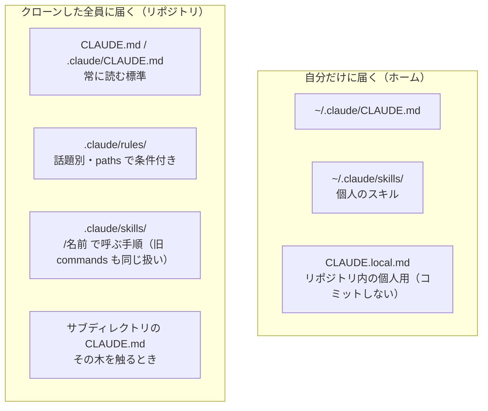
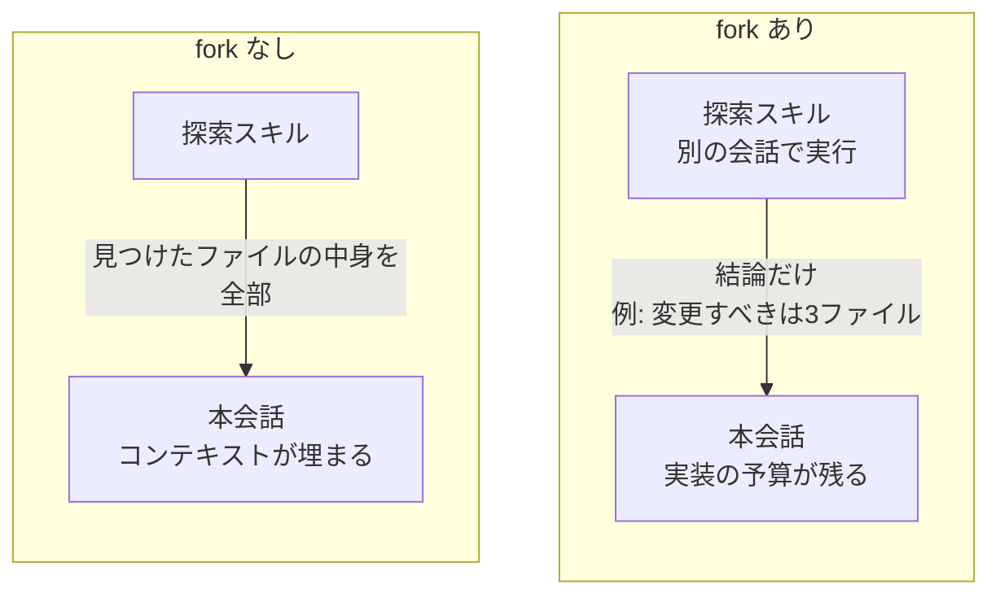
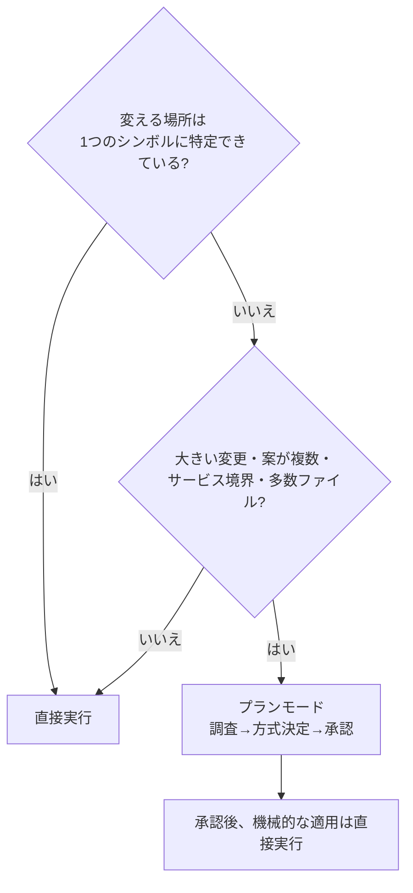
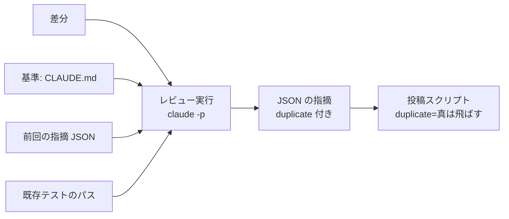
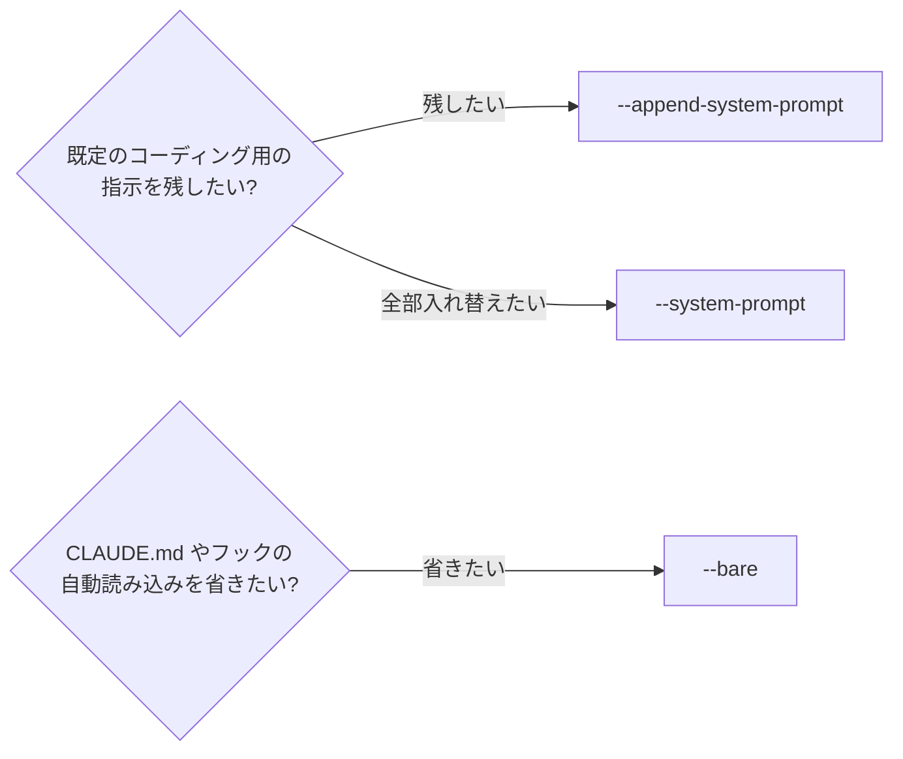

# 第3章 Claude Codeの設定とワークフロー

> [!TIP]
> **この章のたとえ：設定ファイルは「掲示物」**
>
> 自分の机に貼ったメモ（ホームの設定）は、自分にしか見えません。職場の掲示板（リポジトリの設定）に貼れば全員に見えます。テスト担当の部屋にだけ貼りたい注意書きは、その部屋のドアに貼ります（パスの glob）。「誰に」「いつ」読ませたいかで、貼る場所が決まります。

## 音声（4本）

| 音声 | 対応する節 |
| --- | --- |
| [a. 設定の置き場所](audio/03-a-設定の置き場所.mp3) | 3-1 〜 3-6 |
| [b. プランと反復](audio/03-b-プランと反復.mp3) | 3-7 〜 3-8 |
| [c. 継続的インテグレーション](audio/03-c-継続的インテグレーション.mp3) | 3-9 |
| [d. 公式の仕様で押さえる点](audio/03-d-公式の仕様で押さえる点.mp3) | 3-10 〜 3-13 |

## この章のゴール

- 指示・コマンド・スキル・パスごとの規約を、届けたい人に、届けたいときだけ届く場所に置ける。
- 大きな変更は調査と設計を先に、小さく分かっている修正はすぐに、と進め方を選べる。
- 文章だとぶれる変換を、入出力の例とテストで狭められる。
- CI パイプラインで、入力待ちで止まらず、機械が読める指摘を、前回と重複させずに出せる。

## 要点3つ

1. **置き場所は「誰に届くか」で決まる。** ホーム（`~/.claude/`）は自分だけ、リポジトリ（`.claude/` やルート）は全員。散らばったファイル種別への規約は `.claude/rules/` の `paths`。
2. **大きく・案が複数・多数ファイルならプランモード。** 変える場所が1つに特定できているなら直接実行。
3. **パイプラインは `-p` で非対話。** 出力は JSON とスキーマで固定し、書いた会話とは別の実行でレビューする。

## 30秒で全体像



`CLAUDE.md` には利用者・プロジェクト・ディレクトリの3層があります。共有したい指示はリポジトリ側に置きます。散らばったファイルに規約を自動で載せるのは `.claude/rules/` の glob です。常に読んでほしい標準は `CLAUDE.md`、必要なときだけ呼ぶ手順や全員が `/名前` で呼ぶ手順はスキル（`.claude/skills/`）です。大きな変更はプランモード、範囲が見えている修正は直接実行。パイプラインは `-p` で非対話にし、出力の形を JSON スキーマで固定します。

## 用語

| 置き場所 | 誰に届くか | 中身 |
| --- | --- | --- |
| `~/.claude/CLAUDE.md` | その利用者だけ | 個人の指示。クローンしても配られない |
| `.claude/CLAUDE.md` またはルートの `CLAUDE.md` | リポジトリの全員 | プロジェクトの指示 |
| サブディレクトリの `CLAUDE.md` | その木の中を触るとき | ディレクトリに紐づく指示 |
| `.claude/rules/` | リポジトリの全員 | 話題別のルール。`paths` を付けると条件付きで読み込む |
| `CLAUDE.local.md` | その利用者だけ（リポジトリ内だがコミットしない） | 個人用のプロジェクトの指示 |
| `.claude/skills/<名前>/SKILL.md` | クローンした全員 | `/名前` で呼べる手順。必要なときだけ読まれる |
| `~/.claude/skills/<名前>/SKILL.md` | その利用者だけ | 個人のスキル。共有スキルを書き換えずに作る変種もここ |
| `.claude/commands/` | （旧来の場所） | 以前のカスタムのスラッシュコマンド。今はスキルと同じ仕組みとして扱われる |
| `.claude/agents/` | クローンした全員 | サブエージェントの定義 |

| フロントマターの項目 | 意味 |
| --- | --- |
| `context: fork` | スキルを別の会話で実行し、本会話には結論だけ戻す |
| `allowed-tools` | スキルの実行中だけ、使えるツールを絞る |
| `argument-hint` | 引数なしで呼ばれたとき、必要な引数を利用者に尋ねるヒント |
| `paths`（ルール側） | 一致するファイルを編集するときだけ、そのルールを読み込む glob |

> [!WARNING]
> **綴りの似た別物に注意**：エージェントSDKの `allowedTools`（ハイフンなし）は、列挙したツールを承認なしで実行させる設定（使えるツールを絞る設定ではない）。スキルの `allowed-tools`（ハイフンあり）は、スキル実行中に使うツールを指定する設定。別の仕組みです。

## 本編

### 3-1 置き場所は「誰が、いつ読むか」で決める

例として「テストの失敗メッセージには、期待値と実際の値を書く」という規約を、どこに置くか考えます。

| こうしたい | 置き場所 | 注意点 |
| --- | --- | --- |
| 自分の機械で、どのリポジトリでも効かせたい | `~/.claude/CLAUDE.md` | 隣の人のクローンには届かない |
| クローンした全員に、毎ターン効かせたい | ルートの `CLAUDE.md` か `.claude/CLAUDE.md` | |
| `src/api/` の中だけで効かせたい | `src/api/CLAUDE.md` | |
| テストファイルを編集したときだけ効かせたい（テストはあちこちに散らばっている） | `.claude/rules/testing.md` に `paths: "**/*.test.tsx"` | 3-4 を参照 |
| 全員が `/review` で呼べるようにしたい | `.claude/skills/review/SKILL.md`（旧来の `.claude/commands/review.md` も動く） | `CLAUDE.md` に手順を書いてもコマンドにはならない |
| 自分だけ、このリポジトリで効かせたい | `CLAUDE.local.md` | バージョン管理に含めない |
| 呼んだときだけ読む長い手順にしたい | `.claude/skills/〇〇/SKILL.md` | 常に守らせたい規約をスキルに入れると、呼び忘れたターンに消える |

**共有したい最小構成の例**

```text
リポジトリ/
├── CLAUDE.md                     … 言語・テスト実行コマンド・指摘しないスタイルだけ
├── .mcp.json                     … MCP（秘密は環境変数の参照だけ）
└── .claude/
    ├── rules/
    │   ├── testing.md            … paths: テストの拡張子
    │   └── api.md                … paths: src/api/**
    ├── agents/
    │   └── reviewer.md           … サブエージェントの定義
    └── skills/
        ├── review/SKILL.md       … 全員の /review
        └── migrate/SKILL.md      … ライブラリ移行の手順（context: fork、読み取り中心の allowed-tools）
```

### 3-2 指示が同僚に届かないときは、層を疑う

「新しく入った人だけ規約を守らない」なら、指示がホーム（`~/.claude/CLAUDE.md`）に置かれている可能性が高いです。そのファイルは本人の機械にしかありません。

推測で決めず、**`/context` を実行し、Memory files の一覧に、読み込まれるはずの `CLAUDE.md` が入っているかを確認します。** 一覧になければ、その規約はモデルに届いていません。

> [!NOTE]
> `/memory` は、メモリファイル（`CLAUDE.md` や `CLAUDE.local.md` など）の場所を一覧し、選んだファイルをエディタで開くコマンドです。**実際に読み込まれたか**の確認は `/context` で行います。（※なお、公式 Exam Guide v0.2 の Task Statement 3.1 では、読み込まれたメモリファイルの確認コマンドとして `/memory` が挙げられているため、試験問題では文脈に合わせて押さえておいてください。）

| `/context` の様子 | 原因 | 対処 |
| --- | --- | --- |
| ホームのファイルだけで、プロジェクトのファイルがない | 起動したディレクトリがリポジトリのルートではなく、ルートの `CLAUDE.md` が探索範囲の外 | ルートで起動し直す |
| 両方あり、指摘が人によって違う | ホーム側の文が勝っている | 共有したい文はプロジェクトへ移し、ホームからは消す |
| テスト編集中にテストのルールがなく、実装編集中にある | `paths` の glob が逆 | glob を直す |
| 個人の `review` だけが走る | ホームのスキル（または旧 commands）に同じ名前がある | 個人側を外す |

> [!TIP]
> チームで再現しない不具合は、まず個人の `CLAUDE.md`・`CLAUDE.local.md`・スキルを空にしてから再現を試します。

### 3-3 巨大な1枚の `CLAUDE.md` は分ける

1枚に全部を書くと、関係のない節まで毎ターンのコンテキストに入ります。分け方は2つです。

1. **`@import`**：各パッケージの `CLAUDE.md` から、そのパッケージに必要な標準ファイルだけを取り込む。全員に全標準を読ませない。
2. **`.claude/rules/` に話題別ファイル**（テスト、API、デプロイ）を置く。常に必要なら条件なし、特定のファイル種別だけなら `paths` を付ける。

### 3-4 `paths` の glob は「編集したときだけ」規約を載せる

`.claude/rules/` のファイルのフロントマターに `paths` を書きます。

| glob | 読み込まれるとき |
| --- | --- |
| `terraform/**/*` | terraform の下を編集するとき |
| `**/*.test.tsx` | 場所を問わず、テストファイルを編集するとき |

一致しないファイルを編集しているターンでは、その規約のトークンを払いません。

**ほかの方法がダメな理由**

| 方法 | 問題 |
| --- | --- |
| ルートの `CLAUDE.md` に全規約を書き「該当の節を選べ」と頼む | 選ぶのはモデルの推測。実装用の節をテストに当てはめることがある |
| 規約をスキルに入れる | 自動ではなく、呼ばれるまで効かない |
| テストのあるディレクトリごとに `CLAUDE.md` を複製する | 1つ直すと残りが古くなる |

> [!TIP]
> **一言まとめ**：「自動で」かつ「編集したときだけ」を満たすのは `paths` だけ。

### 3-5 常時指示・コマンド・スキルは寿命が違う

| 仕組み | いつ効くか | 向いているもの |
| --- | --- | --- |
| `CLAUDE.md` / ルール | 常に（または `paths` 一致時に自動で） | 常に守ってほしい標準 |
| スキル（`SKILL.md`。旧来の `.claude/commands/` も同じ扱い） | 利用者が `/名前` と打ったとき、または作業に合うと Claude が判断したとき | 定型作業の呼び出し、ときどきしか使わない長い手順 |

- `CLAUDE.md` にコマンドの手順を書いても、スラッシュコマンドとしては登録されません。
- 存在しない設定の配列にコマンド名を書く、という「第3の場所」はありません。
- 個人の好みで共有スキルを書き換えると、チーム全員の手順が変わります。別名の変種を `~/.claude/skills/` に作ります。

### 3-6 スキルのフロントマター：何を隔離し、何を絞るか

**`context: fork`（本会話を長い出力から守る）**



- フォークしないと、探索の長いログがそのまま本会話の履歴になります。そのあと実装を頼むと、モデルは貼られた中身の一部しか見ず、残りを忘れます。
- フォークするなら、スキルの最後に「**ファイル名と判断だけを返せ**」と書きます。結論にファイル名がないと、本会話はその結論を使えません。

**`allowed-tools`（スキル実行中だけツールを絞る）**

- 読み取りのスキルなら、Read・Grep・Glob だけにします。シェルが入っていると、調査のつもりでマイグレーションを実行できてしまいます。
- 書き込みが必要な適用作業は**別のスキル**に分け、**フォークしない**で本会話で差分が見えるようにします。隔離と適用を1つのスキルにすると、差分がフォークの中に閉じこもり、利用者が差分を見ないまま終わります。

**`argument-hint`（必要な引数を尋ねさせる）**

ヒントがないと、引数なしで呼ばれたときにモデルが対象ファイルを推測して手順を始めてしまいます。

### 3-7 プランモードと直接実行の使い分け



| | プランモード | 直接実行 |
| --- | --- | --- |
| 向いている仕事 | マイクロサービスへの分割、広範囲のライブラリ移行、方式が2つある統合 | スタックトレースが1行を指している、1つの関数に検証を足す |
| 理由 | 先にコードを書くと、境界が間違っていたときの差分の破棄が調査より高くつく | 調査を挟んでも、同じ結論に着くまでの往復が増えるだけ |

**プランに書くもの**：残す境界、動かすモジュール、触らないディレクトリ、最初の検証コマンド。コード断片を大量に貼ったものはプランではなく調査ログです。

**承認してから移る**：承認したプランのファイルを、次の直接実行の会話に残します。「だいたいこの方向で」と口頭で移ると、プランの制約が次のターンで落ちます。

**長い調査は Explore に任せる**：調査ログが長いあいだは Explore サブエージェントに渡し、本会話にはファイル名と理由だけ戻します。生の検索結果を本会話に積むと、設計を書くころにはコンテキストが探索で埋まっています。

**例：途中で境界が動く**

1. 報告は「`session.ts` の比較が1日になっている」。スタックトレースが1つの関数を指しているので、直接実行で始めます。
2. 読み進めると、比較がミドルウェアと各ハンドラの2か所にあり、有効期限の置き場所がサービス境界の問題だと分かりました。→ ここで直接実行をやめ、プランモードに上げます。
3. プランを承認したら、選んだ方式の機械的な置き換えだけを直接実行します。

> [!WARNING]
> - 「途中で複雑さが見えるかもしれないから、とりあえず直接実行」は、要件の時点で再編だと分かっている仕事には向きません。
> - 調査をせずに、完全な事前指示だけで直接実行するのも危険です。まだ読んでいない依存関係を想像で固定してしまいます。

### 3-8 反復は「形容詞」ではなく「観測」で進める

**① 入出力の例を2〜3個見せる（端のケースを1つ入れる）**

「日付の検証をもう少し堅く」は、人によって別の実装になります。入力と望む出力を見せると、変換の定義が共有されます。

| 入力 | 望む出力 |
| --- | --- |
| `2026-10-05` | OK |
| `2026/10/5` | `2026-10-05` に正規化 |
| `""`（空文字）や `null`、全角の数字 | エラー（端のケース） |

端を入れないと、モデルは典型例の形だけを覚え、null で落ちます。

**② 先にテストを置き、失敗の出力を一緒に渡す**

期待する挙動・端のケース・性能の上限をテストにしておけば、直ったかどうかはテストが決めます。失敗を隠して「いい感じに」と頼むと、見た目は成功でも同じ端が残ります。

**③ 不慣れな領域では、実装の前に質問させる**

キャッシュなら、無効化のタイミング、障害時に古い値を返すか、キーの衝突。質問を飛ばすと、無効化の抜けがレビューまで残り、差分が大きくなってから設計が変わります。

**④ 問題の渡し方は「依存」で分ける**

| 関係 | 渡し方 | 理由 |
| --- | --- | --- |
| 互いに影響する（同じ関数の条件と、そのテストの期待値） | 1つのメッセージにまとめる | 分けると、先の修正が後の前提を壊す |
| 独立している（別パッケージの誤字と、無関係な日付検証） | 順番に1つずつ | 混ぜると、片方の差分がもう片方の失敗を隠す |

### 3-9 CI パイプライン：人の入力を待てない

**① `-p`（`--print`）で非対話にする**

対話の Claude Code は確認の質問で止まりますが、ジョブには人がいません。`-p` はプロンプトを処理し、結果を標準出力に書いて、入力を待たずに終了します。

| 代わりにならないもの | 理由 |
| --- | --- |
| 「ヘッドレス」という名前の環境変数 | そのような仕組みはない |
| `--batch` フラグ | 存在しない |
| 標準入力を捨てる | プログラムが質問を出して待つこと自体は止まらない |

**② 出力の形を固定する**

PRの行に機械でコメントを付けるなら、文章ではなく構造です。`--output-format json` と `--json-schema` で欄を固定します。

| 欄 | 中身 |
| --- | --- |
| file | ファイル名 |
| line | 行番号 |
| severity | 重大度 |
| body | 指摘の本文 |
| duplicate | 前回と同じ指摘なら真（投稿スクリプトはこの行を飛ばす） |

自由文だと、投稿スクリプトが行番号を読み違えます。

**③ 1回の実行で渡すもの**



- **基準は `CLAUDE.md` に書く**：価値のあるテストとは何か、使えるフィクスチャ、指摘しないスタイル。空だと、体裁だけのテストやスタイルの指摘が増えます。
- **既存テストを渡す**：すでに覆っているケースを再提案させないためです。
- **前回の指摘を渡す**：入れ忘れると `duplicate` は常に偽になり、同じ行に同じコメントが2回付きます。
- リポジトリ全体を無関係に読ませると、指摘がスタイルの話に逃げます。

**④ 書いた会話でレビューしない**

コードを書いた会話には、書いたときの理由が履歴に残っています。モデルはその理由を疑いにくく、自分のコードを擁護します。「よく考えて」と思考を長くさせても、同じ履歴の上で考えるだけです。

- 生成ジョブとレビュージョブは**別のプロセス**にします。
- レビューに渡すのは**差分と基準だけ**。生成のログをレビューのプロンプトに貼ると、別プロセスでも同じ履歴を再現してしまいます。

（この分離は、第4章の「複数パスのレビュー」と同じ理由です。）

### 3-10 指示ファイルが読み込まれる仕組み

| 仕組み | 押さえる点 |
| --- | --- |
| 起動時に読まれる | 作業ディレクトリと、その**上**の階層にある `CLAUDE.md` と `CLAUDE.local.md` |
| あとから読まれる | 作業ディレクトリより**下**のサブディレクトリの `CLAUDE.md` は、Claude がそのサブディレクトリのファイルを読み書き・編集したときに読み込まれる |
| `.claude/rules/` | `paths` があれば、Claude が Read・Write・Edit で一致するファイルを扱うときに読み込まれる。`paths` がなければ起動時に毎回読み込まれる |
| `@path/to/file` のインポート | `CLAUDE.md` からほかのファイルを取り込む。相対パスは**インポートを書いたファイル**が基準。サービスの `CLAUDE.md` から取り込んだ指針は、そのサービスで作業するときだけ読み込まれる |
| `/init` | コードベースを調べて `CLAUDE.md` の下書きを作るコマンド |
| 届き方 | `CLAUDE.md` の内容は、システムプロンプトの後にユーザーメッセージとして渡される。Claude は従おうとするが、**毎回守られる保証はない**（助言的） |

> [!IMPORTANT]
> `CLAUDE.md`・ルール・スキルの内容は、いずれも「コンテキストとして渡される指示」で、強制される設定ではありません。必ず守らせたいこと（フォーマッタを必ず走らせる、特定のパスを編集させない）は、フック（`PostToolUse` の matcher に `Edit|Write`）や権限ルール（`deny` に `Edit(./vendor/**)`）で強制します。

**一度きりの作業で手本を示すなら `@` で参照**

プロンプトの中で `@` に続けてファイルのパスを書くと、Claude は応答の前にそのファイルを読みます。「この既存の実装と同じ書き方で」と手本を示すときに便利です。`CLAUDE.md`・ルール・`/init` は繰り返し使う指示を整える仕組みで、一度きりの作業の手本には向きません。

**ほかの読み込み先**

- `SessionStart` フックは、セッションの開始時にコマンドを実行し、その出力をコンテキストに加えられます。
- サブエージェントは `.claude/agents/` に定義し、依頼文での指名や `@` メンションで呼び出します。

### 3-11 Claude Code の起動フラグ

| フラグ | 働き | 注意 |
| --- | --- | --- |
| `-p`（`--print`） | 対話なしで実行し、結果を出して終了する | CI で使う |
| `--system-prompt` / `--system-prompt-file` | 既定のシステムプロンプトを**置き換える** | ツールの使い方の指針、安全の指示、コーディングの規約がすべて消える。コーディング以外のエージェントなど、既定の振る舞いが合わないときに使う |
| `--append-system-prompt` / `--append-system-prompt-file` | 既定のシステムプロンプトの末尾に**追加する** | 既定の指示は残る。コーディングアシスタントとして使いながら、指示や出力形式だけを足したいときはこちら |
| `--bare` | スクリプトから速く起動するための最小構成。フック、スキル、カスタムコマンド、サブエージェント、プラグイン、MCP サーバー、自動メモリ、`CLAUDE.md` の自動検出をまとめて省く | 必要な指示や設定はフラグ（`--settings` / `--mcp-config`）で明示的に渡す。サブスクリプションログインは使わず **`ANTHROPIC_API_KEY` が必須** |
| `--max-turns` | エージェントのターン数を制限する。上限に達するとエラーで終了 | |
| `--max-budget-usd` | API 呼び出しの推定支出が指定額に達したら止める | 推定はクライアント側なので、上限を多少超えることがある |
| `--permission-mode dontAsk` | 事前に許可していないツールの使用を、確認なしで**拒否**する | 権限モードは他に `Auto`（分類器が意図を事前検査し `Stop` フックが事後検査）や `bypassPermissions`（`--dangerously-skip-permissions`：隔離コンテナ・VM内限定）がある |
| `--output-format json` / `stream-json` | 出力の形式を決める | `--json-schema` と組み合わせた構造化出力は JSON の `.structured_output` に入る。連続処理では `.session_id` を取得して `--resume` で引き継ぐ |
| `--name`（`-n`）/ `--resume`（`-r`）/ `--continue`（`-c`） | セッションの名前付け・再開・直近の会話の再開 | 第1章 1-19 |



### 3-12 仕事の進め方の公式のおすすめ

**Claude に検証の手段を与える**

テスト、ビルド、スクリーンショットとの比較など、Claude が**自分で実行できる**合否の基準を与えます。すると Claude は、作業 → 検証 → 結果を読む → 直す、を合格するまで繰り返せます。検証の手段がないと、人が検証役になり、すべての誤りが人に気づかれるまで残ります。`/model` で性能の高いモデルに替えても、何を正解とするかの基準は与えられません。

**大きな機能は、Claude にインタビューさせてから**

まず Claude に `AskUserQuestion` ツールで質問させ、実装の方法・端のケース・トレードオフを確かめます。答えを仕様にまとめてから、**新しいセッション**で実装に入ります。本人が気づいていない論点も、Claude からの質問として表に出ます。

| 進め方 | 向いている仕事 |
| --- | --- |
| すぐに依頼する（直接実行） | 誤字の修正、ログ行の追加、変数名の変更など、差分を一文で説明できる小さな変更 |
| プランモード | 直し方が決まっていない、複数の方式から選ぶ、多くのファイルにまたがる変更。承認されるまで編集やコマンドによる変更はしない |
| Explore サブエージェント | 変える場所や影響が分からないとき、広いコードを本会話の外で読ませて要点だけ受け取る |
| インタビュー → 仕様 → 新しいセッション | 要件がまだ固まっていない大きな機能 |

**移行は「動きが変わる箇所」を調べてから**

関数名や記法の違いは検索と置換で対応できます。一方、オブジェクトが変更不可になる、既定値が変わるといった変更は、書き方が同じでも結果が変わります。こうした箇所はコードの使われ方を読んで初めて特定できるので、プランモードで調べてから進めます。

**コンテキストを減らす**

`/compact` は会話を要約して短くします。一時的に余裕ができますが、同じ会話で読み込みを続ければまた膨らみます。調査そのものをサブエージェントに出すほうが、本会話を守れます。

### 3-13 CI と Code Review

- GitHub Actions で Claude Code を動かすときも、プロジェクトの `CLAUDE.md` に書いた規約やレビューの基準に従います。`~/.claude/CLAUDE.md` はその人の端末だけに効くので、CI には届きません。
- マネージドの **Code Review**（Claude GitHub App を通じてプルリクエストをレビューするサービス）は、2つのファイルで調整します。

| ファイル | 役割 |
| --- | --- |
| `CLAUDE.md` | プロジェクト全体の規約。レビューはその違反を指摘する |
| `REVIEW.md`（リポジトリのルート） | レビュー専用の指示。重大度の定義、Nit（細かい指摘）の件数の上限、報告しない対象（生成ファイル、ロックファイル、外部の依存コード、CI で検査済みの内容など）を書ける |

- 誤った指摘が多い種類には、「動作についての主張には、名前からの推測ではなく `file:line` の引用を求める」のように証拠を必須にすると、誤りが減ります。
- `REVIEW.md` はプルリクエスト自身の変更ではなく、ベースブランチ（または既定のブランチ）から読まれます。
- レビュー全体の丁寧さ（Quick・Standard・Deep）は、組織の Owner が設定するレビューのレベルで決まります。
- GitHub Actions 連携（`/install-github-app` で `.github/workflows/claude.yaml` を作成、`anthropics/claude-code-action@v1`）では、`permissions` に `id-token: write` を設定し、`trigger_phrase`（既定 `@claude`）や `prompt`、`claude_args`（`--max-turns` 等）で制御します。
- プラグイン（`.claude-plugin/plugin.json`）はスキル・`agents/`・`hooks/hooks.json`・`.mcp.json` をまとめて共有でき、`name` によりスキルが `/<plugin-name>:<skill-name>` の namespace に分かれ衝突を防げます。実行権限を引き継ぐため、導入前に必ず中身を検査します。

## まとめ：どう判断するか

| 状況 | 判断 |
| --- | --- |
| 同僚に指示が届かない | ホームのファイルを疑う。`/context` の Memory files で読み込まれているファイルを見る |
| 置き場所に迷う | 全員が `/名前` で呼ぶ手順は `.claude/skills/`（旧 `.claude/commands/` も同じ扱い）、常時の標準は `CLAUDE.md`、呼び出す手順はスキル、散らばったファイルへの自動規約は `paths` |
| スキルの設定 | `context: fork` は本会話を守る、`allowed-tools` はスキル中のツールを絞る、`argument-hint` は引数を促す。SDK の `allowedTools` とは別 |
| 進め方（規模・調査） | 大きい・案が複数・多数ファイルはプランモード。分かっている小さな修正は直接実行。長い探索は Explore に要約させる |
| 結果がぶれる | 入出力の例を2〜3個（端を含む）。影響し合う修正は1通に、独立した修正は順に。不慣れな領域は実装前に質問させる |
| CI | 非対話は `-p`。指摘は JSON とスキーマ。再レビューは新規と未対応だけ。書いた会話でレビューしない |
| 必ず守らせたい | `CLAUDE.md`・ルール・スキルは助言的。フックや権限ルール（`deny`）で強制する |
| システムプロンプトを変えたい | 既定を残すなら `--append-system-prompt`、置き換えるなら `--system-prompt`。自動読み込みを省くなら `--bare` |
| 進め方（検証・要件定義） | 検証の手段（テスト等）を与える。大きな機能はインタビュー→仕様→新しいセッション |

## 確認問題

### 問1

リポジトリをクローンした全員が `/review` で呼べるレビューの手順を置きたい。ファイルはどこに置きますか。

A. `.claude/skills/review/SKILL.md`  
B. `~/.claude/skills/review/SKILL.md`  
C. ルートの `CLAUDE.md` の中だけ  
D. 個人の `~/.claude.json`

<details>
<summary>解答</summary>

**A**。プロジェクトのスキルはリポジトリにあるので、コミットすればチームで共有できます（旧来の `.claude/commands/review.md` も同じ扱いで動きます）。Bは個人用です。Cは指示であって、コマンドとしては登録されません。DはMCPの個人設定です。

</details>

### 問2

テストファイルが各実装の隣に散らばっています。テストを編集したときだけ、同じテスト規約を自動で読み込ませたい。どうしますか。

A. `.claude/rules/` に `**/*.test.tsx` の `paths` を書く  
B. 全規約をルートの `CLAUDE.md` に書き、節の選択はモデルに任せる  
C. 規約をスキルに入れ、毎回人が呼ぶ  
D. テストがあるディレクトリごとに `CLAUDE.md` を複製する

<details>
<summary>解答</summary>

**A**。Bはモデルの推測、Cは手動、Dは複製の保守が必要です。「自動で」かつ「1か所で保守できる」を満たすのは A だけです。

</details>

### 問3

数十ファイルとサービス境界の判断が必要な再編です。最初の進め方はどれですか。

A. プランモードで調査し、方式を決めてから変更する  
B. 直接実行で進め、境界は書きながら決める  
C. 調査なしの完全な事前指示だけで直接実行する  
D. 直接実行を始め、困ってからプランモードへ切り替える

<details>
<summary>解答</summary>

**A**。境界の判断が要件の時点で必要です。書きながら決めると、間違った境界の差分が先に積み上がります。

</details>

### 問4

CI パイプラインのレビューが、確認の入力待ちで終わりません。何を付けますか。

A. `-p`  
B. ドキュメントにないヘッドレス用の環境変数  
C. ドキュメントにない `--batch`  
D. 標準入力を捨てるだけ

<details>
<summary>解答</summary>

**A**。`-p`（または `--print`）が、結果を出して終了する起動方法です。

</details>

### 問5

説明文だけでは変換結果がぶれます。次に足すものとして効果があるのはどれですか。

A. 「注意深く」という語  
B. 端のケースを含む入出力の例を2〜3個  
C. モデルの確信度の自己申告  
D. 利用者レベルの `CLAUDE.md` への秘密のトークン

<details>
<summary>解答</summary>

**B**。形容詞や自己申告では、望む変換の形が伝わりません。トークンは指示ファイルに書いてはいけません。

</details>

### 問6

CI のスクリプトから Claude Code を `-p` で呼び、出力の形式についての指示を足したい。ただし、Claude Code が既定で持つツールの使い方やコーディングの規約は残したい。どのフラグを使いますか。

A. `--system-prompt-file`  
B. `--append-system-prompt-file`  
C. `--bare`  
D. `--permission-mode dontAsk`

<details>
<summary>解答</summary>

**B**。追加のフラグは既定のシステムプロンプトの末尾にテキストを加えるので、既定の指示は残ります。A は既定のプロンプト全体を置き換えるため、ツールの使い方や規約が消えます。C は `CLAUDE.md` やフックなどの自動読み込みを省く最小構成のモードです。D は許可していないツールを確認なしで拒否する権限モードです。

</details>

### 問7

プロジェクトの規約が守られていないようです。起動時に読み込まれるはずの `CLAUDE.md` が、このセッションに本当に読み込まれているかを確かめたい。どのコマンドを使いますか。

A. `/memory`  
B. `/context`  
C. `/init`  
D. `/compact`

<details>
<summary>解答</summary>

**B**。`/context` の Memory files の一覧で、読み込まれたファイルを確かめます。A の `/memory` はメモリファイルの場所を一覧して編集するためのコマンドで、読み込まれたかの確認には使いません。C は `CLAUDE.md` の下書きを作り、D は会話を要約して短くします。

</details>

### 問8

ファイルを編集するたびに、必ずフォーマッタを走らせたい。`CLAUDE.md` に「編集後はフォーマッタを実行すること」と書いても、ときどき忘れられます。どうしますか。

A. `CLAUDE.md` の指示を太字にする  
B. `PostToolUse` フックの matcher に `Edit|Write` を指定し、フォーマッタを実行する  
C. `.claude/rules/` に同じ指示を書く  
D. スキルにフォーマットの手順を書く

<details>
<summary>解答</summary>

**B**。`CLAUDE.md`・ルール・スキルはどれも助言的な指示で、毎回守られる保証はありません。フックは決まった時点で必ず実行される決定的な仕組みです。

</details>

## 自分で確かめる

1. 同じ規約文をホームの `CLAUDE.md` とプロジェクトの `CLAUDE.md` に分けて置き、別のディレクトリから開いたときにどちらが読み込まれるか、`/context` で確認します。
2. `**/*.test.*` のルールが、実装ファイルを編集しているときには読み込まれないことを確認します。
3. 同じプロンプトを対話で実行すると入力待ちになり、`-p` を付けると終了することを、短いエコーで比べます。
