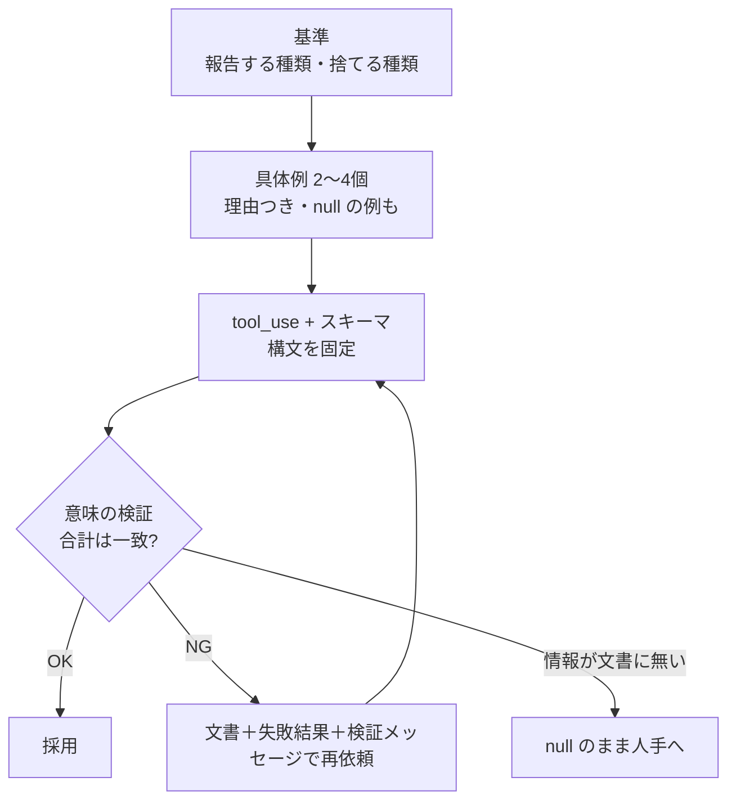
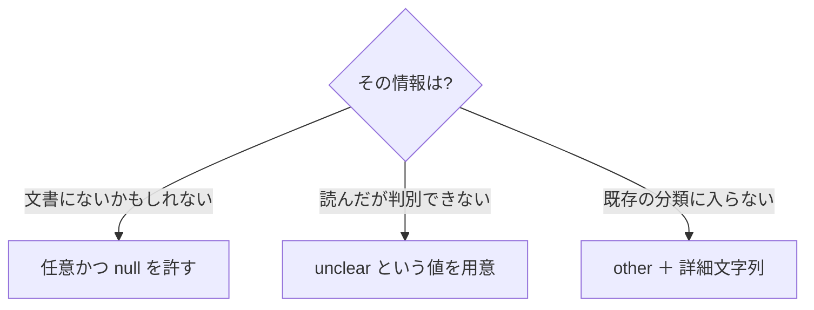
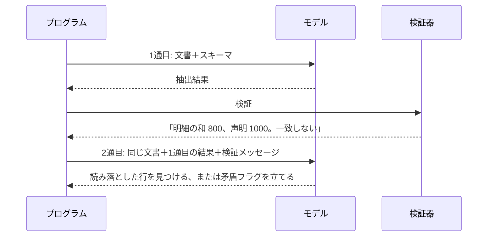
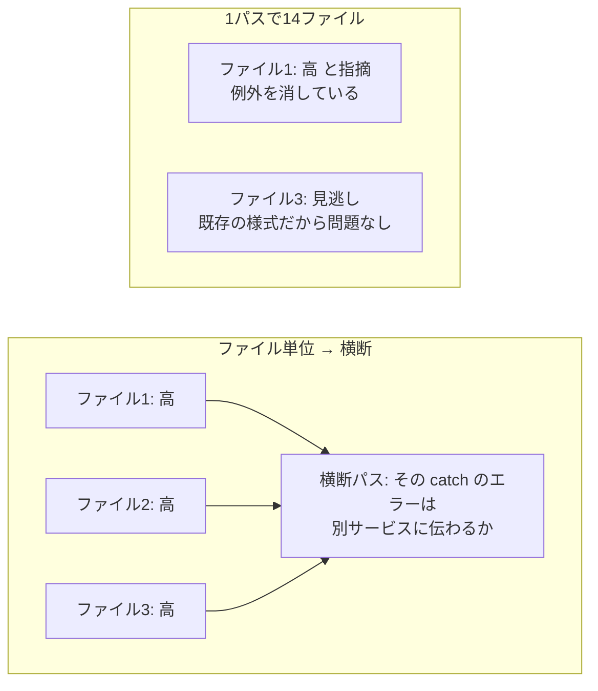

# 第4章 プロンプトエンジニアリングと構造化出力

> [!TIP]
> **この章のたとえ：プロンプトは「新人への業務マニュアル」**
>
> 「丁寧にやって」「慎重に」と言われても、新人は何をすればいいか分かりません。「この種類のミスは報告、この種類は無視」と基準を示し、見本を2〜3枚見せ、提出用紙（書式）を決めておけば、仕事はそろいます。さらに提出物はチェック係（検証）が確かめ、間違いがあれば「どこがどう違うか」を添えて差し戻します。

## 音声（4本）

| 音声 | 対応する節 |
| --- | --- |
| [a. 基準と具体例](audio/04-a-基準と具体例.mp3) | 4-1 〜 4-2 |
| [b. スキーマと再試行](audio/04-b-スキーマと再試行.mp3) | 4-3 〜 4-5 |
| [c. バッチとレビューの分け方](audio/04-c-バッチとレビューの分け方.mp3) | 4-6 〜 4-7 |
| [d. 公式の仕様で押さえる点](audio/04-d-公式の仕様で押さえる点.mp3) | 4-8 〜 4-11 |

## この章のゴール

- 何を報告し何を捨てるかを、形容詞ではなく「基準」で書ける。
- 出力がぶれるとき、少数の具体例（few-shot）で一般化させられる。
- 構文はスキーマ付きのツール使用で固定し、意味の矛盾は検証と再試行で扱える。
- 待ち時間が許されない仕事を、遅延保証のないバッチに置かない。
- レビューを、書いた会話から切り離し、ファイル単位と横断に分けられる。

## 要点3つ

1. **「慎重に」は基準ではない。** 報告する種類と捨てる種類を、コード例つきで書く。
2. **スキーマは「形」を守るが「中身の正しさ」は守らない。** 合計の不一致などは、検証して、理由を添えて再依頼する。無い情報は null にする。
3. **バッチは半額だが最大24時間・遅延保証なし。** 人が待っている仕事やツール往復が必要な仕事には使わない。

## 30秒で全体像

「慎重に」では、どの指摘を捨てるかが決まりません。報告する種類と捨てる種類を例つきで書きます。指示だけで形式がそろわないなら、2〜4個の具体例を見せます。JSONの構文を確実にするのは、スキーマを入力にしたツール使用です。ただしスキーマは合計の不一致のような意味の誤りは防げません。再試行が効くのは形式の誤りで、文書に情報がないときは効きません。Message Batches API は費用がおよそ半分ですが、最大24時間かかり遅延の保証がなく、途中でツールを往復できません。レビューは、書いた会話とは別の実行で、ファイル単位と横断に分けて行います。

## 用語

| 用語 | 意味 |
| --- | --- |
| 明示的な基準 | 報告する欠陥と捨てる指摘を、種類とコード例で定義したもの |
| few-shot | 判断と出力の形を見せる、少数の具体例 |
| `tool_use`（構造化出力） | スキーマどおりの引数をツール呼び出しとして返させ、構文を固定する使い方 |
| nullable | 文書にない値を、作らずに空（null）で返してよい欄 |
| `other` と詳細 | 既存の分類に入らないものを「その他」と自由記述で受ける形 |
| strict | スキーマに厳密に従わせ、構文の破れを拒否する仕組み。意味の正しさは別 |
| 意味的な検証 | 合計の不一致など、スキーマを通ったあとに残る矛盾の検査 |
| `conflict_detected` | 情報源どうしが矛盾していることを示すフラグ |
| `detected_pattern` | 指摘のもとになったコードの形。却下の集計に使う |
| Message Batches API | 費用を抑えた非同期処理。最大24時間、遅延の保証はない |
| `custom_id` | バッチの依頼・応答・失敗の再送を対応づける識別子 |
| セルフレビュー | 生成したのと同じ会話で、その出力を見直すこと。生成時の前提が残る |
| マルチパス | ファイル単位の局所パスと、ファイル横断の統合パスに分けるレビュー |

## 本編

### 4-1 基準のないレビューは、好みを欠陥として報告する

「コメントの正確さを確認して」とだけ頼むと、文体の好みまで指摘されます。開発者は2回目から、正しいバグの指摘まで読み飛ばすようになります。

**基準はこう書く**

| | 書き方 |
| --- | --- |
| ❌ 形容詞 | 「保守的に」「確信度が高いものだけ」「慎重に」 |
| ✅ 種類で線を引く | 「コメントが主張する挙動が、実際の分岐と矛盾するときだけ指摘する。命名・空行・局所的な書き癖は指摘しない」 |

モデルの確信度の自己申告は、難しいケースほど高く出すぎます。数値で絞り込む前に、**種類で線を引きます**。

**レビュー規約の例（この密度で足ります）**

| 区分 | 内容 |
| --- | --- |
| 報告する | 分岐がコメントや名前と矛盾する欠陥／認証の抜け／検証されていない入力が外部へ出る箇所 |
| 捨てる | インポートの順序／1行の長さ／既存ファイルにすでにある書き癖 |
| 重大度：高 | 本番データが誤った相手に出る、または例外が握りつぶされて呼び出し元が成功に見える（コード断片つきで定義） |
| 重大度：中 | 特定の入力でだけ結果が違うが、データは漏れない |
| 重大度：低 | **報告しない**、と書き切る |

> [!WARNING]
> 「低」を残すと、モデルは「低」を埋めるために好みを報告し始めます。また「高」という語だけでは、同じ欠陥が人によって別の段階になります。段階ごとにコード断片で定義します。

**誤検知が多い種類は、いったん外してよい**

好みの指摘が正しいバグの隣に並ぶだけで、正しい指摘まで無視されるようになります。直すあいだ、その種類を指摘対象から外します。

- 外すときは「インポートの順序、1行の長さ、既存の書き癖は書くな」と**種類を名指し**します。「慎重に」では、どの種類を外したかが残りません。
- 戻すときは、その種類の**正例と反例**を足してからにします。
  - 正例：コメントと矛盾する空の catch
  - 反例：プロジェクトにすでにある同じ空の catch で、呼び出し元が失敗をちゃんと見ているもの

### 4-2 具体例（few-shot）は「一致表」ではなく「一般化の材料」

指示が長いのに形式がぶれるとき、効くのが few-shot です。

| ポイント | 理由 |
| --- | --- |
| **個数は2〜4個が目安**（試験ガイド基準／プロンプトガイドでは3〜5個） | 関連性があり、互いに違いのある例をそろえる。似た例ばかり並べると、例の表面の形だけを真似される |
| **選ばなかった代替と、その理由を書く** | 理由がない例は、表面の語だけを真似される |
| **正例と反例を対にする**（レビュー） | 対がないと、例に似た正しいコードまで指摘する |
| **該当なし（null）の例を1つ入れる**（抽出） | 他の例が全部値を埋めていると、情報がない文書でも値を作る |
| **出力の形も例で見せる** | 自由文の例を見せながらスキーマを要求すると、自由文に戻る |

**例：ツール選択の few-shot（理由つき）**

| 依頼 | 選ぶツール | 捨てたツールと理由 |
| --- | --- | --- |
| 「A-19 の状態は？」 | 注文参照 | 顧客取得ではない。識別子が注文番号の形だから |
| 「山田さんの住所は？」 | 顧客取得 | 注文参照ではない。番号がなく、人を特定する依頼だから |
| 「山田さんの A-19 を返金して」 | まず顧客確認 | 番号があっても、顧客が未確認なら返金に進まない |

この3つは「番号があるかどうか」という表面ではなく、「確認済みかどうか」という状態を一般化させます。

**例：抽出の few-shot**

体裁の違い（本文中の引用と末尾の参考文献、方法の節と本文に埋め込まれた条件）を例で見せると、必須欄が空で返る頻度が下がります。そのうえで、例の1つは「税額の行がない請求書 → 税額は null、合計は本文の数字のまま」にします。この例がないと、モデルは合計の1割を税額として作ってしまいます。

### 4-3 構文はツールとスキーマで固定する

「JSONだけを出力して」と文章で頼むと、前置きの1文や末尾のカンマでパーサが壊れます。

| 方法 | 結果 |
| --- | --- |
| 文章で「JSONだけ」と頼む | 前置き・末尾カンマ・閉じ忘れが混ざる |
| スキーマをツールの入力にし、`tool_use` の引数として受け取る | 構文の破れはAPI側で拒否される。受け取ったオブジェクトをそのまま検証できる |
| さらに strict を使う | 構文の拒否がより厳密になる |

> [!IMPORTANT]
> スキーマを通ったオブジェクトは「形」が正しいだけです。中身の合計が明細と一致する保証はありません（4-5）。

**抽出での `tool_choice`（第2章の復習）**

| 状況 | 設定 |
| --- | --- |
| 文章で返されては困る。文書の種類が不明でスキーマが複数 | `any` |
| 先にメタデータ抽出を通したい | そのターンだけ `extract_metadata` を強制し、結果を見た次のターンで続きを選ばせる |
| 文章で答えてもよい対話 | `auto` |

### 4-4 スキーマ設計の3原則

| 原則 | 守らないと |
| --- | --- |
| **① ないかもしれない情報は null を許す** | 必須にすると、モデルは近くの数字で埋める。税額の行がない請求書で、合計を税額にコピーする |
| **② 曖昧さそのものを値にする（`unclear`）** | 「不明」を空文字にすると、「まだ抽出していない」と「読んだが判別できない」が区別できない |
| **③ 分類が増えるなら `other` と詳細** | enum を毎回広げずに未知を既存のどれかに押し込むと、新しい種類が古い種類の件数に混ざる |

**表記のゆれはスキーマでは直らない**

スキーマは「どの文字列を許すか」の定義で、日付の方言を理解するわけではありません。「和暦は西暦のISO日付にそろえてから入れる」という正規化のルールを、スキーマと並べてプロンプトに書きます。

**例：請求書の抽出スキーマ**

| 欄 | 設計 |
| --- | --- |
| 請求番号 | 必須 |
| 明細 | 配列 |
| 税額 | 任意・null 可 |
| 通貨 | 判別できなければ `unclear` |
| 費目 | 既知の enum ＋ `other` と詳細 |
| 声明の合計 | 文書に書かれた合計 |
| 計算した合計 | 明細から足した合計 |
| `conflict_detected` | 2つの合計が違えば真 |

### 4-5 意味の検証と再試行：材料があるときだけ効く

**意味の検証はスキーマの外に足す**

声明の合計と、明細から計算した合計を両方抜き出し、一致しなければ再依頼します。情報源どうしが矛盾するなら `conflict_detected` を立て、どちらかを黙って捨てさせません。

**再試行の2通目に入れる3つの材料**

| 入れ忘れたもの | 起きること |
| --- | --- |
| 文書 | 失敗した結果だけを見て、数字を声明に合わせにいく（根拠のない補正） |
| 検証メッセージ | 同じ結果を繰り返す |

**再試行が効くもの・効かないもの**

| 効く（形式・構造） | 効かない（情報の不在） |
| --- | --- |
| 桁区切りの違い、欄の取り違え、閉じ括弧 | 必要な数字が別の文書にしかない |
| → 小さい回数だけ自動で再試行 | → 再試行は「無いものを作れ」という圧力になる。null のまま人手へ |

> [!WARNING]
> 3通目でも同じ矛盾なら、再試行をやめて `conflict_detected` のまま人手へ回します。上限まで自動で回すと、モデルは3通目で存在しない行を作ります。矛盾は上限を待たずに人手へ回してよいです。

**検証器は値を黙って直さない**

Pydantic のような検証器は、スキーマと意味の検査をコードで行い、**失敗の理由を次のプロンプトに戻す**ための道具です。検証器が黙って桁を直すと、モデルは誤りを知りません。

**却下された指摘から学ぶ：`detected_pattern`**

レビュー指摘に `detected_pattern`（指摘のもとになったコードの形）を残すと、開発者が却下したときに「空の catch が誤検知の源だ」と集計できます。件数だけ捨てると、基準の改善が勘になります。

### 4-6 バッチは「人を待たせない仕事」だけ

| | Message Batches API | 同期API |
| --- | --- | --- |
| 費用 | およそ半分 | 通常 |
| 処理時間 | 最大24時間。**遅延の保証なし** | すぐ |
| 途中のツール往復 | **できない**（ツール定義やプロンプトキャッシュは使えるが、1件は1回の応答なので、ツールを実行して続ける往復はできない） | できる |
| 上限 | 1バッチ 100,000 件または 256 MB のどちらか先に達するまで | — |
| 向いている仕事 | 夜間のレポート、週次の監査、夜間のテスト生成、文書→構造の単発抽出 | マージ前の危険チェックなど、結果が出るまで次に進めない仕事 |

「たいてい早く終わる」は、マージボタンの前で待っている人の保証になりません。「とりあえずバッチに入れて、遅ければ同期に切り替える」も、切り替わるまでの待ちがそのままマージの待ちです。最初から同期に置きます。

**`custom_id` と失敗の再送**

例：100件に `doc-001` 〜 `doc-100` を付けて夜間に送った。朝、4件がコンテキスト長で失敗し、96件は成功した。

- 再送は**失敗した4件だけ**。ページで分割し、`doc-014-p1` のような**新しい識別子**を付け、元の `doc-014` を参照欄に残します。
- 成功した96件まで送り直すと、費用がもう一度かかり、同じ抽出が2版できます。
- 同じ識別子で再送すると、どの版の失敗かがログで混ざります。
- 下流は識別子を使って、文書ごとに「最新の成功」を1つに決めます。

**大量投入の前に見本で直す**

数十件の見本でプロンプトとスキーマを直してから本番を送ります。初回の失敗率が高いまま1万件送ると、再送が本番より高くつきます。

**送信間隔の計算**

約束が「到着から30時間以内に結果」、バッチの処理上限が24時間のとき：

| 送信の間隔 | 送信までの最悪の待ち | 処理の上限 | 合計 | 約束（30時間）と比べると |
| --- | --- | --- | --- | --- |
| 4時間ごと | 4時間 | 24時間 | 28時間 | ✅ 2時間の余裕がある |
| 6時間ごと | 6時間 | 24時間 | 30時間 | ❌ 余裕がゼロ。少しでも遅れると約束を破る |

> [!TIP]
> **一言まとめ**：送信間隔は「約束の時間 − 最大処理時間」より短くする。「たいてい早い」は計算に入れない。

### 4-7 レビューは「誰が」「何パスで」見るか

**① 書いた会話でレビューしない**

同じ会話の自己レビューでは、生成時に「この境界でよい」「この catch は意図的」と判断した文が履歴に残っています。見直せと言われても、その判断を擁護します。思考を長くさせても、同じ履歴の上で考えるだけです。**差分と基準だけを渡した別の実行**のほうが、前提を持たないので矛盾を見つけます。

**② 多数のファイルは「ファイル単位 → 横断」の2段に分ける**

例：3つのファイルに同じ空の catch がある。14ファイルを1パスで見ると…

1パスでは、注意が先に読んだファイルに偏り、同じパターンを片方では指摘し、片方では見逃します。モデルが怠けているのではなく、一度に配れる注意に限りがあるからです。ファイルごとに同じ基準で見れば判定がそろい、そのあと横断パスで影響の広がりを見ます。

**効かない対策**

| 対策 | なぜ効かないか |
| --- | --- |
| より大きなコンテキストのモデルに替える | 一度に配る注意の偏りは残る |
| 開発者に小さなPRを義務づける | レビューの構造（1パス）は変わっていない |
| 3回実行して2回以上出た指摘だけ残す（多数決） | たまにしか出ない本物の欠陥を「合意がない」として落とす |

**③ 確信度は校正してから使う**

各指摘に確信度を付けるのは、人に回す優先順位の材料にはなります。ただし、その数値を閾値として使う前に、ラベル付きのデータで校正が必要です（第5章）。未校正の数値で自動マージしてはいけません。

### 4-8 構造化出力の仕組みを正しく区別する

| 仕組み | 何を保証するか | 保証しないこと |
| --- | --- | --- |
| 構造化出力（structured outputs） | 応答を指定した JSON スキーマに従わせる。項目の有無と型 | 値の意味の正しさ。`string` の欄にどんな書き方の文字列を入れるか |
| ツールの `input_schema` ＋ `strict: true`（strict tool use） | ツール名と入力がスキーマに厳密に従う（有効な JSON・型・必須の欄） | 欄の値が文書の内容として正しいか。文書の情報を漏れなく拾えたか |
| `enum` | 値を列挙した候補に限る | 列挙にない値が来ると検証で失敗する（→ `"other"` ＋詳細の欄で受ける） |
| 引用（citations） | 回答が、渡した文書のどの部分に基づくかを示す | 渡していない文書の範囲は示せない |
| プロンプトに記入例を書く／別の呼び出しで JSON を直させる／`stop_sequences` で止める | （どれも）出力が自由な文章であることは変わらない | 不正な JSON、必須の欄の欠落、型の不一致が起こりうる |

**抽出専用のツールを用意する設計**

抽出結果を受け取るためだけのツールを用意し、`input_schema` に抽出したい項目を書きます。Claude はそのツールを呼び、値は `tool_use` ブロックの入力として、項目ごとに分かれた形で返ります。アプリケーションはそれをそのまま登録に使えます。

**スキーマでは決まらないことは、プロンプトで決める**

| 決まらないこと | プロンプトでの伝え方 |
| --- | --- |
| 表記の書き方（`os_version` を "14.2" と書くか "iOS 14.2" と書くか） | 正規化の規則を書く。「単価は通貨記号を付けない数値」「在庫はアイコンや文字から判断して真偽値」など。アイコンの意味のように文脈を読む変換は、抽出の時点で Claude に任せるのが確実 |
| 配列の1件の粒度（`string[]` のどこで区切るか） | 区切り方の規則と、境目の判断を示す few-shot の例 |
| いつ `null` にするか | 「本文に明記されていない欄は `null` にする」のように、条件と返す値を明示する。nullable にしただけでは、文脈から推測した値で埋めることがある |
| 「10日前後」「1〜2週間」のような幅のある値 | 1つの整数では表しきれない。最小値と最大値の欄を持つようにスキーマを見直す方法もある |

**相反する値は、両方を構造で残す**

文書の中に相反する値があるとき（改定前と改定後の条件など）、値を1つしか持てない欄では、モデルはどちらかを選ぶしかなく、選び方が文書ごとに揺れます。値を配列で持たせ、各要素に記載箇所と発効日を必ず入れる構造にすると、出力の形がそろい、あとから検証できます。

**エラーのメッセージをそのまま再試行に使う**

`'10日前後' is not of type 'integer'` のような検証のメッセージは、誤った欄・受け取った値・求められる型を示しており、そのまま修正の指示として働きます。同じリクエストを変えずに送り直す再試行とは、モデルに渡る情報が違います。

### 4-9 出力の長さとコンテキストウィンドウ

| 現象 | 仕様 | 対処 |
| --- | --- | --- |
| 出力が `max_tokens` に達した | `stop_reason` が `max_tokens` になり、途中で切れる。ツールの入力の途中なら `tool_use` ブロックは未完成のまま | `max_tokens` を上げて再試行。ただし出力量が入力の規模に比例するなら、入力を小さく分けて呼び、結果をつなぐ（配列ならつなげるだけで1つの結果になる） |
| 入力だけで上限を超えた | API は 400 の `invalid_request_error`（prompt is too long）を返す。通常の API でもバッチでも同じ | 文書を区切って送り、区切りごとの結果をあとでまとめる |
| コンテキストウィンドウに数えるもの | システムプロンプト、`messages`（文書やツール結果を含む）、ツール定義、そのターンの出力 | 入力が上限近くまで占めると、出力の余地がその分だけ減る。キャッシュで再利用する部分や、Files API で参照するファイルの中身も入力に数える |
| 長い文書の置き場所 | 長い文書をプロンプトの**先頭**に置き、質問や指示を**後ろ**に書くと応答の質が上がる | — |
| コンテキストの劣化（context rot） | トークン数が増えるほど、精度と想起が下がる | 関係する情報を選んで与える。大きいウィンドウのモデルに替えても、送る量が同じなら残る |

**料金の決まり方**：モデルごとのトークン単価 × 使った入力と出力のトークン数。`max_tokens` は生成の上限で、単価には関係しません。

### 4-10 Message Batches API の細部

| 項目 | 仕様 |
| --- | --- |
| 費用 | 入力・出力を含むすべての利用が、標準の料金の50％ |
| 処理時間 | ほとんどは1時間以内に終わる。24時間以内に終わらなかったリクエストは期限切れ。結果が得られるのは、全件が終わったときか24時間後のどちらか早いほう |
| 上限 | 1バッチ 100,000 件または 256 MB |
| 結果の対応づけ | 結果は送った順に並ぶとは限らない。各リクエストの `custom_id` で元のリクエストと対応づける |
| 失敗 | 結果はリクエストごとに成功か失敗かが分かる。`errored` になったリクエストは課金されない。失敗したものだけを新しいバッチで送り直せる |
| 使える機能 | ツール使用やプロンプトキャッシュも使える（ただし1件は1回の応答） |

### 4-11 プロンプトの書き方の公式の指針

**曖昧な依頼には、解釈を置いて進め、それを示す**

曖昧な依頼に質問だけを並べて返すと、利用者は答えるまで何も受け取れません。手元の情報から妥当な解釈を置いて作業を進め、**置いた解釈を明示し**、違っていれば調整すると申し出ます。解釈が外れていても、示された解釈を見て訂正できます。どの程度質問し、どの程度自分で判断するかは、システムプロンプトで明示的に指示できます。

**観点を詰め込みすぎない**

1回の呼び出しに多くの観点を詰め込むと、注意が観点の間で分かれます。ある観点の例を増やすと、その観点の検出は上がる一方で、ほかの観点の検出が下がる、という奪い合いが起きます。観点ごとに呼び出しを分け（プロンプトチェーンや並列の呼び出し）、それぞれに専用の例を持たせて、最後に指摘の一覧を統合します。

**発見と絞り込みを分ける**

レビューのプロンプトに「重大なものだけ」「確実なものだけ」と書くと、見つけていても基準に届かないと判断した指摘は報告されません。見落としたのではなく、指示どおりに外した状態です。見逃しを減らしたいなら、発見の段階では不確かなものや軽微なものも含めてすべて報告させ、各指摘に**確信度と重大度**を付けさせます。どれを採用するかは、後段の検証や振り分けでその値を使って決め、線は正解付きのデータで確かめてから引きます。

> [!NOTE]
> 4-1 の「報告しない種類を名指しする」と矛盾はしません。**種類**として価値がないもの（言い回しの好みなど）は最初から外し、価値のある種類の中での**確からしさ**による絞り込みは後段に回す、という使い分けです。

**正しさと価値は別の軸**

言い回しの好みの指摘は、内容としては誤っていません。だから「正しいか見直して」と頼んでも減りません。減らすには、指摘する対象と指摘しない対象を具体的に書きます。

**ツールを使うエージェント型のレビュー**

エージェントは、必要な情報をその場で取りに行けます（just-in-time な文脈の取得）。変更した項目や関数の名前でコードを検索し、見つかったファイルを読み、さらにその先の参照をたどる、という手順を自分で組み立てられるので、影響が思わぬ場所に及ぶ変更のレビューに向きます。ターン数の上限を設ければ、1件のレビューの長さを抑えられます。

**レビューで直された結果を例に生かす**

人が直した抽出を集計すると、誤りが特定の入力の型に集中していることが分かります。その型の正しい扱いを few-shot の例として示すと、同じ型の誤りをまとめて減らせます。

**Prompt Evaluation（Model Grader のバイアス対策）**

Code Grader（`json.loads()` 等による形式・構文の検査）と Model Grader（タスク達成・網羅性の評価）を組み合わせます。Model Grader で JSON 出力に `score`（1〜10）だけを求めると `6` 付近の中庸な点に偏りやすいため、必ず先に `strengths`（1〜3点）・`weaknesses`（1〜3点）・`reasoning` を出力させてから `score` を付けさせます。評価で満点（10/10）だった出力は、理由を添えて few-shot の `<ideal_output>` に再利用できます。

**Prompt Caching のルール（補足）**

キャッシュは **Tools → System Prompt → Messages** の順に評価され、1文字でも変わるとその地点以降が無効になります。1リクエストあたり最大 **4** cache breakpoints、breakpoint までの合計最低 **1,024 tokens** が必要で、TTL は既定 **5分**（cache hit 時に追加課金なしで延長）です。

## まとめ：どう判断するか

| 状況 | 判断 |
| --- | --- |
| 精度を上げたい | 最初の一手は、報告する種類・しない種類と段階ごとの例。確信度の自己申告や「慎重に」は基準の代わりにならない |
| 形式がぶれる・境界が曖昧 | 理由つきの例を2〜4個。1つは情報がないときの null の例 |
| 構文と意味 | 構文はスキーマ付き `tool_use`。意味の矛盾は検証。ない欄は null、未知の分類は `other` と詳細 |
| 再試行 | 文書・失敗結果・検証メッセージを含める。情報が文書にないなら再試行しない |
| バッチ | 人を待たせず、ツール往復も不要な仕事だけ。失敗は識別子単位で再送。送信間隔は「約束 − 最大処理時間」より短く |
| レビュー | 別の実行で行う。多数ファイルはファイル単位→横断。多数決や大きいモデルでは注意の偏りは直らない |
| スキーマで決まらないこと | 表記の正規化、配列の粒度、`null` にする条件はプロンプトで明示する |
| 出力が切れる・入力が大きすぎる | `max_tokens` を上げる、または入力を分けて結果をつなぐ。入力超過は 400 エラー |
| 曖昧な依頼 | 解釈を置いて進め、その解釈を示して調整を申し出る |
| 見逃しを減らしたい | 発見はすべて報告させ、確信度と重大度を付けて後段で絞る |

## 確認問題

### 問1

自動レビューの誤検知が多く、正しい指摘まで無視され始めています。最初に直すものはどれですか。

A. 「確信度が高いものだけ」と足す  
B. 報告する欠陥と捨てる指摘を、種類とコード例で定義する  
C. 文章の否定的な調子でレビュー対象を決める  
D. 3回実行し、2回以上出た指摘だけ残す

解答

**B**。自己申告（A）、感情（C）、多数決（D）は、何が欠陥かという定義をあいまいなままにします。

### 問2

文書の種類が事前に分からず、抽出スキーマが2つあります。必ず構造化された形で受け取りたい。`tool_choice` はどれですか。

A. `auto`  
B. `any`  
C. ツールを定義せず、文章でJSONを依頼する  
D. バッチの `custom_id`

解答

**B**。種類が不明で、どれかの構造で必ず返させたいなら `any` です。特定の1段を先に通したいなら強制です。`auto` は文章で返すことがあります。

### 問3

合計欄が明細と一致しない抽出結果が、スキーマ検証は通過しています。次の一手はどれですか。

A. スキーマを通ったので採用する  
B. 声明の合計と計算した合計を比べ、不一致のメッセージを添えて再依頼する  
C. 同じプロンプトを、メッセージなしで再実行する  
D. 必須欄を増やし、欠落を埋めさせる

解答

**B**。これは意味の誤りです。C は同じ結果を繰り返すだけで、D は存在しない値の創作を誘います。

### 問4

夜間の技術的負債レポートと、マージ前に終わらせたい危険チェックがあります。費用を下げるため両方をバッチに移す提案を、どう評価しますか。

A. 夜間のレポートだけバッチにし、危険チェックは同期のままにする  
B. 両方をバッチにする。たいてい朝までに終わる  
C. 識別子で対応づけられないので、夜間も同期にする  
D. 遅いときだけ同期へ切り替える仕組みを、用途を分ける前に作る

解答

**A**。バッチには遅延の保証がありません。対応づけは `custom_id` でできます（C は誤り）。切り替えの仕組み（D）は、用途を分けるより先に作るものではありません。

### 問5

14ファイルを1つのパスでレビューすると、深さがばらつき、同じパターンの判定が矛盾します。どう分けますか。

A. ファイルごとの局所パスと、横断のデータの流れを見る別パス  
B. より大きいコンテキストのモデルに替え、1つのパスを維持する  
C. 提出を3ファイルずつに分ける規則だけを足し、レビューの構造は変えない  
D. 独立に3回実行し、2回以上出たものだけ採用する

解答

**A**。原因は一度に配れる注意の偏りです。モデルの大きさ、提出の規則、多数決では、各パスの入力は小さくなりません。

### 問6

ツール定義に `strict: true` を付けて請求書を抽出しています。スキーマ違反は起きなくなりましたが、文書に書かれていない支払期日が入っていることがあります。`due_date` は必須の文字列です。最初に見直すべきところはどれですか。

A. `strict: true` を外す  
B. `due_date` を nullable にし、「本文に明記されていなければ `null`」と指示する  
C. `due_date` に日付の形式の制約を足す  
D. `max_tokens` を増やす

解答

**B**。必須の欄は、スキーマを満たすために何らかの値で埋められます。strict が保証するのは形だけで、値が文書の内容として正しいかは保証しません。C の形式の制約は、もっともらしい日付（形式は正しい）を区別できません。

### 問7

レビューのプロンプトに「確実な問題だけを報告して」と書いたところ、本番で起きた不具合を、調査はしていたのに報告していなかったことが分かりました。見逃しを減らす変更として最も適切なものはどれですか。

A. 「もっと注意深く」と書き足す  
B. 発見の段階ではすべてを報告させ、各指摘に確信度と重大度を付けさせて、採否は後段で決める  
C. 同じレビューを3回実行して多数決をとる  
D. 確信度が0.9未満の指摘を生成後に削除する

解答

**B**。「確実なものだけ」という指示が、見つけた指摘を報告から外させています。発見と絞り込みの役割を分け、絞り込みは正解付きのデータで確かめた線で後段が行います。D は絞り込みの線を変えるだけで、モデルが報告しなかったものは戻りません。

### 問8

Message Batches API で 5万件を処理しました。結果の一覧の順番が、送ったときの順番と違います。結果を元のリクエストと対応づける方法として正しいものはどれですか。

A. 結果は必ず送った順に並ぶので、並べ替えは不要  
B. 各リクエストに付けた `custom_id` で対応づける  
C. 結果の本文を元の文書と文字列比較して対応づける  
D. バッチを1件ずつに分けて送り直す

解答

**B**。バッチの結果は送った順に並ぶとは限りません。`custom_id` で対応づけます。失敗した（`errored`）リクエストは課金されず、それだけを新しいバッチで送り直せます。

## 自分で確かめる

1. 税額の欄がない文書とある文書を用意し、税額を必須にしたスキーマと null を許したスキーマで、ない税額が作られるかを比べます。
2. 検証失敗の再依頼に、文書・失敗結果・メッセージを含めた場合と、プロンプトだけで再実行した場合で、同じ誤りが残る回数を数えます。
3. 14ファイルを1つのプロンプトで読ませた指摘と、ファイル単位のあと横断させた指摘で、同じパターンの判定が矛盾する箇所を数えます。
