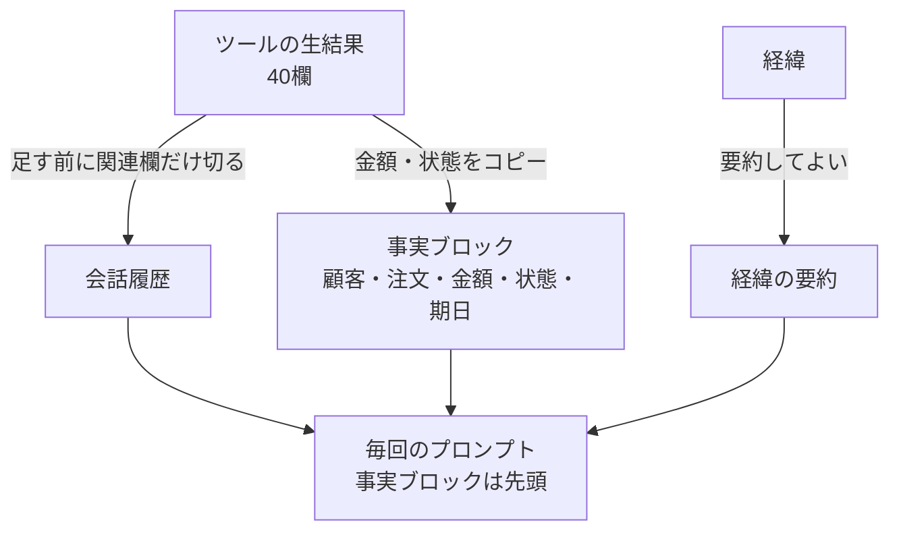
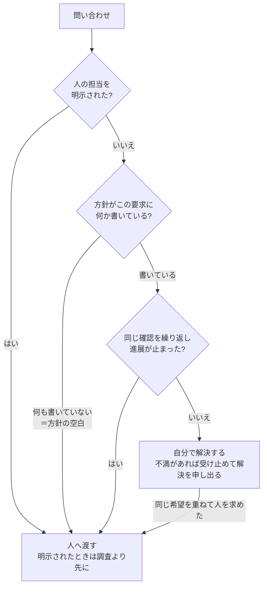
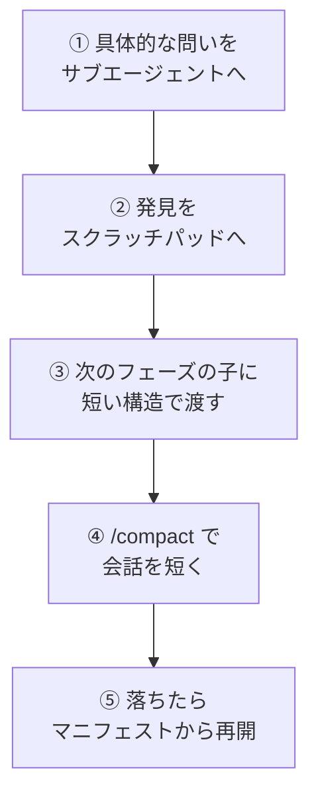

# 第5章 コンテキスト管理と信頼性

> [!TIP]
> **この章のたとえ：長い会話は「伝言ゲーム」**
>
> 伝言を重ねるほど、「8000円、金曜まで」は「なるべく早く」に丸まっていきます。だから大事な数字は伝言に任せず、メモ用紙（事実ブロック）に書いて毎回手渡します。伝言が途中で途切れたら「ここで途切れた」と正直に書き、2人の証言が食い違ったら、両方をそのまま記録します。

## 音声（4本）

| 音声 | 対応する節 |
| --- | --- |
| [a. 事実を残す](audio/05-a-事実を残す.mp3) | 5-1 〜 5-2 |
| [b. 引き渡しと失敗](audio/05-b-引き渡しと失敗.mp3) | 5-3 〜 5-4 |
| [c. 探索と確認と出典](audio/05-c-探索と確認と出典.mp3) | 5-5 〜 5-7 |
| [d. 公式の仕様で押さえる点](audio/05-d-公式の仕様で押さえる点.mp3) | 5-8 〜 5-10 |

## この章のゴール

- 長い会話で、金額や期日を要約に溶かさず、毎回渡す事実として残せる。
- 人へ引き渡す条件と、自分で解決する条件を分けられる。
- 失敗を、握りつぶさず全体を止めもせず、親が復旧方法を選べる形で伝えられる。
- 広いコードベースの探索で、会話が具体を忘れる前に発見を外に出せる。
- 平均の精度だけで人の確認をやめず、出典の食い違いを1つの数字に潰さない。

## 要点3つ

1. **数字・日付・番号・状態は要約の外。** 事実ブロックとして毎回プロンプトの先頭に入れる。要約してよいのは経緯だけ。
2. **人へ渡すのは「明示された」「方針に書いていない」「進展が止まった」とき。** 怒っている、難しそう、確信度が低い、では渡さない。
3. **平均の精度は区分の失敗を隠す。食い違う出典は両方残す。** 文書の種類・欄ごとに精度を見て、出典には日付を持たせる。

## 30秒で全体像



会話を続けるときは履歴を渡します。ただし要約を重ねるほど数字や期日は丸まるので、それらは要約の外の事実ブロックとして毎回入れます。ツール結果は、関連する欄だけに切ってから履歴に足します。長い入力の真ん中は見落とされやすいので、重要な指摘は先頭にも置きます。人へ渡すのは、人を明示されたとき・方針が何も言っていないとき・進展が止まったときです。失敗は種類・試行・部分結果・代替を付けて親に返し、最終出力に穴を書きます。長い探索では、サブエージェント・スクラッチパッド・フェーズ要約・`/compact`・マニフェストを使います。高く見える全体の精度は、区分の失敗を隠します。矛盾する出典は両方残し、日付を持たせます。

## 用語

| 用語 | 意味 |
| --- | --- |
| ケースの事実（事実ブロック） | 金額・日付・番号・状態。要約の外に置き、毎回プロンプトに入れる |
| lost in the middle | 長い入力の真ん中を、端より見落としやすい現象 |
| スクラッチパッド | 主要な発見をファイルに書き残し、会話が劣化しても参照できるようにするもの |
| `/compact` | 探索の出力で埋まった会話を要約して短くする操作。残す事実は先に外へ出しておく |
| マニフェスト | 各エージェントが決まった場所に書いた状態の索引。再開時に親が読む |
| 方針の空白 | 規程がその要求について何も書いていない状態。「複雑さ」とは別 |
| 層化抽出 | 種類や確信度が偏らないように区分ごとに抜き取り、誤り率を測る方法 |
| 主張と情報源の対応 | 主張・抜粋・URL・文書名・日付の組。統合のあとまで保持する |

## 本編

### 5-1 履歴は全部渡す。ただしツール結果は足す前に切る

**履歴を省くと、決めたことが消える**

次のAPI依頼で履歴の一部を落とすと、前に確定した制約が消えます。「写真のない返金はしない」と決めたターンを省くと、モデルは写真なしで返金を提案します。続ける会話では、履歴を渡します。

**ツール結果を無加工で積むと、コンテキストが埋まる**

注文照会が40欄を返し、返品に必要なのは5欄（番号・金額・状態・配送日・写真の有無）だけだとします。40欄のまま10回照会すると、コンテキストの大半が無関係な配送業者コードで埋まります。

| 切るタイミング | 結果 |
| --- | --- |
| ❌ モデルに読ませたあと | 全文はすでにコンテキストを使っている |
| ✅ 履歴に足す前 | 必要な欄だけが残る |

> [!IMPORTANT]
> 捨てる前に、後で必要な値（金額・状態）を**事実ブロックへコピー**します。コピーを忘れて捨てると、履歴からもブロックからも金額が消えます。切る処理のテストは「ブロックに 8000 が残っていること」です。

### 5-2 事実は要約の外に置く

要約を重ねるほど、「8000円、金曜まで」は「迅速に対応」になります。取引の事実は、要約された物語とは別のブロックにします。

**事実ブロックの例（文章ではなく行で書く）**

```text
顧客: C-42
注文: A-19
金額: 8000
状態: 配送済み
利用者の期日: 金曜
写真: 未着
---
経緯の要約: 破損の申告が2回あり、写真を依頼した。
```

- 事実ブロックは**要約関数に渡さない**。要約関数を通すと、8000 が「数千円」に、金曜が「早めに」になります。
- 実装では、要約の入力からブロックを除外し、要約の出力の前に毎回結合します。
- 要約してよいのは**経緯の叙述**だけです。

**用件が複数あるときは、用件ごとに層を分ける**

1つの段落にまとめると、どの金額がどの注文のものか分からなくなります。

**大事な但し書きは先頭にも置く（lost in the middle 対策）**


長い入力の真ん中の段落にだけ「ただし返金不可」と書くと見落とされ、モデルは返金可能として話します。重要な指摘の要約を先頭に置き、詳細は見出し付きの節に分け、但し書きは先頭の事実ブロックにも1行入れます。

**下流に渡すのは「事実・引用・関連度」**

下流の予算が小さいなら、上流は推論の過程や全文ではなく、事実・引用・関連の度合いを返します。日付、情報源の場所、方法（検索クエリか、PDFの何ページか）を構造に含めます。親が子の文章を自分の言葉で書き直してから次に渡すと、この構造が消えます。

### 5-3 人へ渡す条件は「トーン」ではない



**直ちに渡す3つの条件**

1. **利用者が人の担当を明示した** →調査より先に渡します。先に注文を調べると、人が欲しいと言ったのに待たせることになります。
2. **方針の空白** →例：方針には自社サイトの価格調整しか書いていないのに、利用者が「競合の価格に合わせて」と言う。これは難易度ではなく方針の空白です。エージェントが承認すると、書いていない規則を作ったことになります。
3. **進展が止まった** →同じ質問を2往復しても新しい事実が出てこない。

**渡さないもの**

| きっかけ | なぜダメか |
| --- | --- |
| 「複雑に見える」 | 単純な交換を人に渡し、方針の穴を自分で承認する、という逆転が起きる |
| 不満のトーン | 範囲内の問題なら、不満を受け止めて解決を申し出る。同じ希望を重ねたら渡す |
| 確信度の自己申告 | 難しい案件ほど、誤って高く出る |
| 感情スコア | 案件の複雑さや方針の空白と相関しない |

**複数の顧客に一致したら、選ばずに聞き返す**

同姓が2人に一致したら、名前の近さで1人を選びません。どちらにも返金せず、電話番号の下4桁などを尋ねます。それらしい選択が、別人への返金になります。

**基準は「両側の例」とセットでシステムプロンプトに置く**

| 例 | 正しい行動 |
| --- | --- |
| 怒った文面だが、写真と注文番号がそろった標準的な破損交換（期限内） | 不満を受け止め、自分で交換を申し出る |
| 穏やかな文面だが、競合価格への合わせを求める | 人へ渡す（方針の空白） |
| 同姓が2人に一致 | どちらにも返金せず、追加の識別子を尋ねる |

この対がないと、モデルはトーンを難易度だと思い込み、怒った簡単な交換を渡して、穏やかな方針の穴を自分で承認します。また、例が「それらしいほうを選べ」になっていると、**例が基準の文章に勝ちます**。例のほうを直します。

### 5-4 失敗は、親が「3つの続き」を選べる形で返す

親の選択肢は3つです。

1. クエリを変えて再試行する
2. 代わりの情報源へ行く
3. 部分結果で終え、穴を注記する

この選択には、**失敗の種類・試したクエリ・取れた部分結果・考えた代替**が必要です。

**例：検索の子がタイムアウトした**

| 子の返し方 | 親が取れる行動 |
| --- | --- |
| ✅ 種類：一時的／クエリ：3本／部分結果：音楽の記事2件／代替：文書庫の検索 | 2件を最終報告に使い、文書庫へ音楽だけを再委任する |
| ❌ 「失敗」だけ | 3本全部を最初からやり直す |
| ❌ 「検索を利用できません」の1文 | クエリを変える材料がない |
| ❌ 空の成功に変換 | 音楽は「無かった」と書いてしまう |
| ❌ 例外のまま上げて調査全体を止める | 取れていた抜粋まで捨てる |

**成功したゼロ件は、失敗に入れない**

ゼロ件を失敗にすると再試行が無駄になり、タイムアウトをゼロ件にすると、穴が「無かった」という結論になります。

**子が直すのは一時的な障害だけ**

子は一時的な障害を短い再試行で自分で直し、直せないものだけを親に上げます。

**最終報告には穴を書く**

統合の最後の節は「裏付けのある主張」と「未調査の領域」です。未調査を書かないと、読者は完全な調査だと誤解します。親は「子が返した穴の行が、最終報告に残っていること」を出力の検査にします。

### 5-5 広いコードベースの探索では、会話が具体を忘れる

長い探索のあと、モデルが見つけたクラス名ではなく「典型的なサービス層では…」と一般論で話し始めたら、劣化のサインです。会話の真ん中に埋もれた発見が、新しいターンの注意から落ちています。

**対策は5つ。順番が大事**



| 対策 | やること | 注意 |
| --- | --- | --- |
| ① サブエージェントへ隔離 | テストファイルの一覧・返金処理の依存などの具体的な問いを子に任せる。メインは高レベルの地図だけ持つ | 子の生ログは戻さない。ファイル名と結論の一覧を戻す |
| ② スクラッチパッドへ外部化 | 主要な発見をファイルに書き、後の質問は「スクラッチパッドを読んでから答えよ」で始める | 書くのは散文ではなく行（下の例） |
| ③ フェーズ要約 | 次のフェーズの子を起動する前に、前フェーズの発見を短い構造にして子の初期プロンプトに入れる | 生ログを丸ごと渡すと、子の予算が前フェーズのログで尽きる |
| ④ `/compact` | 探索の出力で会話が埋まったら短くする | 圧縮は要約なので、金額やファイル名を落とす。**先に②を済ませておく** |
| ⑤ マニフェスト | 各エージェントが決まったパスに状態を書き、再開時に親が読んでプロンプトに入れる | プロセスが落ちるとメモリ上の進捗は消える。マニフェストにない進捗はやり直す前提で設計 |

> [!WARNING]
> 圧縮（④）を先にすると、外部化（②）する前の発見が消えます。「圧縮しても大事なものは残ったはず」は検証できません。ファイルを書き忘れた `/compact` は、発見の削除と同じです。

**スクラッチパッドに書く行の例**（`notes/explore.md` など）

| ✅ 行で書く | ❌ 散文で書く |
| --- | --- |
| `src/auth/session.ts` — `isExpired()` — 呼び先: `config.ttlDays` — 未解決: 単位が日か時間か | 「認証はだいたいミドルウェアにある」 |

散文は、劣化したあとに読み返しても具体に戻れません。

**マニフェストに書くもの**：エージェント名、状態ファイルのパス、**最後に成功したフェーズ**。再開した親は、成功したフェーズの次から子を起動し、状態ファイルの中身を子のプロンプトに入れます。フェーズが書いていないと、どこから再開するかが人の記憶頼みになります。

### 5-6 人の確認は、平均の精度では減らせない

**平均は、件数の多い簡単な種類に引っ張られる**

10万件の抽出が全体で97％でも、手書きの領収書の税額欄だけ60％かもしれません。

| 文書の種類 | 欄 | 件数 | 精度 |
| --- | --- | --- | --- |
| 印刷の請求書 | 合計 | 95,000 | 99％ |
| 印刷の請求書 | 税額 | 95,000 | 98％ |
| 手書きの領収書 | 税額 | 5,000 | **60％** |
| （全体：文書10万件） | | | 約97％ |

人の確認を減らす前に、**文書の種類ごと・欄ごとの表**を作ります。すべての区分で安定している区分だけが、自動化の候補です。

**確信度が高いものも、層化抽出で測る**

確信度が高いものを監査から外すと、系統的な偏り（特定の帳票で合計を税額に入れる、など）が人の目を通らずに流れます。文書の種類と欄の組み合わせごとに、確信度の高いものからも無作為に抜き取り、誤り率を週ごとに見ます。新しい帳票の版が加わった週は、その種類の抜き取りを増やします。

**確信度の閾値は、ラベル付きデータで校正する**

例：100件のラベル付き請求書で、モデルの欄ごとの確信度と、実際に合っていたかを集計します。

- 確信度0.9以上の税額のうち、実際の正解率が0.95を超える区分だけを、人の確認から外す候補にする。
- 手書きの区分で実際の正解率が0.6なら、確信度が高くても人が見る。
- **申告0.9の実際の正解率が0.6なら、0.9は自動採用の線ではありません。**

人が見る優先順位は、校正後に低い欄と、情報源が曖昧または矛盾している抽出です。担当者の時間は有限なので、安定した欄から自動化し、矛盾は人に残します。

### 5-7 出典・時点・矛盾

**主張と情報源の組を、統合まで壊さない**

子には「URLまたは文書名・抜粋・公開日または収集日」を構造で出させ、下流はその組を保持します。親が「だいたいこう書いてあった」と書き直した時点で、組は壊れます。

**2つの信頼できる情報源で数字が違うとき**

例：同じ年の就業率が、出典Aでは62％、出典Bでは64％。

| やり方 | 問題 |
| --- | --- |
| ❌ 新しいほうを黙って採用 | 読み手が検証できない |
| ❌ 平均の63％を1つのセルに書く | どちらの定義でもない数字になる |
| ✅ 両方を出典つきで残す | 「2ポイントの差があり、定義は出典を参照」と書ける |

**表の形**

| 指標 | 値 | 出典 | 公開日 | 母数の定義 |
| --- | --- | --- | --- | --- |
| 就業率 | 62％ | 出典A | 2026-03 | 15〜64歳 |
| 就業率 | 64％ | 出典B | 2026-04 | 15歳以上の労働力人口 |

- 報告は「十分に裏付けられた主張」と「異論のある主張」を節で分けます。
- 元の文書が「速報」と呼んでいるものを「確定値」と書き換えません。特徴づけと方法（調査の母数・期間）を残します。

**時点の差を矛盾と取り違えない**

- 年が違うなら、矛盾ではなく**時点の差**として別の行にします。
- 日付のない出典は「時点不明」と書き、年付きの行と足し算しません。日付のない「利用率」は、別の年の数字でも同じ主張に見えてしまいます。

**表現は中身に合わせる**

| 中身 | 表現 |
| --- | --- |
| 財務の比較 | 表 |
| ニュースの経緯 | 文章 |
| 技術的な発見 | 一覧 |

すべてを1つの段落に潰すと、表で見せるべき差が読めなくなります。一律のテンプレートは、欠落を隠す方向に働きます。

### 5-8 コンテキストを減らす方法を使い分ける

| 方法 | 何をするか | 向いている場面 | 弱点 |
| --- | --- | --- | --- |
| スライディングウィンドウ | システムプロンプトと直近の一定数のターンだけを送り、古いターンを落とす | 利用者が直近の内容しか参照しない会話。いちばん単純に速さと質を改善できる | 古いターンの情報は消える |
| コンパクション（要約） | 古い会話を要約して短くする | 経緯を残しつつ量を減らしたいとき | 要約の過程で ID・金額・日付などの正確な値が欠けやすい（→ 5-2 の事実ブロックで守る） |
| `structured note-taking` | エージェントが定期的にコンテキストの**外**へメモを書き、後で読み戻す（5-5 の scratchpad） | 多数のツール呼び出しや長い会話にまたがって進捗や知見を保ちたいとき | 書き忘れると守れない |
| ツールでの取り直し | 必要になったときに外部のシステムから取り直す | 外部に記録がある情報 | 外部に記録がない情報には使えない |
| Files API | ファイルの受け渡しを効率化する | 同じファイルを何度も使うとき | 参照した内容はコンテキストに入るので、量は減らない |
| プロンプトキャッシュ | 繰り返し送る先頭部分の処理を再利用する | 費用と時間を減らしたいとき | モデルに渡るコンテキストの量は減らない |

> [!IMPORTANT]
> コンテキストの劣化（context rot）は、トークン数が増えるほど情報を正確に思い出す力が下がる性質です。履歴が同じ長さのまま残る限り、指示を足しても、セッションを区切って再開しても、この性質は変わりません。量そのものを減らすか、外に書き出します。

**古いツール結果が残る会話の再開**

会話を再開すると、以前のツール結果も履歴として毎回モデルに送られます。新しい結果を取り直しても、モデルが古い結果やそれに基づく以前の発言を参照してしまうことがあります。テストでそれが確かめられているなら、「古い結果は無視して」という注記は守られる割合を上げるだけです。古い結果を含む履歴で再開するより、**新しいセッション**を始め、前回の問い合わせの種類・実施した対応・未解決の点を構造化した要約で渡し、現在の状況はツールで取り直します。経緯は引き継ぎ、古いデータは持ち込みません。

### 5-9 顧客対応での引き継ぎの細部

**`first-contact resolution`（FCR）を手放さない**

`first-contact resolution` は、顧客が問い合わせを繰り返さずに済むよう、その場で対応できることを完了させる考え方です。

- エージェントの範囲で解決できるなら、ツールで確かめたあと、追加の質問をはさまずに解決を申し出ます。そのとき**引き継ぎの選択肢も示す**と、顧客が人の対応を望む場合にも応じられます。
- 一部の処理が障害で止まっても、取得済みの情報でできる説明や確認まで手放す必要はありません。タイムアウトのような一時的な失敗は、時間をおいた再試行で解決することがあります。そのうえで、**何ができて何ができなかったか**を正直に伝え、再試行や担当者への引き継ぎといった次の手段を示します。
- 完了していない処理を「完了した」と伝えるのは、解決ではありません。

**引き継ぎの基準を明確に書く**

確信度の数値、特定の語の出現、問い合わせの種類による振り分けは、機械的に扱いやすい指標ですが、人の判断が要るかどうかとは一致しません。確信度は回答への自己評価にすぎず、語の出現は言い回しに左右され、種類ごとの対応表は会話ごとの状況の違いを扱えません。「顧客が人を明示的に求めた」「規約の例外のように権限を超える」「解決に向けて進められない」という基準を明確に書くと、モデルは会話の内容に照らして判断できます。

**途中で権限を超えると分かったとき**

ツールで調べている途中で、権限を超える判断（無償修理の例外など）が必要だと分かった時点で引き継ぎます。それまでに得たものは会話の中にしかないので、対象の顧客と製品、確かめた事実、特定した問題、求める判断を項目に分けて渡します。生の記録の置き場所や、会員番号と製品名だけでは足りません。

### 5-10 統合と出典の細部

**集計方法の違いから生じる食い違い**

ログイン中の利用者だけを数えたログと、自己申告のアンケートのように、集計の方法が違えば数値が食い違うのは当然です。どちらも誤りではなく、別のものを測っています。

| よくある対処 | 問題 |
| --- | --- |
| 裏付けの十分な所見だけを残す | 条件付きの正当な所見まで消える |
| 出典の優先順位で一方を採る | もう一方の所見と方法の違いを捨てる |
| 再実行して一致させる | 方法の違いから生じる食い違いは、やり直しても消えない |

出典の間で**一致した所見と食い違う所見を分けて**示し、出典ごとの元の数値と集計の方法を残せば、読み手が根拠の質を比べて判断できます。

**時点を項目として受け渡す**

時点の違う値は、日付が付いていれば推移として読めますが、日付がなければ同じ時点の食い違いにしか見えません。子のサブエージェントには、値に加えて発行日や収集時点を**構造化した項目**として返させます。統合のエージェントは、それを時系列に並べて改定前後の変化として報告できます。

**所見と根拠の ID を組で渡す**

根拠が文章の中の注記としてしか付いていないと、統合で似た所見がまとめられ文面が書き換えられたときに、対応が崩れます。所見と根拠の ID を組にした構造化データで受け渡し、統合でもその組を保たせます。`PostToolUse` フックのような検査は形式の欠けは見つけられても、記述と根拠の組み合わせが正しいかまでは判定できません。

**状態の永続化とマニフェスト**

長く動くマルチエージェントの処理では、状態を決まった形式でコンテキストの外に書き出しておきます。文章の要約と違って細部が削られません。再開時はコーディネーターがマニフェストを読み、エージェントどうしの受け渡し（抽出は21件目、分類は18件目、のような進み具合の差）を含めて続きの地点を決め、各エージェントにはそのエージェントに関係する状態だけを渡します。各エージェントが別々に自分の状態を読み直して再開すると、進み具合の差をつなぐ役がいなくなります。

**一致率は正確さの代わりにならない**

同じ入力に対する出力の一致率は、結果のばらつきを測る指標です。正しい値と比べていないので、一致していても誤っていることがあります。正確さは、正解付きのデータと比べて測ります。

## まとめ：どう判断するか

| 状況 | 判断 |
| --- | --- |
| 長い会話 | 履歴は渡す。金額・日付・番号・状態は毎回先頭に。要約は経緯だけ。ツール結果は足す前に切る。但し書きは先頭にも |
| 人へ渡すか | 明示されたらすぐ渡す。範囲内の不満は一度解決を申し出て、希望が重なったら渡す。方針の空白も渡す。複数一致は聞き返す。感情や未校正の確信度では渡さない |
| 失敗の返し方 | 種類・試行・部分結果・代替。ゼロ件の成功とタイムアウトを混ぜない。空の成功にも全体停止にもしない。穴は最終出力に書く |
| 長い探索 | サブエージェント → スクラッチパッド → フェーズ要約 → `/compact` の順。落ちたらマニフェストから再開 |
| 自動化の判断 | 文書の種類・欄ごとの精度を見る。確信度が高いものも層化して測る。閾値はラベルで校正 |
| 出典 | 構造のまま統合まで運ぶ。矛盾は両方残す。日付を持たせる。表現は表・文章・一覧を中身に合わせる |
| 会話が長くて遅い | 直近だけでよいならスライディングウィンドウ。経緯を残すならコンパクション＋事実ブロック。キャッシュや大きいウィンドウでは量は減らない |
| 古いツール結果が混ざる | 新しいセッションに構造化した要約を渡し、現状はツールで取り直す |
| 引き継ぎの判断 | 明示の要求・権限超え・進展なしを基準に書く。解決を申し出るときは引き継ぎの選択肢も示す |
| 集計方法の違う数値 | 一致と食い違いを分け、出典ごとの数値と方法を残す |

## 確認問題

### 問1

長い返品の会話を要約し続けた結果、返金額と期日が文章から消えました。どう残しますか。

A. 金額・日付・注文番号・状態を、要約の外のブロックとして毎回プロンプトに入れる  
B. 要約の回数を増やして、さらに短くする  
C. ツールの全欄を毎回履歴に積む  
D. 重要な数字を、長い入力の真ん中の段落だけに書く

<details>
<summary>解答</summary>

**A**。要約を重ねるほど数字は落ちます（B）。全欄はコンテキストを浪費し（C）、真ん中への配置は見落としを招きます（D）。

</details>

### 問2

利用者は「人に代わって」と書いています。中身は単純な交換に見えます。次の行動はどれですか。

A. 先に調査を終えてから、必要なら人へ渡す  
B. 明示の要求なので、調査より先に人へ渡す  
C. 否定的な語のスコアが高いときだけ渡す  
D. 確信度の自己申告が低いときだけ渡す

<details>
<summary>解答</summary>

**B**。明示の要求にはすぐ応じます。「不満はあるがまだ人を求めていない、範囲内の問題」とは別の規則です。

</details>

### 問3

検索の子がタイムアウトしました。親が復旧方法を選ぶには、どの返し方が必要ですか。

A. 失敗の種類、試したクエリ、部分結果、代替を構造で返す  
B. 再試行を使い切ったあと、「利用できません」だけを返す  
C. 空の結果を成功として返す  
D. 例外のまま上げ、調査全体を終了する

<details>
<summary>解答</summary>

**A**。B は材料を隠し、C は失敗を消し、D は部分結果で続ける選択肢を捨てます。

</details>

### 問4

抽出全体の精度は高く見えます。人の確認を減らす前に見るべきものはどれですか。

A. 文書の種類ごと・欄ごとに精度が安定しているか  
B. 平均が十分なら、区分は見なくてよいか  
C. 確信度が高い抽出は監査から外すか  
D. 自己申告の確信度を、校正なしで確率として使うか

<details>
<summary>解答</summary>

**A**。平均は件数の多い種類に引っ張られます。確信度が高いものも層化して測り、閾値はラベル付きデータで校正します。

</details>

### 問5

信頼できる2つの情報源で、同じ指標の数値が違います。統合ではどう書きますか。

A. 新しいほうを黙って採用する  
B. 両方を出典つきで残し、矛盾として注記する  
C. 平均を1つの値にし、出典は落とす  
D. 日付を捨て、矛盾ではないとみなす

<details>
<summary>解答</summary>

**B**。勝手な選択や出典のない平均は、読み手が検証できません。時点の違いが原因のこともあるので、日付は残します。

</details>

### 問6

社内ヘルプデスクのチャットは、利用者がほぼ直近のやり取りしか参照しません。会話が長くなると応答が遅く、質も下がります。最も単純に改善できる方法はどれですか。

A. コンテキストウィンドウの大きなモデルに替える  
B. プロンプトキャッシュを有効にする  
C. システムプロンプトと直近の一定数のターンだけを送る（スライディングウィンドウ）  
D. Files API で会話の履歴をファイルとして渡す

<details>
<summary>解答</summary>

**C**。直近しか参照しない会話なら、古いターンを落とせば送る量が一定に保たれ、加工の処理も要りません。A は送る量が同じなら劣化が残ります。B は処理の再利用で、モデルに渡る量は減りません。D も参照した内容はコンテキストに入ります。

</details>

### 問7

2つの調査の情報源で、ある機能の利用率が 31％ と 47％ と食い違っています。一方はログイン中の利用者のログ、もう一方は自己申告のアンケートです。統合レポートの書き方として最も適切なものはどれですか。

A. 公的な情報源を優先し、一方の数値だけを載せる  
B. 調査を再実行し、数値が一致するまで繰り返す  
C. 一致した所見と食い違う所見を分け、出典ごとの数値と集計の方法を残す  
D. 平均の 39％ を載せる

<details>
<summary>解答</summary>

**C**。集計の方法が違うので、どちらも誤りではなく別のものを測っています。方法を残せば読み手が比べて判断できます。B は方法の違いから生じる食い違いを誤りとして扱うので、やり直しても消えません。

</details>

### 問8

顧客の調査の途中で、無償修理の例外という権限を超える判断が必要だと分かりました。担当者に引き継ぐときに渡すものとして最も適切なものはどれですか。

A. 会話ログの保存場所  
B. 会員番号と製品名  
C. 対象の顧客と製品、確かめた事実、特定した問題、求める判断を項目に分けた要約  
D. 顧客に担当者へ連絡し直すよう案内する文

<details>
<summary>解答</summary>

**C**。エージェントが得たものは会話の中にしかありません。担当者がログを開かずに判断できる構造で渡します。A と B では要点を得られず、D では調査の成果が担当者に届きません。

</details>

## 自分で確かめる

1. 40欄の注文JSONから、返品に必要な5欄だけを履歴に足す関数と、全欄を足す関数で、10ターン後のプロンプトの長さを比べます。
2. 金額と期日を事実ブロックにコピーした場合と、要約文だけにした場合で、15ターン後にモデルが金額を正確に言えるかを確かめます。
3. タイムアウトを空の成功で返した調査と、部分結果と穴の注記を返した調査で、最終報告が「その分野は無かった」と書いてしまうかを比べます。
