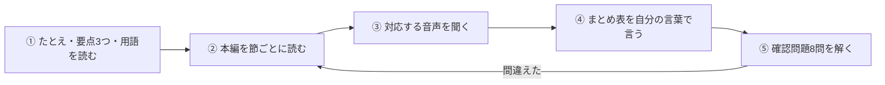

# エージェントを設計する5つの技能

ツールを使うAIエージェントを、自分で設計できるようになるための教材です。読み終えると、次のことを自分で判断できるようになります。

- エージェントのループを、いつ続け、いつ止めるか
- ツールの説明とエラーを、どう書くか
- Claude Code の設定を、どこに置くか
- 出力の形を、どう固定し、どう検証するか
- 長い会話で、大事な事実をどう守るか

資格試験の手続きや出題形式は扱いません。

## 教材の構成

| 種類 | 中身 | 使いどころ |
| --- | --- | --- |
| ノート（このフォルダの `.md`） | 本体。図・比較表・確認問題がある | 机に向かって読む |
| 音声（`audio/`） | ノートと同じ内容を話し言葉にしたもの。1章4本、各7〜12分。各章の4本目（d）は、公式ドキュメントの仕様で押さえる点のまとめ | 読んだあとの復習、通勤中の聞き流し |
| 台本（`scripts/`） | 音声の読み上げ原稿 | 聞き取れなかった箇所の確認 |
| [用語集](用語集.md) | 用語の意味と、まちがえやすい点 | 言葉があいまいになったとき |
| [直前チェック](直前チェック.md) | 5つの技能の判断を1枚にまとめたもの | 最後の見直し |

## 学び方（1章あたり約3時間）

1. 各章の冒頭にある「たとえ」「要点3つ」「用語」を読み、全体の地図を頭に入れます。
2. 本編を節ごとに読みます。各章の冒頭の表に、音声と節の対応が書いてあります。
3. 節を読んだら、対応する音声を聞きます。聞きながら図を見返すと、いちばん記憶に残ります。
4. 「まとめ：どう判断するか」の表を、自分の言葉で言ってみます。
5. 確認問題8問を、解答を開く前に解きます。間違えた問題は、本編のその節に戻ります。
6. 「自分で確かめる」は、手を動かせるときだけで構いません。

> [!TIP]
> 音声だけを先に聞くと、図と比較表が抜けます。通勤中に聞くのは、一度読んだ章の復習にしてください。音声は「聞き流しでも分かる」ように作っていますが、ノートと組み合わせるのがいちばん効果的です。

## 進める順番と時間の目安

後ろの章は、前の章の用語を使います。上から順に進めてください。1日1章で、5日で終わります。

| 順 | ノート | 読む | 聞く |
| --- | --- | --- | --- |
| 1 | [第1章 エージェントアーキテクチャとオーケストレーション](01-エージェントアーキテクチャとオーケストレーション.md) | 90分 | 約46分（4本） |
| 2 | [第2章 ツール設計とMCP統合](02-ツール設計とMCP統合.md) | 85分 | 約41分（4本） |
| 3 | [第3章 Claude Codeの設定とワークフロー](03-Claude-Codeの設定とワークフロー.md) | 80分 | 約36分（4本） |
| 4 | [第4章 プロンプトエンジニアリングと構造化出力](04-プロンプトエンジニアリングと構造化出力.md) | 80分 | 約37分（4本） |
| 5 | [第5章 コンテキスト管理と信頼性](05-コンテキスト管理と信頼性.md) | 75分 | 約38分（4本） |

全部終えたら [直前チェック](直前チェック.md) で見直します。

## 各章のつくり

どの章も同じ順番で並んでいます。

1. **たとえ** ── 章の内容を身近なものにたとえた導入
2. **音声の対応表** ── どの音声がどの節に対応するか
3. **ゴール・要点3つ・30秒で全体像** ── 先に結論と地図を示す
4. **用語** ── この章で使う言葉
5. **本編** ── 節ごとに、例・比較表・図で説明。各節に「一言まとめ」や注意の囲みがある
6. **まとめ：どう判断するか** ── 状況と判断の対応表
7. **確認問題** ── 8問。解答は折りたたみ
8. **自分で確かめる** ── 手を動かして確認する課題

## 音声の聞き方

- 再生速度は等倍がおすすめです。速くすると、似た用語（実行前のフックと実行後のフック、再開とフォークなど）が混ざります。
- 各音声は冒頭で「この回で分かること」を、最後に「まとめ」を話します。
- 英語の設定名やコマンド名は、カタカナで読み上げています（例：`end_turn` →「エンドターン」）。つづりはノートで確認してください。
- 確認問題は音声には入っていません。問題はノートで解きます。

## この教材で繰り返し出てくる判断

- モデルはツールを実行しない。実行して結果を会話に戻すのはハーネス。
- だいたい従えばよい案内は文章に書き、外れると事故になる順序はプログラムで止める。
- ツール選びの決め手は説明文。失敗は、次の手が分かれる形で返す。
- 設定は、届けたい相手と読ませたいタイミングが一致する場所にだけ置く。
- 構文はスキーマで固定し、意味の矛盾は検証と、材料を添えた再試行で扱う。
- 金額や期日は要約の外に残し、出典の食い違いは1つの数字に潰さない。
