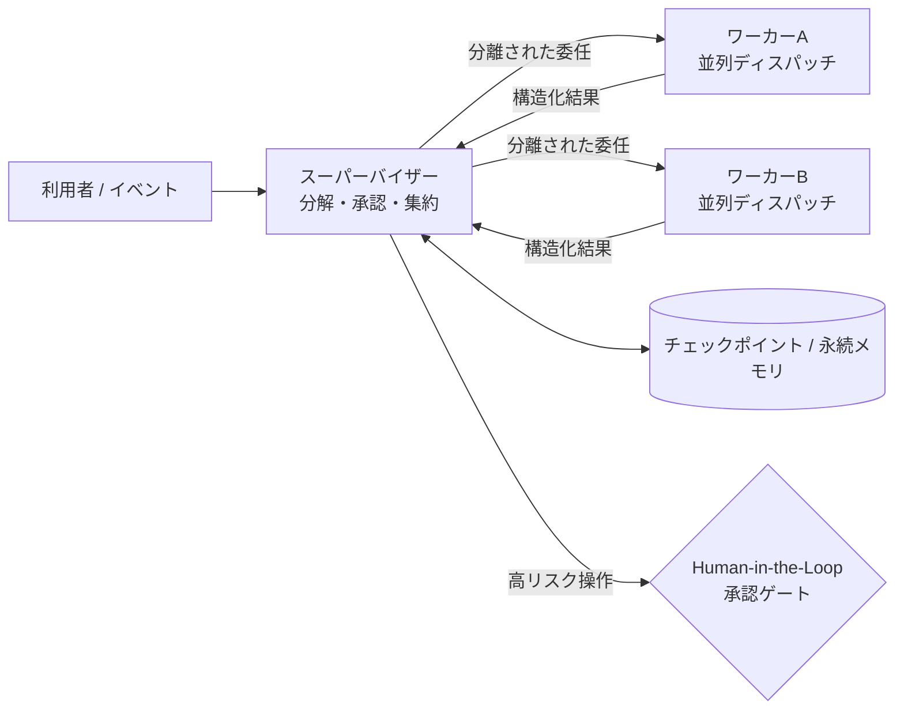
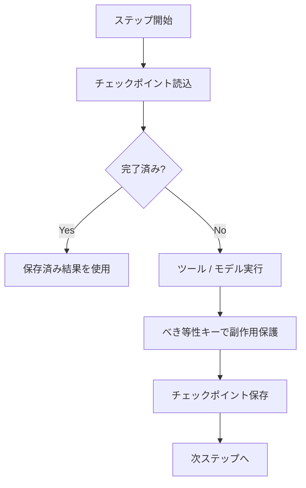

# 第1章 高度なエージェントアーキテクチャとオーケストレーション（配点 17%）

> [!TIP]
> **この章のたとえ：大規模プロジェクトの「プロジェクトマネージャー」と「各専門チーム」**
>
> 1人の担当者に全工程と全資料を抱えさせると、机（コンテキストウィンドウ）がパンクし、停電（プロセス再起動）が起きれば最初からやり直しになります。本番のエージェント運用では、仕事を適切に分割して独立した作業室（コンテキスト分離）で動かし、進捗を日誌（チェックポイント／永続メモリ）に刻み、要所だけ承認（Human-in-the-Loop）を挟む設計が求められます。

## この章のゴール

- 本番環境のマルチエージェント設計で、障害分離・通信境界・承認フローを正しく構成できる。
- 中断・再起動・モデル変更に耐えるセッション永続化とチェックポイント設計ができる。
- コスト・信頼性・品質データに基づき、ワークフロー型とエージェント型の移行、およびハーネス選定ができる。
- コンテキスト上限やコスト上限に近づいた長時間エージェントに対し、Compaction・Context Editing・永続メモリ・キャッシュ維持・大規模ツールカタログ管理を適切に組み合わせられる。

## 要点3つ

1. **エージェント間の委任はコンテキスト分離の境界になる。** サブエージェントは親の会話履歴を自動共有しないため、必要な前提・出典・出力形式を明示して渡し、障害もサブエージェント単位で封じ込める。
2. **長時間稼働エージェントの命綱は「外出しした状態」である。** メモリや会話履歴だけに状態を置かず、チェックポイント・構造化状態・セッション永続化によって、中断やモデル更新後も安全に再開できるようにする。
3. **コンテキストは「要約・削除・外出し・キャッシュ維持」の4手で守る。** Context Compaction（要約）、Context Editing（古いツール結果・思考ブロックの除去）、永続メモリ（ファイル／DB）、`tool_search`（大規模ツールの遅延ロード）を使い分け、途中の指示変更でキャッシュプレフィックスを壊さない。

## 30秒で全体像

## 用語

| 用語 | 意味 |
| --- | --- |
| スーパーバイザー／ワーカー階層 | 親が計画・委任・集約を担い、子が個別タスクを実行する階層構造 |
| コンテキスト分離 | サブエージェントごとに独立した会話履歴を持たせ、無関係な情報やノイズの混入を防ぐ境界 |
| Human-in-the-Loop (HITL) | 不可逆・高リスクな操作の前に人間の承認を必須とする制御フロー |
| チェックポイント | 実行途中の状態・完了済みステップ・中間成果物を外部ストレージへ保存する仕組み |
| ワークフロー型パターン | 実行経路がコードで事前に定義された決定論的なパイプライン（Routing, Prompt Chaining 等） |
| エージェント型パターン | モデルが状況に応じて次のツールや手順を動的に選択する自律ループ |
| Claude Managed Agents | Anthropic がホストするクラウドサンドボックス・状態管理・セッション永続化を備えたマネージド実行基盤 |
| Agent SDK | ループ制御・ツール実行・セッション管理・フックを提供する開発者向け SDK |
| Context Compaction | 長い会話履歴を要約に置き換えてコンテキストウィンドウ内に収める手法（API の `compact_20260112` 等） |
| Context Editing | 古い `tool_result` や `thinking` ブロックをルールベースで削除するサーバーサイド機能（`context_management`） |
| `tool_search` / `defer_loading` | 数十〜数百のツール定義を初期コンテキストに載せず、必要なツールだけを動的に検索・ロードする手法 |

## 本編

### 1-1 マルチエージェントのオーケストレーション

本番のマルチエージェントでは、「何人でどう分けるか」だけでなく **「どこで失敗が止まるか（障害の封じ込め）」** を設計します。

| パターン | 適した場面 | 注意点・障害モード |
| --- | --- | --- |
| **スーパーバイザー／ワーカー階層** | 複合タスクの分解・進捗管理・結果統合が必要 | スーパーバイザーがボトルネック化しやすい。ワーカーの途中経過は親に自動共有されない |
| **並列サブエージェントディスパッチ** | 互いに依存しない調査・ファイル処理・評価の同時実行 | 依存関係のあるタスクを並列化すると不整合が起きる。個別ワーカーの部分失敗を許容する集約設計が必要 |
| **エージェント間直接通信（メッシュ）** | 対等なピア同士の交渉・反復レビュー | 循環呼び出し（無限ループ）や状態発散のリスクが高い。本番ではスーパーバイザー経由のハブ＆スポークが原則 |

#### コンテキスト分離と委任の境界

- **なぜ分離するのか**: 大量の検索結果やログを1つのコンテキストに積むと「コンテキスト汚染（Context Rot）」が起き、モデルの判断精度が低下する。
- **委任時に渡すもの**: サブエージェントは親の履歴を見ないため、タスクの目的・制約・必要なIDや抜粋・期待する出力スキーマを明示的に渡す。
- **承認フロー (HITL)**: 返金実行、本番 DB 更新、外部メール送信などの高リスク操作は、ワーカーに自律実行させず、実行前に一時停止（suspend）して人間の承認を待つ。

> [!IMPORTANT]
> ワーカーの1つがタイムアウトやエラーで落ちても、スーパーバイザー全体がクラッシュしないよう、構造化されたエラーを返して「部分的成功の継続」または「該当タスクのみ再委任」できる設計にする。

### 1-2 耐久性のある実行と状態管理

長時間稼働するエージェントは、ネットワーク断、プロセス再起動、ワーカーのタイムアウト、さらには **稼働中のモデルバージョン更新** に直面します。

| 要件 | 実装パターン | 避けるべきアンチパターン |
| --- | --- | --- |
| **セッションの永続化** | 会話履歴・状態・メタデータを DB やマネージドセッションに保存し、プロセス再起動後も復元 | インメモリ変数だけに会話配列を保持する |
| **複数コンテキストウィンドウ跨ぎの継続** | Initializer Agent が環境・機能リスト JSON・進捗ファイル（`claude-progress.txt`）を初期化し、各セッションは Git コミットと進捗ファイルを読んで1機能ずつ進める | 1つのセッションで全機能をやり切ろうとしてコンテキスト上限で途中崩壊する |
| **チェックポイントと再開可能性** | ステップ／フェーズ単位で完了状態と成果物を保存し、失敗時は未完了ステップから再開 | 失敗時に最初から全ステップを再実行し、トークンと時間を浪費する |
| **べき等性キーによる副作用保護** | 外部 API 呼び出しに冪等性キー（idempotency key）を付与し、再開時の二重実行を防止 | 再開のたびに課金やメール送信が重複実行される |
| **モデルバージョン変更への耐性** | 状態データはモデル非依存の JSON スキーマで保持し、プロンプトやハーネス側で互換性を維持 | 特定モデルの非公開思考ブロックや暗黙の挙動に再開ロジックを依存させる |

### 1-3 大規模環境でのアーキテクチャの選択

「すべてを自律エージェントにする」のは本番では過剰設計になりがちです。本番のコスト・信頼性・品質データに基づいて **ワークフロー型** と **エージェント型** を適切に選び、必要に応じて移行します。

| 比較軸 | ワークフロー型（決定論的パイプライン） | エージェント型（自律ループ） |
| --- | --- | --- |
| **手順の予測可能性** | ステップが事前に決まっている（抽出→検証→保存など） | 入力や途中結果に応じて次の手が動的に変わる |
| **コストとレイテンシ** | 予測しやすく、最小限の呼び出しで済む | ステップ数が変動し、コスト・レイテンシの上振れがある |
| **信頼性とテスト** | 各ノードを単体テストしやすく、SLA を守りやすい | 非決定的な経路をとるため、評価とガードレールが必須 |
| **移行の判断基準** | エージェントのトレースを分析し、80%以上が同じ固定経路を辿っているなら **ワークフロー型へ切り出して固定化** する | ワークフローの分岐が爆発し、例外処理がコードで書ききれなくなったら **エージェント型へ移行** する |

#### ハーネスと実行基盤の選択

| 選択肢 | 特徴 | 向いているケース |
| --- | --- | --- |
| **Messages API + 自前ハーネス** | ループ・状態・リトライ・ツール実行を完全制御 | 既存の自社インフラや特殊な SLA・コンプライアンス要件に密結合させる場合 |
| **Agent SDK** | ループ・セッション・フック・サブエージェント機構を標準装備 | アプリケーションコード内でカスタムツールやガードレールを組みつつ素早く本番構築したい場合 |
| **Claude Managed Agents** | Anthropic がホストするサンドボックス・セッション永続化・ツール実行・トレーシングを提供（セルフホストサンドボックスも選択可） | 長時間自律タスクや並列セッションのインフラ構築・保守コストを削減したい場合 |

### 1-4 コンテキストとメモリのアーキテクチャ

長時間稼働するエージェントがコンテキスト上限やコスト上限に近づいたとき、以下の4つの手法を組み合わせます。

#### 1. Context Compaction と Context Editing の使い分け

| 手法 | 仕組み | 強み | 注意点 |
| --- | --- | --- | --- |
| **Context Compaction** | 古い会話ターンをモデルの要約に置き換える（サーバーサイド `compact_20260112` 等） | 会話全体の流れや意図を保ったまま長期間継続できる | 要約から漏れた数値・ID・制約は失われるため、重要事実は外部メモリへ退避する |
| **Context Editing** | 古い `tool_result` や `thinking` ブロックをルールに基づき削除する | API レベルでトークン数計算前・キャッシュ参照後に適用されるため、**プロンプトキャッシュを壊しにくい** | 大量のツール出力が蓄積するワークフローに特に有効 |

#### 2. キャッシュを損なわずに会話途中で指示を変更する方法

Prompt Caching は **プレフィックス完全一致** で機能します。会話の途中で `system` プロンプトやツール定義を書き換えると、それまでのキャッシュがすべて無効化（Cache Miss）され、コストとレイテンシが急増します。

- **NG**: 状況が変わるたびに `system` プロンプトの文言を書き換える。
- **OK**: `system` プロンプトとツール定義は不変のプレフィックスとして固定し、動的な指示変更や状態更新は **最新の `user` メッセージ（またはシステム注入ブロック）として末尾に追加** する。

#### 3. 大規模ツールカタログの扱い（`tool_search`）

MCP サーバーや社内 API が増え、ツール定義が数十〜数百個になると、それだけで数万トークンを消費し、ツール選択の精度も落ちます。

- すべてのツール定義を毎回コンテキストに載せず、`defer_loading` と **`tool_search`** を用いて、タスクに必要なツールだけをオンデマンドで検索・ロードさせる。

#### 4. 永続メモリ（Persistent Memory）

セッションをまたいで保持すべきユーザーの好み、学習した手順、確定済みの事実（Case Facts）は、コンテキストウィンドウ内ではなく外部のメモリファイル・DB（または Memory Tool）に保存し、必要なものだけを読み込む。

## まとめ：どう判断するか

| 状況 | 避ける選択 | とるべき選択 |
| --- | --- | --- |
| ワーカーに巨大な検索結果をそのまま読ませた後、親へ渡す | 親のコンテキストに全生ログを返す | コンテキスト分離し、ワーカーには構造化された要約・結論だけを返させる |
| 決済や本番変更を伴う自律エージェント | プロンプトで「慎重に確認せよ」と書く | 実行前に一時停止する HITL 承認ゲートを組み込む |
| 長時間エージェントが途中でクラッシュした | 最初から全ステップをやり直す | チェックポイントから未完了ステップのみ再開し、副作用は冪等性キーで保護する |
| 会話途中で方針・コンテキストを追加したい | `system` プロンプトを動的に書き換える | `system` とツール定義は固定し、末尾の `user` メッセージで指示を追加してキャッシュを維持する |
| ツール数が100個を超え、精度とコストが悪化 | 全ツール定義を毎回リクエストに含める | `tool_search`（遅延ロード）で必要なツールだけをコンテキストに読み込む |

## 確認問題

### 問1
ある企業で、自律型エージェントが社内調査からレポート作成までを20ステップかけて実行しています。本番トレースを分析したところ、リクエストの90%は「データ取得 → 正規化 → テンプレート埋め込み」という完全に同じ3段階の経路を辿っており、不要な推論トークンと時折発生する分岐ミスがコストとエラー率を押し上げています。最も適切なアーキテクチャ改善はどれですか。

A. エージェントのモデルをより大型のものに変更し、分岐ミスを減らす  
B. 90%の定型パターンを予測可能なワークフロー型パイプラインへ切り出し、例外的なケースのみエージェント型にフォールバックさせる  
C. 各ステップで全会話履歴を保持したまま `max_tokens` を増やす  
D. すべてのステップを複数の並列サブエージェントに分割し、メッシュ通信で合意形成させる

解答

**B**。本番のトレースとコストデータから経路の大半が固定化していることが分かっている場合、決定論的なワークフロー型へ移行することでコスト・レイテンシ・信頼性を大幅に改善できます。

### 問2
長時間稼働するカスタマーサポート兼調査エージェントで、会話が長くなるにつれてコスト上限に近づいています。このエージェントは各ターンで大きなデータベース検索結果（`tool_result`）を受け取りますが、数ターン後には古い検索結果の詳細は不要になります。プロンプトキャッシュのヒット率を維持しつつコンテキスト消費を抑えるには、どの組み合わせが最適ですか。

A. 毎回クライアント側で古い `user` メッセージを手動削除して再送信する  
B. `system` プロンプトを毎ターン要約して書き換える  
C. サーバーサイドの Context Editing（古い `tool_result` のクリア）を有効にし、確定した顧客・注文の重要事実は外部メモリ／先頭の固定領域外ではなく永続ストアへ保存する  
D. すべてのツール呼び出しを廃止し、全データベースを `system` プロンプトに埋め込む

解答

**C**。Context Editing はキャッシュ参照後に API 側で古い `tool_result` を整理するためキャッシュプレフィックスを壊しにくく、ツール多用エージェントのコスト・精度を効果的に保てます。A や B はプレフィックスを変えてしまいキャッシュミスを招きます。

### 問3
複数のサブエージェントが並列で外部 SaaS のチケットを更新する処理で、3つ目のサブエージェントの実行中にネットワーク障害でプロセスが再起動しました。再起動後に安全かつ低コストで処理を完了させる設計はどれですか。

A. プロセス起動時に最初から全3つのサブエージェントを再実行する  
B. 各サブエージェントの完了状態と成果物をチェックポイントに保存しておき、再起動後は未完了の3つ目のみ再開し、外部更新には冪等性キーを付与する  
C. サブエージェント間の直接通信で互いの進捗をメモリ上に記憶させる  
D. 障害が起きた場合は自動的にモデルバージョンをダウングレードして最初からやり直す

解答

**B**。耐久性のある実行には、チェックポイントによる再開可能性と、再実行時の二重更新を防ぐ冪等性キーの両方が不可欠です。

### 問4
あるプラットフォームチームは、120個の社内 API ツールを MCP 経由でエージェントに公開したところ、初回トークンまでの時間（TTFT）と入力トークンコストが急増し、ツールの誤選択も増えました。最も直接的な解決策はどれですか。

A. 120個のツール定義を `system` プロンプトに平文で書き直す  
B. `tool_search`（遅延ロード）を導入し、タスクに関連するツールだけを動的にコンテキストへ読み込む  
C. `output_config.effort` を `max` に引き上げる  
D. 会話の毎ターンでツール定義の順序をランダムにシャッフルする

解答

**B**。大規模ツールカタログをコンテキストウィンドウの外に置き、必要なときに `tool_search` で取得することで、入力トークン削減とツール選択精度の向上を両立できます。

### 問5
稼働中の長時間エージェントで、会話の途中から「本日の出力は必ず英語の箇条書きにすること」という一時的な方針変更を適用したいと考えています。プロンプトキャッシュの効率を損なわない方法はどれですか。

A. リクエストの `system` パラメータの先頭に新しい指示を挿入する  
B. `system` プロンプトとツール定義は変更せず、最新の `user` メッセージに指示変更を追記する  
C. すべてのツール定義の `description` に英語出力の指示を追記する  
D. 会話履歴をすべて破棄して新規セッションを開始する

解答

**B**。Prompt Caching は先頭からのプレフィックス一致で判定されるため、`system` やツール定義を変えるとキャッシュが無効化されます。末尾のメッセージで追加指示を渡すことでキャッシュヒットを維持できます。

## 自分で確かめる

1. 自身のエージェントループで `system` プロンプトを1文字だけ変更したとき、`usage.cache_read_input_tokens` がゼロになり `cache_creation_input_tokens` が発生することを確認する。
2. 3ステップの処理にファイルベースのチェックポイントを追加し、2ステップ目の後に強制終了させて再開したとき、1ステップ目がスキップされることを検証する。
