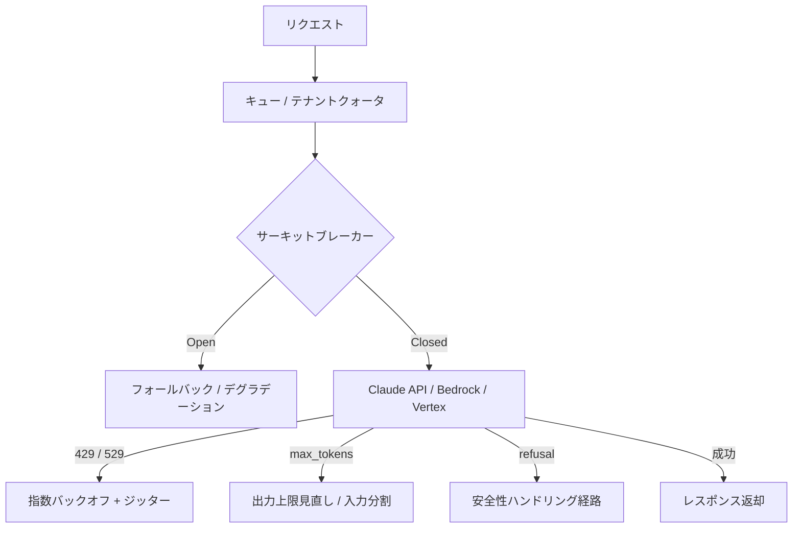
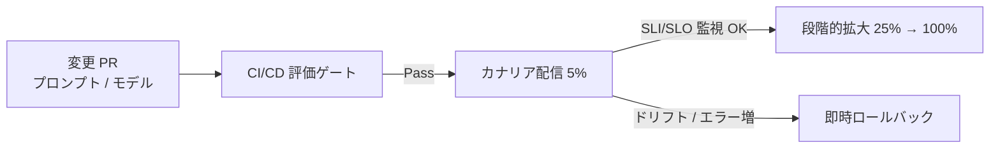

# 第2章 本番環境の統合・信頼性・知識グラウンディング（配点 20%）

> [!TIP]
> **この章のたとえ：国際空港の「管制塔」と「精密な図書館司書」**
>
> 飛行機（リクエスト）が急増しても、滑走路が1本だけなら大渋滞します。天候不良（レート制限）なら待機旋回し、機体トラブル（安全性拒否や出力長超過）なら別の滑走路（フォールバックモデル）へそのまま飛ばすのではなく、専用の着陸手順へ振り分けなければなりません。そして図書館司書（検索・グラウンディング）は、曖昧な記憶で答えず、必ず「どの棚のどの資料の何ページか」を添えて回答します。

## この章のゴール

- 停止理由やエラー種別を正確に分類し、適切なリトライ・サーキットブレーカー・モデル／リージョン／プラットフォーム間フォールバックを設計できる。
- レート制限、トークンスループット、キューイング／バックプレッシャー、Batch API の経済性、マルチテナント分離からボトルネックを特定できる。
- リモート MCP の認証・バージョン管理・段階的ロールアウト（カナリア／ロールバック）とプロンプト変更管理を運用できる。
- エージェント型検索と RAG を比較評価し、ハイブリッド検索・リランキング・出典引用・不確実性明示・検索品質の段階的診断ができる。

## 要点3つ

1. **すべての失敗を同じリトライ／フォールバック経路に流してはならない。** レート制限（`429` / `529`）は指数バックオフ＋ジッターでリトライし、`max_tokens` は上限調整や分割、安全性拒否（`refusal`）は専用処理経路へ分岐させる。
2. **スループット設計は「何が制約か」を見極める。** RPM/ITPM/OTPM のレート制限なのか、同時実行によるトークンスループットなのか、遅延許容できるバッチ経済性なのかを切り分け、キューとバックプレッシャーで保護する。
3. **知識グラウンディングは「検索品質の4段階」で診断する。** 取得漏れ（Recall）、チャンク分断（Chunking）、順位付け（Ranking）、生成時の無視（Synthesis）のどこで落ちたかを特定し、出典引用と不確実性シグナルを強制する。

## 30秒で全体像

## 用語

| 用語 | 意味 |
| --- | --- |
| 指数バックオフ＋ジッター | リトライ間隔を指数的に延ばしつつ乱数（ジッター）を加えて再試行集中（Thundering Herd）を防ぐ手法 |
| サーキットブレーカー | 下流障害が一定閾値を超えた際に回路を開き、無駄な呼び出しを止めて即座にフォールバックさせる保護機構 |
| グレースフルデグラデーション | 障害時に全停止させず、軽量モデル・キャッシュ応答・機能縮小などでサービスを継続する設計 |
| バックプレッシャー | 下流の処理能力を超えた際に、キュー長制限や `429` 返却などで上流からの流入速度を抑制する仕組み |
| Message Batches API | 非同期一括処理 API。同期比 **50% コスト削減**、最大24時間以内処理（SLO 保証なし）、ツール往復不可 |
| Streamable HTTP | リモート MCP サーバーで推奨される HTTP ベースのトランスポート方式（旧 SSE から移行） |
| エージェント型検索 (Agentic Search) | エージェントが Grep / 検索ツールを自律的に複数回呼び出して情報を探索する方式 |
| ハイブリッド検索 | キーワード検索（BM25 等）とベクトル意味検索を組み合わせ、固有名詞と意味の両方を捉える手法 |
| リランキング (Reranking) | 初期検索で広めに取得した候補を、クロスエンコーダ等で精査して上位に並べ替える処理 |

## 本編

### 2-1 Claude サービスの信頼性エンジニアリング

本番環境で最も多い失敗は、**原因の異なるエラーをすべて同じリトライやフォールバックモデルへ流してしまうこと** です。

#### 停止理由・エラー別の分岐設計

| 現象 / `stop_reason` / ステータス | 原因 | 正しい対処 | 誤った対処 |
| --- | --- | --- | --- |
| **HTTP `429` / `529` (overloaded)** | レート制限・一時的過負荷 | `Retry-After` ヘッダー尊重、指数バックオフ＋ジッター、別リージョン／別モデルへフォールバック | 固定間隔の即座リトライ（負荷増幅） |
| **`stop_reason: "max_tokens"`** | 出力トークン上限に到達して切断 | 出力上限の引き上げ、または入力を分割して処理 | そのまま別モデルへリトライ（同じ位置でまた切れる） |
| **`stop_reason: "refusal"`** | 安全性ポリシーによる拒否 | 安全性の専用ハンドリング経路へ回し、理由確認やユーザー案内を行う | 拒否を別モデルで無差別にリトライしてコストを浪費する |
| **`400` / コンテキスト超過** | 入力トークンがウィンドウ上限を超過 | Compaction / Context Editing / 入力削減を行う | リトライ回数を増やす |

#### プラットフォーム間・リージョン間の差異に注意

ファーストパーティ API（Anthropic API）とクラウドプラットフォーム（Amazon Bedrock / Google Cloud Vertex AI）では、以下の差異があるため単純なフォールバックでは動作が変わることがあります。

- **モデル ID と機能提供時期**: 新機能（Context Editing や特定ベータ機能、Prompt Caching の仕様、Batch API の形式）の提供タイミングやパラメータ形式が異なる。
- **リージョン制約とクォータ**: クロスリージョン推論（Cross-Region Inference）やプロビジョンドスループット（Provisioned Throughput）の有無、データレジデンシー要件（EU/US/JP 等）。
- **認証とネットワーク**: API キー vs IAM ロール（STS / Workload Identity）。

### 2-2 スケールとスループットの管理

大量のワークロードを捌く際は、**何が真のボトルネックか** を特定する必要があります。

| 制約要因 | 症状と特徴 | 対策 |
| --- | --- | --- |
| **レート制限 (RPM / ITPM / OTPM)** | 分間平均では上限未満でも、**短時間のバースト（Token Bucket）** や **リクエスト時の `max_tokens` 事前予約** により `429` が発生する | クライアント側ペーシング（スムージング）、`max_tokens` を実需に合わせて小さく設定、Prompt Caching による非キャッシュ入力削減、複数リージョン分散 |
| **トークンスループット (TTFT / 生成速度)** | エラーは出ないが1件あたりの完了が遅く、同時接続が詰まる | ストリーミング（`input_json_delta` によるツール引数の逐次処理を含む）、中断ストリームからの復旧設計、並列リクエスト化 |
| **バッチの経済性** | 同期 API での夜間・大量処理によりコストが膨張 | Message Batches API（50%割引）への移行。ただし遅延保証なし・ツール往復不可に注意 |

#### マルチテナントのクォータと分離

1つのテナント（顧客）の暴走が全顧客のレート制限を食い潰す「ノイジーネイバー問題」を防ぐため、以下を実装します。

- テナントごとの **トークン／リクエストクォータ** とレート制限（API ゲートウェイ層）
- テナント別キューによる **公平なスケジューリング**（優先度付きキュー・サーキットブレーカーのテナント分離）
- テナント単位のコスト配分（Chargeback / Showback）用メタデータ付与

### 2-3 本番環境の MCP と変更管理

ローカル開発の stdio MCP から本番のリモート MCP へ移行する際は、運用・セキュリティ・互換性管理が不可欠です。

#### リモート MCP の本番要件

- **トランスポートと認証**: リモートサーバーでは Streamable HTTP を使用し、OAuth 2.1（PKCE / トークン検証・スコープ制限）や mTLS、API ゲートウェイで認証を強制する。静的シークレットの共有やリポジトリ直書きは厳禁。
- **ツールとスキーマのバージョン管理**: ツール名や入力スキーマの必須項目追加・型変更は **破壊的変更** となる。バージョン付きエンドポイント（`/v1/mcp`, `/v2/mcp`）や後方互換な任意フィールド追加で移行期間を設ける。
- **動作の破壊的変更に対する移行テスト**: ツール出力フォーマットやエラー形式が変わった際、エージェントが誤動作しないか回帰テストを実行する。

#### モデル・プロンプトの段階的ロールアウト

- **プロンプトのバージョン管理**: プロンプトをコード外にハードコードせず、Git 管理・不変バージョン ID で追跡可能にし、どのトレースがどのプロンプト版で動いたか記録する。
- **ゲートウェイ／ルーティング層**: アプリ本体を再デプロイせずに、モデル切替・重み付きカナリア配信・即時ロールバックを切り替えられる AI ゲートウェイを配置する。

### 2-4 大規模な検索と知識グラウンディング

本番アプリケーションで外部知識を参照させる際、**エージェント型検索** と **RAG** の特性を理解して選択・統合します。

| 手法 | 仕組み | 強み | 弱み |
| --- | --- | --- | --- |
| **RAG (Retrieval-Augmented Generation)** | 事前にチャンク化・埋め込みを行い、クエリ時に検索してコンテキストへ注入 | 低レイテンシ・予測可能なコスト・大規模コーパスに強い | 固定チャンクで文脈が切れる、複数ホップの探索に弱い |
| **エージェント型検索** | エージェントが検索・Grep・閲覧ツールを反復呼び出しして探索 | 複雑な多段階推論、最新コード・文書の正確な探索に強い | ターン数が増えレイテンシ・コストが高くなる |
| **ハイブリッド構成** | 初期候補をハイブリッド検索＋リランキングで絞り、不足時のみエージェントが追加検索 | 速度と精度のバランスが良い | パイプラインが複雑になり各段の監視が必要 |

#### 検索パイプライン設計と障害診断（4段階）

検索に根拠を置くアプリで回答品質が落ちた場合、**生成モデルを疑う前にどの段階で失敗したか** を切り分けます。

1. **チャンク分断 (Chunking)**: 見出し・表・文脈が途中で切れており、単独チャンクでは意味が通じない → **Contextual Retrieval**（各チャンクの埋め込み・BM25 インデックス作成前に、文書全体の文脈を説明する短い前置きを付与する手法）や親子チャンクを採用。
2. **取得漏れ (Retrieval Recall)**: 固有名詞や型番がベクトル検索で拾えていない → **ハイブリッド検索（Contextual BM25 + ベクトル）** を導入。
3. **順位不備 (Ranking)**: 正解チャンクがトップ20にはあるがトップ5に入っていない → **リランキング（Reranker）** を導入。
4. **グラウンディング失敗 (Synthesis)**: 正解チャンクはコンテキストにあるのにモデルが無視／幻覚を起こす → **Citations API** や `search_result` ブロックを用いて文字単位の引用元を強制し、該当情報がない場合の「不明（`insufficient_evidence`）」出力を設計する。

## まとめ：どう判断するか

| 状況 | 避ける選択 | とるべき選択 |
| --- | --- | --- |
| リトライ経路に `429`・`max_tokens`・`refusal` が混在 | 全エラーを同一のフォールバックモデルへリトライ | 停止条件ごとに分岐（`429` はバックオフ、`max_tokens` は上限調整、`refusal` は安全処理経路） |
| 1つの顧客の大量リクエストで他顧客も `429` になる | 全テナント共有の単一キューで処理 | テナント別クォータ・キュー分離・バックプレッシャーを導入 |
| ツール定義の変更で既存エージェントが失敗 | 既存ツールをインプレースで破壊的変更 | スキーマのバージョン管理と移行テスト、段階的ロールアウトを実施 |
| 固有名詞の検索漏れで RAG が「情報なし」と答える | プロンプトで「もっとよく探せ」と指示 | ベクトル単独検索からハイブリッド検索（BM25 + ベクトル）＋リランキングへ改善 |
| 検索結果が不十分なときにモデルが推測で補う | そのまま回答を生成させる | 出典の引用を必須化し、根拠不足時は不確実性を明示させる |

## 確認問題

### 問1
本番の Claude 統合システムで、特定のリクエストに対して `stop_reason: "max_tokens"` が返却されました。ハーネスがこのエラーを「一時的エラー」とみなして別のリージョンの同じモデルに3回リトライした結果、入力と出力のトークンコストが4倍に膨れ上がり、ユーザーには同じ途切れた応答が返されました。根本原因と正しい修正はどれですか。

A. バックオフ時間を30秒に延ばしてリトライする  
B. `stop_reason` に応じて分岐し、`max_tokens` はリトライせずに出力上限の調整や入力分割・継続生成で処理する  
C. サーキットブレーカーを開いて全トラフィックを停止する  
D. すべてのリクエストを Message Batches API に切り替える

解答

**B**。`max_tokens` はネットワーク障害ではなく出力長上限への到達であり、同じ入力でリトライしても同じ位置で切断されます。停止理由で分岐し、上限引き上げや分割処理に切り替える必要があります。

### 問2
エンタープライズ向けマルチテナント環境で、ある1社が大量の文書要約ジョブを急激に投入したため、API の ITPM（1分あたり入力トークン数）上限に達し、他の全顧客のリアルタイムチャットまで `429` エラーで遅延しています。優先的に導入すべき対策はどれですか。

A. リトライ回数を無制限にして全員が成功するまで待機させる  
B. テナント別のクォータとキュー分離、およびバックプレッシャーを導入し、バッチ処理は Message Batches API 等へ分離する  
C. 全顧客のモデルを最も高価な上位モデルに切り替える  
D. プロンプトキャッシュを無効化する

解答

**B**。ノイジーネイバーを防ぐには、テナントごとのクォータ・キュー分離とバックプレッシャーが必須です。さらに遅延許容できる大量要約は Batch API へ分離すると ITPM の競合を緩和できます。

### 問3
社内規定検索 RAG システムで、特定のエラーコード（例：`ERR-9042`）に関する質問の正答率が低いことが判明しました。検索ログを調べると、正解文書はインデックスに存在するものの、ベクトル検索の上位10件にすら入っていません。最初に取るべき対策はどれですか。

A. 生成モデルの温度パラメータ（`temperature`）を下げる  
B. ベクトル検索にキーワード検索（BM25）を組み合わせたハイブリッド検索とリランキングを導入する  
C. システムプロンプトに「エラーコードを推測しないこと」と追記する  
D. チャンクサイズを現在の10倍に大きくする

解答

**B**。固有名詞や型番・エラーコードは意味ベースのベクトル検索だけでは取りこぼしやすいため、BM25 等のレキシカル検索を組み合わせたハイブリッド検索で取得漏れを防ぎ、リランキングで順位を上げます。

### 問4
本番環境で稼働するリモート MCP サーバーにおいて、既存ツールのパラメータ名を `user_id` から `account_id` に変更したいと考えています。複数の本番エージェントがこの MCP サーバーを参照している場合、最も安全な変更管理手順はどれですか。

A. メンテナンス時間外にいきなり `account_id` へ置換し、エラーが出たエージェントから順次修正する  
B. 新しいパラメータを任意項目として後方互換を保つかバージョン付きエンドポイントを用意し、移行テストと段階的ロールアウトを経て旧仕様を廃止する  
C. エージェントのシステムプロンプトだけで「`user_id` の代わりに `account_id` を使え」と指示する  
D. MCP サーバーの認証を無効化してテストを高速化する

解答

**B**。本番のツール・スキーマ変更は破壊的変更になり得るため、バージョニングや後方互換性の維持、移行テスト、段階的ロールアウトで安全に移行します。

### 問5
あるサービスはファーストパーティ API をプライマリとし、障害時のフォールバック先としてクラウドプラットフォーム（Bedrock / Vertex AI）上の Claude を設定しています。フェイルオーバー試験を行ったところ、特定のベータ機能パラメータが原因でフォールバック先が `400 Bad Request` を返しました。設計上見落とされていた点はどれですか。

A. クラウドプラットフォーム間でモデル ID 形式や利用可能な API 機能・ヘッダーに差異があることを考慮したリクエスト変換・構成一貫性  
B. フォールバック先では常に指数バックオフを無効にする必要がある点  
C. クラウドプラットフォームでは `stop_reason` が返らない点  
D. フォールバック先では JSON 出力が一切サポートされない点

解答

**A**。ファーストパーティ API とクラウドプラットフォームではモデル ID、利用可能なベータヘッダー、機能提供時期に差異があるため、ゲートウェイ層で差異を吸収する構成一貫性が必要です。

## 自分で確かめる

1. サンプルの HTTP クライアントで `429`、`max_tokens`、`refusal` の3パターンを模擬し、それぞれ異なる分岐（バックオフ再試行・上限調整/分割・安全ハンドリング）に入ることを確認する。
2. ハイブリッド検索（BM25 + ベクトル）で「固有名詞・エラーコードを含むクエリ」と「抽象的な意味クエリ」の検索順位変化を比較する。
