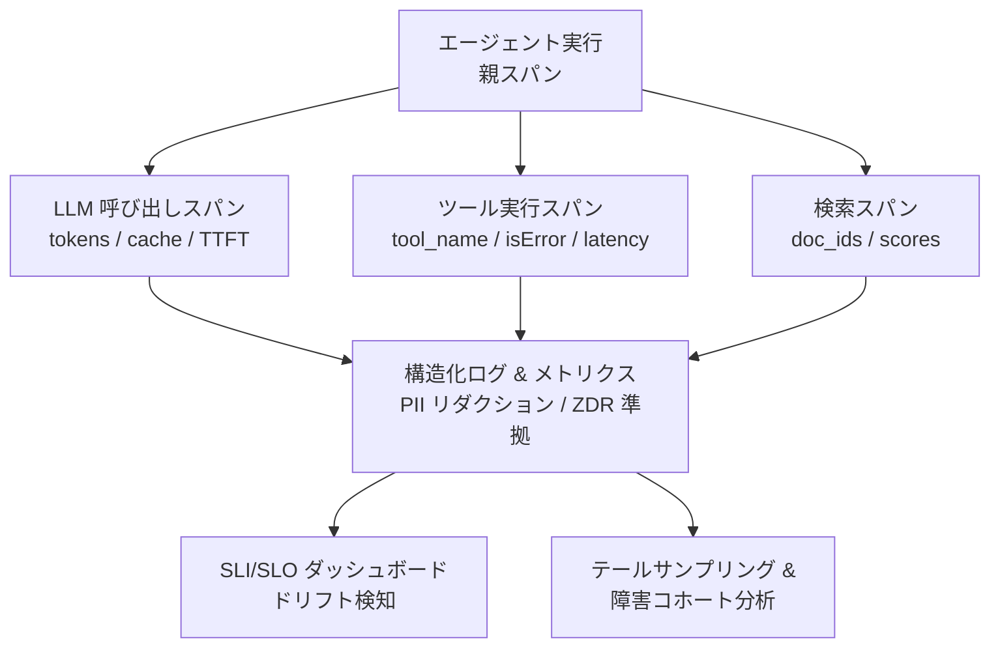

# 第3章 オブザーバビリティと本番環境のモニタリング（配点 12%）

> [!TIP]
> **この章のたとえ：飛行機の「ブラックボックス」と「コックピット計器」**
>
> 飛行機が落ちたあとに「たぶんエンジンの調子が悪かった」では原因を特定できません。各部品のセンサー（分散トレース）、燃料消費（トークンとコストのメトリクス）、計器の異常警告（SLI/SLO とアラート）が必要です。ただし、乗客の個人情報（PII）や機密会話はプライバシー規則（ZDR）に従って保護したうえで記録しなければなりません。

## この章のゴール

- エージェントループとツール呼び出しの分散トレース、コスト、キャッシュ効率を計装できる。
- ゼロデータ保持（ZDR）などのプライバシー制約下で安全なコンテンツキャプチャを構成できる。
- LLM サービス特有の SLI / SLO を定義し、品質ドリフト・動作回帰・異常使用を検出するアラートを設計できる。
- サンプリング戦略、集計、障害コホート分析を用いて大量トレースからシステム全体の問題を定量化できる。

## 要点3つ

1. **エージェントの観測は「リクエスト単位」ではなく「トレース単位」で行う。** 親エージェントからサブエージェント、各ツール呼び出し、検索結果、モデル応答までを親子スパン（Span）で紐づけ、推論とグラウンディングを追跡可能にする。
2. **デバッグ可能性とプライバシー（ZDR / PII）は設計で両立する。** 機密データをそのまま平文ログに流さず、構造化イベント・メタデータ・PII リダクション・条件付きサンプリングを組み合わせる。
3. **平均値（Average）は本番の異常を隠す。** パーセンタイル（p95 / p99）、キャッシュヒット率、モデル更新前後のドリフト、障害コホート分析によって局所的な悪化を炙り出す。

## 30秒で全体像

## 用語

| 用語 | 意味 |
| --- | --- |
| 分散トレース (Distributed Tracing) | 1つのリクエストから派生する全 LLM 呼び出し・ツール・サブエージェント・検索をトレース ID とスパン階層で記録する手法 |
| 構造化ログ | JSON 等の機械可読な形式で、`trace_id`, `tenant_id`, `prompt_version`, `stop_reason` 等を統一スキーマで出力するログ |
| ZDR (Zero Data Retention) | API プロバイダー側でプロンプト・応答データを保持しない契約・構成要件 |
| SLI (Service Level Indicator) | サービスの品質や信頼性を測る定量指標（例：TTFT p95、ツール成功率、グラウンディング率） |
| SLO (Service Level Objective) | SLI に対する目標水準（例：月間成功率 99.5% 以上、TTFT p95 が 1.5秒以内） |
| 品質ドリフト | モデル更新、入力データ分布の変化、外部データ劣化により、エラーは出ないのに回答品質が徐々に悪化する現象 |
| コントロールバンド (`bands.yaml`) | 過去30日間の平均と標準偏差（`σ`）およびウェスタン・エレクトリック・ルールでドリフトを段階検知する仕組み |
| Compliance API | 会話コンテンツ・監査ログ・アクティビティフィードを保持し、CASB/DLP/eDiscovery/SIEM と連携する API（Primary Owner が有効化） |
| Analytics API / Spend Limits API | Analytics API は利用量・コスト集計（チャージバック）用、Spend Limits API は支出上限設定用の API |
| ヘッドサンプリング | トレース開始時に一律確率（例：5%）で記録有無を決める方式。稀な障害を取りこぼしやすい |
| テールサンプリング | トレース完了後に結果を見て保存を決める方式（エラー・高レイテンシ・低評価は 100% 保存等） |
| 障害コホート分析 | エラーや低品質が発生したトレース群を、モデル版・プロンプト版・ツール種別・テナント等の属性でグルーピングし偏りを定量化する分析 |

## 本編

### 3-1 テレメトリと計装

本番の Claude システムでは、単なる HTTP ステータスコードだけでなく、エージェント内部の振る舞いを計装します。

#### 記録すべき必須テレメトリ

| カテゴリ | 計装する主な属性 | 診断できる問題 |
| --- | --- | --- |
| **エージェントループ** | `trace_id`, `parent_span_id`, `turn_index`, `stop_reason`, `max_turns_reached` | 無限ループ、途中打ち切り、`max_tokens` 切断 |
| **ツール呼び出し** | `tool_name`, `duration_ms`, `isError`, `errorCategory`, `retry_count` | 特定ツールの遅延・タイムアウト、誤ったツール選択 |
| **トークンとコスト** | `input_tokens`, `output_tokens`, `model`, `tenant_id`, `estimated_cost_usd` | コスト急増、テナント別原価、トークン肥大化 |
| **キャッシュパフォーマンス** | `cache_creation_input_tokens`, `cache_read_input_tokens`, キャッシュヒット率 | プレフィックス破壊によるキャッシュミス、TTL 切れ |
| **グラウンディングと推論** | `retrieval_doc_ids`, `rerank_scores`, `cited_ids`, `prompt_version` | 検索漏れか生成無視かの切り分け、プロンプト版ごとの品質比較 |

#### ZDR（ゼロデータ保持）およびプライバシー制約下のログ設計

医療・金融・エンタープライズ環境では、本番ログに生プロンプトや顧客の PII（個人識別情報）を残せないケースが多くあります。

- **常に記録可能（メタデータ）**: トークン数、レイテンシ、モデル名、プロンプトバージョン、`stop_reason`、ツール名、エラー種別、ハッシュ化されたセッション ID。
- **PII リダクション後に記録**: 入力・出力・ツール引数をログパイプラインへ送る前に、正規表現や NER で氏名・メール・カード番号等をマスキングする。
- **ZDR 環境でのコンテンツキャプチャ**: プロバイダー側にログが残らないため、障害調査に必要な最小限のデータ（サンプリングされたトレースやエラー時のみ）を自社管理の暗号化・アクセス制御付きストアに一時保持する（またはコンテンツ記録自体をオプトイン／環境変数で制御する）。

#### 組織レベルの可視性3要素と保持期間（Retention）

組織でメンバーのアクセスを開始する前に、以下の可視性設定を完了させておく必要があります（後から有効化しても空白期間は埋まりません）。

| 要素 | 特徴と設定のポイント |
| --- | --- |
| **Compliance API** | 会話コンテンツ（チャット、ファイル、Cowork / Claude Code のセッショントランスクリプト）＋監査ログイベント＋アクティビティフィードを保持し、CASB / DLP / eDiscovery / SIEM と統合する。**Primary Owner** が有効化し、キーのスコープ（親組織全体または単一の子組織）を選択する。監査ログ（メタデータのみ）や Primary Owner 向け一括取得のフルデータエクスポートとは役割が異なる |
| **OpenTelemetry (OTel)** | 運用テレメトリを可観測性スタックへ送信する。Claude Desktop の Cowork エクスポートは現行版でメタデータのみがデフォルト（プロンプト等は `otlpContentCapture` デバイスポリシーで有効化、ただしメンバーのメールアドレスと接続先フォルダパスは常に含まれるため必要に応じコレクターでフィルタする） |
| **保持期間（Retention）** | デフォルトは無期限、カスタム最短期間は **30日**（ゼロ保持オプションなし）。組織全体に適用され、短縮すると過去履歴が復元不可で消去される。アクティビティフィードとリモートセッショントランスクリプトは設定にかかわらず **6年間**（リモートはユーザー削除まで）。ローカルセッショントランスクリプトはカスタム期間に従う（未設定時は6年間、HIPAA 有効組織では取得から **30日間**） |
| **推論フック（Inference hooks）** | Claude に届くべきでないコンテンツを事後保持ではなく**入口（応答前）で許可・拒否**するサーバーへルーティングする仕組み |

### 3-2 本番環境のモニタリングとアラート

従来の Web サービス（CPU・メモリ・HTTP 500 率）だけでは、LLM システムのサイレント障害（**HTTP 200 だが回答がデタラメ**）を検知できません。

#### LLM システムの主要な SLI とアラート設計

| 指標 (SLI) | 監視すべき対象 | 検知できる異常 |
| --- | --- | --- |
| **レイテンシ** | TTFT（最初のトークンまで）と E2E 全体時間（p50 / p95 / p99） | ストリーミング詰まり、思考トークン肥大化、ツール遅延 |
| **信頼性・停止理由分布** | HTTP 429/5xx 率、`stop_reason` の割合（`end_turn`, `max_tokens`, `refusal`） | レート制限逼迫、予期しない拒否率の上昇、出力切断の急増 |
| **トークン・コスト効率** | 1リクエストあたりの平均コスト、入力/出力トークン比率、キャッシュヒット率 | ループ暴走、キャッシュ無効化デプロイ、異常なユーザー利用（濫用） |
| **品質・ドリフト指標** | オンライン評価スコア、フォーマット検証失敗率、ユーザー低評価率、ツール再試行率 | **モデル更新後のドリフト**、プロンプト劣化、知識ベース陳腐化 |

> [!WARNING]
> **モデル更新後のドリフトに注意**：モデルのスナップショット更新やクラウド側のマイナー変更後、エラー率は 0% のまま「出力フォーマットの揺れ」「拒否率の微増」「ツール呼び出し回数の増加」が起きることがあります。デプロイ時刻・モデル ID ごとに指標をスライスして監視します。

#### コントロールバンドとメトリクスの自律ループ（ステージ6：維持）

人が手動で監視画面を見るだけでなく、決定的な監視スクリプトが異常を検知して Claude をヘッドレス起動し、`intent.md` を出力して開発パイプラインへ流す「メトリクスのループを閉じる」設計が有効です。

- **`bands.yaml` とウェスタン・エレクトリック・ルール**: 過去30日間の1時間ごとの読み取り値の平均と標準偏差（`σ`、フラットベースライン対策で `MIN_SIGMA = 0.01`）で正常帯域を定義します。緩やかなドリフト検知のため、**直近5回中4回が `1σ` 超え**、または **8回連続で平均超え** の場合は **`2σ` 扱い** に引き上げます。
- **ティア別アクション**:
  - `1sigma`: `action: log`（ログ記録のみ。月720回で偶然1日4回程度発生するため通知しない）
  - `2sigma`: `action: diagnose`（`Read,Grep,Bash(gh run view *)` 等の読み取り専用ツールで診断）
  - `3sigma`: `action: propose`（`routes: [pull_request, runbook:rollback-deploy]` のゲート付きルートのみ実行可能）
- **インシデントの回帰防止と Claude Tag 連携**: 修正リリース後は再現用 eval JSON をスイートに追加します。また、Slack チャンネルに常駐する **Claude Tag**（パブリックベータ）と MCP を連携させ、インシデント対応やメトリクス確認、ポストモーテム記録を行うこともできます。

### 3-3 大規模なトレース分析と支出管理

本番で1日何百万件もリクエストが流れる場合、全トレースの生テキストを保存・目視することは不可能です。

#### 支出の管理（Enterprise 課金とトークンプール制御）

Enterprise 契約はメンバー単位のプラットフォーム料金＋**組織全体で共有されるトークンプール**で構成されます（セールス支援型は月次後払い、セルフサービス型はクレジット前払いで枯渇すると停止）。自律ステップが多い Cowork や Claude Code は消費量が多くなりやすいため、以下のレバーで上限を動かさずに支出を抑えます。

- **最も効果的なレバー**: 組織／ロールごとの**デフォルトモデルをミドルレンジに設定**＋**デフォルトエフォートを中程度に設定**＋定型業務へのエフォート上限設定（多くのユーザーはピッカーを触らないため効果が高い）。
- **コンテキスト設計と定期タスクの見直し**: 常にコンテキストに含まれる「プロジェクト」より、オンデマンド読み込みの「スキル」の方がトークン効率に優れます。また、放置されたスケジュールタスクがトークンプールを消費し続けないよう定期的に棚卸しします。
- **支出レビューの3サーフェス**: 定期レビュー用の**分析ダッシュボード**（Groups ビューあり）、単発質問用の **Analytics チャット**、財務ツール連携・チャージバック用の **Analytics API**（Primary Owner がキー発行、グループ別分解可）。なお、利用上限の設定には **Spend Limits API** を使います。

#### サンプリング戦略の選択

- **ヘッドサンプリング（一律 1% など）**: コストは低いが、発生率 0.1% の重大なエッジケース障害を取りこぼす。
- **テールサンプリング（推奨）**: 正常かつ低レイテンシなトレースは 1〜5% に間引き、**エラー発生・高レイテンシ（p99超）・`refusal`・再試行発生・ユーザー低評価** のトレースは **100% 保存** する。

#### 障害コホート分析 (Failure Cohort Analysis)

個々のトレースを1件ずつ眺めるだけでは「全体で何が一番効いているか」が見えません。トレースを集計し、属性別のコホート（集団）で比較します。

- 例：全体のエラー率は 2% だが、コホート分析すると「特定の `mcp_server_version=v2` × `language=ja` の組み合わせ」だけでエラー率が 35% に跳ね上がっていることを定量的に特定できる。

## まとめ：どう判断するか

| 状況 | 避ける選択 | とるべき選択 |
| --- | --- | --- |
| マルチエージェントのどこで遅いか分からない | アプリの最終応答時間だけを記録する | 親・子・LLM・ツール・検索ごとにスパンを分けた分散トレースを計装する |
| ZDR / プライバシー要件で生テキストを保存できない | ログを完全に無効化する | PII リダクションと、メタデータ（トークン・`stop_reason`・版数・ツール名）の構造化ログを残す |
| キャッシュコストが突然倍増した | モデル料金のせいだと推測する | `cache_creation_input_tokens` と `cache_read_input_tokens` の推移でヒット率を診断する |
| 稀に起きる本番障害を再現・調査したい | 低確率のヘッドサンプリングのみに頼る | エラー・高レイテンシ・異常停止を 100% 残すテールサンプリングを採用する |
| モデル更新後に品質クレームが増えた | HTTP エラー率が 0% なので正常と判断 | モデル ID 別・停止理由別・オンライン評価スコア別のドリフトを監視する |

## 確認問題

### 問1
本番環境で稼働中のエージェントシステムにおいて、週末にトークンコストが通常の3倍に跳ね上がりました。HTTP エラー率は変化していません。原因を最も素早く特定するためにダッシュボードで確認すべきメトリクスの組み合わせはどれですか。

A. サーバーの CPU 使用率とディスク I/O  
B. `cache_read_input_tokens` / `cache_creation_input_tokens`（キャッシュヒット率）、1トレースあたりのターン数、`tenant_id` 別の使用量  
C. データベースのコネクションプール数  
D. ユーザーのブラウザ種別と OS バージョン

解答

**B**。HTTP エラーなしでコストが急増する場合、キャッシュ無効化（ヒット率低下）、エージェントのループ回数増加（ターン数増）、特定テナントの異常利用が主な原因です。

### 問2
金融機関の Claude アプリケーションで、コンプライアンス要件により ZDR（Zero Data Retention）が適用されており、本番の顧客プロンプト平文を一般的なログ基盤に保存できません。しかし、障害発生時の切り分け能力は維持したいと考えています。最も適切な計装方針はどれですか。

A. すべてのロギングとトレースを完全に停止する  
B. トークン数、レイテンシ、`stop_reason`、ツール名、エラー種別、プロンプト版数などの構造化メタデータを常時記録し、コンテンツは PII リダクションと厳格なアクセス制御下でエラー時のみ限定キャプチャする  
C. ZDR を解除して全顧客の生プロンプトを平文で外部 SaaS に送信する  
D. 開発者のローカル端末に本番トラフィックを複製して表示する

解答

**B**。プライバシー制約下でも、構造化メタデータによってループ・コスト・ツール障害の大半は診断可能です。コンテンツが必要な場合もリダクションと最小権限のサンプリングで制限します。

### 問3
1日500万件のリクエストを処理するシステムで、全トレースの保存コストが高すぎるため、一律 1% のヘッドサンプリングを導入しました。しかし、発生率 0.2% の「特定条件でのみ発生するツール引数の破損」が調査できなくなりました。適切な改善策はどれですか。

A. サンプリング率を 0.1% にさらに下げる  
B. 正常リクエストは低率でサンプリングしつつ、エラー・`max_tokens`・異常レイテンシ・低評価のトレースを 100% 保存するテールサンプリングへ切り替える  
C. ログの出力先を標準出力からテキストファイルに変える  
D. 問題が起きるまで本番環境でデバッグプリントを有効にする

解答

**B**。ヘッドサンプリングは稀な障害を取りこぼします。結果に基づいて保存対象を選ぶテールサンプリングなら、コストを抑えつつ異常トレースを確実に捕捉できます。

### 問4
個々の失敗トレースをいくつか確認したところ、すべてツールタイムアウトや出力形式エラーなど別々の症状に見えました。システム全体の根本的な偏りを定量化するために行うべき分析はどれですか。

A. 最も遅かった1件のトレースだけを徹底的に書き直す  
B. 失敗トレースをモデル版・プロンプト版・ツール名・入力カテゴリなどの属性で集計する障害コホート分析を行う  
C. すべてのエラーを無視して SLO を緩和する  
D. ランダムに選んだ成功トレースを10件読む

解答

**B**。障害コホート分析により、一見バラバラに見える障害が特定のプロンプト版やツール・入力カテゴリに集中していることを定量的に発見できます。

### 問5
Enterprise 環境で可視性を確保するため Compliance API と保持期間（Retention）を設定する際、正しい仕様と運用判断はどれですか。

A. Compliance API はメンバーが使い始めた後から有効化しても、過去の空白期間の会話が遡って記録される  
B. Compliance API は Primary Owner がメンバーのアクセス開始前に有効化し、カスタム保持期間の最短は 30日（ゼロ保持オプションはなし）であることを前提に設計する  
C. 保持期間を短縮しても、過去の履歴はアーカイブ領域に残りいつでも復元できる  
D. アクティビティフィードとリモートセッショントランスクリプトは、カスタム保持期間を 30日に設定すると 30日で削除される

解答

**B**。可視性要素はメンバーのアクセス開始前に設定が必須で、後からオンにしても空白期間は埋まりません。カスタム保持期間の最短は 30日（組織全体適用・短縮時は過去履歴が復元不可で消去）で、アクティビティフィードとリモートセッショントランスクリプトは設定にかかわらず 6年間保持されます。

### 問6
`bands.yaml` を用いた自律監視ループで、単発の急増ではなく緩やかな品質ドリフトを検知し、誤アラートを抑えながら原因調査まで自動化したいと考えています。最も適切な設定はどれですか。

A. `1sigma` を検知した瞬間に毎回ページング通知し、本番ロールバックを自動実行する  
B. `1sigma` は `action: log` にとどめ、ウェスタン・エレクトリック・ルール（直近5回中4回が `1σ` 超え、または8回連続平均超え）で `2sigma` 扱いとして読み取り専用ツールによる `diagnose` を実行し、`3sigma` のみゲート付き `propose` ルートへ渡す  
C. 標準偏差の下限を設定せず、フラットな指標で微小変動もすべて `3sigma` として扱う  
D. 支出の上限設定は Analytics API を使って変更する

解答

**B**。`1sigma` は偶然でも1日4回程度発生するためログ記録にとどめ、ウェスタン・エレクトリック・ルールで緩やかなドリフトを `2sigma`（読み取り専用診断）へ昇格させます。なお支出上限の設定は Analytics API ではなく Spend Limits API を使います。

## 自分で確かめる

1. 自身のエージェント呼び出しで `trace_id`, `turn_index`, `stop_reason`, `cache_read_input_tokens`, `tool_name`, `isError` を構造化 JSON ログとして出力するラッパーを書いてみる。
2. 正常応答とエラー応答を混ぜたログに対し、「エラーのみ 100% 抽出」と「`prompt_version` 別の失敗率集計」を行う簡易スクリプトを試す。
