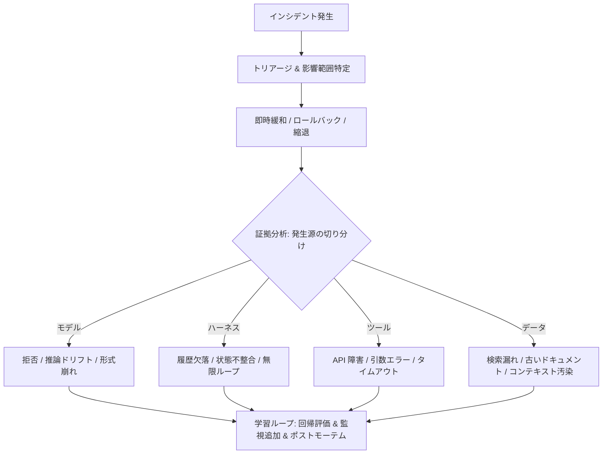

# 第4章 高度なデバッグとインシデント対応（配点 10%）

> [!TIP]
> **この章のたとえ：救急外来の「トリアージ」と「原因究明カンファレンス」**
>
> 患者（本番システム）が急変したとき、いきなり手術（プロンプトの当てずっぽうな修正）を始める前に、まず止血（緩和・ロールバック）を行います。次に、症状が「脳（モデル出力）」「神経伝達（エージェントハーネス）」「手足（ツール）」「カルテ（データ／検索）」のどこから来ているかを証拠に基づいて切り分け、再発防止を検査項目（回帰評価）に組み込みます。

## この章のゴール

- マルチターン、マルチエージェント、非決定的な本番障害の証拠を分析し、発生源（モデル・ハーネス・ツール・データ）を正確に切り分けられる。
- モデルの拒否（`refusal`）や検索グラウンディング障害を、システム障害の一種として診断・処理できる。
- システム停止や品質回帰時のトリアージ、緩和、ロールバック、ステークホルダーへのコミュニケーションを選択できる。
- インシデントの知見を回帰テスト、モニタリングカバレッジ、ポストモーテムへ確実にフィードバックできる。

## 要点3つ

1. **非決定的な障害は「4つの発生源」で切り分ける。** モデルの出力（推論・拒否）、エージェントハーネス（ループ・履歴管理・状態）、ツール（スキーマ・タイムアウト・戻り値）、データ（検索漏れ・陳腐化）を証拠（トレース）で特定する。
2. **インシデント中の最優先は「原因究明」ではなく「止血（緩和・ロールバック）」である。** 最新の変更を即座にロールバックするか、トラフィックを安定版・縮退運転へ逃がしてから根本原因を調査する。
3. **同じインシデントを二度と起こさない「学習ループ」を閉じる。** ポストモーテムで終わらせず、再現ケースを CI/CD の回帰評価スイートに追加し、検知できなかった理由をアラート・SLI に反映する。

## 30秒で全体像

## 用語

| 用語 | 意味 |
| --- | --- |
| 非決定的な障害 | 同じような入力でも毎回再現せず、特定のターン順・検索結果・サンプリングゆらぎで発生する障害 |
| 発生源の切り分け | トレース上の入出力を追い、モデル・ハーネス・ツール・データのどの層に原因があるか特定すること |
| モデル拒否 (`refusal`) | 安全性フィルタや境界条件により、モデルがタスク実行を断る状態。正常応答と混同するとサイレント障害になる |
| トリアージ | 影響範囲（全テナントか一部か）、重大度、緊急度を素早く判定し、対応優先度を決めること |
| 緩和 (Mitigation) | 根本修正を待たず、ロールバック・機能フラグ OFF・レート制限・フォールバック等でユーザー影響を止める処置 |
| ポストモーテム | インシデントのタイムライン・根本原因・対応の振り返り・恒久対策（Blameless Postmortem）をまとめた記録 |
| 回帰評価 (Regression Eval) | インシデントを引き起こした入力やシナリオをテストスイートに追加し、将来の変更で再発しないことを自動検証する仕組み |

## 本編

### 4-1 複雑な障害の診断（4層の切り分け）

マルチターンやマルチエージェントの障害は、「モデルのせい」と決めつけると原因を見誤ります。トレースを上から順に追い、**入力と出力の境界** で責任を切り分けます。

| 発生源 | 典型的な証拠（トレース上の兆候） | 具体的な障害例 |
| --- | --- | --- |
| **1. モデル出力** | 正しいツール結果とプロンプトが渡っているのに、誤った判断や形式違反を返す | 突然の `refusal` 増加、指示無視、長いコンテキスト中間部の見落とし（Lost in the Middle） |
| **2. エージェントハーネス** | モデルの宣言は正しいが、次ターンの入力履歴や状態が壊れている | ツール結果を履歴に戻し忘れ、サブエージェントへの委任時に必須 ID が欠落、`max_turns` 到達後の必須処理漏れ |
| **3. ツール** | モデルの引数は妥当だが、ツール側が異常を返す（または誤解を招く表現） | タイムアウト時に空配列 `[]` を返して「該当なし」と誤認させる、`isError: true` 未設定、5xx 障害 |
| **4. データ / 検索** | ハーネスもツールも正常だが、渡された情報自体が誤り・不足・古い | 古い社内規定が上位にヒット、チャンク分断による数値欠落、信頼できない外部文書からの間接インジェクション |

#### 障害の一種としての「モデルの拒否」

モデルが `stop_reason: "refusal"`（または拒否文言）を返したとき、ハーネスがそれを検知できないと、ユーザーに「申し訳ありませんが対応できません」がそのまま返るか、後続パーサーがクラッシュします。
- 正当な安全拒否なのか、無害な入力に対する **過剰拒否（False Refusal）** なのかを分類し、過剰拒否であればシステムプロンプトの表現調整や誤検知ルールの見直しを行います。

### 4-2 インシデント対応と学習ループ

本番で品質回帰やシステム停止が起きた際、エンジニアは以下の順序で動きます。

#### インシデント対応の4ステップ

1. **トリアージ (Triage)**: 影響を受けているテナント、機能、モデル版、プロンプト版を特定し、重大度を確定する。
2. **緩和とロールバック (Mitigate & Rollback)**: 原因デプロイ（プロンプト更新・モデル変更・MCP 改修）が直近にあるなら **即座にロールバック** する。外部障害ならサーキットブレーカーや縮退運転（軽量機能・人間エスカレーション）へ切り替える。
3. **コミュニケーション (Communicate)**: 影響範囲・暫定回避策・復旧見込みを関係者と顧客へタイムリーに共有する。
4. **学習ループへの反映 (Close the Loop)**:
   - **回帰評価の追加**: インシデントを再現するケースをゴールデンセット／CI 評価ゲートへ必ず追加する。
   - **モニタリングの拡張**: 今回アラートが遅れた、あるいは鳴らなかった理由（例：`refusal` 率を監視していなかった等）を特定し、SLI/アラートを追加する。
   - **ポストモーテム**: 個人を責めず（Blameless）、システムとプロセスの改善アクション（担当・期限付き）を確定する。

> [!IMPORTANT]
> 本番障害の最中に「プロンプトを少しずつ書き換えて様子を見る」のは厳禁です。変更履歴が錯綜してロールバック不能になり、復旧を遅らせます。まずは既知の安定バージョンへ戻すことが最優先です。

## まとめ：どう判断するか

| 状況 | 避ける選択 | とるべき選択 |
| --- | --- | --- |
| マルチエージェントが同じ質問を3回繰り返す | プロンプトに「繰り返すな」と追記する | トレースでハーネスがツール結果を履歴に戻しているか確認する |
| モデル更新直後からユーザー不満が急増した | 本番環境でプロンプトを直接書き換えて調整する | 即座に前のモデル版・プロンプト版へロールバックし、安定後にオフライン評価で検証する |
| RAG が誤った回答をした | まず LLM のモデルサイズを上げる | 検索スパンを確認し、取得漏れ・順位・データ鮮度・生成無視のどこが原因か切り分ける |
| 重大インシデントが復旧した | 報告書を書いて対応完了とする | 再現ケースを CI の回帰テストスイートに追加し、検知用の SLI/アラートを補強する |

## 確認問題

### 問1
本番のマルチエージェント調査システムで、ワーカーが正しい数値をツールから取得したにもかかわらず、最終レポートにその数値が反映されない障害が散発しています。トレースを確認すると、ワーカーの最終応答テキストには数値が書かれていませんでした。問題の発生源と最初に確認すべき箇所はどれですか。

A. モデルが計算能力を失っているため、より大きいモデルに変更する  
B. ハーネスおよび委任プロンプト設計の問題であり、親が受け取れるのは子の最終メッセージのみであるため、ワーカーへの指示で必須数値を含めるよう指定されているか確認する  
C. ツールがタイムアウトしているため、タイムアウト値を10倍に延ばす  
D. 検索データベースのインデックスが破損しているため、再構築する

解答

**B**。ツール結果自体はワーカー内にあり、親に届くのはワーカーの最終メッセージだけです。出力指示やハーネス側の構造化出力契約を見直すべきです。

### 問2
プロンプトの軽微な修正を本番リリースした30分後、一部の顧客カテゴリから「エージェントが正当な問い合わせをすべて拒否する」というクレームが急増しました。インシデント対応として最初に取るべき行動はどれですか。

A. 問題の顧客カテゴリの入力例を収集し、数時間かけて新しいプロンプトを設計・テストする  
B. まずプロンプトを直前の安定バージョンへ即時ロールバックして顧客影響を止め、その後に拒否された入力のトレースを分析する  
C. すべての安全ガードレールを無効化する  
D. モデルの `temperature` を 1.0 に上げて回答の多様性を増やす

解答

**B**。インシデント対応の基本は「まず止血（ロールバック）」です。原因分析と修正は影響を止めたあとに行います。

### 問3
あるエージェントが非決定的な障害（10回に1回だけ不正な JSON 引数でツールを呼び出し失敗する）を起こしています。再現と原因切り分けに最も有効なアプローチはどれですか。

A. 本番ログから失敗した1件だけの最後の応答文を読む  
B. 失敗トレースの全ターン履歴（モデル宣言・ツール定義・`stop_reason`・コンテキスト長）と成功トレースを比較し、発生条件のコホート（特定の長さ・ツール順序・`max_tokens` 切断など）を特定する  
C. 再現しないため仕様として放置する  
D. ユーザーに「失敗したらページをリロードしてください」と案内する

解答

**B**。非決定的な障害は単発の応答文だけでは分からず、成功例と失敗例のトレース比較（特に `max_tokens` や特定履歴パターン）で条件を特定します。

### 問4
先月発生した「特定の外部 API エラー時にエージェントが無限ループに陥り、高額課金が発生した」インシデントについて、再発防止の学習ループとして最も不十分な対応はどれですか。

A. 該当 API エラーを模擬したケースを CI/CD の回帰評価スイートに追加する  
B. 1リクエストあたりのターン数とトークン上限のアラートをモニタリングに追加する  
C. エンジニア全員に「今後このようなコードを書かないように」とメールで注意喚起して終了する  
D. ポストモーテムでハーネスの `max_turns` とエラー分類の欠陥を特定し、修正タスクを起票する

解答

**C**。精神論の注意喚起だけではシステム的な再発防止になりません。回帰テストとモニタリングへの反映が不可欠です。

## 自分で確かめる

1. サンプルのエージェントで「意図的にツール結果を履歴に戻し忘れるバグ」「`max_tokens` を極端に小さくするバグ」をそれぞれ入れ、トレース上での見え方の違いを確認する。
2. 仮想のインシデント（例：モデル更新による JSON 形式崩れ）を想定し、15分で書ける簡易ポストモーテム（タイムライン・緩和策・回帰テスト追加案）を作成してみる。
