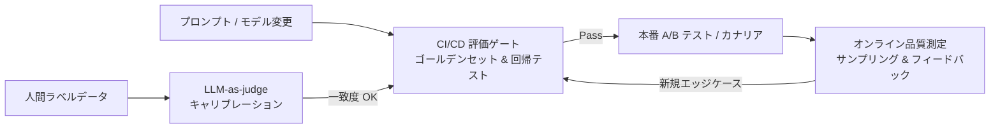

# 第5章 評価エンジニアリングと品質保証（配点 12%）

> [!TIP]
> **この章のたとえ：自動車の「衝突安全テスト場」と「計測器の校正」**
>
> 新しいエンジン（プロンプトやモデル）を公道（本番環境）に出す前に、テストコース（CI/CD 評価ゲート）で合格させなければなりません。しかし、計測器（LLM-as-judge）自体が狂っていれば、危険な車が合格し続けます。まずは人間のプロの評価（ラベル付きデータ）で計測器をキャリブレーションし、コースが古びて暗記されないよう定期的にテストコースも刷新します。

## この章のゴール

- ゴールデンセット、回帰テスト、CI/CD 評価ゲートを含むオフライン評価システムを設計し、長期的な妥当性（汚染・飽和・カバレッジ不足対策）を維持できる。
- 人間ラベルと照合して LLM-as-judge をキャリブレーションし、位置バイアス等の歪みを排除して信頼できるジャッジを構築できる。
- 本番ライブトラフィックでのサンプリング、A/B テスト、フィードバックループ、タスク種別に応じたオンライン評価指標を選択できる。

## 要点3つ

1. **キャリブレーションされていない LLM-as-judge にリリースゲートを任せてはならない。** 位置バイアス（先に出た方を好む等）をランダム化で抑え、人間のラベルとの一致度（Cohen's kappa 等）が許容水準に達するまでゲート権限を与えない。
2. **評価スイートは「作って終わり」にすると腐敗する。** テストデータの汚染（Contamination）、全問正解による飽和（Saturation）、本番分布との乖離（カバレッジ不足）を防ぐため継続的に更新する。
3. **オフライン評価とオンライン評価は車の両輪。** リリース前はゴールデンセットと CI ゲートで守り、リリース後はライブトラフィックのサンプリング・A/B テスト・タスク別指標（抽出・生成・エージェント・検索）で実品質を測る。

## 30秒で全体像

## 用語

| 用語 | 意味 |
| --- | --- |
| ゴールデンセット (Golden Set) | 期待出力や判定基準が確定している厳選されたテストデータセット |
| CI/CD 評価ゲート | プルリクエストやデプロイ時に自動評価を実行し、基準未満の変更をブロックする関門 |
| 評価スイートの飽和 (Saturation) | モデルの進歩等で既存テストの正答率が 99% に達し、改善と劣化の差を識別できなくなる状態 |
| 汚染 (Contamination) | テストデータがモデルの学習データに含まれたり、開発者がテストケースに特化しすぎて汎化性能を測れなくなること |
| LLM-as-judge | 別の LLM（または評価用プロンプト）を使って出力品質を自動採点する手法 |
| 位置バイアス (Position Bias) | ペア比較において、内容ではなく「最初（または最後）に提示された回答」を好んで選んでしまう LLM ジャッジの偏り |
| 評価者間信頼性 (Inter-rater Reliability) | 人間同士、または人間と LLM-as-judge の判定がどれだけ一致しているかの指標（Cohen's κ など） |
| キャリブレーション (Calibration) | ジャッジのスコアや判定基準が、人間の専門家ラベルの判断と一致するように調整・検証すること |

## 本編

### 5-1 評価システムの設計と長期維持

本番運用では「変更したら悪化した（リグレッション）」をリリース前に防ぐため、オフライン評価システムを構築します。

#### 評価スイートの構成要素

1. **動作チェック (Behavioral Checks)**: 決定論的な単体テスト（JSON スキーマ準拠、禁止語不使用、期待ツールの呼び出し有無）。高速・低コスト。
2. **検索・グラウンディング指標**: 検索の適合率（Retrieval Precision）と再現率（Recall）、回答が根拠文書に基づいているか（Groundedness / Faithfulness）。
3. **回帰テストスイート**: 過去のインシデントや既知の難しいエッジケースを集めたテスト群。
4. **非決定的なエージェントの評価（`pass@k` vs `pass^k`）**: エージェントは試行ごとに経路が変わるため、単一実行だけでなく複数試行で評価する。「k回中1回でも成功すればよい」探索タスクには **`pass@k`** を、本番の信頼性（k回連続で成功すべきタスク）には **`pass^k`** を用いる。また、最終結果だけでなく **トランスクリプト（ツール呼び出し軌跡）** も採点し、インフラノイズ（コンテナ・ネットワーク揺らぎ）を分離する。
5. **ゴールデンセットとリリース基準**: 本番分布を反映した代表ケース。プロンプト・モデル・エージェント変更時に「必須テスト 100% 合格＋品質スコア劣化なし」等のゲート基準を設定する。

#### スイートの妥当性を長期に維持する3つの脅威と対策

| 脅威 | 症状 | 対策 |
| --- | --- | --- |
| **飽和 (Saturation)** | 新旧どちらのプロンプトも 98% を取り、違いが見えない | より高難度なエッジケースや本番の失敗トレースを継続追加する |
| **汚染 (Contamination)** | 評価データに合わせた過剰チューニングで、未知の本番入力に弱い | 開発者に見せない非公開ホールドアウトセット（Holdout Set）を保持する |
| **カバレッジ不足** | 新機能や季節変動など、本番の入力分布とテストが乖離 | 本番ライブトラフィックから定期的に新規ケースをサンプリングして補充する |

### 5-2 LLM-as-judge のエンジニアリング

自然言語の品質や複雑な推論をすべてコードで採点することは困難なため、LLM-as-judge を用いますが、**設計と校正を誤ると偽の安心感を生みます**。

#### よくあるバイアスと対策

| バイアス／問題 | 内容 | 対策 |
| --- | --- | --- |
| **位置バイアス** | ペア比較で A（先頭）を無意識に多く選ぶ | **提示順序をランダム化（または A/B 入れ替えて両方評価）** し、一貫しない場合は引き分け・無効とする |
| **冗長性バイアス** | 中身が薄くても長い回答を高評価する | ルーブリックに簡潔性・過剰情報の減点基準を明記し、事実単位（Factuality）で採点させる |
| **自己選好バイアス** | 同じモデルファミリーの出力を高く評価しがち | 評価対象と異なる観点・厳格な参照解答（Reference-based）を与える |
| **ジャッジのドリフト** | ジャッジ用モデルのバージョン更新で採点基準がズレる | ジャッジモデルのバージョンを固定し、更新時は人間ラベルセットで再キャリブレーションする |

#### キャリブレーションの鉄則

1. まず人間がラベル付けした代表サンプル（例：100〜200件）を用意する。
2. 明確なルーブリック（1〜5点の具体例付き、または Pass/Fail の二値基準）を設計する。
3. LLM-as-judge の判定と人間ラベルの一致度（一致率や Cohen's kappa）を測定する。
4. **一致度が許容水準に達するまで、CI/CD のリリースゲートとしての権限を与えない。**

### 5-3 オンラインでの品質測定

オフラインテストをすべて通過しても、本番のリアルなユーザー行動は予測を超えます。

- **ライブトラフィックのサンプリング**: 本番トラフィックの一部を継続的に抽出し、オフラインと同じジャッジや人間レビューにかけて品質推移を監視する。
- **A/B テスト**: 新旧のプロンプトやモデルをトラフィック分割して比較し、ユーザー行動（解決率、再質問率、離脱率、Thumbs Up/Down）で統計的有意差を検証する。
- **タスク種別に合った指標の選択**:

| タスク種別 | 適切な指標 |
| --- | --- |
| **構造化抽出** | フィールド単位の完全一致（Exact Match）、F1 スコア、スキーマ準拠率 |
| **自由生成（要約・文章作成）** | ルーブリックに基づく LLM-as-judge、人間評価、ユーザー修正率 |
| **エージェント型** | タスク完了率（Pass@1）、ターン数・ツール呼び出し効率、ポリシー違反ゼロ率 |
| **検索に根拠を置くもの (RAG)** | 検索適合率／再現率、引用の正確性（Citation Precision）、幻覚率（Hallucination Rate） |

## まとめ：どう判断するか

| 状況 | 避ける選択 | とるべき選択 |
| --- | --- | --- |
| ペア比較ジャッジが先頭の回答ばかり選び、人間と一致しない | そのまま合格しきい値を下げたりモデルだけ変える | 順序のランダム化（または入れ替え）でバイアスを抑え、人間ラベルで再校正するまでゲート権限を外す |
| 評価スイートで全モデルが 99% を記録している | 「品質が完璧になった」と判断する | 飽和を疑い、本番の失敗ケースや高難度ケースを追加して識別力を回復する |
| モデル更新後にジャッジのスコアだけ急に上がった | 製品品質が向上したとみなす | ジャッジモデルのドリフトを疑い、固定の人間ラベルセットでキャリブレーションをやり直す |
| 構造化抽出タスクのオンライン品質を測りたい | 文章の流暢さ（Fluency）を LLM に採点させる | フィールド単位の正確性、検証エラー率、人間修正率などタスク適合指標を選ぶ |

## 確認問題

### 問1
あるチームはペア比較型の LLM-as-judge でプロンプト変更をゲートしていますが、人間評価者との一致率が約 52% しかなく、ジャッジが「1番目に表示された応答」を圧倒的に多く選んでいることが判明しました。最初に取るべき対応はどれですか。

A. ジャッジの合格しきい値を緩めてリリース速度を上げる  
B. 応答の提示順序をランダム化（または入れ替え比較）し、人間がラベル付けしたデータセットで再キャリブレーションを行い、一致度が基準を満たすまでゲート権限を一時停止する  
C. 出力形式をペア比較から 100点満点の自由採点に変えてそのまま運用を続ける  
D. 人間の評価者を増やして本番リリースごとに全件目視する

解答

**B**。公式試験ガイドのサンプル問題でも問われている最重要ポイントです。位置バイアスを除去したうえで人間ラベルと照合し、信頼できる一致度が確認できるまで自動ゲートとして使ってはいけません。

### 問2
半年前から運用しているゴールデンセット（200問）に対して、新しいプロンプトと現行プロンプトのどちらも正答率 98.5% を記録しました。しかし本番ユーザーからは「複雑な例外処理の失敗が増えた」という報告が上がっています。評価システムに起きている問題はどれですか。

A. 評価スイートの飽和（Saturation）および本番分布とのカバレッジ不足  
B. 位置バイアスによる過小評価  
C. トークン上限による `max_tokens` エラー  
D. プロンプトキャッシュの TTL 切れ

解答

**A**。テストが簡単すぎる・古すぎることで差異が出なくなる「飽和」と、本番の新しいユースケースを反映できていない「カバレッジ不足」が起きています。

### 問3
CI/CD パイプラインに評価ゲートを組み込む際、実行コストとフィードバック速度を最適化しつつ品質を担保する設計として最も適切なものはどれですか。

A. すべてのプルリクエストごとに、1万件の複雑なエージェントタスクを最高価な LLM-as-judge で全件評価する  
B. 高速・決定論的な動作チェック（スキーマ検証・単体テスト）と厳選された回帰セットを PR ごとに実行し、大規模なゴールデンセット評価はマージ前や夜間バッチで実行する階層化ゲートにする  
C. CI/CD には評価を入れず、本番デプロイ後 1週間に1回だけ人間が抜粋確認する  
D. テストケースをすべてシステムプロンプトの例題として埋め込む

解答

**B**。高速な決定論的チェックと厳選回帰セットで開発サイクルを回し、重い包括評価はリリース前ゲートとして階層化するのが実務標準です。

### 問4
RAG を用いた社内問い合わせエージェントのオンライン評価において、タスクの性質に最も適した指標の組み合わせはどれですか。

A. 1秒あたりの出力文字数のみ  
B. 検索適合率（必要な社内文書が上位に取れているか）、グラウンディング率（回答が取得文書に基づいているか）、およびユーザー解決率  
C. 回答の平均文字数（長いほど良いとする）  
D. API の HTTP 200 応答率のみ

解答

**B**。検索に根拠を置くエージェントでは、「正しく検索できたか」「検索結果に忠実に答えたか」「ユーザーの課題を解決できたか」を組み合わせて測定します。

## 自分で確かめる

1. 同じ2つの回答 A・B を使い、提示順を `(A, B)` と `(B, A)` に入れ替えて LLM-as-judge に評価させ、位置バイアスが起きるか実験してみる。
2. 自分のプロジェクトで、決定論的チェック（JSON 検証等）3件と、人間ラベル付きの小規模回帰セット（10件）を作り、CI スクリプトで自動判定する流れを組んでみる。
