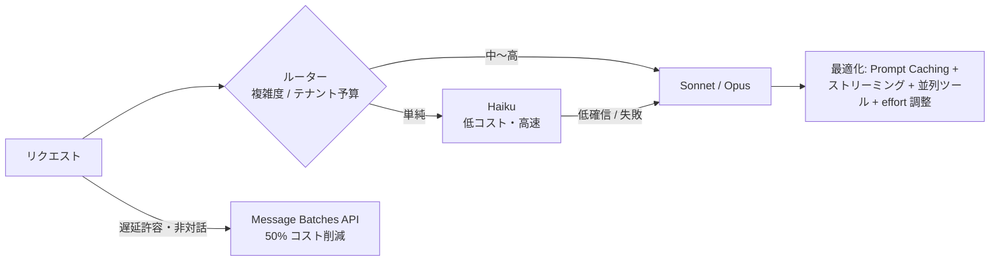

# 第6章 大規模環境でのコストとレイテンシの最適化（配点 8%）

> [!TIP]
> **この章のたとえ：物流ネットワークの「配車最適化」と「高速道路の優先レーン」**
>
> すべての荷物を大型トラック1台（最上位モデル）で運べば確実ですが、燃料代（コスト）が破綻します。軽トラック（Haiku）で運べる荷物は振り分け、同じルートは定期便（Prompt Caching）を使い、急がない荷物は深夜便（Message Batches API）に回します。急ぐ荷物には、積荷を全部降ろす前に渡し始める工夫（ストリーミング）と、複数スタッフの同時作業（ツール並列実行）を使います。

## この章のゴール

- 使用量とコストのデータに基づき、コストモデリング・モデルルーティング／カスケード・キャッシング・Batch 経済性・テナント予算を設計できる。
- TTFT（初回トークンまでの時間）と全体レイテンシ（E2E）を区別し、ストリーミング、ツール並列実行、キャッシュチェックポイント、`output_config.effort` を適切に適用できる。

## 要点3つ

1. **モデルルーティングとカスケードでフリート全体の単価を下げる。** 簡単な分類・抽出は小型モデル（Haiku 等）へルーティングし、確信度が低い・失敗したケースだけ上位モデル（Sonnet / Opus）へカスケードする。
2. **Prompt Caching は「構造の安定性」が命。** 長いシステムプロンプト、ツール定義、共通文書をプレフィックスに固定し、`cache_read_input_tokens` を最大化して入力コストと TTFT を劇的に下げる。
3. **レイテンシは「TTFT」と「全体時間」を切り分けて最適化する。** 体感速度（TTFT）にはストリーミングとキャッシュが効き、全体完了時間には並列ツール実行、`effort` レベル調整、出力トークン抑制が効く。

## 30秒で全体像

## 用語

| 用語 | 意味 |
| --- | --- |
| モデルルーティング | 入力の難易度やタスク種別を事前判定し、最適なモデル（Haiku / Sonnet / Opus）へ振り分ける手法 |
| モデルカスケード | まず安価・高速なモデルで処理し、検証失敗や低確信の場合のみ上位モデルへフォールバックする二段階手法 |
| Prompt Caching | リクエスト先頭の不変プレフィックスをサーバー側にキャッシュし、再利用時の入力コストと TTFT を削減する仕組み |
| TTFT (Time To First Token) | リクエスト送信から最初の 1トークンが返ってくるまでの時間。ユーザーの体感応答速度に直結する |
| 全体レイテンシ (E2E Latency) | リクエスト送信から最終トークンおよび全ツール実行が完了するまでの総時間 |
| `output_config.effort` | Claude API のパラメータ（`low`, `medium`, `high`, `xhigh`, `max` 等）。推論・応答に費やすトークン量と深さを調整する |
| アダプティブ思考 | Claude Opus 5 でデフォルト有効の動的思考機能。`thinking={"type": "adaptive", "display": "summarized"}` 等で指定 |
| Programmatic Tool Calling | `code_execution_20260120` を用いてコンテナ内スクリプトでツール結果を処理し、最終要約のみ Claude へ返すコスト削減手法 |
| テナントごとの予算 (Per-tenant Budget) | マルチテナント環境で顧客単位のコスト上限・アラート・縮退ルールを適用する制御 |

## 本編

### 6-1 大規模環境でのコストアーキテクチャ

フリート規模（数千〜数百万リクエスト/日）になると、1リクエストあたり数円の差が月間数百万円の差になります。

#### 1. コストのモデリングと予測

コストは `入力トークン単価 × 入力量 + 出力トークン単価 × 出力量 + キャッシュ書込/読込費` で決まります。
- **落とし穴**: エージェントループでは、**ターンが進むたびに過去の履歴全体が入力トークンとして再課金される** ため、ターン数が 2倍になると総入力トークンは 4倍近く膨らみます。Prompt Caching と Context Editing が不可欠な理由です。

#### 2. モデル階層とルーティング／カスケード

| モデル階層 | モデル ID 例 | 適したワークロード |
| --- | --- | --- |
| **Claude Fable** | `claude-fable-5-1` | 最難関課題向けの最上位階層（Opus の上位） |
| **Claude Opus** | `claude-opus-5-5` | 深い推論、複雑分析、複数ステップコーディング、繊細な文章作成 |
| **Claude Sonnet** | `claude-sonnet-5` | 知能・速度・コストのバランスに優れた本番標準 |
| **Claude Haiku** | `claude-haiku-4-5` | 最速・最低コスト。分類、抽出、ルーティング等の大量・低複雑度作業 |

- **選定プロセス**: 代表的な **20〜30件** のサンプル入力で評価を作成し、**Haiku → Sonnet → Opus** と下から順に試して「そのまま出荷できる出力を生成する最も安いモデル」で止めます。1つのエンドポイント内でもタスク種別ごとにルーティングします（例：分類＝Haiku、更新案＝Sonnet、RFP 回答＝Opus）。

| 戦略 | 仕組み | メリット・使いどころ |
| --- | --- | --- |
| **ルーティング** | 軽量分類器やルールでタスク複雑度を判定し、最初から適切なモデルへ送る | ルーティング自体の遅延が小さければ最初から最適コストになる |
| **カスケード** | まず Haiku で試行し、スキーマ検証失敗や低確信時のみ Sonnet/Opus へ送る | 80% が Haiku で解ける場合、全体コストを劇的に削減。ただしエスカレーション時は2回分の遅延がかかる |

#### 3. キャッシング戦略と Programmatic Tool Calling（導入順）

ツール多用型ワークフローでは、**まずプロンプトキャッシング、次に Programmatic Tool Calling** の順で導入します。

- **プロンプトキャッシングの仕様と料金（Sonnet 5）**: ツール定義リストの最後のツールに `cache_control: {"type": "ephemeral"}` を追加（またはトップレベル `cache_control` を指定）してプレフィックスをキャッシュします。読み取りは **1/10（0.1倍）**、書き込みは **1.25倍**（デフォルト TTL **5分**、使用ごとに更新）、`"ttl": "1h"` は書き込み **2倍** です。なお、Sonnet 5 ではキャッシュ対象プレフィックスが **最低 1,024トークン** 必要です（未満だとエラーなしでキャッシュされません）。総入力トークンは `input_tokens + cache_read_input_tokens + cache_creation_input_tokens` で計測します。
- **診断**: `cache_read_input_tokens` が想定より低い場合、直前にタイムスタンプや動的 ID を混入させて **プレフィックスを壊していないか**、1文字でも定義を変えていないか、TTL を超えて失効していないかを確認します。
- **Programmatic Tool Calling（プログラムによるツール呼び出し）**: Claude がコンテナ内でスクリプトを実行し、ツール結果をスクリプト側で集計・フィルタして最終要約だけを Claude に返すことで、中間結果の再課金を劇的に削減します。
  - **4つの設定**: ① `code_execution_20260120` 以降を `tools` に追加、② 対象ツールに `"allowed_callers": ["code_execution_20260120"]` を設定、③ レスポンスの `resp.container.id` を次回リクエストの `container=` に渡す、④ スクリプトがパースできるようツール定義に戻り値の JSON 形状を明記。
  - **非対応制約**: `strict: true` ツール、`disable_parallel_tool_use`、`tool_choice` による強制、`Claude Haiku 4.5` では利用できません。互いに依存しないルックアップに最適です。

#### 4. Batch API とリアルタイムの経済性

- **Message Batches API**: 同期 API 比 **50% 割引**。夜間バッチ、大規模データ抽出、オフライン評価の大量実行に最適。
- **使えない場面**: ユーザーが待機している対話 UI、24時間以内の厳格な短時間 SLA が必要な処理、途中で外部ツール往復が必要なエージェントループ。

#### 5. テナントごとの予算適用

- ハードリミット到達時：完全拒否（`429`）するか、自動的に安価なモデル／低 `effort` モードへグレースフルデグラデーションさせるかを契約プランに応じて設計する。

### 6-2 レイテンシエンジニアリング

「遅い」と言われたとき、**TTFT が遅いのか、E2E 全体が遅いのか** を区別して処方箋を出します。

| 最適化手法 | 効く指標 | 内容とポイント |
| --- | --- | --- |
| **ストリーミング (`client.messages.stream`)** | **TTFT / 体感速度** | `content_block_start` の時点で `content_block.type == "tool_use"` とツール名 `name` が届くため、引数生成中でも即座に UI ステータスを更新できる。続く `content_block_delta`（`input_json_delta` / `partial_json`）→ `content_block_stop` を経て、最後に `stream.get_final_message()` を呼べば既存のツールループを維持できる |
| **Prompt Caching** | **TTFT** | 長い入力プレフィックスの再計算（Prefill）をスキップし、初回トークンまでの待ち時間を短縮 |
| **ツールの並列実行** | **E2E 全体** | 1つの応答内の複数 `tool_use` を `ThreadPoolExecutor` / `asyncio.gather` 等で並列実行する。**すべての `tool_use` に対する `tool_result` を1つのユーザーメッセージ（`content: results` 配列）にまとめて返す**（別々のメッセージで返すと並列ツール呼び出しが減る）。一部失敗時は `is_error: True` で返しループを止めない（データ変更や順序依存がある場合は順次実行） |
| **`output_config.effort` と `Ultracode`** | **E2E 全体 & コスト** | モデルは「知識・能力」、エフォートは「リソース使用量」を決める。エフォートを上げて解決しない場合のみモデルを上げ、**モデル変更時はエフォートをデフォルトから試す**。`--effort`、`/effort`、`/model` 内矢印、`effortLevel`、`CLAUDE_CODE_EFFORT_LEVEL`、フロントマター `effort` で設定可能（`max` は環境変数以外セッション限定）。なお **`Ultracode` はエフォートレベルではなく**、`xhigh` で複数エージェントへ動的分散するセッション限定設定 |
| **アダプティブ思考 (`Claude Opus 5`)** | **推論品質 vs 速度** | デフォルト有効。`thinking={"type": "adaptive", "display": "summarized"}`（`summarized` 指定時のみ思考表示）と `output_config={"effort": "high"}`（`thinking` 外の `output_config` 内に配置）を使う。単純分類・抽出ではコスト・遅延増になるため避ける |
| **出力の簡潔化・構造化** | **E2E 全体 & コスト** | 出力トークンは入力トークンより生成時間がかかる（逐次生成）。不要な前置きや解説を省き、簡潔な JSON のみに絞る |

> [!TIP]
> **レイテンシの計算感覚**：出力トークン生成（Decode）は 1トークンずつ順番に生成されるため、E2E レイテンシの大半は「出力トークン数」と「直列のツール往復回数」で決まります。並列化と `effort` 調整が最も効きます。

## まとめ：どう判断するか

| 状況 | 避ける選択 | とるべき選択 |
| --- | --- | --- |
| 単純な分類と複雑な推論が混在し、コストが高い | 全リクエストに最上位モデル（Opus 等）を使う | モデルルーティングまたはカスケード（Haiku → Sonnet/Opus）を導入する |
| チャットボットの体感待ち時間（TTFT）が長い | 応答全文を待ってから一括表示する | ストリーミングと Prompt Caching を有効化する |
| 3つの独立した API を順に呼んで E2E が 15秒かかっている | 1ターン1ツールで直列実行する | モデルに並列ツール呼び出しを許可し、ハーネスで非同期並列実行する |
| 簡単なサブエージェントが思考トークンを使いすぎて遅い | モデルを変更せずに `max_tokens` だけ削る | `output_config.effort` を `low` または `medium` に下げる |
| 夜間の10万件ドキュメント分類コストを半分にしたい | 同期 API を並列で叩き続ける | ツール往復が不要な非同期処理として Message Batches API を使う |

## 確認問題

### 問1
あるマルチステップの検索エージェントで、E2E レイテンシ（全体完了時間）が 12秒かかっており、目標の 5秒を超えています。トレースを見ると、1回の処理で互いに依存しない4つの社内 DB 検索ツールを 4ターンに分けて1つずつ直列実行していました。E2E レイテンシを短縮する最も効果的な変更はどれですか。

A. ストリーミングを有効化する  
B. 4つの独立したツール呼び出しを1回のモデル応答で並列宣言させ、ハーネス側で非同期に並列実行する  
C. システムプロンプトを短くする  
D. Message Batches API に切り替える

解答

**B**。独立したツール呼び出しを並列化することで、4回分のネットワーク往復とツール待ち時間を1回分に圧縮でき、E2E レイテンシを大幅に削減できます。ストリーミング（A）は TTFT（体感）には効きますが、ツール実行を含む全体の完了時間は短縮しません。

### 問2
長いシステムプロンプト（15,000トークン）に Prompt Caching を設定しているにもかかわらず、メトリクスを見るとキャッシュヒット率が 5% 未満で、ほぼ毎回 `cache_creation_input_tokens` が課金されています。最も可能性の高い原因はどれですか。

A. 出力トークン数が多すぎるため  
B. システムプロンプトの先頭付近に「現在時刻（秒単位）」や「リクエストごとの一意な ID」を埋め込んでおり、プレフィックスが毎回変化しているため  
C. ストリーミングを使用しているため  
D. モデルの `effort` を `high` にしているため

解答

**B**。Prompt Caching は先頭からの完全一致が条件です。先頭付近に動的な値（現在時刻、ランダム ID、ユーザー固有情報）があるとキャッシュが毎回ミスします。動的情報は末尾の `user` メッセージに置くべきです。

### 問3
ある開発チームは、定型的なコードスタイルチェックや簡単なデータ抽出を行うサブエージェントでも、デフォルトの `high` effort を使用しているため、不要に長い思考プロセスと遅延が発生しています。モデルファミリーを変えずにレイテンシと出力トークンコストを抑える最も適切な設定はどれですか。

A. `output_config.effort` を `low`（または `medium`）に調整する  
B. `stop_reason` を無視して 2秒で接続を切る  
C. リトライ回数を増やす  
D. `max_tokens` を 10 に設定する

解答

**A**。`effort` パラメータを下げることで、同一モデルのまま思考トークンや出力の冗長さを抑え、レイテンシとコストを最適化できます。

### 問4
以下の4つのワークロードのうち、Message Batches API の利用が最も不適切なものはどれですか。

A. 毎晩深夜に実行する 5万件のサポートチケットの感情分析・タグ付け  
B. オフライン評価スイート（3,000問）のモデル回答一括生成  
C. ユーザーが画面の前で結果を待っており、途中で 3〜4回の外部 API ツール往復が必要な対話型トラブルシューティングエージェント  
D. 週次の法務文書アーカイブからのメタデータ抽出

解答

**C**。Message Batches API は最大24時間の非同期処理（即時性保証なし）であり、途中のツール往復を伴うリアルタイム対話には使えません。

### 問5
ツールを多数呼び出すワークフローでプロンプトキャッシングを導入したものの、40ターン近くかけて大量のツール結果を処理するため入力コストが依然として高額です。次にとるべき施策と必要な設定はどれですか。

A. `code_execution_20260120` を `tools` に追加し、対象ツールに `"allowed_callers": ["code_execution_20260120"]` を設定して Programmatic Tool Calling を行い、次ターンへ `resp.container.id` を渡す  
B. `strict: true` と `disable_parallel_tool_use` を同時に有効にして Programmatic Tool Calling を使う  
C. 並列ツール呼び出しの `tool_result` を1件ずつ別々の `user` メッセージに分けて送信する  
D. `Claude Haiku 4.5` に切り替えて Programmatic Tool Calling を実行する

解答

**A**。Programmatic Tool Calling により、コンテナ内のスクリプトでツール結果を処理して要約だけを Claude へ返すことでトークンとコストを大幅に削減できます。`strict: true`、`disable_parallel_tool_use`、`tool_choice` 強制、`Claude Haiku 4.5` は非対応であり、また通常の並列ツール呼び出しではすべての `tool_result` を1つの `user` メッセージにまとめる必要があります。

### 問6
`Claude Opus 5` でアダプティブ思考を有効にしつつ、`effort` を `high` に設定して思考要約も取得したい場合、正しい API パラメータ配置はどれですか。

A. `thinking={"type": "adaptive", "effort": "high"}` とし、`display` は省略する  
B. `thinking={"type": "adaptive", "display": "summarized"}` とし、`output_config={"effort": "high"}` のように `output_config` 内に配置する  
C. `client.messages.stream()` を使う場合はツールループを完全に書き直す必要がある  
D. 単純な分類タスクでも常に `effort: "max"` とアダプティブ思考を併用する

解答

**B**。`effort` は `thinking` ブロック内ではなく `output_config` 内に配置し、思考テキストを表示するには `"display": "summarized"` を指定します。なお、`client.messages.stream()` でも最後に `stream.get_final_message()` を呼べば既存のツールループをそのまま維持できます。

## 自分で確かめる

1. 同じプロンプトで `output_config.effort` を `low` と `high` に変えて実行し、出力トークン数（思考トークン含む）と応答時間の違いを計測する。
2. `system` プロンプトの末尾に動的タイムスタンプを入れた場合と、`user` メッセージ末尾に移動した場合で、`cache_read_input_tokens` の変化を比較する。
