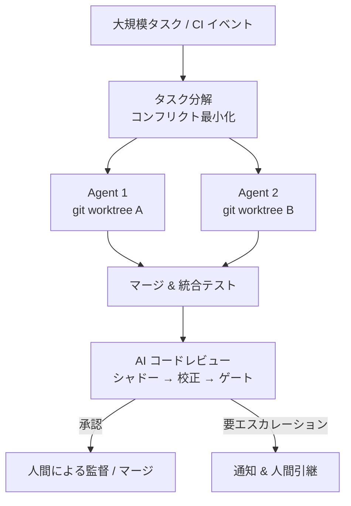

# 第8章 ソフトウェア提供のためのエージェントフリート運用（配点 10%）

> [!TIP]
> **この章のたとえ：複数ラインの「自動工場」と「品質管理ライン長」**
>
> 1人の職人（単一エージェント）ではなく、何十台ものロボット（コーディングエージェント群＝フリート）を同時に動かしてソフトウェアを作る時代です。同じ作業台を共有させると部品がぶつかるため、作業台を分け（`git worktree`）、製造スピードが人間の検査を上回るなら自動検査機（AI コードレビュー）を「まずは試運転（シャドーモード）」から始め、工場全体のルール（管理設定・MCP 許可リスト・ガバナンス）を統一します。

## この章のゴール

- 分離されたワークツリー（`git worktree`）、タスク分解、マージ／コンフリクト戦略を含む並列ファンアウトを設計し、フリートレベルの障害を診断できる。
- 生成速度が人間レビューを上回る環境で、シャドーモード導入・人間レビューとのキャリブレーション・監督設計を伴う AI コードレビューを運用できる。
- 目標駆動・スケジュール駆動・イベント駆動の無人エージェント（ヘッドレス運用）を、チェックポイント・通知・エスカレーション付きで設計できる。
- 管理設定（Managed Settings）、MCP 許可リスト、ゲートウェイ、Skills／プロンプト／MCP 共有のガバナンスを組織全体に適用できる。

## 要点3つ

1. **並列コーディングエージェントは「ワークツリーの分離」と「共有ファイル回避の分解」が前提。** 同一ディレクトリで並列編集させると競合と上書きが起きるため、`git worktree` で作業空間を分け、インターフェース境界に沿ってタスクを分解する。
2. **AI コードレビューはいきなりマージゲートにしない。** まずシャドーモードで導入し、人間のレビュー指摘とキャリブレーションして精度（偽陽性・見逃し）を確認してからブロッキング権限を与える。
3. **組織導入は「管理設定・許可リスト・ガバナンス」で統制する。** 開発者個人の判断任せにせず、エンタープライズ管理設定、MCP 許可リスト、統一テレメトリ、ゲートウェイルーティング、共有 Skills／MCP の品質・安全審査を敷く。

## 30秒で全体像

## 用語

| 用語 | 意味 |
| --- | --- |
| 並列ファンアウト | 大規模な開発タスクを複数の独立サブタスクに分割し、多数のエージェントへ同時にディスパッチするパターン |
| 分離されたワークツリー (`git worktree`) | 同一リポジトリの異なるブランチを別々のディレクトリにチェックアウトし、並列エージェント間のファイル衝突を防ぐ仕組み |
| フリートレベル障害モード | 単一エージェントではなく、フリート全体で同時に起きる障害（共通レート制限枯渇、同一マイグレーションの競合、連鎖 CI 失敗など） |
| シャドーモード (Shadow Mode) | AI レビューを実行して結果を記録・比較するが、まだ PR のマージをブロックしない試験導入段階 |
| 無人実行 (Headless / Unattended Execution) | 人間の対話入力なしで、`claude -p` やスケジューラ、CI イベントから自律的にタスクを完遂する運用形態 |
| 管理設定 (Managed Settings) | 組織管理者がエンドポイントやデバイス全体に強制適用するポリシー設定（個人の設定で上書き不可） |
| ガバナンス | チーム間でプロンプト、Skills、MCP サーバーを共有する際の品質基準・セキュリティ審査・バージョン管理の枠組み |

## 本編

### 8-1 エンジニアリング作業のための並列エージェントオーケストレーション

複数のコーディングエージェントを並列で走らせる「フリート運用」では、単体とは異なる問題が起きます。

| 設計要素 | ベストプラクティス | 避けるべき失敗 |
| --- | --- | --- |
| **作業空間の分離** | エージェントごとに **`git worktree`**（例：`claude --worktree feature-auth`）と専用ブランチを割り当てる。`.worktreeinclude` に `.env` 等の git 管理外ファイルを列挙して自動コピーする。開始数は **2〜3セッション**（上限は1人がレビューできるストリーム数）が目安 | 同じ作業ディレクトリで複数エージェントに同時編集させる |
| **タスクの分解** | 変更対象ファイルやモジュール境界が重複しないよう分解し、共有インターフェースを先に確定する。単一セッション内ヘルパーは `.claude/agents/*.md`（例：`verifier.md` は `tools: Bash, Read` のみ）で分離する | 同じコアファイル（`routes.ts` 等）を全エージェントが触る形で分割する |
| **フィードバックループ** | `CLAUDE.md` の `## Verifying your work` に非ゼロ終了コマンド（`make test` 等）と正常出力例を記載し、バグ修正時は先に失敗テストをコミットして**テストファイル編集禁止フック**でループを保護する。UI 作業はスクリーンショットツール等で 2〜3回反復させる | テストや検証コマンドなしで修正完了とみなす |
| **マージとコンフリクト戦略** | 専任の統合エージェントまたは CI パイプラインでリベース・テスト・コンフリクト解消を行う | コンフリクトを放置し、後勝ちで他エージェントの変更を上書きする |
| **フリートテレメトリ診断** | 先行指標（OTel の同時セッション数・操縦時間割合）と遅行指標（週あたりマージ数・手戻り率）、および競合率・レート制限消費を横断監視する | 個別エージェントのログだけを見て「全体の詰まり」を見落とす |

### 8-2 検証と AI コードレビューの運用

コーディングエージェントが大量の PR を生成するようになると、**人間のコードレビューがボトルネック** になります。かといって検証を緩めると本番障害が増えます。

#### AI コードレビュー導入の3段階

1. **シャドーモード導入**: 本番の PR に対して AI レビューを実行するが、結果は開発者や管理用ダッシュボードに記録するのみで **マージはブロックしない**。
2. **人間レビューとのキャリブレーション**: 人間のシニアエンジニアの指摘と AI の指摘を比較し、重大なバグの見逃し（偽陰性）と、ノイズになる些細な指摘（偽陽性）を調整する。
3. **ゲート昇格と人間による監督**: 一致度が基準を満たした領域（セキュリティ・型不整合・回帰テスト欠如など）からマージゲートへ昇格させ、設計判断や高リスク変更は **人間による最終承認** を残す。

> [!IMPORTANT]
> コードを生成したエージェントと **同じセッション・同じ推論文脈** で自己レビューさせてはなりません。生成時のバイアスを引き継ぐため、差分と規約のみを渡した独立したレビュープロセスを使います。

#### `REVIEW.md`・マネージド Code Review・GitHub Action の使い分け

- **`REVIEW.md` の運用**: リポジトリルートに配置し、レビューのパス（Bugs / Security / Compliance）、`Important` と `Nit` の定義、`Cap the nits`（例：1レビュー最大5件）、`Do not report`（`src/gen/` 等）を定義します。同じ誤りが2回指摘されたら `CLAUDE.md` にルールを追記し、月1回 `REVIEW.md` をチューニングします。
- **マネージド Code Review（Team / Enterprise）**: Owner が管理設定で `Allow code review` を有効化し、Claude GitHub app を導入します。PR 作成・プッシュ・`@claude review` 時に重複排除・ランク付けされたインラインコメントを投稿しますが、**承認・ブロック・修正プッシュは行いません**（ブランチ保護の職務分掌を維持、ローカル修正には `/code-review --fix` を使用）。
- **GitHub Action（`anthropics/claude-code-action@v1`）**: レビューを超えた作業（`@claude` メンションからの実装、cron 定期レポート等）に使います（`/install-github-app` で導入）。`id-token: write` 権限とワークロード ID フェデレーション（または `anthropic_api_key` / `use_bedrock` 等）、`prompt`（自動実行時）、`claude_args`（`--max-turns 5` 等）を設定します。

### 8-3 無人実行とイベント駆動のエージェント運用

コーディングエージェントは、人間が画面を見ているときだけでなく、バックグラウンドで自律稼働します。

| 駆動タイプ | 例 | 必須の安全設計 |
| --- | --- | --- |
| **目標駆動 (Goal-driven)** | テストカバレッジ 80% 達成、特定ライブラリの移行完了まで反復 | 明確な終了条件（テスト通過）、`max_turns`・コスト上限、チェックポイント保存。長時間タスクはローカル占有を避ける **Cloud session**（クラウドサンドボックス）と手元環境を使う **Remote Control** を使い分ける |
| **スケジュール駆動 (Scheduled)** | 毎晩の依存関係脆弱性パッチ PR 作成、デッドコード整理 | 変更範囲の制限、自動テスト通過後の Draft PR 作成（自動マージしない） |
| **イベント駆動 (Event-driven)** | CI/CD 失敗・本番アラート発生時の一次調査（トリアージ・原因 PR 特定・修正案提示） | 冪等な再実行制御、一定時間／失敗回数での **人間への通知とエスカレーション** |

#### 自動化のスペクトラムと長時間セッションの操縦

- **4段階の自動化手段**:
  1. **クラウドスケジュールタスク（旧称ルーティン、リサーチプレビュー）**: `claude.ai/code/routines` や `/schedule` で設定（cron / HTTP POST / PR イベント）。**最短間隔は1時間ごと**で、デフォルトブランチの新規クローンから開始し `claude/` ブランチにプッシュします（PR トリガー時は PR ヘッドから開始）。
  2. **ヘッドレスモード（`claude -p`）**: `--output-format json --json-schema '...'` で `.structured_output` に構造化出力を得て、`claude --resume "$(jq -r .session_id /tmp/plan.json)"` でステップ分割再開できます。
  3. **`--bare` フラグ（CI 向け決定論的実行）**: フック、Skills、プラグイン、MCP、`CLAUDE.md` の自動検出をスキップし、`--settings` や `--mcp-config` で明示指定したものだけを読み込みます（サブスクリプション認証を使わないため `ANTHROPIC_API_KEY` が必須）。
  4. **Agent SDK**: TypeScript / Python で `query` 関数を呼び出し、自社アプリへ組み込みます。
- **長時間セッションの操縦ツール**: プランモードでの事前精査、方向指定付き圧縮（`/compact <残したい焦点>`）、**Esc 2回の巻き戻し**（コードと会話を復元／会話を復元／コードを復元／ここから要約／ここまで要約の5択）、`/goal <完了条件>`（**評価器はトランスクリプトしか読めない**ためテスト出力等で確認可能な条件にする）、ループ監視（自己ペースまたは固定間隔・最大7日）。
- **Slack `@Claude` 定型業務スケジュール**: チャンネルで曜日・時刻・ソース・形式・サイレント条件を1メッセージで指定して作成（`@Claude !scheduled` で一覧確認、作成者離脱後もチャンネルに残る）。

### 8-4 組織全体でのコーディングエージェントの構成

全社規模で Claude Code 等を展開する場合、ガバナンスと標準化が不可欠です。

- **管理設定とポリシー (Managed Settings)**・**Claude Tag 管理者ガイド**: 危険なシェルコマンドの禁止、組織外へのデータ送信制限、ZDR の強制などを管理ポリシーとして配布し、個人設定での無効化を禁止する。また、トリガーやタグ機能を通じた自律実行の権限範囲を組織レベルで統制する。
- **カスタマイズのガバナンス（4つの配布コントロール）**: Skill の実行には組織設定で **`Cloud code execution and file creation`** と **`Skills`** の両方がオンである必要があります。配布は ①`Owner provisioning`、②`Skill sharing`（同僚共有）、③`Share with groups`、④`Publishing`（`Off` / `Requires review`＝自己承認不可 / `Open`。厳格化しても既公開アイテムは自動削除されないため手動削除が必要）の4つで統制します。
- **MCP の許可リスト**: 承認済み・セキュリティ審査済みの社内 MCP サーバーのみ接続を許可し、未検証の野良 MCP の追加をブロックする。
- **テレメトリとゲートウェイルーティング**: すべてのエージェント通信を組織の AI ゲートウェイ経由にし、利用量・コスト・エラー率・監査ログを一元収集する。
- **プロンプト・Skills・MCP サーバーの共有ガバナンス**: チーム間で再利用する Skills や MCP は中央リポジトリでコードレビュー・自動テスト・セキュリティスキャンを通過したものだけを配布する。

## まとめ：どう判断するか

| 状況 | 避ける選択 | とるべき選択 |
| --- | --- | --- |
| 5つの機能実装を5台のコーディングエージェントに並列実行させたい | 同じリポジトリフォルダで同時にファイルを編集させる | エージェントごとに `git worktree` を分離し、ファイル重複を避けた分解と統合戦略をとる |
| AI コードレビューを導入したいが、誤検知で開発が止まるのが怖い | 初日から必須マージゲートとして全 PR をブロックする | シャドーモードで導入し、人間レビューとキャリブレーションしてからゲート化する |
| CI 失敗時に無人エージェントが自動で原因調査・修正案を出す | 修正を main ブランチへ直接プッシュさせる | テスト実行・チェックポイント記録のうえ PR 作成にとどめ、解決不能時は人間にエスカレーションする |
| 各チームが勝手に外部 MCP サーバーや独自プロンプトを導入している | 各チームのローカル設定に一任する | 管理設定・MCP 許可リスト・ゲートウェイルーティングと共有 Skills の審査プロセスを導入する |

## 確認問題

### 問1
大規模なモノレポで、10台の並列コーディングエージェントを同時に動かしてマイグレーション作業を行っています。フリート全体のテレメトリを確認したところ、個別エージェントの実装成功率は高いにもかかわらず、最終的な統合成功率（マージ成功）が 30% に落ちています。最も可能性の高いフリートレベルの障害原因と対策はどれですか。

A. モデルが非協力的であるため `temperature` を上げる  
B. エージェント間のワークツリー分離やファイル境界に沿ったタスク分解が不十分で、共通ファイルでのマージコンフリクトと相互上書きが多発しているため、`git worktree` 分離と依存関係を考慮したタスク分解・統合ステップを導入する  
C. 各エージェントの `max_tokens` を増やす  
D. 並列実行をやめて、常に1人のエンジニアが手動でコードを書く

解答

**B**。個別タスクが成功しても統合で失敗する場合、並列ファンアウトにおけるタスク分解の境界重複とワークスペース分離不備が典型的な原因です。

### 問2
コーディングエージェントの導入により PR の作成速度が3倍になりましたが、人間のレビュアーが追いつかず滞留しています。開発チームは AI コードレビューを導入しようとしています。品質を維持しつつ開発を止めない導入手順として最も適切なものはどれですか。

A. 初日から AI が「承認」すれば人間のレビューなしで自動マージする  
B. まずシャドーモードで AI レビューを動かし、人間のレビュー結果と照合してキャリブレーションを行ったうえで、信頼できる検査項目から段階的にゲート・補助へ組み込む  
C. レビュー工程そのものを廃止し、本番監視だけで対応する  
D. コードを生成したエージェントに同じ会話内で「自分のコードを厳しくレビューして」と頼む

解答

**B**。AI レビューはシャドーモードでの計測と人間レビューとのキャリブレーションを経てからゲート権限を与えるのが安全です。D は自己レビューバイアスがあるため不適切です。

### 問3
CI/CD パイプラインの夜間ビルドが失敗した際、イベント駆動の無人エージェントを起動して一次対応（原因コミットの特定と修正 PR の作成）を行わせたいと考えています。本番環境への安全性を確保するための必須設計はどれですか。

A. エージェントに本番デプロイ権限と `main` ブランチへの強制プッシュ権限を与える  
B. サンドボックス環境でテストを実行させ、修正は人間レビュー用の Draft PR にとどめ、一定ターン数で解決しない場合はログと調査結果を添えて人間へエスカレーション・通知する  
C. 無人実行ではタイムアウトやターン上限を一切設定しない  
D. 失敗時はすべてのテストを削除してビルドを通す

解答

**B**。無人運用では、変更の自動反映を避け（PR＋テスト検証）、コスト・ループ暴走を防ぐ上限と人間へのエスカレーション経路を設計します。

### 問4
あるエンタープライズ企業が、全社数百名のエンジニアにコーディングエージェント（Claude Code 等）を展開します。セキュリティと品質のガバナンスを保つため、組織レベルで適用すべき構成の組み合わせはどれですか。

A. 各エンジニアの個人の裁量で任意の外部 MCP サーバーをインストールさせる  
B. 管理設定（Managed Settings）によるポリシー強制、承認済み MCP の許可リスト、ゲートウェイ経由の統一テレメトリ、および共有 Skills・プロンプトの審査基準を適用する  
C. 全員に共通の個人用 API キーをテキストファイルで配布する  
D. 監査ログをオフにしてディスク容量を節約する

解答

**B**。エンタープライズ展開では、管理ポリシー・MCP 許可リスト・統一テレメトリ／ゲートウェイ・共有資産の品質・安全ガバナンスの4点が柱になります。

### 問5
CI パイプラインで `claude -p` を使い、ローカルの個人設定や自動検出された MCP・フックの影響を受けない決定論的な実行を行いたい場合、適切な構成はどれですか。

A. `--bare` フラグを付与し、`ANTHROPIC_API_KEY` と `--settings` / `--mcp-config` で必要な構成だけを明示指定する  
B. `--bare` フラグを付与し、サブスクリプションログインの認証情報をそのまま流用する  
C. クラウドスケジュールタスク（ルーティン）を 1分間隔の cron で実行する  
D. `/goal` の完了条件に「画面の見た目が良くなったら終了」とだけ書く

解答

**A**。`--bare` フラグはフック・Skills・プラグイン・MCP・`CLAUDE.md` の自動検出をスキップし、`--settings` や `--mcp-config` の明示指定のみを読み込むため決定論的 CI 実行に適しています（ただし `ANTHROPIC_API_KEY` が必須）。クラウドスケジュールタスクの最短間隔は 1時間ごとであり、`/goal` の評価器はトランスクリプトしか読めないためテスト出力等で確認できる条件にする必要があります。

### 問6
チームでマネージド Code Review と `anthropics/claude-code-action@v1` を併用する際の役割分担として最も適切なものはどれですか。

A. マネージド Code Review に PR の自動承認と自動マージを任せる  
B. マネージド Code Review で PR への重複排除・ランク付けされたインラインコメント（承認・ブロックなし）を受け取り、`@claude` メンションによる修正実装や定期レポートは `claude-code-action@v1` に任せる  
C. バグ修正時はエージェントにテストファイルも同時に書き換えさせて全テストをパスさせる  
D. 同じ誤りがレビューで2回指摘されても `CLAUDE.md` や `REVIEW.md` は更新しない

解答

**B**。マネージド Code Review はインラインコメント投稿に特化し、承認・ブロック・修正プッシュは行いません（職務分掌を維持）。実装や定期タスクは `claude-code-action@v1` を利用し、バグ修正時はテスト編集禁止フックで検証ループを保護します。

## 自分で確かめる

1. 自身の Git リポジトリで `git worktree add` を使い、2つの異なる作業ディレクトリで同時に別ブランチの修正・テストが干渉せず実行できることを確認する。
2. `claude -p`（ヘッドレスモード）＋ `--output-format json` を使い、PR の差分を入力としてレビュー結果を JSON で出力するスクリプトをローカルで試す。
