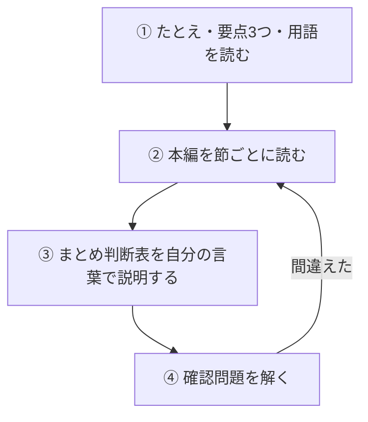

# 本番環境で Claude を運用する8つの技能

Claude Certified Developer – Professional (CCDV-P) の対策教材です。単なるプロトタイプやチャットボットの構築にとどまらず、本番環境で大規模に稼働する Claude アプリケーションとエージェントの **信頼性・品質・コスト・安全性・フリート運用** に責任を持つエンジニア向けの知識を体系化しています。

読み終えると、次の8つの領域で実務的かつ試験基準に沿った判断ができるようになります。

- マルチエージェントの障害分離、状態永続化、コンテキストとメモリの最適化を設計する
- 障害種別に応じたリトライ／フォールバック、レート制限、MCP 運用、大規模検索を設計する
- 分散トレース、ZDR 下のログ設計、SLI/SLO、大規模トレースのコホート分析を実装する
- マルチターン／マルチエージェントの非決定的な障害を切り分け、インシデント対応とポストモーテムを主導する
- ゴールデンセット、CI/CD 評価ゲート、キャリブレーション済み LLM-as-judge、オンライン評価を構築する
- モデルルーティング、Prompt Caching、Batch API、ストリーミング、`output_config.effort` でコストとレイテンシを最適化する
- 多層ランタイムガードレール、敵対的入力（プロンプトインジェクション等）への防御、ID・シークレット・監査を実装する
- 並列コーディングエージェント、AI コードレビュー、無人実行、組織ガバナンスを運用する

## 試験の概要（公式試験ガイド v1.0 / 2026年11月発効より）

| 項目 | 内容 |
| --- | --- |
| 資格名 | Claude Certified Developer – Professional |
| 試験コード | `CCDV-P` |
| 問題数・形式 | 70問（うち **60問が採点対象**、10問が採点対象外で非明示）・シナリオに基づく択一式および複数選択式 |
| 試験時間 | 120分 |
| 合格ライン | スケールスコア 100〜1,000 のうち **720**（基準準拠型評価） |
| 実施方法 | 監督付き：オンライン監督付き（Pearson VUE OnVUE）またはテストセンター |
| 前提条件 | なし（`CCDV-F` は準備として推奨されるが必須ではない） |
| 受験料・有効期間 | $175 USD / 取得日から12か月（期限内は Partner Academy の無料・監督なしアセスメントで更新可能） |

### 8つの試験分野と配点比率

| 章 | 分野名 | 配点比率 |
| --- | --- | --- |
| 第1章 | 高度なエージェントアーキテクチャとオーケストレーション | **17%** |
| 第2章 | 本番環境の統合、信頼性、知識グラウンディング | **20%** |
| 第3章 | オブザーバビリティと本番環境のモニタリング | **12%** |
| 第4章 | 高度なデバッグとインシデント対応 | **10%** |
| 第5章 | 評価エンジニアリングと品質保証 | **12%** |
| 第6章 | 大規模環境でのコストとレイテンシの最適化 | **8%** |
| 第7章 | ランタイムガードレールと本番環境のセキュリティ | **11%** |
| 第8章 | ソフトウェア提供のためのエージェントフリート運用 | **10%** |

> [!NOTE]
> 公式の無料対策コース（Skilljar「[Claude Certified Developer – Professional 対策コース](https://anthropic-partners.skilljar.com/path/claude-certified-developer-professional-prep-course-japanese)」全8コース：本番環境での統合・信頼性・ナレッジグラウンディング、高度なエージェントアーキテクチャとオーケストレーション、オブザーバビリティと本番環境のモニタリング、評価エンジニアリングと品質保証、ランタイムガードレールと本番環境のセキュリティ、高度なデバッグとインシデント対応、ソフトウェアデリバリーのためのエージェントフリート運用、大規模環境でのコストとレイテンシの最適化）の学習目標・出題分野別リソース（Claude Platform docs、Engineering 記事、Claude Cookbook）を、本試験の8分野構成に沿って整理しています。

## 教材の構成

| 種類 | 中身 | 使いどころ |
| --- | --- | --- |
| 第1章〜第8章 | 各分野の本編。たとえ・図解・比較表・実装判断・確認問題 | 分野別の体系的な学習 |
| [用語集](用語集.md) | 試験で頻出する専門用語の意味と、混同しやすいポイント | 曖昧な用語の確認 |
| [直前チェック](直前チェック.md) | 8分野の二択判断表と、公式サンプル問題3問の完全解説 | 試験直前の総仕上げ |

## 学び方

1. 各章の冒頭にある「たとえ」「要点3つ」「用語」を読み、全体の地図を頭に入れます。
2. 本編を節ごとに読みます。特に「なぜその選択肢がダメで、どれを選ぶべきか」の根拠を押さえます。
3. 「まとめ：どう判断するか」の表を、自分の言葉で説明してみます。
4. 確認問題（シナリオ形式）を、解答を開く前に解きます。誤答の理由まで理解できると本番で迷いません。

## 進める順番と時間の目安

配点比率の高い **第2章（20%）** と **第1章（17%）** が土台になります。1日1〜2章のペースで進めると、約1週間で一周できます。

| 順 | ノート | 配点 | 目安 |
| --- | --- | --- | --- |
| 1 | [第1章 高度なエージェントアーキテクチャとオーケストレーション](01-高度なエージェントアーキテクチャとオーケストレーション.md) | 17% | 75分 |
| 2 | [第2章 本番環境の統合・信頼性・知識グラウンディング](02-本番環境の統合・信頼性・知識グラウンディング.md) | 20% | 85分 |
| 3 | [第3章 オブザーバビリティと本番環境のモニタリング](03-オブザーバビリティと本番環境のモニタリング.md) | 12% | 60分 |
| 4 | [第4章 高度なデバッグとインシデント対応](04-高度なデバッグとインシデント対応.md) | 10% | 55分 |
| 5 | [第5章 評価エンジニアリングと品質保証](05-評価エンジニアリングと品質保証.md) | 12% | 65分 |
| 6 | [第6章 大規模環境でのコストとレイテンシの最適化](06-大規模環境でのコストとレイテンシの最適化.md) | 8% | 50分 |
| 7 | [第7章 ランタイムガードレールと本番環境のセキュリティ](07-ランタイムガードレールと本番環境のセキュリティ.md) | 11% | 65分 |
| 8 | [第8章 ソフトウェア提供のためのエージェントフリート運用](08-ソフトウェア提供のためのエージェントフリート運用.md) | 10% | 60分 |

全部終えたら [直前チェック](直前チェック.md) で最終確認を行ってください。

## 本試験で繰り返し問われる5つの判断軸

1. **失敗の種類を切り分ける**：レート制限・長さ超過・安全性拒否・検索ミス・ツール故障は原因が異なるため、単一の雑なリトライやプロンプト修正で済ませない。
2. **プロンプトに頼らず決定論的に強制する**：セキュリティ境界、不可逆な操作、順序制約はモデルの「お願い」ではなく、フック・ゲート・権限・サンドボックスで封じる。
3. **測定とキャリブレーションが先**：LLM-as-judge も SLO も、人間のラベルや実際のトレースに照らして校正されるまではゲート権限を与えない。
4. **コンテキストとキャッシュを資産として設計する**：長いセッションでは Compaction / Editing・外部メモリ・`tool_search` を組み合わせ、キャッシュプレフィックスを壊さない。
5. **自動化を段階的に信頼する**：AI コードレビューや自律エージェントは、シャドーモード → キャリブレーション → 人間による承認ゲート（HITL）の順で権限を広げる。
